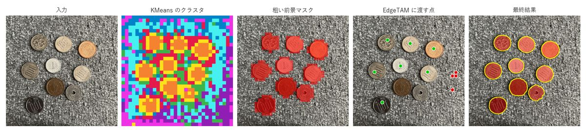

# はじめに

- [perception_models](https://github.com/facebookresearch/perception_models.git)を活用して、様々な検出タスクを**高速**に行うことを目標にしたリポジトリ

- OpenVINOやfaissなども活用して、CPUで高速に動作する基盤モデルを目指す

- テキストプロンプトだけで（学習なしで）、画像から「何がどこにあるか」を求める。**PE-Spatial（CLIP 系）で当たりを付け、EdgeTAM で輪郭を切り出す**



| ドキュメント | 説明 |
| --- | --- |
| [docs/overview.md](docs/overview.md) | 全体の流れ・処理時間 |
| [docs/coarse_segmentation.md](docs/coarse_segmentation.md) | 粗い段階 |
| [docs/detailed_segmentation.md](docs/detailed_segmentation.md) | 詳細な段階 |
| [docs/method_history.md](docs/method_history.md) | これまでに試した手法 |

## 使い方

### データセットの用意

1. データセットを用意する

2. `configs/dataset.sample.yaml`をコピーして`configs/dataset.yaml`にファイル名を変更する

3. `dataset.yaml`に用意したデータセットのパスを記載する

### OpenVINOモデル

1. PyTorch -> OpenVINOモデルに変換

    ```bash
    python convert_openvino.py
    ```

    クラスタリングに使う PE の層を変えたモデルは、`python convert_openvino.py --cluster-layers 6 --out-dir ./weights/openvino_models_l6 --pe-only` で別フォルダに作れる（EdgeTAM のモデルは `openvino_models` からコピーし、`configs/ov_config.yaml` の `model_dir` で切り替える）。

2. モデル実行

    ```bash
    python develop.py
    ```

### PyTorchモデル

1. モデル実行

    ```bash
    python test_pytorch.py
    ```

## 予定、checkpoint

- [x] 前景、背景のセグメンテーション処理を開発
- [x] セマンティックセグメンテーションを追加
- [ ] インスタンスセグメンテーション処理を追加
- [ ] 処理時間の高速化（～200ms）

## 補足
- PyTorchでの動作は、基本的に確認程度とするため、実行しても処理が最新とは限らない