# 粗いセマンティックセグメンテーション

画像を **32×32 のパッチ単位**で「背景 / 前景（どの種類の物体か）」に分ける段階。CLIP（PE）の特徴とテキストプロンプトだけを使い、学習はしない。
ここで得た粗い結果は、次の段階（EdgeTAM による精緻化。[semantic_refiner.md](semantic_refiner.md)）が「**どこに、どのクラスのプロンプト点を置くか**」の根拠にする。したがって、この段階の誤りは最終結果の誤り（背景の広がり、物体の見逃し、クラスの割れ）に直結する。

実装は `core/common/coarse_segmentation.py`（`CoarseSegmenter`）、全体の流れは `core/common/segmentation_runner.py`、固定値は `core/common/params.py`。

- [1. 全体像](#1-全体像)
- [2. 設計の思想: 何を解決したいのか](#2-設計の思想-何を解決したいのか)
- [3. 処理の詳細と、その実装の理由](#3-処理の詳細とその実装の理由)
- [4. プロンプトの設計](#4-プロンプトの設計)
- [5. 精緻化への受け渡し](#5-精緻化への受け渡し)
- [6. 出力画像の読み方](#6-出力画像の読み方)
- [7. 設定値・固定値](#7-設定値固定値)
- [8. 既知の失敗パターンと対処](#8-既知の失敗パターンと対処)
- [9. 処理時間](#9-処理時間)
- [Appendix: 実験の記録](#appendix-実験の記録)

---

## 1. 全体像

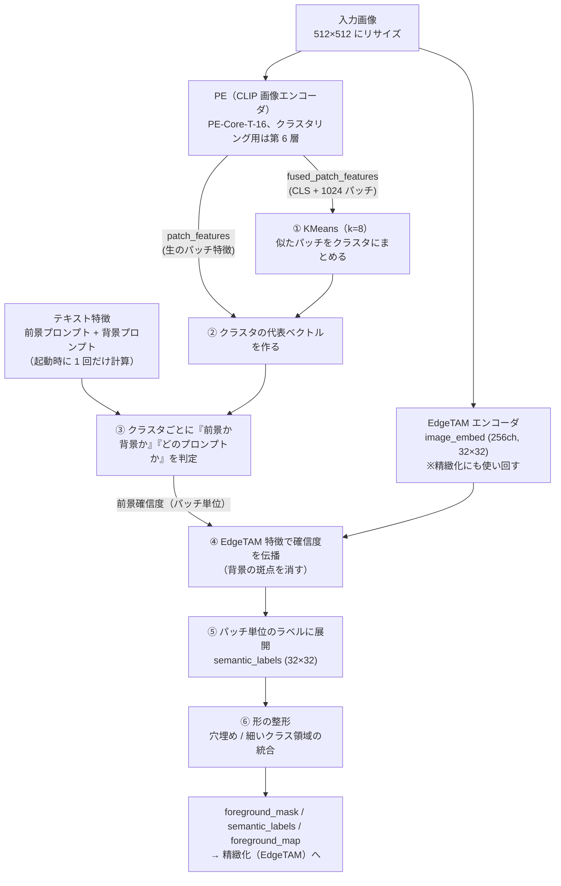

| | |
|---|---|
| 入力 | 画像 1 枚（RGB）、前景・背景のテキストプロンプト |
| 出力 | `foreground_map`（32×32、前景らしさ 0〜1）、`foreground_mask`（32×32、0/1）、`semantic_labels`（32×32、クラス ID）、`labels_list`（クラス ID → プロンプトの番号） |
| 粒度 | 画像 512×512 ÷ パッチ 16px = **32×32 = 1024 パッチ** |

最大の特徴は、**判定の単位が「パッチ」ではなく「クラスタ」**であること（理由は [§2.2](#22-判定の単位をクラスタにする)）。

---

## 2. 設計の思想: 何を解決したいのか

この段階は、次の 6 つの課題に 1 つずつ答える形でできている。**処理の各ステップは「どの課題のためか」で説明できる**。

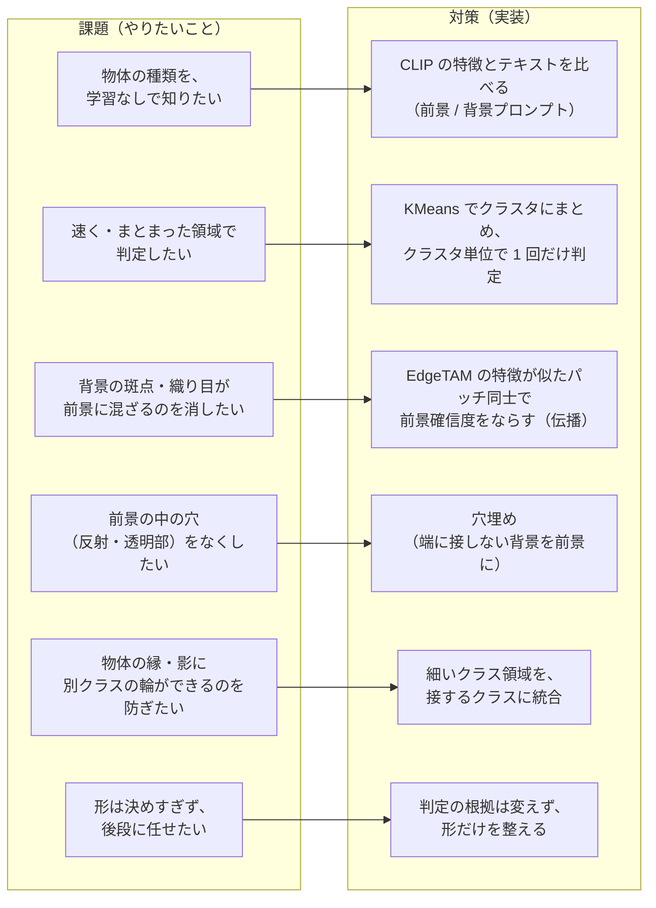

### 2.1 学習なしで物体の種類を知る

CLIP 系のモデルは、画像の特徴とテキストの特徴を同じ空間に置く。そこで「前景として探したい物体」と「背景として扱いたいもの」を**文（プロンプト）で並べ、画像の特徴とどちらに近いか**で前景/背景を決める。追加の学習もアノテーションも要らない。物体の種類を増やしたければ文を足すだけ。

ただし CLIP は「画像全体」を見るモデルで、パッチ単位の特徴には**画像全体の情報（写っている物体）が背景のパッチにも混ざる**（[Appendix A.1](#a1-背景の斑点を消す対策の試行不採用)）。テキストとの類似度だけで背景を見分けるには限界があり、それが次の設計判断（クラスタ化、伝播）の動機になっている。

### 2.2 判定の単位をクラスタにする

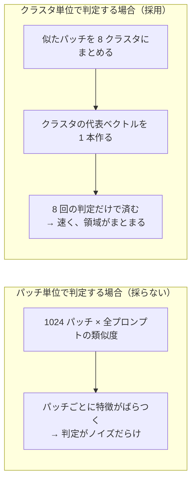

- パッチ 1 つ 1 つをテキストと照合すると、特徴がノイズを含むため結果が斑点状になる（パッチごとの照合を試した MaskCLIP / ClearCLIP 型は、背景を前景とする誤りが大きく増えた。[A.1](#a1-背景の斑点を消す対策の試行不採用)）。
- クラスタにまとめて**代表ベクトルを作ると、ノイズが平均され、判定が安定し、判定の回数も 8 回に減る**。同じクラスタのパッチは同じ判定になるので、結果は物体の領域としてまとまりやすい。
- 代償: クラスタに背景と前景が混ざると、**そのクラスタ全体が誤判定される**。この弱点を補うのが ④ 伝播（[§3.5](#35-前景確信度を-edgetam-の特徴で伝播する)）と ⑥ 整形。

### 2.3 背景のプロンプトを置く理由

前景プロンプトだけだと、どのクラスタも「どれかの前景プロンプトに最も近い」ので、全部が前景になってしまう。そこで**「前景ではないもの」も文で書いて**（`a photo of a plain background.`、`a photo of a shadow.` など）、前景と背景のどちらに近いかで決める。背景に何を書くかが、前景/背景の境目を決める（[§4](#4-プロンプトの設計)）。

### 2.4 背景の斑点を消したい → 確信度をならす（伝播）

PE のクラスタは意味は近いが**空間的にばらける**。背景の斑点や織り目の一部が、前景のクラスタに紛れ込みやすい。一方、EdgeTAM の特徴は**物体の輪郭・領域に沿ってまとまる**。そこで、EdgeTAM の特徴が似たパッチどうしで前景確信度を平均し、背景の斑点を周りの背景に引き寄せる。
「両方が前景のときだけ前景」（AND）にしない理由は [§3.5](#35-前景確信度を-edgetam-の特徴で伝播する)。

### 2.5 前景の穴あきをなくしたい → 穴埋め

反射や透明部があると、物体の内側のパッチが背景と判定されて**穴が開く**。穴は物体の内側にあるので、**画像の端に接していない背景は穴とみなして前景にする**（[§3.7](#37-形の整形)）。

### 2.6 物体の縁・影の輪をなくしたい → 細い領域の統合

物体の縁や影のパッチは、物体と背景の特徴が混ざり、物体の内側とは別のクラスタ（＝別プロンプト）になりやすい。物体のまわりに**別クラスの細い輪**ができる。細い（幅 2 パッチ以下）クラス領域が他クラスの前景に接していれば、そのクラスに統合する（[§3.7](#37-形の整形)）。

### 2.7 形は決めすぎない

この段階の解像度は 32×32（1 パッチ = 16px）で、物体の輪郭を決めるには粗すぎる。**最終的な形は EdgeTAM が決める**。だからこの段階は、

- 判定の根拠（プロンプトとの類似度）は変えず、**形（連結成分）だけを整える**。
- 穴埋めは「粗いマスクを物体単位でつなぐ」ためのもの。ワッシャーの穴のような本物の穴を埋めても、後段の EdgeTAM が除く。
- 「他のクラスに囲まれた小さなクラスを統合する」処理は**入れていない**。基板の上のねじのような、本当に別の物体が消えるのを避けるため。

---

## 3. 処理の詳細と、その実装の理由

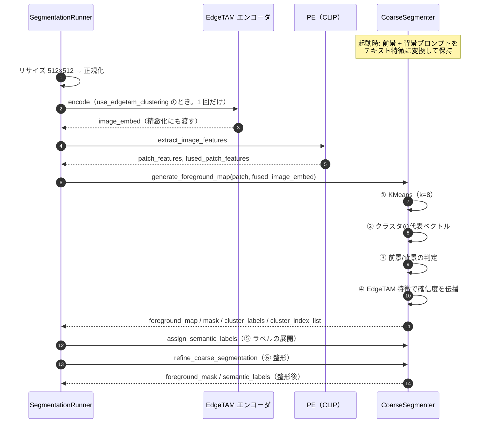

### 3.1 入力: 2 種類の特徴

PE（PE-Core-T-16。PE-Spatial の重みは未使用）から、用途の違う 2 種類のパッチ特徴を取る。

| 特徴 | 使い道 |
|---|---|
| `fused_patch_features`（CLS + 1024 パッチ） | KMeans のクラスタリング用。`model_dir` の `openvino_models_l6` は、**クラスタリングに第 6 層**の特徴を使う（以前の第 8〜10 層より、粗い判定の誤りが 20.2% → 16.7% に減った。[A.2](#a2-前景特徴への背景混入の軽減追加学習なし)） |
| `patch_features`（生のパッチ特徴） | クラスタの代表ベクトル（テキストと比較できる特徴）を作る入力 |

「クラスタを作る特徴」（中間層）と「テキストと比べる特徴」（クラスタの代表ベクトル）を分けているのは、クラスタリングに使う層を変えるだけで粗い判定の誤りが変わった（A.2）ため。クラスタの作り方と、テキストとの照合を独立に調整できる。

### 3.2 KMeans

関数: `fit_predict_kmeans`。

`fused_patch_features` から CLS を除いた 1024 パッチを、faiss の KMeans で `k_clusters`（既定 8）個に分ける。`n_iter` は反復回数、シードは固定（`KMEANS_SEED = 42`）で、同じ入力は同じ結果になる。

**K は「粗さ」を決める。** 大きいほどクラスタが純粋になる（物体と影が分かれる）が、前景/背景の判定がクラスタ数だけ増えて不安定になる。実験では K=12, 16 でねじ・トランジスタは改善した一方、cable・zipper が崩れた。8 は両者のバランス。

### 3.3 クラスタの代表ベクトル

関数: `extract_cluster_tokens`。

`pe_patch_logits_model`（PyTorch 版では `visual.trunk.custom_forward`）に「生のパッチ特徴」と「クラスタ番号」を渡し、**クラスタごとに 1 本の、テキストと比較できる特徴ベクトル**を得る。これがそのクラスタの「代表」になる。集約の中身は PE 側の実装（`convert_openvino.py` で変換しているカスタム forward）に依存し、このリポジトリ内では内部を持たない。

### 3.4 前景/背景の判定

関数: `_classify_cluster`。

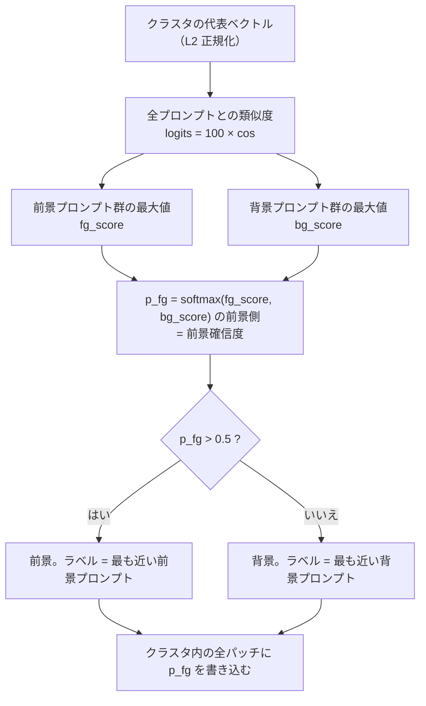

```
logits   = 100 × token · text_features^T          # CLIP_LOGIT_SCALE = 100
fg_score = max(logits[前景プロンプト])
bg_score = max(logits[背景プロンプト])
p_fg     = softmax([fg_score, bg_score])[0]       # = sigmoid(fg_score - bg_score)
```

**なぜ `max` か。** プロンプトは「言い換え」ではなく「選択肢」の列挙。たとえば `screw` と `washer` は同じ物体の別表現ではなく別の物体なので、**最も近い 1 つで代表させる**のが自然。平均（`logmeanexp`）にすると、プロンプトの個数を変えただけで判定が偏った（個数が多い側が不利になる）。`max` なら、プロンプトを増減しても判定が偏らない。

**なぜ softmax の前景側か。** 前景と背景のスコアの差だけが効き、`p_fg` が 0〜1 の確信度になる。この値は閾値（`foreground_threshold`、0.5）で 2 値化するだけでなく、**後段のスコア（精緻化の重なり解決）に連続値のまま使う**。

クラスタ内の全パッチに同じ `p_fg` を書き込んだものが `foreground_map`（クラスタごとの階段状）。ラベルには「前景なら前景プロンプトの番号、背景なら `前景数 + 背景プロンプトの番号`」を入れる。

#### 判定が拮抗するとき

`001_crop`（タオルの上のコイン）で、プロンプトに `a photo of a fabric.` が入っていたときのクラスタ別の値（ロジットは `100 × cos`）。

| クラスタ | パッチ数 | 前景側の最大 | 背景側の最大 | p_fg | 判定 | 実際 |
|---|---|---|---|---|---|---|
| k2 | 113 | coin 43.9 | uniform background 39.3 | 0.99 | 前景 | コイン ✓ |
| k4 | 117 | coin 44.9 | uniform background 38.9 | 1.00 | 前景 | コイン ✓ |
| k3 | 225 | **fabric 41.3** | plain background 41.4 | 0.47 | 背景 | タオル ✓（紙一重） |
| k5 | 200 | **fabric 41.8** | plain background 41.7 | 0.53 | **前景** | タオル ✗ |
| k6 | 150 | **fabric 42.2** | plain wall 41.5 | 0.68 | **前景** | タオル ✗ |

物体（コイン）は 4〜5 ロジットの差で安定して勝つ一方、背景のタオルは前景プロンプト `fabric` と背景プロンプトが **0.1〜0.7 ロジット差**で拮抗し、判定が不安定になっている。**ロジット差が 1 未満のクラスタは、プロンプトの小さな変更で結果が反転する**と考えてよい。この性質が、[§4](#4-プロンプトの設計) のプロンプト設計の方針の根拠になっている。

### 3.5 前景確信度を EdgeTAM の特徴で伝播する

関数: `_propagate_with_edgetam`。

`use_edgetam_clustering: true` のとき、③ の結果（パッチごとの前景確信度）を、**EdgeTAM の特徴が似たパッチどうしで平均してならす**（`_propagate_with_edgetam`）。

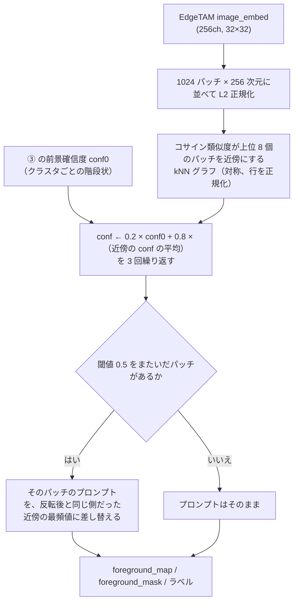

**イメージ**（前景=`#`、背景=`.`、PE の判定で背景の斑点 `x` が前景に混ざった例。EdgeTAM の特徴では `x` は周りの背景に近い）:

```
PE の判定                伝播後
. . . . . . .            . . . . . . .
. . x . . . .            . . . . . . .      ← 斑点 x は近傍（背景）の平均に引かれ、
. . . . # # .            . . . . # # .         確信度が閾値を下回って消える
. . . . # # .            . . . . # # .
. . . . . . .            . . . . . . .
```

#### なぜ伝播なのか（AND ではないのか）

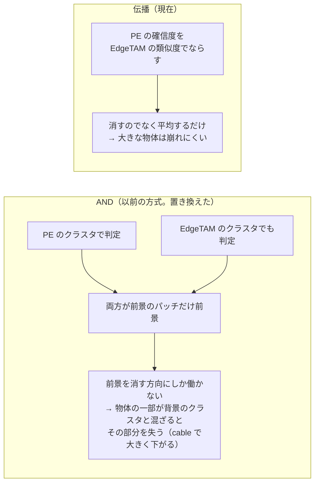

- 背景の斑点は、周りの背景に引かれて確信度が下がる。大きな前景は、周りも前景なので確信度が保たれる。
- 二回目の KMeans とトークンのプールが**要らない**（AND は要った）。追加の処理は、1024×1024 の類似度と上位 8 個の選択（NumPy で約 9ms、`mask_utils.knn_graph`）と、疎行列での伝播（0.1ms 未満）。
- 伝播はプロンプトの文に依らないので、**プロンプトを増やしても（4 倍にしても）結果が保たれる**。
- パラメータ `EDGE_PROPAGATION_ALPHA`（0.8）、`EDGE_PROPAGATION_NEIGHBORS`（8）、`EDGE_PROPAGATION_ITERATIONS`（3）は `core/common/params.py`。α は 0.7〜0.9、近傍数は 4〜8 で結果が同程度、反復は 5 回でも変わらない（平坦な範囲から選んだ）。
- 検証値は [A.8](#a8-edgetam-特徴での確信度の伝播と詳細側のプロンプト2026-10-24)。

`use_edgetam_clustering: false` のときは、このステップを飛ばし、PE の判定だけを使う。

### 3.6 パッチ単位のラベルへの展開

関数: `assign_semantic_labels`。

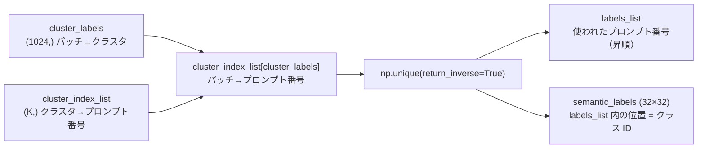

- **同じプロンプトに判定された複数のクラスタは、同じクラス ID に統合される**（3 つのクラスタがすべて `coin` なら、クラス ID は 1 つ）。物体の種類ごとに 1 クラスにするため。
- `labels_list` は昇順なので、**前景プロンプトの番号（小さい）が先、背景プロンプトの番号（`前景数 + …`）が後**になる。クラス ID の小さい側が前景。
- クラス ID からプロンプトに戻すには `プロンプト = labels_list[クラス ID]`。
- 伝播を使った場合、クラスタは「（PE のクラスタ, 伝播後のプロンプト）の組」に振り直す（PE の同じクラスタの中でも、伝播で判定が変わったパッチはプロンプトが違うため）。

### 3.7 形の整形

関数: `refine_coarse_segmentation`。

判定の根拠は変えず、パッチ格子上の形（連結成分）だけを整える。

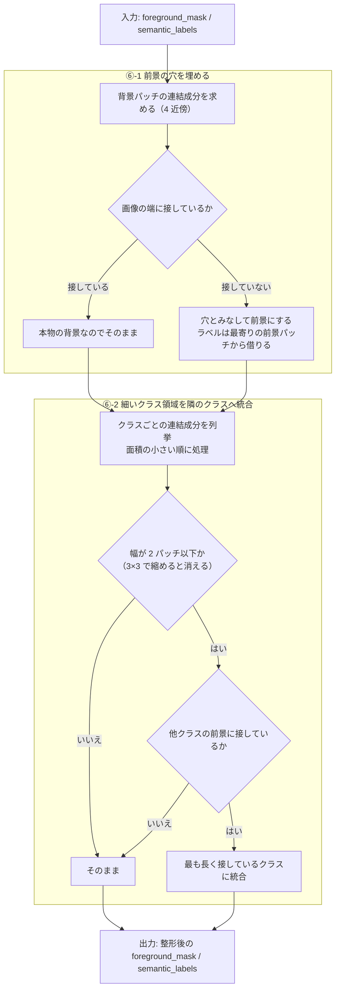

#### ⑥-1 穴埋め（前景の穴あきをなくす）

反射や透明部などで、物体の内側に背景と判定されたパッチが残ることがある。

```
前景=# 背景=.                      穴埋め後
. . . . . . .                     . . . . . . .
. # # # # # .                     . # # # # # .
. # . . # # .   ← 内側の .         . # # # # # .
. # # # # # .     は端に接して     . # # # # # .
. . . . . . .     いない → 穴     . . . . . . .
```

- 判定は **「画像の端に接していない背景の連結成分」はすべて穴**。**面積のしきい値は無い**（大きさに関係なく埋める）。しきい値を足すと調整するパラメータが増え、物体ごとに最適値が変わる。
- 埋めたパッチのラベルは、元の前景のうち最も近いパッチのラベル（距離変換のインデックス）を使う。
- 穴埋めは「粗いマスクを物体単位でつなぐ」ためのもの。ワッシャーの穴のような本物の穴を埋めても、後段の EdgeTAM が除く。

#### ⑥-2 細いクラス領域の統合（縁・影の輪をなくす）

コインの周りに別クラスの輪ができる例。

```
コインの周りに別クラス(R)の輪ができた状態            統合後
. . . . . . . . .                                    . . . . . . . . .
. . R R R R R . .                                    . . C C C C C . .
. R R C C C R R .      R の幅は 1〜2 パッチ           . C C C C C C C .
. R C C C C C R .      → 縮めると消える               . C C C C C C C .
. R R C C C R R .      → C（コイン）に接している       . C C C C C C C .
. . R R R R R . .      → C に統合                     . . C C C C C . .
. . . . . . . . .                                    . . . . . . . . .
```

- 「**細い**」の定義は、そのクラス領域（4 近傍の連結成分）を 3×3 で縮めたとき**何も残らない**こと（幅 2 パッチ以下）。`PATCH_NEIGHBORHOOD = 3`。粗いマスクは縁・影で最大 1 パッチ太る、という前提に基づく。
- 「**接している**」は、領域を 3×3 で 1 回広げた輪の中に、**別クラスの前景**パッチがあること。背景にしか接していない細い領域（細いケーブルなど）は**統合されない**（本当の細い物体を消さないため）。
- 統合先は、輪の中で**最も多く接しているクラス**。
- 面積の小さい領域から順に処理する（先に統合された結果が、後の判定に反映される）。

#### この段階が直さないもの

次のような誤りは形では直らない（判定そのものの誤り）。

- 背景のクラスタが前景と判定された（背景がまるごと前景になる）
- 物体のクラスタが背景と判定された（物体の見逃し）
- 同じ物体が別のプロンプトに割れた（`syringe` と `bolt` など）

これらは [§8](#8-既知の失敗パターンと対処) のとおり、主にプロンプトで対処する。

---

## 4. プロンプトの設計

プロンプトは `prompts_dir` の `foreground.yaml`（前景）と `background.yaml`（背景）。現在の `prompts/candidates/color_free_bg/` の方針:

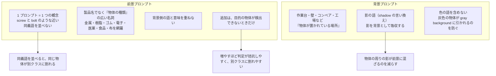

理由（[§3.4](#34-前景背景の判定) の判定の性質から）:

- 判定は**前景群と背景群の最大類似度の差**で決まる。前景の語が背景の質感に近いと（例: `fabric` とタオル）、差が 1 ロジット未満になって判定が反転する。**前景と背景の語が意味で重ならない**ようにすることが、判定を安定させる。
- 同義語は、同じ物体が別々のクラスタ・別々のラベルに割れる原因になる（`screw` と `bolt`）。**1 プロンプト = 1 概念**にして、クラスの割れを防ぐ。
- 色の語を背景に入れると、同じ色の物体（灰色のホイルのふたなど）が背景に引かれる。色の語を外した（`color_free_bg`）。
- `a photo of a fabric.` は、タオル・カーペットなどの背景が前景になるため無効化している（代償として zipper の IoU が 0.96 → 0.92）。

---

## 5. 精緻化への受け渡し

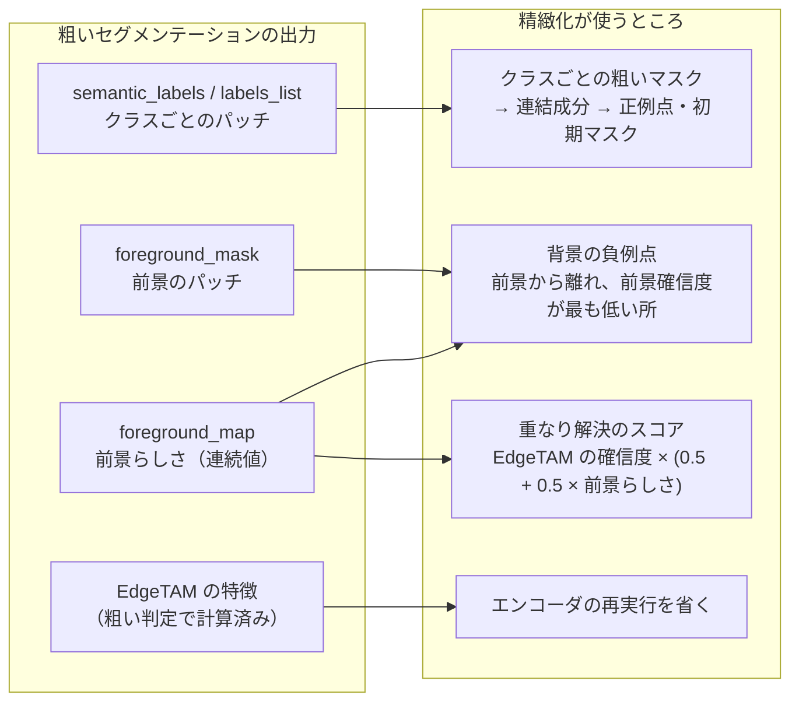

- 粗い前景マスクは、**正例点を置く場所**と、**負例点を置かない場所**（前景から離す）を決める。
- 前景らしさ（`foreground_map`）は連続値のまま、重なり解決のスコアと、負例点の選択（最も確信できる背景）に使う。**確信度を 2 値化して捨てない**のはこのため。
- 粗いマスクの信頼限界は **1 パッチ**（縁・影で最大 1 パッチ太る）。精緻化はこの前提で、外周 1 パッチを「不明」として扱う。
- EdgeTAM のエンコードは粗い判定の前に 1 回だけ実行し、精緻化にも渡す（二重に実行しない）。

---

## 6. 出力画像の読み方

`output_dir/<画像名>/` に次の画像が出る。

| ファイル | 内容 |
|---|---|
| `coarse_semantic_segmentation_raw.png` | ⑤ 展開の直後（整形前）の `semantic_labels` |
| `coarse_semantic_segmentation.png` | ⑥ 整形後の `semantic_labels` |
| `foreground_map.png` | `foreground_map`（前景確信度。伝播すると連続値） |
| `foreground_mask.png` | 整形後の `foreground_mask` |
| `layer_fused_k8.png` | KMeans のクラスタ分け（色はクラスタ ID） |
| `foreground_overlay.png` | 前景マスクと EdgeTAM に渡した点（緑 = 正例、赤 = 負例） |

**`coarse_semantic_segmentation*.png` の色について**: 色は `config` の `color_palette` を**クラス ID**で引いたもの（0 = 黒、1 = 赤、2 = 緑、3 = 青、4 = 黄…）。`labels_list` は昇順なので、**前景プロンプトが当たったクラスほど小さい ID（黒・赤…）、背景プロンプトが当たったクラスほど大きい ID**になる。画像ごとに前景のクラス数が違うため、「黒 = 前景」と決めつけず、前景が何クラスあるかで境界が変わる点に注意する（前景クラスが 2 つなら、黒と赤が前景で、緑以降が背景）。

---

## 7. 設定値・固定値

| 名前 | 値 | 場所 | 意味 |
|---|---|---|---|
| `k_clusters` | 8 | `configs/ov_config.yaml` | KMeans のクラスタ数 |
| `n_iter` | 10 | 同上 | KMeans の反復回数 |
| `foreground_threshold` | 0.5 | 同上 | `p_fg` がこの値を超えたら前景 |
| `image_size` | 512 | 同上 | 入力サイズ。パッチ 16px なので 32×32 パッチ（`feature_size`） |
| `prompts_dir` | `prompts/candidates/color_free_bg` | 同上 | `foreground.yaml` / `background.yaml` のあるディレクトリ |
| `model_dir` | `weights/openvino_models_l6` | 同上 | クラスタリングに PE の第 6 層を使うモデル |
| `use_edgetam_clustering` | true | 同上 | EdgeTAM の特徴での前景確信度の伝播（§3.5） |
| `CLIP_LOGIT_SCALE` | 100.0 | `core/common/params.py` | 類似度（cos）に掛ける係数 |
| `KMEANS_SEED` / `FAISS_NUM_THREADS` | 42 / 2 | 同上 | KMeans の再現性・スレッド数 |
| `EDGE_PROPAGATION_ALPHA` / `_NEIGHBORS` / `_ITERATIONS` | 0.8 / 8 / 3 | 同上 | 伝播の重み・近傍数・反復回数 |
| `PATCH_NEIGHBORHOOD` | 3 | 同上 | 「細い」「接している」「内側」の判定に使う近傍（= 1 パッチ分） |

固定値は `core/common/params.py` にまとまっている（値を変えるときはそこだけを編集する）。

---

## 8. 既知の失敗パターンと対処

| 症状 | 原因 | 対処 |
|---|---|---|
| 背景（タオル・カーペットなど）が前景になる | 背景の質感が前景プロンプト（例: `fabric`）に近い。前景/背景の最大類似度が 1 ロジット未満の差で拮抗する（§3.4） | 背景と同じ素材を表す前景プロンプトを外す。外せない場合は背景側に同素材の語を足す（ただし同素材の物体が検出しにくくなる） |
| 背景の一部のクラスタだけが前景になり、斑点状に残る | 前景・背景の最大類似度がどちらも低いクラスタ。どちらのプロンプトにも合わず、判定が偶然に決まる | 現在は §3.5 の伝播が主な対策。背景側に「textured background」のような総称を足すと消えるが、textile の物体（zipper）が背景になりやすくなる |
| 灰色の物体（ホイルのふたなど）が背景になる | 色の語を含む背景プロンプト（`gray background` など）に近づく | 背景プロンプトから色の語を外す（`color_free_bg`） |
| 同じ物体が別クラスに割れる | 近い意味のプロンプトを複数入れている（`screw` と `bolt`） | 1 プロンプト = 1 概念にし、同義語を並べない |
| カップと麺のように、別物体が同じクラスになる | 同じクラスタに入ってしまう（K が小さい） | K を大きくすると改善するが、他で不安定になる。EdgeTAM 側の対処が必要 |
| 大きな物体（cable など）が欠ける | クラスタの判定の誤りが大きな領域に及ぶ（伝播が大きな領域を落とす場合。bottle で 0 の事例あり） | 未解決（[A.9](#a9-背景の負例点の密集と高分解能な事前マスク2026-10-24) の「見込みのある別の方向」） |

#### プロンプトを変えたときの確認

`tools/evaluation/eval_prompts.py` で、MVTec AD の物体カテゴリを使い、前景 IoU・最小 IoU・クラスの割れやすさ（frag）を測れる。

```bash
python tools/evaluation/eval_prompts.py                              # config の prompts_dir を評価
python tools/evaluation/eval_prompts.py --prompts-dir ./prompts/xxx  # 候補ディレクトリを評価
python tools/evaluation/eval_prompts.py --set k_clusters=12          # config の値を上書きして評価
```

MVTec にない画像（自前の画像）は正解マスクがないので、`develop.py` の出力画像を目で見て確認する。前景/背景の判定が拮抗していないかは、§3.4 のように**クラスタごとの前景側・背景側の最大類似度を並べて見る**のが早い。

---

## 9. 処理時間

OpenVINO・FP32・`ov_num_thread: 4`。粗いセグメンテーションに関わる段の目安（実画像 17 枚 + 合成 12 枚の中央値。詳細は [performance.md](performance.md)）。

| 段 | 時間 |
|---|---|
| PE（画像特徴） | 約 83 ms |
| EdgeTAM エンコーダ（粗い判定にも精緻化にも使う） | 約 32 ms |
| 粗い前景（KMeans・クラスタ代表・伝播） | 約 15 ms |
| 合計（全体。精緻化を含む） | 約 177 ms |

- 伝播の類似度の行列積（1024×256 @ 256×1024）が NumPy の BLAS で多数のスレッドを起こし、OpenVINO の推論とコアを取り合っていたため、**BLAS のスレッド数を 1 に制限**している（合計 252 → 180 ms）。行列積そのものは 2.3ms → 4.0ms と少し遅くなるが、競合が無くなって他の処理が速くなる。
- 伝播の約 9ms は、これ以上は精度を変えずに縮められない。

---

# Appendix: 実験の記録

この段階に関して行った実験を、時系列で並べる。**採用したものは本文に反映済み**。採用しなかったものも、再び同じ案を試さないよう結果を残す。

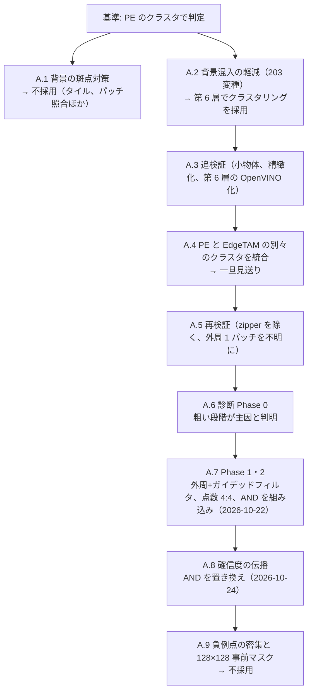

共通の評価データ: **MVTec AD 物体カテゴリ**（`tools/evaluation/eval_prompts.py` の `OBJECT_CATEGORIES` 10 種、`EVAL_CATEGORIES` は zipper を除く 9 種）と、**合成データ**（MVTec の部品 × 背景。`tools/dataset/make_synthetic_dataset.py`）。IoU は最終セマンティックマップの前景（> 0）と正解の IoU。信頼区間は 95%。実験の多くは PyTorch 版（`TorchCLIPProbe`）で行い、本体の OpenVINO 版とは別途一致を確認している。

## A.1 背景の斑点を消す対策の試行（不採用）

**目的**: 背景の斑点（背景クラスタに混ざった孤立パッチ）を消す。

| 対策 | 結果 |
|---|---|
| クラスタ単位の「曖昧なら背景」規則（閾値・言い換えの合意・null プロンプト・散らばり・画像の枠を基準にする） | 誤りの合計が減らない（前景の見逃しが増える） |
| 前景確信度の平滑化 | zipper の布のような、まばらな前景しか手がかりの無い物体が消える |
| クラスタのトークンから CLS を除く / CLS 方向を除く / 画像全体との差を取る | 背景を前景とする誤りが大きく増える |
| パッチごとのテキスト類似度（MaskCLIP / ClearCLIP 型） | 背景を前景とする誤りが大きく増える |
| モデルを大きくする（PE-Core S / B） | 誤りが増える（T: 19.3%、S: 21.9%、B: 29.1%） |
| EdgeTAM の予測 IoU で成分を確認して外す | 小さな物体を大量に消す（合成データで、見逃しが 11/166 → 49/166） |
| Overlapping Tiling（下記） | 採用せず |

残しているのは、**負例を「背景だと最も確信できる」パッチから選ぶ**変更だけ（`select_background_points` に `foreground_map` を渡す）。確信の弱い「背景」は実際は物体（濃い布など）のことがあり、そこに負例を置くと物体を打ち消してしまうため。

**分かったこと**:
- 正解の物体領域だけで集約したトークンは、100 枚すべてで前景と判定される。一方、**正解の背景領域だけで集約したトークンの半数が、前景と判定される**。最終層のパッチ特徴には、画像全体（＝写っている物体）の情報が背景のパッチにも混ざっており、背景の領域でも物体の意味が出る。プーリングの方法を変えても、これは取り除けなかった。
- つまり、テキストとの類似度だけで背景を見分けるには限界がある（→ §2.1、伝播の動機）。

### Overlapping Tiling の検証

`tools/experiments/tiling/eval_tiling.py` で、4 タイル（384、128px ずらし、24×24 パッチを 32×32 の格子に重ねる）と全体縮小（384）の計 5 枚から前景マップを作る方式を比べた（MVTec 物体 10 カテゴリ、`--num 5`）。

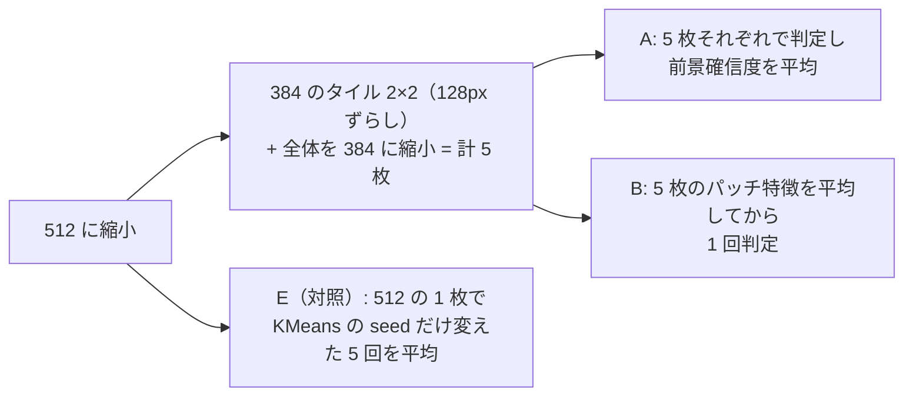

| 方式 | dev IoU | holdout IoU | frag (dev/holdout) | 粗い前景(整形後) FP / FN (dev) | 特徴量抽出 |
|---|---|---|---|---|---|
| 基準（512 の 1 枚） | 0.817 | 0.836 | 0.142 / 0.147 | 0.145 / 0.137 | 87 ms |
| A | 0.855 | 0.828 | 0.262 / 0.229 | 0.137 / 0.190 | 233 ms |
| B | 0.808 | 0.822 | 0.165 / 0.183 | 0.196 / 0.084 | 246 ms |
| E（対照） | 0.813 | 0.830 | 0.152 / 0.137 | 0.146 / 0.148 | 83 ms（判定 +30 ms） |

- 100 枚（dev + holdout）の平均 IoU は基準 0.826、A 0.841、B 0.815。A の差はカテゴリで大きく割れる: cable +0.17（10 枚中 7 勝 1 敗）、metal_nut +0.12、toothbrush −0.11（2 勝 7 敗）、pill −0.06、screw（2 勝 6 敗）。
- 粗い前景の FP+FN は A・B とも基準と同程度か悪化。クラスの割れ（frag）は A で大きく増える。
- 特徴量抽出は 87 ms → 約 240 ms（トークン数が 1025 → 5×577）。目標の ~200 ms に収まらない。
- 診断（`--diag`）: タイルの特徴は、512 全体の同じ位置の特徴とコサイン類似度 0.889（1 パッチずらすと 0.662）、タイル同士の重なりで 0.909。タイルにしても、背景の特徴に物体の意味が混ざる性質は大きくは変わらない。
- `develop.py` の画像では、circuit の黒い床面の確信度は A・B とも基準より下がった（A: 前景 55%、B: 66%、基準 64%）。rings は 3 方式とも画像全体が前景のまま。

**A の改善はタイルによるものか、アンサンブルによるものか**（対照 E で切り分け）。100 枚のカテゴリ別 IoU:

| カテゴリ | 基準 | A | E |
|---|---|---|---|
| cable | 0.722 | 0.893 | 0.761 |
| metal_nut | 0.773 | 0.888 | 0.788 |
| toothbrush | 0.914 | 0.807 | 0.802 |
| 全体 | 0.826 | 0.841 | 0.822 |

- **cable・metal_nut の改善はタイルによるもの**（局所の視野が有効）。seed を変えて平均しても再現しない。
- **toothbrush の悪化は平均によるもの**（細長い物体では確信度の平均が閾値付近に薄まる）。E でも −0.11。
- E 自体は改善しない（0.813 / 0.830）ので、安価なアンサンブルは採用しない。
- タイルの結果を平均以外（前景側を優先する統合など）で束ねれば両立できる可能性はあるが、統合規則の選択が新しいパラメータ的な判断になる点と、特徴量抽出が約 2.7 倍になる点が課題。

## A.2 前景特徴への背景混入の軽減（追加学習なし）

**目的**: 「前景の特徴に背景が混ざる」問題を、追加学習なしで軽減する。PyTorch 版（`TorchCLIPProbe`）で **203 変種**を検証。全変種の結果・図は `outputs/decontam/index.html`（`python tools/experiments/decontam/report_decontam.py` で再生成）。実験は `tools/experiments/decontam/exp_decontam.py`、画像比較は `exp_decontam_cases.py`。

**評価**: MVTec 物体 10 カテゴリの 120 枚（dev + holdout）と、変種を選んだ後に測り直した別の 60 枚（verify）。誤りはパッチ単位の前景/背景の判定（FP + FN、正解は fg_mask）で、基準（第 8〜10 層でクラスタリング）は 20.2%（FP 6.8% + FN 13.3%）。

| 手法 | 誤り（主実験） | 誤り（verify） | 最終 IoU（dev / holdout / verify） |
|---|---|---|---|
| 基準（第 8〜10 層でクラスタリング） | 20.2% | 19.4% | 0.816 / 0.805 / 0.804 |
| クラスタリングに第 6 層だけを使う | 16.7%（−3.4pt） | 17.3%（−2.0pt） | 0.801 / 0.830 / 0.790 |
| EdgeTAM の親和度で特徴を平滑化（α=0.7） | 18.8%（−1.3pt） | 19.0% | 0.786 / 0.764 / 0.801 |
| トークン側の背景除去（端につながる背景のトークンを射影で除去、背景判定のクラスタだけ救済） | 17.4%（−2.8pt） | 17.6% | 0.783 / 0.770 / 0.766 |
| 第 6 層 + トークン側の背景除去 | 14.7%（−5.4pt） | 16.4% | 0.793 / 0.819 / 0.777 |
| 第 6 層 + EdgeTAM 平滑化 + トークン側の背景除去 | 14.1〜15.1%（−5.1〜−6.1pt） | 13.8〜14.0% | 0.797 / 0.787 / 0.794 ほか |

**分かったこと**:
- **誤りの大半は、クラスタの純度ではなくトークン（判定）側にある。** クラスタを正解の前景/背景で分けても 19.4%。純度を上げる手法（階層分割・K の変更・EdgeTAM 特徴での純度向上）の天井は約 0.8pt。
- **混入の経路**は、パッチ間の直接の attention（前景→背景は 0.10、背景の面積比は 0.55）ではなく、CLS を介した全体の文脈と最終層付近の表現。領域ごとに attention を制限しても（正解の領域でも）悪化する。文脈は背景の識別にも使われている。
- パッチに高ノルムは無い（max/median 1.2〜1.5）。最終層では 1 チャンネルが全エネルギーの 61%（massive activation）を占めるが、抑えると悪化する。
- **背景の特徴を引くと前景に戻る観察は、トークン（512 次元）の段階で再現した**（FN 13.3% → 5.9〜7.8%、代償に FP 6.8% → 10〜11%）。パッチ特徴（576 次元）の段階で、混在クラスタの高ノルムパッチの平均を引く方法は、MVTec 全体では FN を減らさず、効いたのは純度（FP の減少）だった。
- 混在クラスタ・誤判定クラスタを、推論時に使える量で検出することはできない（AUC 最大 0.68）。
- **粗い段階の改善は、EdgeTAM まで通した最終 IoU に届かなかった。** 最終 IoU は FP に約 2 倍敏感（回帰: ΔIoU ≈ −1.3×ΔFP − 0.7×ΔFN）で、基準では粗い FN と最終 IoU の相関がほぼ 0（EdgeTAM が FN を補っている）。カテゴリ別には逆方向に動く（第 6 層: cable +0.30、screw +0.12、toothbrush −0.11、zipper −0.11）。toothbrush では粗いマスクが物体の内側に縮み、zipper では布に点在していた前景の「種」が消える。
- トークン側の背景除去は、**背景が一様でない画像**（空・海・岩、暗い床面）で FP が大きく増える（dog 27% → 43〜54%）。端につながる背景を 1 つのトークンにまとめるため（推測）。

**採用しなかった**（悪化・効果なし）: 領域ごとの attention 制限（V8）、最終ブロックの q-q attention・残差/FFN の除去（V9）、中間層のトークン（V5）、最終層の外れ値チャンネルの抑制（V11）、パッチ特徴の標準化・白色化・グローバル成分の除去（V1, V3）、テキスト側での背景除去の方向（V13）。

**結論**: 第 6 層でのクラスタリングを採用した（→ 本文 §3.1）。

## A.3 背景混入の軽減の追検証（小物体・精緻化・背景除去の改良・第 6 層の OpenVINO 化）

A.2 の「次の手順」を実施。全表・図は `outputs/decontam_followup/index.html`。実験は `tools/experiments/decontam_followup/`（合成データは `exp_followup_data.py`）。

- **合成データ（MVTec の部品 54 個 × 背景 4 種、120 枚・物体 451 個）**: 基準の検出率は S 0.924 / M 0.940 と高く、粗い誤りは FP 10.4% / FN 0.15%（MVTec と逆で、FN を減らす手法の出番が無い）。第 6 層は IoU +0.061（有意）、EdgeTAM 平滑化は +0.075 だが検出率が有意に低下（小物体 0.924 → 0.83〜0.86）。ガード無しのトークン側の背景除去は、textured / pattern / natural 背景で背景全体を前景にして破綻（誤検出 +47〜56pt、IoU 0.09〜0.21）。natural 背景の写真には正解に無い実物体が写るため、その誤検出は参考値。
- **精緻化側**: 粗いマスクの外は背景の事前確率 0 から始まるため、**粗いマスクが正解より約 1 パッチ（512 入力で 16px）広いときが最良**。正解を粗い結果にしても IoU 0.870、1 パッチ膨張で 0.924、収縮で 0.669（独立した画像でも 0.857 / 0.926）。予測のマスクを膨張すると FP が増えて悪化（−0.098）。toothbrush が第 6 層で悪化するのは、粗い FP が減って外周の余裕が減るため（正解そのままでも 0.76）。zipper は、基準では布に散らばっていた粗い前景から EdgeTAM が布全体へ広がるが、第 6 層は歯の列にまとまり広がらない（事例からの推測）。
- **トークン側の背景除去の改良**: 救済ガード（背景判定のクラスタを救済するのは、前景判定のクラスタのトークンに、背景の参照トークンより似ているときだけ）で、粗い誤りは 14.7% → 13.6%、合成データの誤検出は +47pt → +7pt に収まる。しかし最終 IoU は +0.005〜+0.010（有意でない）、独立した画像では符号が揺れ、合成データでは基準・第 6 層単独に及ばない。クラスタごとの背景参照（near）は効かない。**採用しない**。
- **第 6 層のみの OpenVINO 版**: `python convert_openvino.py --cluster-layers 6 --out-dir ./weights/openvino_models_l6 --pe-only`。PyTorch 版との一致は粗いマスク 99.8%・最終の前景 IoU 0.983。MVTec の IoU 0.813 → 0.818（有意でない）、合成 0.514 → 0.579（有意）、処理時間は同等（中央値 221 → 212ms）。カテゴリ別は cable +0.28 / screw +0.10 / toothbrush −0.09 / zipper −0.12。

**結論**: 第 6 層版を採用（現在の `model_dir`）。精緻化の「外周 1 パッチ」の余裕が重要という発見が、A.5 以降の流れにつながった。

## A.4 PE と EdgeTAM の特徴を別々にクラスタリングして統合する

PE と EdgeTAM エンコーダ出力（`image_embed`、256 次元・32×32）を、それぞれ KMeans（K=8）でクラスタに分け、2 つの結果から粗い前景/セマンティックラベルを作れるかを検証した。全表・図は `outputs/dual_cluster/index.html`。実験は `tools/experiments/dual_cluster/exp_dualcluster.py`。

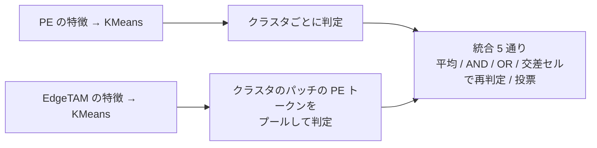

- **作り方**: EdgeTAM の特徴にテキストとの対応は無いので、EdgeTAM 側のクラスタの前景/背景・プロンプトは、そのクラスタのパッチの PE トークンをプールしてテキストと照合して得る。統合は 5 通り（平均・AND・OR・PE × EdgeTAM の交差セルで再判定・EdgeTAM のクラスタごとに PE 側の確信度を投票）。EdgeTAM 側の特徴 2 種、PE 側の層 2 種（第 8〜10 層 / 第 6 層）と組み合わせた 24 変種。
- **2 つのクラスタ結果の性質**（MVTec 120 枚）: EdgeTAM 側のクラスタは空間的にまとまる（最大の連結成分に 76% のパッチ、PE 側は 28%）。判定が食い違うパッチ（14%）では EdgeTAM 側が正しい割合が 60%。→ **伝播（本文 §3.5）の動機**。
- **粗い判定の誤り**: 基準 20.2% → 投票 15.2〜16.6%。AND・交差セルは FP を減らす（6.8% → 4.1% / 3.0%）が FN が増え、計では悪化。
- **MVTec の最終 IoU は上がらない**: 基準 0.813 に対し最良 0.815（平均 / `image_embed`）。23 変種中 15 変種が有意に悪化（EdgeTAM のみ 0.726、AND 0.739、交差セル 0.681、投票 0.772）。capsule・metal_nut は改善（0.875 → 0.95〜0.98、0.848 → 0.88〜0.90）、zipper（0.921 → 0.24〜0.68）・toothbrush（0.938 → 0.68〜0.89）は大きく悪化。
- **悪化の機構**: ① zipper は、基準では PE が布に点在させた前景判定のパッチが EdgeTAM の「種」になるが、EdgeTAM 側のクラスタでは布が 1 つのまとまりになり背景と判定され、前景が歯の列だけになる。② toothbrush は、EdgeTAM 側のクラスタが物体にぴったり沿うので、精緻化（粗いマスクの外を背景から始める）が外周の縁を落とす。
- **合成データ（小物体・複数物体、背景が雑多）**: 誤検出の少ない規則が有意に上がる。IoU は基準 0.513・第 6 層 0.573 に対し、AND 0.628、交差セル（PE=第 6 層）0.638。背景の誤検出 12.8% → 6.1% / 3.7%、個数の誤差 4.82 → 1.4。代償は検出率（0.936 → 0.874 / 0.882。小物体 S 0.924 → 0.82 / 0.86）。投票は小物体の検出率が大きく下がる。
- **コスト**（OpenVINO・FP32）: 増える処理は約 4.3ms（EdgeTAM 特徴の KMeans 1.7ms + PE トークンのプール 2.6ms）。EdgeTAM エンコーダ（30.8ms）は精緻化でも使うので、粗い判定の前に実行して使い回せば増えない。
- **限界**: 24 変種を同じ 120 枚で選んでおり、多重比較の補正は無い（独立した 60 枚で確認したのは 9 変種）。PyTorch 版のみ。

**結論**: この時点では見送り。MVTec 型（FN 主体）には向かず、背景が雑多で誤検出が多い画像向き。A.5 で zipper を除いて再検証。

## A.5 再検証: zipper を評価から除く・精緻化側の改良（外周 1 パッチを不明にする）

A.4 に対し、「zipper は画面の 78% が前景（布まで前景）で、物体として評価する意味が無い」「toothbrush の悪化は精緻化側の問題」という指摘を受けて測り直した。全表・図は `outputs/dual_cluster_recheck/index.html`。実験は `tools/experiments/dual_cluster_recheck/exp_recheck.py`。

- **zipper を除く**: `EVAL_CATEGORIES`（9 種）を `eval_prompts.py` に足した。texture 系は全面が前景で最初から除外。108 枚、独立確認 54 枚。
- **zipper を除いた結果（外周は従来のまま）**: 基準の最終 IoU は 0.813 → 0.801（zipper で 0.92 と強かった）。基準を有意に上回るのは平均・`image_embed` の 0.830 だけで、独立 54 枚では再現しない（0.800 対 0.802）。交差セルは有意に低い（−0.069）。粗い判定の誤りは、基準 16.4% → 投票・第 6 層 11.3%（第 6 層のみ 12.6%）。
- **toothbrush の原因は精緻化側**: EdgeTAM に渡す初期マスクは「粗いマスクの外は背景」なので、粗いマスクが物体より内側に入ると、物体の縁が背景の事前確率に入って削られる。**粗いマスクを 1 パッチ膨らませた範囲のうち core でない部分の事前確率を「不明」（0.5）にする**（パラメータ・推論の追加なし）。正解を粗いマスクにした上限で 0.857 → 0.903。
- **外周を不明にした結果**: 11 変種中 9 で最終 IoU が有意に上がる。第 6 層のみ 0.815 → 0.844（+0.030 [+0.009, +0.051]）、投票・第 6 層 0.820 → 0.853、AND・第 6 層 0.812 → 0.851。toothbrush は第 6 層のみ 0.83 → 0.98。前回の膨張より +0.06〜+0.14 高い（膨張は粗い FP を 4.5〜8.1% → 14〜20% に増やす）。
- **外周を直した後は、統合の上積みが MVTec では示せない**: 第 6 層のみ + 外周 0.844 に対し、投票 +0.009 [−0.012, +0.031]、AND +0.007 [−0.018, +0.033]。
- **代償（小物体・実画像）**: 合成データでは、外周は検出率を上げる（+0.02〜+0.04）が背景へ膨らみ、第 6 層のみの IoU は 0.573 → 0.521（−0.053）、誤検出面積 10.3% → 12.7%。AND・交差セルは影響が小さい。外周ありどうしでは、AND・交差セルが第 6 層のみより IoU +0.08〜+0.10 有意に高い（検出率 −0.02〜−0.04）。
- **screw・transistor**: `fg_mask` が物体に沿っておらず、どの設定でも IoU が頭打ち。精緻化の改良を測れない。
- **限界**: 11 変種を同じ 108 枚で比べており、多重比較の補正は無い。PyTorch 版のみ。

**結論**: 外周「不明」は有効（MVTec 型）だが小物体で膨らむ → A.7 でガイデッドフィルタを足して解決。

## A.6 性能向上の方針のための診断（Phase 0）

粗い段階と詳細段階のどちらが最終性能を決めているかを測った。全表・事例は `outputs/diagnosis/index.html`。実験は `tools/experiments/diagnosis/`。

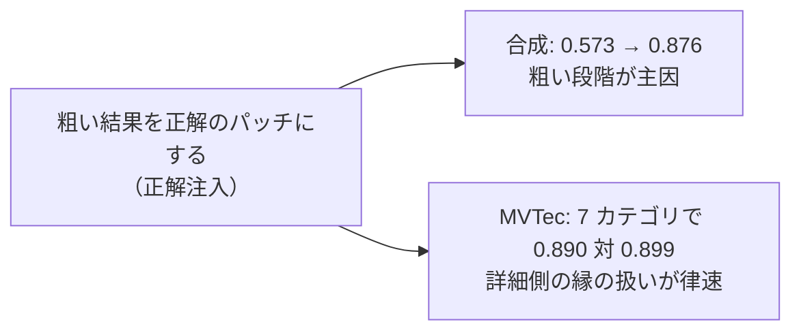

- **正解注入**: 合成データ 120 枚で IoU 0.573 → **0.876**（外周「不明」ありで 0.902）。背景の種類によらず 0.84〜0.92。難しい条件の失敗はほぼすべて粗い段階。MVTec は 0.815 → 0.857（外周あり 0.844 → 0.903）で、zipper・screw・transistor を除く 7 カテゴリでは現行 0.890 対 上限 0.899（差 +0.009）。現行の事前マスクのままでは、粗い判定を完璧にしても MVTec は上がらない。
- **粗い誤りの分解**（合成データ、画像の面積比 8.8%）: クラスタの判定の誤り（背景のクラスタを前景とする）6.5%、クラスタの混在 1.6%、格子の解像度 1.1%。最終マスクの誤検出は孤立した成分（10.2%）で、食み出しは 0.16%。背景の種類で IoU は plain 0.89 / textured 0.67 / pattern 0.59 / natural 0.15（natural は実物の写る背景で、前景の定義が曖昧）。
- **クラス単位**: 部品の種類が 2 つ以上の 94 枚で、正解の種類 3.6 に対し予測クラス 1.5、homogeneity 0.13。結果はほぼ前景 / 背景で、セマンティックの区別は弱い。
- **処理時間**（静かな状態で測り直した値）: 中央値 227ms のうち PE 38%、デコード 27%、EdgeTAM エンコーダ 15%、精緻化の NumPy 処理 16%。候補バックボーン（512px、重みなし）は PE-Spatial-T が PE-Core-T と同じ（0.97 倍）、DINOv3-S 2.1 倍、PE-Core-S 2.6 倍。
- **限界**: 合成データは貼り合わせで、natural 背景は実物を含む。正解注入は上限で、達成できる値ではない。

**結論**: 合成（小物体・雑多な背景）は粗い段階の判定の誤りが主因。MVTec は詳細側の縁の扱いが律速。

## A.7 追加実験（Phase 1・2）: 事前マスクの縁・切り抜きでの分類・特徴源の差し替え

A.6 を受けた追加実験。手法の詳細は [improvement_methods.md](improvement_methods.md)。全表・事例は `outputs/phase2/index.html`。

- **効いた: 外周「不明」+ ガイデッドフィルタ（手法 D）**。精緻化の事前確率（外周「不明」で作った 32×32）を 128×128 に拡大し、入力画像（128×128 に縮小した輝度）をガイドに、半径 4（= 1 パッチ）・eps 0.01 のガイデッドフィルタにかける。MVTec 108 枚で 0.815 → **0.844**、独立 54 枚で 0.806 → 0.827。合成データは、外周のみの悪化（0.573 → 0.521）が **0.566（−0.007、有意でない）**に消える。
- **D + プロンプト点 4:4**: MVTec 0.840（+0.026）、合成 **0.590**（+0.017）、検出率 0.909、点は 62 → 32。
- **手法 B（PE と EdgeTAM の別々のクラスタリングの統合）+ D**: 検出率の低下が消える。交差セル + D は合成 0.653（+0.080）、AND + D は 0.634（+0.061）。MVTec では上乗せにならない（AND + D 0.837、交差セル + D 0.804）。
- **効かなかった**: C1（領域の分類を切り抜きの CLIP 埋め込みで行う）は、成分単位では誤りを減らす（合成 9.2% → 4.1%）が前景を多数消し、最終 IoU は合成 0.496〜0.567・MVTec 0.255〜0.820（現行 0.573 / 0.815）。C2（クラスタリングの特徴を PE-Spatial-T に替える・EdgeTAM と連結する）は MVTec 0.712〜0.803・合成 0.519〜0.590 で、手法 B に届かない。
- **限界**: PyTorch 版のみ。変種を同じ画像で多数比べており、多重比較の補正は無い。ガイドが輝度のみで、透明・低コントラストの物体は縁の手がかりが弱い。

**2026-10-22 に、D・点数 4:4・手法 B の AND を本体に組み込んだ**（共通コード。PyTorch・OpenVINO の両方）。本体のパイプラインでの測定（PE 第 6 層、OpenVINO）: D・4:4・AND で MVTec 108 枚 0.832、独立 54 枚 0.794、合成 0.638（従来 0.815 / 0.806 / 0.573）。AND は合成の背景の誤検出を半分にした一方、**cable が 0.898 → 0.642 と大きく下がった**。この問題が A.8 の動機。

## A.8 EdgeTAM 特徴での確信度の伝播と、詳細側のプロンプト（2026-10-24）

AND の弱点（cable）を受け、PE × EdgeTAM の統合を深掘りした。全表・事例は `outputs/coarse_ideas/index.html`。実験は `tools/experiments/coarse_ideas/exp_fusion.py`・`exp_judge.py`、`tools/experiments/prompt_ideas/exp_prompt.py`（詳細側）。評価は cable を除く MVTec 8 カテゴリ（96 枚 + 独立 48 枚）と合成 120 枚。

- **前提の変化**: 背景プロンプトに影の語が 13 個足された（`color_free_bg/background.yaml`）ため、AND の MVTec が 0.855 → 0.784 に下がった（PE のみは 0.834 → 0.825）。以下は現在のプロンプトでの値。
- **確信度の伝播が有効**: EdgeTAM の `image_embed` のコサイン類似度の kNN グラフ（k=8）で、PE の前景確信度を `conf ← 0.2·conf0 + 0.8·W·conf` で 3 回伝播する。

| | MVTec 96 枚 | 独立 48 枚 | 合成 120 枚 |
|---|---|---|---|
| PE のみ | 0.825 | 0.851 | 0.613 |
| AND（影の語あり） | 0.784 | 0.785 | 0.656 |
| **伝播** | **0.849**（+0.024 [+0.007, +0.046]） | **0.861** | **0.658**（+0.046 [+0.022, +0.074]） |

- α=0.7〜0.8・k=4〜8 で同程度。プロンプトを 4 倍にしても 0.828（PE のみ 0.810、AND 0.740）。二回目の KMeans・プールが不要。
- **効かなかった**: AND 後の伝播、EdgeTAM の過分割（K=16・32）+ AND（MVTec 0.673・0.249）、高解像度特徴・成分単位の AND・外れ値を除いたプール。
- **詳細側（プロンプト）**: 近接負例点・正例点の選び方・箱・自己プロンプト・成分ごとの推定は、MVTec と合成の両方で安定して上がるものが無い（正解注入の上限 0.886 / 0.894）。**反復 3 → 2 回は精度が同じ（MVTec −0.002）で、デコードが 7.2 → 4.8 回**。

**2026-10-24 に、伝播を本体に組み込み、AND を置き換えた。反復も 3 → 2 回にした**（`edgetam_refine_iterations: 2`）。本体のパイプラインでの測定（PE 第 6 層）: PyTorch は MVTec 0.847 / 独立 48 枚 0.855 / 合成 0.658、OpenVINO は 0.837 / 0.861 / 0.657。PyTorch と OpenVINO の粗い前景マスクの一致は 99.93%、最終の前景の一致は 98.1%（IoU 0.933）。影の背景プロンプトを外した場合（旧プロンプト）との比較: AND は 0.855 / 0.850 / 0.639、伝播は 0.851 / 0.855 / 0.627、PE のみ 0.834 / 0.838 / 0.590。**伝播は影の語があっても MVTec を保ち、合成は 0.627 → 0.658 に上がる**（AND は影の語で MVTec が下がる）ので、影の語は残してよい。dedup・上位 2 の判定を伝播と組み合わせても、独立 48 枚が下がる（0.798・0.839）ので採用しない。

## A.9 背景の負例点の密集と、高分解能な事前マスク（2026-10-24）

質問: ① 背景の負例点が隅に密集する理由（ばらしたら性能は上がるか）、② PE の粗い結果を EdgeTAM の 128×128 特徴で高分解能化して事前マスクにする案は試したか。本体は変更していない。レポートは `outputs/bg_points/index.html`・`outputs/hires_prior/index.html`、実験は `tools/experiments/{bg_points,hires_prior}/`。

**① 背景の負例点**: 密集は、伝播の副作用。`foreground_map` が連続値になり、`select_background_points` の「候補が count 点そろうところまで閾値を上げる」が、最も確信度の低い count パッチそのものになる。**ばらしても精度は上がらない**。

| 選び方 | MVTec 96 枚の差 | 独立 48 枚の差 | 合成 120 枚の差 |
|---|---|---|---|
| 候補を確信度の下位 10% に広げて最遠点 | +0.0009 | −0.0019 | −0.0015 |
| 下位 25% | +0.0013 | −0.0024 | −0.0017 |
| 下位 50% | +0.0006 | −0.0071 | +0.0003 |
| 確信度を使わず、外側背景の全部から最遠点 | **−0.0036**（有意） | **−0.0108**（有意） | +0.0014 |
| EdgeTAM の特徴で背景を 4 つに分け各 1 点 | −0.0024 | −0.0156 | +0.0002 |

負例点は「背景の一点」として働き位置にあまり依らず、最も確信できる背景に置くのが安全で、広げると物体に近い・影や縁など背景か怪しい場所へ置いて物体を削る危険が増える、と推測している（確かめていない）。**現状のまま**。

**② 128×128 の事前マスク**: 提案そのものは未実施だった。近い実験は、EdgeTAM の 64×64 / 128×128 特徴での KMeans で、MVTec 0.618 / 0.625、合成 0.201 / 0.280 と大きく悪化。事前マスクの 128×128 化は、入力画像の輝度のガイデッドフィルタ（手法 D）で採用済み。
- **上限**: 正解の 128×128 を事前マスクにしても（粗い判定も正解）、MVTec 6 カテゴリ 0.9667 → 0.9665（差なし）、合成 0.8935 → 0.9195（+0.026）。
- **実験**（事前マスクの「不明」の帯だけを EdgeTAM の 128×128 特徴で推定し直す）: H1 ガイドを特徴の主成分に、H2 確実な前景・背景のプロトタイプとのコサイン類似度、H3 128×128 の 5×5 窓の局所伝播、H4 128×128 の KMeans + クラスタごとの確信度。現行の粗い判定（PE + 伝播）では、H3 が MVTec 6 カテゴリ +0.015、H2 が +0.010 と上がるが、合成が −0.012・−0.018 と有意に下がり、前景だった画素の消失とクラスの変更も出る。**採用しない**。
- **見込みのある別の方向**: 粗いクラスタの判定の誤り（伝播が大きな領域を落とす問題。bottle 0 など）。
