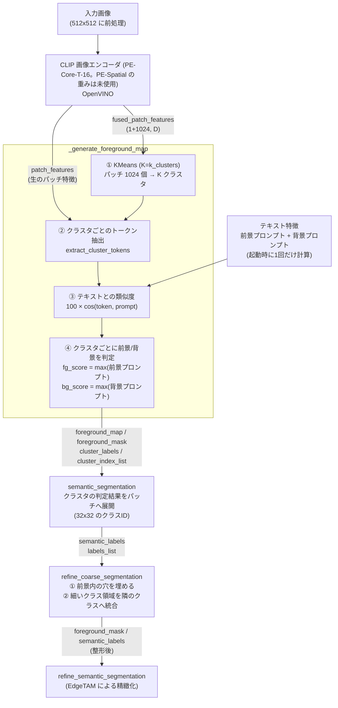
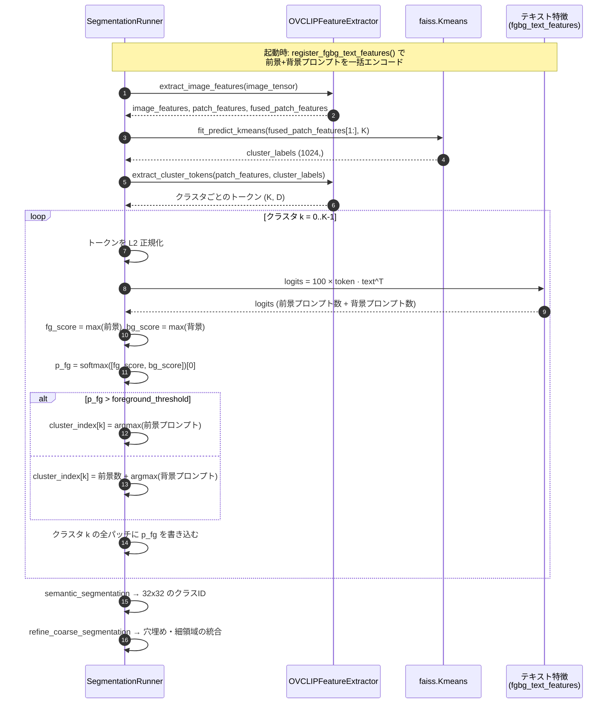
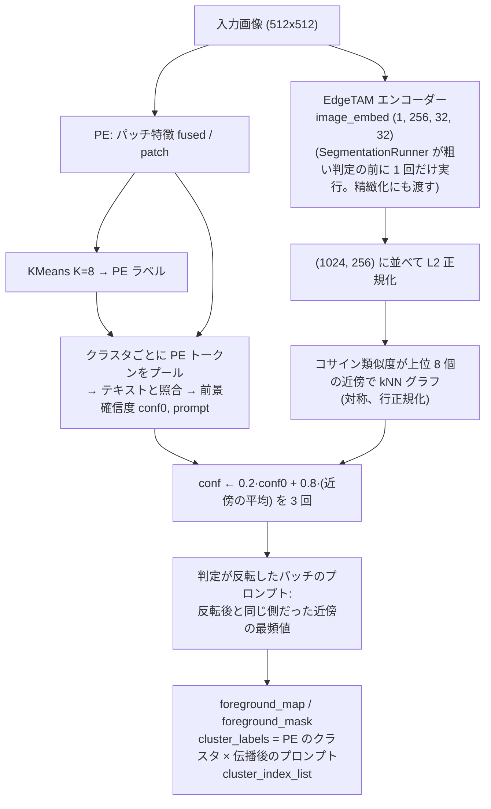
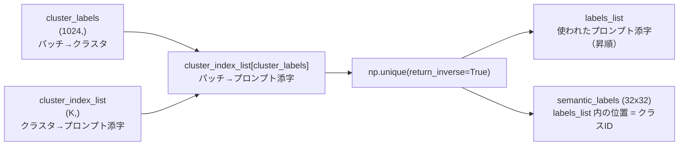
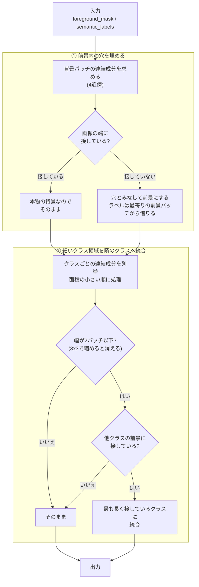

# 粗いセマンティックセグメンテーション

`SegmentationRunner._generate_foreground_map` から `refine_coarse_segmentation` までの処理（OpenVINO 版、`core/common/segmentation_runner.py`）をまとめる。

この段階の目的は、**CLIP の特徴とテキストプロンプトだけで、画像を 32×32 のパッチ単位に「背景 / 前景（どの種類の物体か）」へ分けること**。ここで得た粗い結果は、次段（EdgeTAM による精緻化 `refine_semantic_segmentation`）が「どこに・どのクラスのプロンプト点を置くか」の根拠として使う。したがって、ここでの誤りは最終結果の誤り（背景の広がり、物体の見逃し、クラスの割れ）に直結する。

- [1. 全体像](#1-全体像)
- [2. 処理の流れ（シーケンス）](#2-処理の流れシーケンス)
- [3. `_generate_foreground_map`](#3-_generate_foreground_map)
- [4. `semantic_segmentation`](#4-semantic_segmentation)
- [5. `refine_coarse_segmentation`](#5-refine_coarse_segmentation)
- [6. 出力画像の読み方](#6-出力画像の読み方)
- [7. 設定値・固定値](#7-設定値固定値)
- [8. 既知の失敗パターンと対処](#8-既知の失敗パターンと対処)

---

## 1. 全体像



ポイントは **判定の単位が「パッチ」ではなく「クラスタ」** であること。KMeans が似たパッチを K 個にまとめ、そのクラスタ全体に対して 1 つの判定（前景か背景か、どのプロンプトか）を下す。判定が速い反面、クラスタに背景と前景が混ざると、その全体が誤判定される。

---

## 2. 処理の流れ（シーケンス）

（`use_edgetam_clustering: true` のときの、EdgeTAM の特徴での前景確信度の伝播は [§3.5](#35-edgetam-の特徴で前景確信度を伝播するuse_edgetam_clustering)）



---

## 3. `_generate_foreground_map`

| | |
|---|---|
| 入力 | `patch_features`（生のパッチ特徴）、`fused_patch_features`（クラスタリング用の特徴） |
| 出力 | `foreground_map` (32×32, 0〜1)、`foreground_mask` (32×32, 0/1)、`cluster_labels` (1024,)、`cluster_index_list` (K,) |

### 3.1 KMeans（`fit_predict_kmeans`）

`fused_patch_features[0, 1:, :]`（CLS を除いた 1024 パッチ）を faiss の KMeans で K 個に分ける。K は `k_clusters`（既定 8）、反復は `n_iter`、シードは固定（`KMEANS_SEED = 42`）。

K は「粗さ」を決める。大きいほどクラスタが純粋になる（物体と影が分かれる）が、前景/背景の判定がクラスタ数だけ増えて不安定になる。実験では K=12, 16 でねじやトランジスタは改善した一方、cable・zipper が崩れた。

### 3.2 クラスタのトークン抽出（`extract_cluster_tokens`）

`pe_patch_logits_model`（PyTorch 版では `visual.trunk.custom_forward`）に「生のパッチ特徴」と「クラスタラベル」を渡し、**クラスタごとに 1 本の、テキストと比較できる特徴ベクトル**を得る。これがそのクラスタの「代表」になる。集約の中身は PE 側の実装（`convert_openvino.py` で変換しているカスタム forward）に依存し、このリポジトリ内では内部を持たない。

### 3.3 前景/背景の判定

クラスタ `k` の代表ベクトルを L2 正規化し、全プロンプト（前景 → 背景の順に並んだテキスト特徴）との類似度を取る。

```
logits   = 100 × token · text_features^T          # CLIP_LOGIT_SCALE = 100
fg_score = max(logits[前景プロンプト])
bg_score = max(logits[背景プロンプト])
p_fg     = softmax([fg_score, bg_score])[0]       # = sigmoid(fg_score - bg_score)
```

- **グループの集約は `max`**。プロンプトは言い換えではなく「選択肢」の列挙なので、最も近い 1 つで代表させる。平均（`logmeanexp`）にすると、プロンプトの個数を変えただけで判定が偏った。
- `p_fg > foreground_threshold`（既定 0.5）なら前景。`cluster_index_list[k]` には、前景なら**前景プロンプトの添字**、背景なら**`前景プロンプト数 + 背景プロンプトの添字`** を入れる。
- クラスタ内の全パッチに同じ `p_fg` を書き込んだものが `foreground_map`、これを閾値で 2 値化したものが `foreground_mask`。同じクラスタのパッチは同じ値になるので、`foreground_map` はクラスタごとの階段状になる。

### 3.4 判定の具体例

`001_crop`（タオルの上のコイン）で、プロンプトに `a photo of a fabric.` が入っていたときのクラスタ別の値（ロジットは `100 × cos`）。

| クラスタ | パッチ数 | 前景側の最大 | 背景側の最大 | p_fg | 判定 | 実際 |
|---|---|---|---|---|---|---|
| k2 | 113 | coin 43.9 | uniform background 39.3 | 0.99 | 前景 | コイン ✓ |
| k4 | 117 | coin 44.9 | uniform background 38.9 | 1.00 | 前景 | コイン ✓ |
| k3 | 225 | **fabric 41.3** | plain background 41.4 | 0.47 | 背景 | タオル ✓（紙一重） |
| k5 | 200 | **fabric 41.8** | plain background 41.7 | 0.53 | **前景** | タオル ✗ |
| k6 | 150 | **fabric 42.2** | plain wall 41.5 | 0.68 | **前景** | タオル ✗ |

物体（コイン）は 4〜5 ロジットの差で安定して勝つ一方、背景のタオルは前景プロンプト `fabric` と背景プロンプトが **0.1〜0.7 ロジット差**で拮抗し、判定が不安定になっている。**ロジット差が 1 未満のクラスタは、プロンプトの小さな変更で結果が反転する**と考えてよい。

### 3.5 EdgeTAM の特徴で前景確信度を伝播する（`use_edgetam_clustering`）

`use_edgetam_clustering: true`（既定）のとき、`generate_foreground_map` は EdgeTAM エンコーダーの `image_embed`（256 次元・32×32）を受け取り、PE の判定で得た**前景確信度を、EdgeTAM の特徴が似たパッチどうしで伝播して揃える**（`_propagate_with_edgetam`）。2026-10-24 に、以前の「EdgeTAM の特徴でも KMeans して前景確信度を AND する」方式から置き換えた。

**なぜ**: 粗い誤りの主因は、背景のクラスタを前景とする判定の誤り（背景の斑点・織り目の一部が前景のクラスタに混ざる）。PE の特徴のクラスタは意味は近いが空間的にばらける。EdgeTAM の特徴は物体の輪郭・領域に沿ってまとまる。その類似度で確信度を揃えると、背景の斑点が周りの背景に引かれて消える。AND は前景を消す方向にしか働かず、物体の一部が背景のクラスタと混ざるとその部分を失う（cable で大きく下がる）。伝播は確信度をならすだけなので崩れにくい。



- **パラメータ**: `EDGE_PROPAGATION_ALPHA` = 0.8、`EDGE_PROPAGATION_NEIGHBORS` = 8、`EDGE_PROPAGATION_ITERATIONS` = 3（`core/common/params.py`）。α は 0.7〜0.9、k は 4〜8 で結果が同程度、反復 5 回でも変わらない（平坦な範囲から選んだ）。
- 二回目の KMeans とトークンのプールは**要らない**（以前の AND は要った）。追加の処理は、1024×1024 の類似度と上位 8 個の選択（NumPy で約 10ms。`mask_utils.knn_graph`）と、疎行列での伝播（0.1ms 未満）。プロンプトの文には依らないので、**プロンプトを増やしても（4 倍にしても）結果は保たれる**。
- 検証（cable を除く MVTec 8 カテゴリ 96 枚 / 独立 48 枚 / 合成 120 枚）: PE のみ 0.825 / 0.851 / 0.613 に対し、伝播 **0.849 / 0.861 / 0.658**。以前の AND は、背景プロンプトに影の語を足した後 0.784 / 0.785 / 0.656 で、MVTec が下がった。詳細は §16、`outputs/coarse_ideas/index.html`。
- EdgeTAM の特徴を使わないとき（`false`）は、PE の判定のみ（前の PE のみの状態）。

---

## 4. `semantic_segmentation`

クラスタ単位の判定結果を、パッチ単位の 32×32 のクラスID マップへ展開する。



- **同じプロンプトに判定された複数のクラスタは、同じクラスIDに統合される**（例: 3 つのクラスタが全部 `coin` なら、クラスIDは 1 つ）。
- `labels_list` は昇順なので、**前景プロンプトの添字（小さい）が先、背景プロンプトの添字（`前景数 + …`）が後**に並ぶ。つまりクラスIDの小さい側が前景になる。
- クラスIDからプロンプト名に戻すには `プロンプト = labels_list[クラスID]`（前景なら `foreground_prompts[…]`）。

---

## 5. `refine_coarse_segmentation`

クラスタ単位の判定が作るノイズを、パッチ格子上の形（連結成分）を使って整える。入力は `semantic_labels`、`foreground_mask`。出力は整形後の `(foreground_mask, semantic_labels)`。**判定の根拠（プロンプトとの類似度）は変えず、形だけを整える**。



### 5.1 穴埋め

反射や透明部などで、物体の内側に背景と判定されたパッチが残ることがある。

```
前景=# 背景=.                      穴埋め後
. . . . . . .                     . . . . . . .
. # # # # # .                     . # # # # # .
. # . . # # .   ← 内側の .         . # # # # # .
. # # # # # .     は端に接して     . # # # # # .
. . . . . . .     いない → 穴     . . . . . . .
```

- 判定は **「画像の端に接していない背景の連結成分」はすべて穴**。**面積のしきい値は無い**（大きさに関係なく埋める）。
- 埋めたパッチのラベルは、元の前景のうち最も近いパッチのラベル（距離変換のインデックス）を使う。
- 穴埋めは「粗いマスクを物体単位でつなぐ」ためのもの。最終的な形は EdgeTAM が決めるので、ワッシャーの穴のような本物の穴を埋めても、後段で除かれる。

### 5.2 細いクラス領域の統合

物体の縁や影のパッチは、物体と背景の特徴が混ざり、物体の内側とは別のクラスタ（＝別プロンプト）になりやすい。結果として、コインの周りに別クラスの輪ができる。

```
コインの周りに別クラス(R)の輪ができた状態            統合後
. . . . . . . . .                                    . . . . . . . . .
. . R R R R R . .                                    . . C C C C C . .
. R R C C C R R .      R の幅は1〜2パッチ             . C C C C C C C .
. R C C C C C R .      → 縮めると消える               . C C C C C C C .
. R R C C C R R .      → C(コイン)に接している         . C C C C C C C .
. . R R R R R . .      → C に統合                     . . C C C C C . .
. . . . . . . . .                                    . . . . . . . . .
```

- 「**細い**」の定義は、そのクラス領域（4 近傍の連結成分）を 3×3 で縮めたとき**何も残らない**こと（幅 2 パッチ以下）。`PATCH_NEIGHBORHOOD = 3`。
- 「**接している**」は、領域を 3×3 で 1 回広げた輪の中に、**別クラスの前景**パッチがあること。背景にしか接していない細い領域（細いケーブルなど）は**統合されない**。
- 統合先は、輪の中で**最も多く接しているクラス**。
- 面積の小さい領域から順に処理する（先に統合された結果が、後の判定に反映される）。
- **「他のクラスに完全に囲まれた小さなクラスを統合する」処理は入っていない。** 基板の上のねじのような、本当に別の物体が消えるのを避けるため。

### 5.3 この段階が直さないもの

次のような誤りは形では直らない（判定そのものの誤り）。

- 背景のクラスタが前景と判定された（背景がまるごと前景になる）
- 物体のクラスタが背景と判定された（物体の見逃し）
- 同じ物体が別のプロンプトに割れた（`syringe` と `bolt` など）

これらは §8 のとおり、主にプロンプトで対処する。

---

## 6. 出力画像の読み方

`output_dir/<画像名>/` に次の画像が出る。

| ファイル | 内容 |
|---|---|
| `coarse_semantic_segmentation_raw.png` | `semantic_segmentation` の直後（整形前）の `semantic_labels` |
| `coarse_semantic_segmentation.png` | `refine_coarse_segmentation` の後（整形後）の `semantic_labels` |
| `foreground_map.png` | `foreground_map`（クラスタごとの `p_fg`。階段状） |
| `foreground_mask.png` | 整形後の `foreground_mask` |
| `layer_fused_k8.png` | KMeans のクラスタ分け（色はクラスタID） |
| `foreground_overlay.png` | 前景マスクと EdgeTAM に渡した点（緑=正例、赤=負例） |

**`coarse_semantic_segmentation*.png` の色について**: 色は `config` の `color_palette` を**クラスID**で引いたもの（0=黒、1=赤、2=緑、3=青、4=黄…）。`labels_list` は昇順なので、**前景プロンプトが当たったクラスほど小さいID（黒・赤…）、背景プロンプトが当たったクラスほど大きいID**になる。画像ごとに前景のクラス数が違うため、「黒＝前景」と決めつけず、前景が何クラスあるかで境界が変わる点に注意する（前景クラスが 2 つなら、黒と赤が前景で、緑以降が背景）。

---

## 7. 設定値・固定値

| 名前 | 値 | 場所 | 意味 |
|---|---|---|---|
| `k_clusters` | 8 | `configs/ov_config.yaml` | KMeans のクラスタ数 |
| `n_iter` | 10 | 同上 | KMeans の反復回数 |
| `foreground_threshold` | 0.5 | 同上 | `p_fg` がこの値を超えたクラスタを前景とする |
| `image_size` | 512 | 同上 | 入力サイズ。パッチ 16px なので 32×32 パッチ（`feature_size`） |
| `prompts_dir` | — | 同上 | `foreground.yaml` / `background.yaml` のあるディレクトリ |
| `use_edgetam_clustering` | true | 同上 | EdgeTAM の特徴でも別にクラスタ分けして前景確信度を AND する（§3.5） |
| `CLIP_LOGIT_SCALE` | 100.0 | `segmentation_runner.py` 冒頭 | 類似度（cos）に掛ける係数 |
| `KMEANS_SEED` / `FAISS_NUM_THREADS` | 42 / 2 | 同上 | KMeans の再現性・スレッド数 |
| `PATCH_NEIGHBORHOOD` | 3 | 同上 | 「細い」「接している」「内側」の判定に使う近傍（= 1 パッチ分） |

固定値は `segmentation_runner.py` 冒頭の「固定ハイパーパラメータ」ブロックにまとまっている。

---

## 8. 既知の失敗パターンと対処

| 症状 | 原因 | 対処 |
|---|---|---|
| 背景（タオル・カーペットなど）が前景になる | 背景の質感が前景プロンプト（例: `fabric`）に近い。前景/背景の最大類似度が 1 ロジット未満の差で拮抗する（§3.4） | 背景と同じ素材を表す前景プロンプトを外す。外せない場合は背景側に同素材の語を足す（ただし同素材の物体が検出しにくくなる） |
| 背景の一部のクラスタだけが前景になり、斑点状に残る | 前景・背景の最大類似度がどちらも低い（例: 36.5 対 36.0）クラスタ。どちらのプロンプトにも合わず、判定が偶然に決まる | 背景側に「textured background」のような総称を足すと消えるが、textile の物体（zipper）が背景になりやすくなる。判定の信頼度（両スコアの絶対値）を使う構造的な対処が候補 |
| 灰色の物体（ホイルのふたなど）が背景になる | 色の語を含む背景プロンプト（`gray background` など）に近づく | 背景プロンプトから色の語を外す（`prompts/candidates/color_free_bg/` がその例） |
| 同じ物体が別クラスに割れる | 近い意味のプロンプトを複数入れている（`screw` と `bolt`） | 1 プロンプト=1 概念にし、同義語を並べない |
| カップと麺のように、別物体が同じクラスになる | 同じクラスタに入ってしまう（K が小さい） | K を大きくすると改善するが、他で不安定になる。EdgeTAM 側の対処が必要 |

### プロンプトを変えたときの確認

`tools/evaluation/eval_prompts.py` で、MVTec AD の物体 10 カテゴリを使い、前景 IoU・最小 IoU・クラスの割れやすさ（frag）を測れる。

```bash
python tools/evaluation/eval_prompts.py                              # config の prompts_dir を評価
python tools/evaluation/eval_prompts.py --prompts-dir ./prompts/xxx  # 候補ディレクトリを評価
python tools/evaluation/eval_prompts.py --set k_clusters=12          # config の値を上書きして評価
```

MVTec にない画像（自前の画像）は正解マスクがないので、`develop.py` の出力画像を目で見て確認する。前景/背景の判定が拮抗していないかは、§3.4 のように**クラスタごとの前景側・背景側の最大類似度を並べて見る**のが早い。

---

## 9. 試して採用しなかった対策（背景の斑点を消す）

背景の斑点（背景クラスタに混ざった孤立パッチ）を消すために、次を試した。どれも採用していない。

| 対策 | 結果 |
|---|---|
| クラスタ単位の「曖昧なら背景」規則（閾値・言い換えの合意・null プロンプト・散らばり・画像の枠を基準にする） | 誤りの合計が減らない（前景の見逃しが増える） |
| 前景確信度の平滑化 | zipper の布のような、まばらな前景しか手がかりの無い物体が消える |
| クラスタのトークンから CLS を除く / CLS 方向を除く / 画像全体との差を取る | 背景を前景とする誤りが大きく増える |
| パッチごとのテキスト類似度（MaskCLIP / ClearCLIP 型） | 背景を前景とする誤りが大きく増える |
| モデルを大きくする（PE-Core S / B） | 誤りが増える（T: 19.3%、S: 21.9%、B: 29.1%） |
| EdgeTAM の予測IoU で成分を確認して外す | 小さな物体を大量に消す（合成データで、見逃しが 11/166 → 49/166） |
| Overlapping Tiling（512 に縮小 → 384 のタイル 2×2（128px ずらし）+ 全体を 384 に縮小の計 5 枚。判定結果の平均 (A) / 特徴量の平均 (B)） | 本体では採用せず（下記）。A は dev IoU 0.855 / holdout 0.828、B は 0.808 / 0.822（基準 0.817 / 0.836）。特徴量抽出の時間が約 2.7 倍 |

残しているのは、**負例を「背景だと最も確信できる」パッチから選ぶ**変更だけ（`select_background_points` に `foreground_map` を渡す）。確信の弱い「背景」は実際は物体（濃い布など）のことがあり、そこに負例を置くと物体を打ち消してしまうため。

### 分かったこと

- 正解の物体領域だけで集約したトークンは、100 枚すべてで前景と判定される。一方、**正解の背景領域だけで集約したトークンの半数が、前景と判定される**。最終層のパッチ特徴には、画像全体（＝写っている物体）の情報が背景のパッチにも混ざっており、背景の領域でも物体の意味が出る。プーリングの方法を変えても、これは取り除けなかった。
- つまり、テキストとの類似度だけで背景を見分けるには限界がある。

### Overlapping Tiling の検証結果

`tools/experiments/tiling/eval_tiling.py` で、4 タイル（384、128px ずらし、24×24 パッチを 32×32 の格子に重ねる）と全体縮小（384）の計 5 枚から前景マップを作る方式を比べた（MVTec 物体 10 カテゴリ、`--num 5`）。基準（現行）は dev IoU 0.817 / holdout 0.836。

| 方式 | dev IoU | holdout IoU | frag (dev/holdout) | 粗い前景(整形後) FP / FN (dev) | 特徴量抽出 |
|---|---|---|---|---|---|
| 基準（512 の 1 枚） | 0.817 | 0.836 | 0.142 / 0.147 | 0.145 / 0.137 | 87 ms |
| A: 5 枚それぞれで判定し、前景確信度を平均 | 0.855 | 0.828 | 0.262 / 0.229 | 0.137 / 0.190 | 233 ms |
| B: 5 枚のパッチ特徴を平均してから 1 回判定 | 0.808 | 0.822 | 0.165 / 0.183 | 0.196 / 0.084 | 246 ms |
| E（対照）: 512 の 1 枚で KMeans の seed だけを変えた 5 回の判定を平均 | 0.813 | 0.830 | 0.152 / 0.137 | 0.146 / 0.148 | 83 ms（判定 +30 ms） |

- 100 枚（dev + holdout）の平均 IoU は基準 0.826、A 0.841、B 0.815。A の差はカテゴリで大きく割れる: cable +0.17（10 枚中 7 勝 1 敗）、metal_nut +0.12、toothbrush −0.11（2 勝 7 敗）、pill −0.06、screw（2 勝 6 敗）。
- 粗い前景の FP+FN は A・B とも基準と同程度か悪化（A は FN が増える、B は FN が減るが FP が増える）。クラスの割れ（frag）は A で大きく増える。
- 特徴量抽出は 87 ms → 約 240 ms（トークン数が 1025 → 5×577）。バッチ化しても計算量はほぼ変わらず、目標の ~200 ms に収まらない。
- 診断（`--diag`）: タイルの特徴は、512 全体の同じ位置の特徴とコサイン類似度 0.889（1 パッチずらすと 0.662）、タイル同士の重なりで 0.909。タイルにしても、背景の特徴に物体の意味が混ざる性質は大きくは変わらない（文脈を狭めても、判定の傾向が変わる程度）。
- `develop.py` の画像では、circuit の黒い床面の確信度は A・B とも基準より下がった（A: 前景 55%、B: 66%、基準 64%）。rings は 3 方式とも画像全体が前景のまま。clips は同程度。

### A の改善はタイルによるものか、アンサンブルによるものか

A（5 枚の判定の平均）で cable・metal_nut が大きく改善したため、効いているのが「タイル（局所の視野）」か「複数の予測の平均」かを切り分けた。対照 E は、512 の 1 枚に対して KMeans の seed を 5 通り（42, 1, 2, 3, 4）に変えて判定し、前景確信度を平均する（`tools/experiments/tiling/eval_tiling.py --mode E`）。

100 枚（dev + holdout）のカテゴリ別 IoU（基準 / A / E）:

| カテゴリ | 基準 | A | E |
|---|---|---|---|
| cable | 0.722 | 0.893 | 0.761 |
| metal_nut | 0.773 | 0.888 | 0.788 |
| toothbrush | 0.914 | 0.807 | 0.802 |
| 全体 | 0.826 | 0.841 | 0.822 |

- **cable・metal_nut の改善はタイルによるもの**。seed を変えて平均しても再現しない（cable +0.04、metal_nut +0.02。A は +0.17、+0.12）。局所の視野で見たクラスタ判定が、これらの物体では有効に働いている。
- **toothbrush の悪化は平均によるもの**。E でも −0.11 になる。細長い物体では、確信度の平均が閾値付近に薄まる（確信が割れる視点・クラスタ分けがあると前景が落ちる）と考えられる。
- E 自体は改善しない（dev 0.813 / holdout 0.830、基準 0.817 / 0.836）ので、安価なアンサンブルは採用しない。
- 以上から、タイルの利点（局所の視野）と、平均による欠点（細い物体の確信度が薄まる）は別の要因。タイルの結果を平均以外（例: 前景側を優先する統合）で束ねれば両立できる可能性があるが、統合規則の選択が新しいパラメータ的な判断になる点と、特徴量抽出が約 2.7 倍になる点が課題。

## 10. 前景特徴への背景混入の軽減（追加学習なし）の検証

「前景の特徴に背景が混ざる」問題を、追加学習なしで軽減する手法を PyTorch 版（`TorchCLIPProbe`）で 203 変種、検証した。実施内容・全変種の結果・図は **`outputs/decontam/index.html`**（`python tools/experiments/decontam/report_decontam.py` で再生成）。実験は `tools/experiments/decontam/exp_decontam.py`、画像比較は `tools/experiments/decontam/exp_decontam_cases.py`。

評価は MVTec 物体 10 カテゴリの 120 枚（dev + holdout）と、変種を選んだ後に測り直した別の 60 枚（verify）。誤りはパッチ単位の前景/背景の判定（FP + FN、正解は fg_mask）で、基準（現行）は 20.2%（FP 6.8% + FN 13.3%）。

| 手法 | 誤り（主実験） | 誤り（verify） | 最終 IoU（dev / holdout / verify） |
|---|---|---|---|
| 基準（第 8〜10 層でクラスタリング） | 20.2% | 19.4% | 0.816 / 0.805 / 0.804 |
| クラスタリングに第 6 層だけを使う | 16.7%（−3.4pt） | 17.3%（−2.0pt） | 0.801 / 0.830 / 0.790 |
| EdgeTAM の親和度で特徴を平滑化（α=0.7） | 18.8%（−1.3pt） | 19.0% | 0.786 / 0.764 / 0.801 |
| トークン側の背景除去（端につながる背景のトークンを射影で除去、背景判定のクラスタだけ救済） | 17.4%（−2.8pt） | 17.6% | 0.783 / 0.770 / 0.766 |
| 第 6 層 + トークン側の背景除去 | 14.7%（−5.4pt） | 16.4% | 0.793 / 0.819 / 0.777 |
| 第 6 層 + EdgeTAM 平滑化 + トークン側の背景除去 | 14.1〜15.1%（−5.1〜−6.1pt） | 13.8〜14.0% | 0.797 / 0.787 / 0.794 ほか |

分かったこと:

- **誤りの大半は、クラスタの純度ではなくトークン（判定）側にある。** クラスタを正解の前景/背景で分けても 19.4%。純度を上げる手法（階層分割・K の変更・EdgeTAM 特徴での純度向上）の天井は約 0.8pt。
- **混入の経路**は、パッチ間の直接の attention（前景→背景は 0.10、背景の面積比は 0.55）ではなく、CLS を介した全体の文脈と最終層付近の表現。領域ごとに attention を制限しても（正解の領域でも）悪化する。文脈は背景の識別にも使われている。
- パッチに高ノルムは無い（max/median 1.2〜1.5）。最終層では 1 チャンネルが全エネルギーの 61%（massive activation）を占めるが、抑えると悪化する。
- **ユーザーの観察（背景の特徴を引くと前景に戻る）は、トークン（512 次元）の段階で再現した**（FN 13.3% → 5.9〜7.8%、代償に FP 6.8% → 10〜11%）。パッチ特徴（576 次元）の段階で、混在クラスタの高ノルムパッチの平均を引く方法は、MVTec 全体では FN を減らさず、効いたのは純度（FP の減少）だった。
- 混在クラスタ・誤判定クラスタを、推論時に使える量で検出することはできない（AUC 最大 0.68）。
- **粗い段階の改善は、EdgeTAM まで通した最終 IoU に届かなかった。** 最終 IoU は FP に約 2 倍敏感（回帰: ΔIoU ≈ −1.3×ΔFP − 0.7×ΔFN）で、基準では粗い FN と最終 IoU の相関がほぼ 0（EdgeTAM が FN を補っている）。カテゴリ別には逆方向に動く（第 6 層: cable +0.30、screw +0.12、toothbrush −0.11、zipper −0.11）。toothbrush では粗いマスクが物体の内側に縮み、zipper では布に点在していた前景の「種」が消える。
- トークン側の背景除去は、**背景が一様でない画像**（空・海・岩、暗い床面）で FP が大きく増える（dog 27% → 43〜54%）。端につながる背景を 1 つのトークンにまとめるため（推測）。

採用しなかった（悪化・効果なし）: 領域ごとの attention 制限（V8）、最終ブロックの q-q attention・残差/FFN の除去（V9）、中間層のトークン（V5）、最終層の外れ値チャンネルの抑制（V11）、パッチ特徴の標準化・白色化・グローバル成分の除去（V1, V3）、テキスト側での背景方向の除去（V13）。

次の手順（優先順）: (1) 小さい物体・複数物体の合成データで、粗い FN の改善が効くか確認（MVTec は物体が大きく、これが測れない）。(2) 粗いマスクが「広め」「点在する種」で動く精緻化の挙動の見直し。(3) トークン側の背景除去を、背景クラスタごとに最も近い背景のトークンを引く形に改良。(4) 第 6 層のみの組み込み（`store_layers` を `[6]` にして `pe_visual_model` を再変換）は、(1)(2) の結果を見てから決める。


## 11. 背景混入の軽減の追検証（小物体・精緻化・背景除去の改良・第 6 層の OpenVINO 化）

§10 の「次の手順」を実施した。実施内容・全表・図は **`outputs/decontam_followup/index.html`**（`python tools/experiments/decontam_followup/report_followup.py` で再生成）。実験は `tools/experiments/decontam_followup/exp_followup.py`（合成データは `tools/experiments/decontam_followup/exp_followup_data.py`）。

- **合成データ（MVTec の部品 54 個 × 背景 4 種、120 枚・物体 451 個）**: 基準の検出率は S 0.924 / M 0.940 と高く、粗い誤りは FP 10.4% / FN 0.15%（MVTec と逆で、FN を減らす手法の出番が無い）。第 6 層は IoU +0.061（有意）、EdgeTAM 平滑化は +0.075 だが検出率が有意に低下（小物体 0.924 → 0.83〜0.86）。ガード無しのトークン側の背景除去は、textured / pattern / natural 背景で背景全体を前景にして破綻（誤検出 +47〜56pt、IoU 0.09〜0.21）。natural 背景の写真には正解に無い実物体が写るため、その誤検出は参考値。
- **精緻化側**: 粗いマスクの外は背景の事前確率 0 から始まるため、**粗いマスクが正解より約 1 パッチ（512 入力で 16px）広いときが最良**。正解を粗い結果にしても IoU 0.870、1 パッチ膨張で 0.924、収縮で 0.669（独立した画像でも 0.857 / 0.926）。予測のマスクを膨張すると FP が増えて悪化（−0.098）。toothbrush が第 6 層で悪化するのは、粗い FP が減って外周の余裕が減るため（正解そのままでも 0.76）。zipper は、基準では布に散らばっていた粗い前景から EdgeTAM が布全体へ広がるが、第 6 層は歯の列にまとまり広がらない（事例からの推測）。基準は精緻化の設定を変えても ±0.005。第 6 層は粗いマスク内側の事前確率を 0.9 にすると +0.022（独立した画像で +0.017）だが、基準との差は有意でない。
- **トークン側の背景除去の改良**: 救済ガード（背景判定のクラスタを救済するのは、前景判定のクラスタのトークンに、背景の参照トークンより似ているときだけ）で、粗い誤りは 14.7% → 13.6%（平滑化と合わせて 13.2%、独立した画像で 12.5〜14.0%）、合成データの誤検出は +47pt → +7pt に収まる。しかし最終 IoU は +0.005〜+0.010（有意でない）、独立した画像では符号が揺れ、合成データでは基準・第 6 層単独に及ばない。クラスタごとの背景参照（near）は効かない。**採用しない**。
- **第 6 層のみの OpenVINO 版**: `python convert_openvino.py --cluster-layers 6 --out-dir ./weights/openvino_models_l6 --pe-only`（EdgeTAM のモデルは `weights/openvino_models/edgetam_*` をコピー）。PyTorch 版との一致は粗いマスク 99.8%・最終の前景 IoU 0.983。MVTec の IoU 0.813 → 0.818（有意でない）、合成 0.514 → 0.579（有意）、処理時間は同等（中央値 221 → 212ms、交互測定）。カテゴリ別は cable +0.28 / screw +0.10 / toothbrush −0.09 / zipper −0.12。**既定の `model_dir` は変更していない**（実画像で比べて決める。切り替えは `configs/ov_config.yaml` の `model_dir`）。

次の手順（候補）: 精緻化側で「粗いマスクの外周 1 パッチを背景でなく不明にする」（天井は +0.054、予測のマスクでは未検証）、実画像での第 6 層版の比較、合成データの改善（影・照明、natural 背景の実物体の扱い）。

## 12. PE と EdgeTAM の特徴を別々にクラスタリングして粗いセグメンテーションを作る

PE の特徴と EdgeTAM のエンコーダー出力（`image_embed`、256 次元・32×32）を、それぞれ KMeans（K=8）でクラスタに分け、2 つの結果から粗い前景/セマンティックラベルを作れるかを検証した。実施内容・全表・図は **`outputs/dual_cluster/index.html`**（`python tools/experiments/dual_cluster/report_dualcluster.py` で再生成）。実験は `tools/experiments/dual_cluster/exp_dualcluster.py`（統合は `dual()`）、可視化は `tools/experiments/dual_cluster/exp_dualcluster_viz.py`。本体（`core/`）は変更していない。

- **作り方**: EdgeTAM の特徴にテキストとの対応は無いので、EdgeTAM 側のクラスタの前景/背景・プロンプトは、そのクラスタのパッチの PE トークンをプールしてテキストと照合して得る。2 つの結果の統合は 5 通り（平均・AND・OR・PE × EdgeTAM の交差セルで再判定・EdgeTAM のクラスタごとに PE 側の確信度を投票）。EdgeTAM 側の特徴 2 種（`image_embed` / それ + 高解像度 2 種）、PE 側の層 2 種（第 8〜10 層 / 第 6 層）と組み合わせた 24 変種を評価。
- **2 つのクラスタ結果の性質**（MVTec 120 枚）: EdgeTAM 側のクラスタは空間的にまとまる（最大の連結成分に 76% のパッチ、PE 側は 28%）。判定が食い違うパッチ（14%）では EdgeTAM 側が正しい割合が 60%。
- **粗い判定の誤り**: 基準 20.2% → 投票 15.2〜16.6%（第 6 層のみ 16.7%。独立した 60 枚でも同じ向き）。AND・交差セルは FP を減らす（6.8% → 4.1% / 3.0%）が FN が増え、計では悪化。
- **MVTec の最終 IoU は上がらない**: 基準 0.813 に対し最良 0.815（平均 / `image_embed`）。23 変種中 15 変種が有意に悪化（EdgeTAM のみ 0.726、AND 0.739、交差セル 0.681、投票 0.772）。独立した 60 枚でも基準（0.804）を超えた変種は無い。capsule・metal_nut は改善（0.875 → 0.95〜0.98、0.848 → 0.88〜0.90）、zipper（0.921 → 0.24〜0.68）・toothbrush（0.938 → 0.68〜0.89）は大きく悪化。
- **悪化の機構**（事例と、粗いマスクを 1 パッチ膨張した変種で確認）: ① zipper は、基準では PE が布に点在させた前景判定のパッチが EdgeTAM の「種」になるが、EdgeTAM 側のクラスタでは布が 1 つのまとまりになり背景と判定され、前景が歯の列だけになる（膨張しても直らない）。② toothbrush は、EdgeTAM 側のクラスタが物体にぴったり沿うので、精緻化（粗いマスクの外を背景から始める）が外周の縁を落とす（膨張で 0.68〜0.74 → 0.86〜0.90 に戻る。ただし他のカテゴリが悪化して全体では下がる）。
- **合成データ（小物体・複数物体、背景が雑多）**: 誤検出の少ない規則が有意に上がる。IoU は基準 0.513・第 6 層 0.573 に対し、AND（`image_embed`）0.628、交差セル（PE=第 6 層）0.638（第 6 層比 +0.055 / +0.065、有意）。背景の誤検出 12.8% → 6.1% / 3.7%、個数の誤差 4.82 → 1.4。代償は検出率（0.936 → 0.874 / 0.882、有意。小物体 S 0.924 → 0.82 / 0.86）。投票は小物体の検出率が大きく下がり（S 0.735）IoU は上がらない。
- **コスト**（OpenVINO・FP32）: 増える処理は約 4.3ms（EdgeTAM 特徴の KMeans 1.7ms + PE トークンのプール 2.6ms）。EdgeTAM のエンコーダー（30.8ms）は精緻化でも使うので、粗い判定の前に実行して結果を使い回せば増えない（現状は精緻化の中で実行しており、使い回すには呼び出し順の変更が要る。未実施）。
- **判断**（§13 で zipper を除いて再検証し、一部を改めた）: 採用しない（既定は変更なし）。MVTec 型（FN 主体）には向かない。背景が雑多で誤検出が多い画像で、小物体の見落としを許容できるなら AND / 交差セルが候補。どちらが良いかは FP 主体か FN 主体かで逆転する。
- **限界**: 24 変種を同じ 120 枚で選んでおり、多重比較の補正は無い（独立した 60 枚で確認したのは 9 変種）。合成データは MVTec の部品を貼ったもので、natural 背景の誤検出は参考値。PyTorch 版のみ。交差セルは最大 64 セルになるため、OpenVINO のプールのモデルがラベル数の変化に対応するかは未確認。

次の手順（候補）: 実画像での AND・交差セルの見比べ、精緻化側で「粗いマスクの外周 1 パッチを不明にする」（§11 と共通。zipper は「種」の問題なので直るかは不明）、小物体を残しつつ FP を減らす統合規則。

## 13. 再検証: zipper を評価から除く・精緻化側の改良（外周 1 パッチを不明にする）

§12 の結果に対し、「zipper は画面の 78% が前景（布まで前景）で、物体として評価する意味が無い」「toothbrush の悪化は精緻化側の問題」という指摘を受けて、測り直した。実施内容・全表・図は **`outputs/dual_cluster_recheck/index.html`**（`python tools/experiments/dual_cluster_recheck/report_recheck.py` で再生成）。実験は `tools/experiments/dual_cluster_recheck/exp_recheck.py`。本体（`core/`）は変更していない。

- **zipper を除く**: `tools/evaluation/eval_prompts.py` に `EVAL_CATEGORIES`（`OBJECT_CATEGORIES` から zipper を除く 9 種）を足した。texture 系（carpet, grid, leather, tile, wood）は全面が前景で最初から除外。これまでの結果（dev 0.817 / holdout 0.836 など）は 10 種で測ったので、他のツールの既定は `OBJECT_CATEGORIES` のまま。既存の結果は画像ごとに残っているので、zipper の行を除いて集計し直した（108 枚、独立確認 54 枚）。
- **zipper を除いた結果（外周は従来のまま）**: 基準の最終 IoU は 0.813 → 0.801（zipper で 0.92 と強かった）。基準を有意に上回るのは平均・`image_embed` の 0.830（+0.029 [+0.002, +0.060]）だけで、独立 54 枚では再現しない（0.800 対 0.802）。第 6 層のみ 0.815、投票・第 6 層 0.820、AND・第 6 層 0.812 は差なし。交差セルは有意に低い（−0.069）。粗い判定の誤りは、基準 16.4% → 投票・第 6 層 11.3%（第 6 層のみ 12.6%。第 6 層のみとの差は小さい）。
- **toothbrush の原因は精緻化側**: EdgeTAM に渡す初期マスクは「粗いマスクの外は背景」なので、粗いマスクが物体より内側に入ると、物体の縁が背景の事前確率に入って削られる。**粗いマスクを 1 パッチ膨らませた範囲のうち core でない部分の事前確率を「不明」（0.5）にする**（`SemanticRefiner._refine_region` の `prior_map` の 1 行。パラメータ・推論の追加なし）。正解を粗いマスクにした上限で 0.857 → 0.903（toothbrush・capsule が 0.76・0.79 → 0.98）。
- **外周を不明にした結果**: 11 変種中 9 で最終 IoU が有意に上がる。第 6 層のみ 0.815 → 0.844（+0.030 [+0.009, +0.051]）、投票・第 6 層 0.820 → 0.853、AND・第 6 層 0.812 → 0.851。toothbrush は第 6 層のみ 0.83 → 0.98。独立 54 枚でも同じ向き。前回の膨張より +0.06〜+0.14 高い（膨張は粗い FP を 4.5〜8.1% → 14〜20% に増やす）。
- **外周を直した後は、統合の上積みが MVTec では示せない**: 第 6 層のみ + 外周 0.844 に対し、投票・第 6 層 +0.009 [−0.012, +0.031]、AND・第 6 層 +0.007 [−0.018, +0.033]。
- **代償（小物体・実画像）**: 合成データでは、外周は検出率を上げる（+0.02〜+0.04）が背景へ膨らみ、第 6 層のみの IoU は 0.573 → 0.521（−0.053 [−0.088, −0.021]）、誤検出面積 10.3% → 12.7%。AND・交差セルは影響が小さい（差なし）。外周ありどうしでは、AND・交差セルが第 6 層のみより IoU +0.08〜+0.10 有意に高い（検出率 −0.02〜−0.04）。develop.py の実画像 12 枚では差は小さく、noodle の容器の縁は入る一方、pin の影・circuit の背景が増える。
- **screw・transistor**: `fg_mask` が物体に沿っておらず（screw は一回り大きく、transistor は足の間の背景を含む長方形）、どの設定でも IoU が頭打ち。精緻化の改良を測れない。
- **限界**: 11 変種を同じ 108 枚で外周あり・なしに比べており、多重比較の補正は無い。独立 54 枚は区間が広い。PyTorch 版のみ（OpenVINO 版は未確認）。実験では `_refine_region` を複製して 1 行を変えた（外周なしの設定が本体と画像ごとに一致することは確認済み）。

次の手順（候補）: 外周の改良を本体に入れるかの判断（MVTec 型に有効、小物体・影・雑多な背景では膨らむ）、実画像での見比べ、OpenVINO 版での確認、transistor・screw の評価データ側の扱い。

---

## 14. 性能向上の方針のための診断（Phase 0）

粗い段階と詳細段階のどちらが最終性能を決めているかを測った。実施内容・全表・事例は **`outputs/diagnosis/index.html`**（`python tools/experiments/diagnosis/report_diagnosis.py` で再生成）。実験は `tools/experiments/diagnosis/`。本体（`core/`）は変更していない。粗い判定は PE 第 6 層（現行）、精緻化は EdgeTAM。

- **正解注入（粗い結果を正解の 32×32 パッチにする）**: 合成データ 120 枚で IoU 0.573 → **0.876**（外周「不明」ありで 0.902）。背景の種類によらず 0.84〜0.92。難しい条件の失敗はほぼすべて粗い段階。MVTec は 0.815 → 0.857（外周あり 0.844 → 0.903）で、zipper・screw・transistor を除く 7 カテゴリでは現行 0.890 対 上限 0.899（**差 +0.009**）。現行の事前マスクのままでは、粗い判定を完璧にしても MVTec は上がらない（詳細側の縁の扱いが律速。外周あり 0.931 対 0.965、物体が少しでも入ったパッチまで含めると上限 0.950。ただし合成データの小物体では膨らんで 0.876 → 0.823）。
- **粗い誤りの分解**（合成データ、画像の面積比 8.8%）: クラスタの判定の誤り（背景のクラスタを前景とする）6.5%、クラスタの混在 1.6%、格子の解像度 1.1%。最終マスクの誤検出は孤立した成分（10.2%）で、食み出しは 0.16%。背景の種類で IoU は plain 0.89 / textured 0.67 / pattern 0.59 / natural 0.15（natural は実物の写る背景で、前景の定義が曖昧）。
- **クラス単位**: 部品の種類が 2 つ以上の 94 枚で、正解の種類 3.6 に対し予測クラス 1.5、homogeneity 0.13。結果はほぼ前景 / 背景で、セマンティックの区別は弱い（これまで測っていなかった）。
- **処理時間**（OpenVINO・FP32・4 スレッド。静かな状態で測り直した値。最初の測定は別のソフトが動いていて約 1.5 倍遅かった）: 中央値 227ms のうち PE 38%（86ms）、デコード 27%（9 回 × 約 7ms）、EdgeTAM エンコーダー 15%（34ms）、精緻化の NumPy 処理 16%（36ms）。200ms には約 27ms 足りない。候補バックボーン（512px、重みなし）は PE-Spatial-T が PE-Core-T と同じ（0.97 倍）、DINOv3-S 2.1 倍、PE-Core-S 2.6 倍。PE-Core-T は 256px で 0.22 倍、224px で 0.17 倍（224px の 1 枚が 14ms）。
- **限界**: 合成データは貼り合わせで、natural 背景は実物を含む。正解注入は上限で、達成できる値ではない。時間は 1 つの環境（静かな状態）。実画像の正解は無く目視のみ。

次の手順（候補）: 粗い段階の分類を切り抜きの CLIP 埋め込みで行う案（C1）、PE-Spatial-T をクラスタリングの特徴源にする案（C2）、事前マスクの縁を画素に近い精度で作る案（R1）。

---

## 15. 追加実験（Phase 1・2）: 事前マスクの縁・切り抜きでの分類・特徴源の差し替え

§14 の診断を受けた追加実験。実施内容・全表・事例は **`outputs/phase2/index.html`**（`python tools/experiments/phase2/report_phase2.py` で再生成）。手法の詳細（アルゴリズム・組み込みの差分案・Mermaid の流れ図）は **[improvement_methods.md](improvement_methods.md)**。本体（`core/`）は変更していない。

- **効いた: R1 = 外周「不明」+ ガイデッドフィルタ（手法 D）**。精緻化の事前確率（外周「不明」で作った 32×32）を 128×128 に拡大し、入力画像（128×128 に縮小した輝度）をガイドに、半径 4（= 1 パッチ）・eps 0.01 のガイデッドフィルタにかける。MVTec 108 枚で 0.815 → **0.844**（+0.029 [+0.014, +0.047]、外周のみと同じ）、独立 54 枚で 0.806 → 0.827（+0.021 [−0.001, +0.043]）。合成データは、外周のみの悪化（0.573 → 0.521）が **0.566（−0.007 [−0.030, +0.012]、有意でない）**に消える。1 回 約 3ms（グレーガイド。NumPy）。
- **D + プロンプト点 4:4**: MVTec 0.840（+0.026 [+0.006, +0.045]）、合成 **0.590**（+0.017 [+0.003, +0.034]）、検出率 0.909、点は 62 → 32。現在までの最良（手法 B を使わない場合）。
- **手法 B（PE と EdgeTAM の別々のクラスタリングの統合）+ D**: 検出率の低下が消える。交差セル + D は合成 0.653（+0.080 [+0.033, +0.128]）、検出率 0.909（現行 0.914）、背景の誤検出 3.8%。AND + D は 0.634（+0.061）、検出率 0.907。MVTec では上乗せにならない（AND + D 0.837、交差セル + D 0.804。独立 54 枚では現行 0.806 に対し 0.797 / 0.773）。
- **効かなかった**: C1（領域の分類を切り抜きの CLIP 埋め込みで行う）は、成分単位では誤りを減らす（合成 9.2% → 4.1%）が前景を多数消し、最終 IoU は合成 0.496〜0.567・MVTec 0.255〜0.820（現行 0.573 / 0.815）。C2（クラスタリングの特徴を PE-Spatial-T に替える・EdgeTAM と連結する）は MVTec 0.712〜0.803・合成 0.519〜0.590 で、別々のクラスタリングを統合する手法 B に届かない。
- **限界**: PyTorch 版のみ。変種を同じ画像で多数比べており、多重比較の補正は無い（独立 54 枚で上位を確認したが区間は広い）。ガイドが輝度のみで、透明・低コントラストの物体は縁の手がかりが弱い。実画像の正解は無く目視のみ。

**2026-10-22 に、D・点数 4:4・手法 B の AND を本体に組み込んだ**（共通コード。PyTorch・OpenVINO の両方。`use_edgetam_clustering` で B を切り替え）。内容・結果・処理時間・既知の問題（B で cable が下がる）は [improvement_methods.md §9](improvement_methods.md)、レポートは `outputs/implementation/index.html`。

次の手順（候補）: 処理時間の短縮（現在 中央値 206ms。デコードの反復・作業解像度・INT8・並列実行）、B で cable のような大きな物体が崩れる問題の対策。

---

## 16. 追加実験（2026-10-24）: PE × EdgeTAM の統合の深掘りと、詳細側のプロンプト

全表・事例は **`outputs/coarse_ideas/index.html`**（`python tools/experiments/coarse_ideas/report_ideas.py`）。実験は `tools/experiments/coarse_ideas/exp_fusion.py`（粗い側）・`exp_judge.py`（判定方式）、`tools/experiments/prompt_ideas/exp_prompt.py`（詳細側）。**本体は未変更**。評価は cable を除く MVTec 8 カテゴリ（96 枚 + 独立 48 枚）と合成 120 枚。develop.py の画像は使っていない。

- **前提の変化**: 背景プロンプトに影の語が 13 個足された（`prompts/candidates/color_free_bg/background.yaml`）ため、AND の MVTec が 0.855 → 0.784 に下がった（PE のみは 0.834 → 0.825）。以下は現在のプロンプトでの値。
- **A1 確信度の伝播が有効**: EdgeTAM の `image_embed` のコサイン類似度の kNN グラフ（k=8）で、PE の前景確信度を `conf ← 0.2·conf0 + 0.8·W·conf` で 3 回伝播する。MVTec 0.825 → **0.849**（+0.024 [+0.007, +0.046]）、独立 48 枚 0.851 → 0.861、合成 0.613 → **0.658**（+0.046 [+0.022, +0.074]。AND は 0.656 だが MVTec が下がる）。α=0.7〜0.8・k=4〜8 で同程度。プロンプトを 4 倍にしても 0.828（PE のみ 0.810、AND 0.740）。二回目の KMeans・プールが不要。本体向けの有向 kNN の実装でも近い精度（MVTec 0.838）。
- **効かなかった**: AND 後の伝播、EdgeTAM の過分割（K=16・32）+ AND（MVTec 0.673・0.249）、高解像度特徴・成分単位の AND・外れ値を除いたプール（§15 以前の結果、旧プロンプト）。
- **詳細側（プロンプト）**: 近接負例点・正例点の選び方・箱・自己プロンプト・成分ごとの推定は、MVTec と合成の両方で安定して上がるものが無い（正解注入の上限 0.886 / 0.894）。**反復 3 → 2 回は精度が同じ（MVTec −0.002）で、デコードが 7.2 → 4.8 回**。

**2026-10-24 に、A1（確信度の伝播）を本体に組み込み、AND を置き換えた。反復も 3 → 2 回にした**（`edgetam_refine_iterations: 2`）。本体のパイプラインでの測定（PE 第 6 層）: PyTorch は MVTec 0.847 / 独立 48 枚 0.855 / 合成 0.658（実験の 0.847 / 0.857 / 0.656 と一致）、OpenVINO は 0.837 / 0.861 / 0.657。PyTorch と OpenVINO の粗い前景マスクの一致は 99.93%、最終の前景の一致は 98.1%（IoU 0.933）。影の背景プロンプトを外した場合（旧プロンプト）との比較: AND は 0.855 / 0.850 / 0.639、伝播は 0.851 / 0.855 / 0.627、PE のみ 0.834 / 0.838 / 0.590。**伝播は影の語があっても MVTec を保ち、合成は 0.627 → 0.658 に上がる**（AND は影の語で MVTec が下がる）ので、影の語は残してよい。dedup・上位 2 の判定を伝播と組み合わせても、独立 48 枚が下がる（0.798・0.839。伝播のみ 0.861）ので採用しない。

