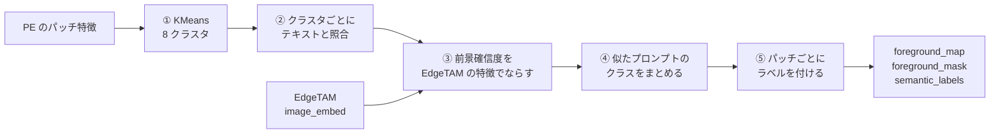
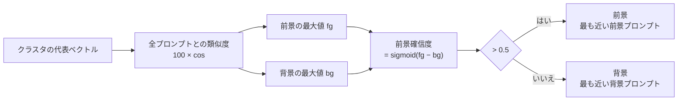
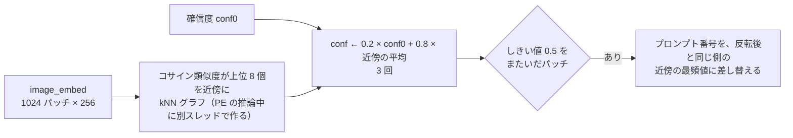
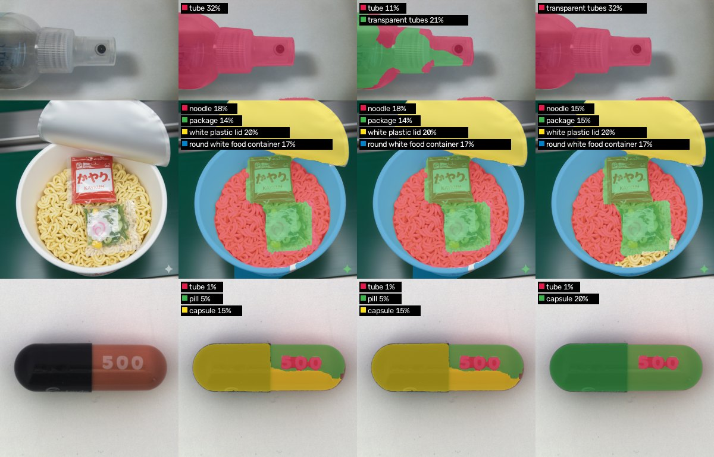

# ① 粗いセマンティックセグメンテーション

画像を 32×32 のパッチ（1 パッチ = 16 画素）に分け、**パッチごとの前景らしさ**と**粗いラベル（何の物体か）**を求める。輪郭は決めない。
`core/common/coarse_segmentation.py`（`CoarseSegmenter`）。全体は [overview.md](overview.md)、次の段階は [detailed_segmentation.md](detailed_segmentation.md)。

| | 内容 |
|---|---|
| 入力 | PE のパッチ特徴・EdgeTAM の `image_embed`・前景/背景プロンプト（`prompts/`） |
| 出力 | `foreground_map`（前景確信度 0〜1）・`foreground_mask`（確信度 > 0.5）・`semantic_labels`（粗いラベル）。すべて 32×32 |

## フロー

| 段階 | 関数 | 解決する課題 |
|---|---|---|
| ① KMeans | `fit_predict_kmeans` | パッチごとにテキストと照合すると斑点だらけになる → 似たパッチを 8 個にまとめて、判定を 8 回にする |
| ② 照合 | `_judge_clusters` | 学習なしで物体の種類を知る → 前景と背景の両方のプロンプトとの類似度で決める |
| ③ 伝播 | `_propagate_with_edgetam` | クラスタに背景の斑点が混ざる → EdgeTAM の特徴が似たパッチどうしで確信度を平均する |
| ④ まとめ | `_merge_similar_classes` | 1 つの物体が似たプロンプトの 2 クラスに割れる → 僅差・同義語のクラスを統合する |
| ⑤ ラベル | `assign_semantic_labels` | 次の段階に渡す形にする → パッチごとの連番ラベル |

**クラスタ単位で判定する代償**は、クラスタに前景と背景が混ざると全体が誤判定されること。③ がこれを減らす。

以下、コイン（3024×3024。前景が 1 種類）で示す。512×512 に縮小し、PE のパッチ 16 画素で 32×32 = 1024 パッチ。

## ① 特徴抽出と KMeans

| 特徴 | 形 | 使い道 |
|---|---|---|
| PE `fused_patch_features`（中間層を連結。第 6 層のモデルでは 192 次元、既定の第 8・9・10 層では 576 次元） | 1024 × 192 | KMeans でクラスタにまとめる |
| PE `patch_features` | 1024 × 192 | クラスタの代表ベクトルを作る（テキストと比べられる特徴） |
| EdgeTAM `image_embed` | 256 × 32 × 32 | ③ の伝播。② の EdgeTAM デコーダにも使う |

- 左は入力、中央は PE の特徴、右は EdgeTAM の特徴（主成分 3 つを RGB に）。PE の特徴は背景にもまだらな模様が出る。EdgeTAM の特徴は物体の輪郭に沿ってまとまる。
- クラスタを作る特徴と、テキストと比べる特徴は別。クラスタリングに使う層は、モデルの変換時に固定される（`convert_openvino.py --cluster-layers`）。

- faiss の KMeans で 8 クラスタ（`k_clusters`）。シード固定なので同じ入力は同じ結果になる。
- K は粗さを決める。大きいと純粋なクラスタになるが判定が不安定になる。8 は前景精度のバランス（[method_history.md](method_history.md)）。

## ② クラスタの判定

- クラスタ 2・4 は前景の最大類似度（coin）が背景より 4 ロジット以上高く、確信度 0.984・0.996 で前景。残り 6 クラスタは背景の語（shadow 系・gray metallic surface）が上回り、確信度は 0.02〜0.04。
- グループの得点は**平均でなく最大**。プロンプトは言い換えではなく選択肢の列挙なので、最も近い 1 つで代表させる。個数を変えても判定が偏らない。
- 前景と背景の差が 1 ロジット未満のクラスタは、プロンプトの小さな変更で反転する。

左は、クラスタの判定を全パッチに書き込んだ前景確信度（クラスタごとの階段状）。右はしきい値 0.5 で 2 値にしたもの。

## ③ 確信度の伝播（EdgeTAM の特徴）

- 左から、PE の判定・近傍の例（赤: 注目パッチ、黄: kNN の近傍）・伝播後・変化の大きさ。変化は物体の縁に集中し、物体の内側・背景の内側はほとんど動かない。
- 注目パッチ (18, 21) は、確信度 0.024 から 0.780 に上がって前景になった。しきい値をまたいだパッチは 16 個。

左は伝播なし、右は伝播あり（粗い前景マスク）。

**AND ではなく伝播にした理由。** 以前の「PE と EdgeTAM の両方が前景のときだけ前景」は、前景を消す方向にしか働かず、物体の一部が背景のクラスタと混ざるとその部分を失った。伝播は確信度を平均するだけなので、大きな物体は崩れにくい。追加は約 9ms。

## ④ 似たプロンプトのクラスをまとめる

`semantic_merge.py`。クラスタごとに「最も近い前景プロンプト」を選ぶので、1 つの物体の中の別のクラスタが、似たプロンプト（tube と transparent tubes など）を選ぶと、② の段階で 2 クラスに割れる。

左から、入力・元のプロンプト・`transparent tubes` 追加後（まとめなし）・現在。上: ボトル（1 → 2 → 1 クラス）、中: カップ麺（4 クラスのまま）、下: カプセル（`pill` と `capsule` の割れが消える）。

| 規則 | 条件 | 例 |
|---|---|---|
| 僅差（`merge_near_ties`） | PE のクラスタのロジット差が `PROMPT_TIE_TOLERANCE`（1.0）以内で、より大きいクラスがあれば、最大のものへ移す | tube と transparent tubes（差 0.6） |
| 同義語（`merge_synonyms_in_objects`） | プロンプトのテキスト埋め込みのコサイン距離が `PROMPT_SYNONYM_DISTANCE`（0.08）以内の組が、**1 つの物体（前景の連結成分）の中**に 2 つ以上あれば、最大のクラスにまとめる | tube / transparent tubes（類似度 0.94）、pill / capsule（0.93）、cable / wire（0.95） |

- 1.0 は、同じ画像のパッチを半分ずつにして測った 1 位のロジット差の 75% 点（0.91）に合わせた。2 を超えると、カップ麺の麺・袋・ふた・容器のような別の部品まで潰れる。
- 別の部品を指すプロンプト（noodle と package など）は、同義語の組にしない。

## ⑤ ラベルの付与

クラスタ（PE のクラスタ × 伝播後のプロンプトの組）の対応プロンプトを、パッチごとの連番ラベルにする。この画像のラベルは 4 種（前景 `coin`、背景は `faint shadow`・`diffuse shadow`・`gray metallic surface`）。② が使うのは前景ラベルのパッチだけで、前景のラベルごとに 1 クラスとして別々に切り出す。

## 複数のクラスがある画像（MVTec cable）

前景が複数のラベルになる例。1024×1024。

- 左から、入力・KMeans・粗い前景マスク・EdgeTAM に渡す点・最終結果。
- 前景は `nut` と `pill` の 2 ラベル（クラスタ 0〜2 が `nut`、確信度 0.81〜1.00。クラスタ 4 が `pill`、確信度 0.546）。クラスタ 3（0.313）は背景。判定が拮抗するクラスタは、プロンプトの選び方で前景にも背景にもなる。
- 伝播でしきい値をまたいだパッチは 64 個（コインは 16 個）。

クラスタの判定。コインと違い、前景と背景の差が小さい（拮抗する）クラスタがある。

## 設定

| キー（`configs/ov_config.yaml`） | 値 | 意味 |
|---|---|---|
| `k_clusters` / `n_iter` | 8 / 10 | KMeans のクラスタ数・反復回数 |
| `foreground_threshold` | 0.5 | 前景のしきい値 |
| `prompts_dir` | `prompts` | 前景・背景プロンプト |
| `use_edgetam_clustering` | true | ③ の伝播を使うか（false なら PE の判定だけ） |
| `model_dir` | `weights/openvino_models` | モデルのフォルダ。クラスタリングに使う PE の層は変換時に固定される（既定は第 8・9・10 層）。**この資料の画像は第 6 層のモデル（`weights/openvino_models_l6`）で作った**（作り方は [overview.md](overview.md#画像の作り方)） |

`core/common/params.py` の固定値:

| 名前 | 値 | 意味 |
|---|---|---|
| `CLIP_LOGIT_SCALE` | 100 | 類似度に掛ける係数 |
| `EDGE_PROPAGATION_ALPHA` / `_NEIGHBORS` / `_ITERATIONS` | 0.8 / 8 / 3 | 伝播の重み・近傍の数・反復（α 0.7〜0.9・近傍 4〜8 で結果は同程度、反復は 5 回でも変わらない） |
| `PROMPT_TIE_TOLERANCE` | 1.0 | 僅差とみなすロジットの差 |
| `PROMPT_SYNONYM_DISTANCE` | 0.08 | 同義語とみなすテキスト埋め込みのコサイン距離 |

## プロンプトの設計

前景は `prompts/foreground.yaml`、背景は `background.yaml`。

| 方針 | 理由 |
|---|---|
| 1 プロンプト = 1 つの概念。同義語を並べない（screw と bolt など） | 同じ物体が別クラスに割れる（④ で減らすが、まとめきれないこともある） |
| 前景と背景の語を重ねない | 差が 1 ロジット未満になると判定が反転する |
| 背景に色の語を入れない | 同じ色の物体（灰色のふたなど）が背景に引かれる |
| 影の語を背景に置く | 物体の周りの影が前景に混ざるのを減らす |
| 追加は、検出できないときだけ | 増やすほど別クラスに割れやすい。**追加したら、前景マスクだけでなくクラスの数・名前も確かめる** |

透明な筒が格子に並ぶ画像（006_syringe）のために `a photo of transparent tubes.` を足している。具体名（syringe・vial）は効かず、複数形の `tubes` だけが効く。

## 限界

- クラスタに前景と背景が混ざると全体が誤判定される。③ で減らすが、消えない。
- 粗い誤りは ② で直せない（背景を前景と判定したクラスには、正例点が背景に置かれる）。
- クラスの意味の区別は弱い。名前の区別は前景プロンプトの語彙で決まる（hazelnut と metal nut がどちらも `nut` になるなど）。
- 過去の実験（パッチごとの照合・Tiling・背景混入の軽減など）は [method_history.md](method_history.md)。
