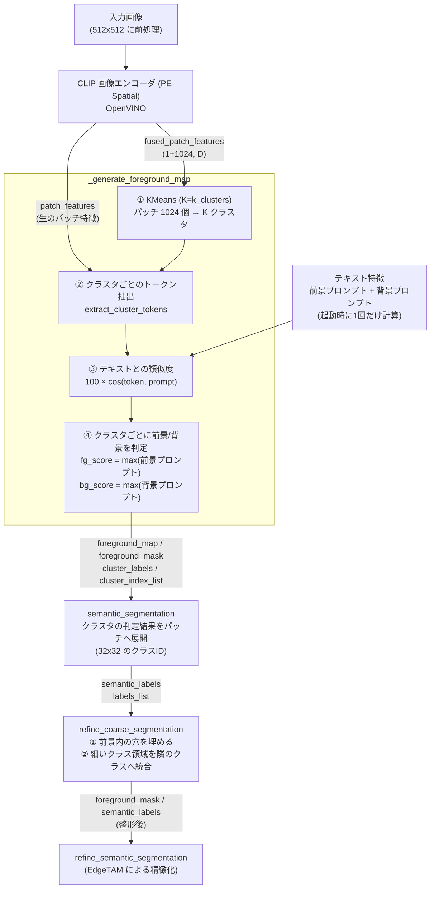
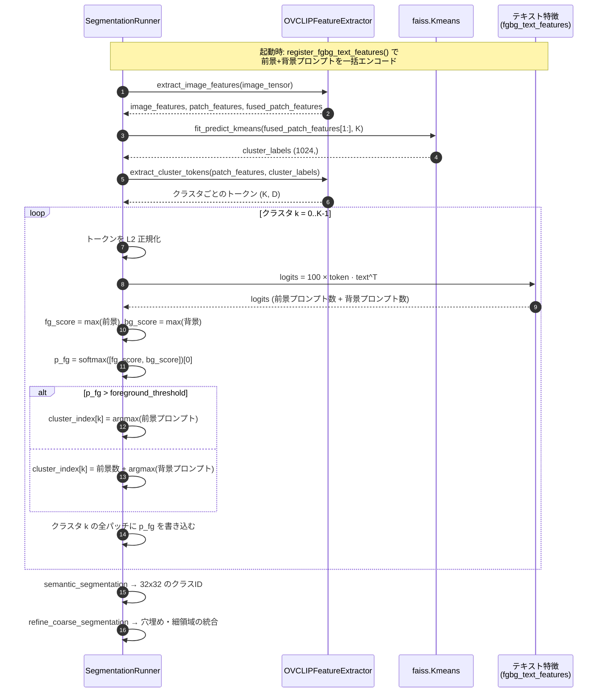
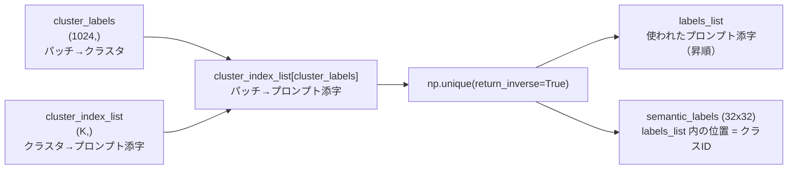
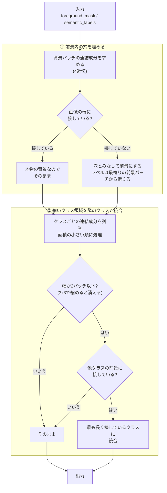

# 粗いセマンティックセグメンテーション

`SegmentationRunner._generate_foreground_map` から `refine_coarse_segmentation` までの処理（OpenVINO 版、`core/openvino/segmentation_runner.py`）をまとめる。

この段階の目的は、**CLIP の特徴とテキストプロンプトだけで、画像を 32×32 のパッチ単位に「背景 / 前景（どの種類の物体か）」へ分けること**。ここで得た粗い結果は、次段（EdgeTAM による精緻化 `refine_semantic_segmentation`）が「どこに・どのクラスのプロンプト点を置くか」の根拠として使う。したがって、ここでの誤りは最終結果の誤り（背景の広がり、物体の見逃し、クラスの割れ）に直結する。

- [1. 全体像](#1-全体像)
- [2. 処理の流れ（シーケンス）](#2-処理の流れシーケンス)
- [3. `_generate_foreground_map`](#3-_generate_foreground_map)
- [4. `semantic_segmentation`](#4-semantic_segmentation)
- [5. `refine_coarse_segmentation`](#5-refine_coarse_segmentation)
- [6. 出力画像の読み方](#6-出力画像の読み方)
- [7. 設定値・固定値](#7-設定値固定値)
- [8. 既知の失敗パターンと対処](#8-既知の失敗パターンと対処)

---

## 1. 全体像



ポイントは **判定の単位が「パッチ」ではなく「クラスタ」** であること。KMeans が似たパッチを K 個にまとめ、そのクラスタ全体に対して 1 つの判定（前景か背景か、どのプロンプトか）を下す。判定が速い反面、クラスタに背景と前景が混ざると、その全体が誤判定される。

---

## 2. 処理の流れ（シーケンス）



---

## 3. `_generate_foreground_map`

| | |
|---|---|
| 入力 | `patch_features`（生のパッチ特徴）、`fused_patch_features`（クラスタリング用の特徴） |
| 出力 | `foreground_map` (32×32, 0〜1)、`foreground_mask` (32×32, 0/1)、`cluster_labels` (1024,)、`cluster_index_list` (K,) |

### 3.1 KMeans（`fit_predict_kmeans`）

`fused_patch_features[0, 1:, :]`（CLS を除いた 1024 パッチ）を faiss の KMeans で K 個に分ける。K は `k_clusters`（既定 8）、反復は `n_iter`、シードは固定（`KMEANS_SEED = 42`）。

K は「粗さ」を決める。大きいほどクラスタが純粋になる（物体と影が分かれる）が、前景/背景の判定がクラスタ数だけ増えて不安定になる。実験では K=12, 16 でねじやトランジスタは改善した一方、cable・zipper が崩れた。

### 3.2 クラスタのトークン抽出（`extract_cluster_tokens`）

`pe_patch_logits_model`（PyTorch 版では `visual.trunk.custom_forward`）に「生のパッチ特徴」と「クラスタラベル」を渡し、**クラスタごとに 1 本の、テキストと比較できる特徴ベクトル**を得る。これがそのクラスタの「代表」になる。集約の中身は PE 側の実装（`convert_openvino.py` で変換しているカスタム forward）に依存し、このリポジトリ内では内部を持たない。

### 3.3 前景/背景の判定

クラスタ `k` の代表ベクトルを L2 正規化し、全プロンプト（前景 → 背景の順に並んだテキスト特徴）との類似度を取る。

```
logits   = 100 × token · text_features^T          # CLIP_LOGIT_SCALE = 100
fg_score = max(logits[前景プロンプト])
bg_score = max(logits[背景プロンプト])
p_fg     = softmax([fg_score, bg_score])[0]       # = sigmoid(fg_score - bg_score)
```

- **グループの集約は `max`**。プロンプトは言い換えではなく「選択肢」の列挙なので、最も近い 1 つで代表させる。平均（`logmeanexp`）にすると、プロンプトの個数を変えただけで判定が偏った。
- `p_fg > foreground_threshold`（既定 0.5）なら前景。`cluster_index_list[k]` には、前景なら**前景プロンプトの添字**、背景なら**`前景プロンプト数 + 背景プロンプトの添字`** を入れる。
- クラスタ内の全パッチに同じ `p_fg` を書き込んだものが `foreground_map`、これを閾値で 2 値化したものが `foreground_mask`。同じクラスタのパッチは同じ値になるので、`foreground_map` はクラスタごとの階段状になる。

### 3.4 判定の具体例

`001_crop`（タオルの上のコイン）で、プロンプトに `a photo of a fabric.` が入っていたときのクラスタ別の値（ロジットは `100 × cos`）。

| クラスタ | パッチ数 | 前景側の最大 | 背景側の最大 | p_fg | 判定 | 実際 |
|---|---|---|---|---|---|---|
| k2 | 113 | coin 43.9 | uniform background 39.3 | 0.99 | 前景 | コイン ✓ |
| k4 | 117 | coin 44.9 | uniform background 38.9 | 1.00 | 前景 | コイン ✓ |
| k3 | 225 | **fabric 41.3** | plain background 41.4 | 0.47 | 背景 | タオル ✓（紙一重） |
| k5 | 200 | **fabric 41.8** | plain background 41.7 | 0.53 | **前景** | タオル ✗ |
| k6 | 150 | **fabric 42.2** | plain wall 41.5 | 0.68 | **前景** | タオル ✗ |

物体（コイン）は 4〜5 ロジットの差で安定して勝つ一方、背景のタオルは前景プロンプト `fabric` と背景プロンプトが **0.1〜0.7 ロジット差**で拮抗し、判定が不安定になっている。**ロジット差が 1 未満のクラスタは、プロンプトの小さな変更で結果が反転する**と考えてよい。

---

## 4. `semantic_segmentation`

クラスタ単位の判定結果を、パッチ単位の 32×32 のクラスID マップへ展開する。



- **同じプロンプトに判定された複数のクラスタは、同じクラスIDに統合される**（例: 3 つのクラスタが全部 `coin` なら、クラスIDは 1 つ）。
- `labels_list` は昇順なので、**前景プロンプトの添字（小さい）が先、背景プロンプトの添字（`前景数 + …`）が後**に並ぶ。つまりクラスIDの小さい側が前景になる。
- クラスIDからプロンプト名に戻すには `プロンプト = labels_list[クラスID]`（前景なら `foreground_prompts[…]`）。

---

## 5. `refine_coarse_segmentation`

クラスタ単位の判定が作るノイズを、パッチ格子上の形（連結成分）を使って整える。入力は `semantic_labels`、`foreground_mask`。出力は整形後の `(foreground_mask, semantic_labels)`。**判定の根拠（プロンプトとの類似度）は変えず、形だけを整える**。



### 5.1 穴埋め

反射や透明部などで、物体の内側に背景と判定されたパッチが残ることがある。

```
前景=# 背景=.                      穴埋め後
. . . . . . .                     . . . . . . .
. # # # # # .                     . # # # # # .
. # . . # # .   ← 内側の .         . # # # # # .
. # # # # # .     は端に接して     . # # # # # .
. . . . . . .     いない → 穴     . . . . . . .
```

- 判定は **「画像の端に接していない背景の連結成分」はすべて穴**。**面積のしきい値は無い**（大きさに関係なく埋める）。
- 埋めたパッチのラベルは、元の前景のうち最も近いパッチのラベル（距離変換のインデックス）を使う。
- 穴埋めは「粗いマスクを物体単位でつなぐ」ためのもの。最終的な形は EdgeTAM が決めるので、ワッシャーの穴のような本物の穴を埋めても、後段で除かれる。

### 5.2 細いクラス領域の統合

物体の縁や影のパッチは、物体と背景の特徴が混ざり、物体の内側とは別のクラスタ（＝別プロンプト）になりやすい。結果として、コインの周りに別クラスの輪ができる。

```
コインの周りに別クラス(R)の輪ができた状態            統合後
. . . . . . . . .                                    . . . . . . . . .
. . R R R R R . .                                    . . C C C C C . .
. R R C C C R R .      R の幅は1〜2パッチ             . C C C C C C C .
. R C C C C C R .      → 縮めると消える               . C C C C C C C .
. R R C C C R R .      → C(コイン)に接している         . C C C C C C C .
. . R R R R R . .      → C に統合                     . . C C C C C . .
. . . . . . . . .                                    . . . . . . . . .
```

- 「**細い**」の定義は、そのクラス領域（4 近傍の連結成分）を 3×3 で縮めたとき**何も残らない**こと（幅 2 パッチ以下）。`PATCH_NEIGHBORHOOD = 3`。
- 「**接している**」は、領域を 3×3 で 1 回広げた輪の中に、**別クラスの前景**パッチがあること。背景にしか接していない細い領域（細いケーブルなど）は**統合されない**。
- 統合先は、輪の中で**最も多く接しているクラス**。
- 面積の小さい領域から順に処理する（先に統合された結果が、後の判定に反映される）。
- **「他のクラスに完全に囲まれた小さなクラスを統合する」処理は入っていない。** 基板の上のねじのような、本当に別の物体が消えるのを避けるため。

### 5.3 この段階が直さないもの

次のような誤りは形では直らない（判定そのものの誤り）。

- 背景のクラスタが前景と判定された（背景がまるごと前景になる）
- 物体のクラスタが背景と判定された（物体の見逃し）
- 同じ物体が別のプロンプトに割れた（`syringe` と `bolt` など）

これらは §8 のとおり、主にプロンプトで対処する。

---

## 6. 出力画像の読み方

`output_dir/<画像名>/` に次の画像が出る。

| ファイル | 内容 |
|---|---|
| `coarse_semantic_segmentation_raw.png` | `semantic_segmentation` の直後（整形前）の `semantic_labels` |
| `coarse_semantic_segmentation.png` | `refine_coarse_segmentation` の後（整形後）の `semantic_labels` |
| `foreground_map.png` | `foreground_map`（クラスタごとの `p_fg`。階段状） |
| `foreground_mask.png` | 整形後の `foreground_mask` |
| `layer_fused_k8.png` | KMeans のクラスタ分け（色はクラスタID） |
| `foreground_overlay.png` | 前景マスクと EdgeTAM に渡した点（緑=正例、赤=負例） |

**`coarse_semantic_segmentation*.png` の色について**: 色は `config` の `color_palette` を**クラスID**で引いたもの（0=黒、1=赤、2=緑、3=青、4=黄…）。`labels_list` は昇順なので、**前景プロンプトが当たったクラスほど小さいID（黒・赤…）、背景プロンプトが当たったクラスほど大きいID**になる。画像ごとに前景のクラス数が違うため、「黒＝前景」と決めつけず、前景が何クラスあるかで境界が変わる点に注意する（前景クラスが 2 つなら、黒と赤が前景で、緑以降が背景）。

---

## 7. 設定値・固定値

| 名前 | 値 | 場所 | 意味 |
|---|---|---|---|
| `k_clusters` | 8 | `configs/ov_config.yaml` | KMeans のクラスタ数 |
| `n_iter` | 10 | 同上 | KMeans の反復回数 |
| `foreground_threshold` | 0.5 | 同上 | `p_fg` がこの値を超えたクラスタを前景とする |
| `image_size` | 512 | 同上 | 入力サイズ。パッチ 16px なので 32×32 パッチ（`feature_size`） |
| `prompts_dir` | — | 同上 | `foreground.yaml` / `background.yaml` のあるディレクトリ |
| `CLIP_LOGIT_SCALE` | 100.0 | `segmentation_runner.py` 冒頭 | 類似度（cos）に掛ける係数 |
| `KMEANS_SEED` / `FAISS_NUM_THREADS` | 42 / 2 | 同上 | KMeans の再現性・スレッド数 |
| `PATCH_NEIGHBORHOOD` | 3 | 同上 | 「細い」「接している」「内側」の判定に使う近傍（= 1 パッチ分） |

固定値は `segmentation_runner.py` 冒頭の「固定ハイパーパラメータ」ブロックにまとまっている。

---

## 8. 既知の失敗パターンと対処

| 症状 | 原因 | 対処 |
|---|---|---|
| 背景（タオル・カーペットなど）が前景になる | 背景の質感が前景プロンプト（例: `fabric`）に近い。前景/背景の最大類似度が 1 ロジット未満の差で拮抗する（§3.4） | 背景と同じ素材を表す前景プロンプトを外す。外せない場合は背景側に同素材の語を足す（ただし同素材の物体が検出しにくくなる） |
| 背景の一部のクラスタだけが前景になり、斑点状に残る | 前景・背景の最大類似度がどちらも低い（例: 36.5 対 36.0）クラスタ。どちらのプロンプトにも合わず、判定が偶然に決まる | 背景側に「textured background」のような総称を足すと消えるが、textile の物体（zipper）が背景になりやすくなる。判定の信頼度（両スコアの絶対値）を使う構造的な対処が候補 |
| 灰色の物体（ホイルのふたなど）が背景になる | 色の語を含む背景プロンプト（`gray background` など）に近づく | 背景プロンプトから色の語を外す（`prompts/candidates/color_free_bg/` がその例） |
| 同じ物体が別クラスに割れる | 近い意味のプロンプトを複数入れている（`screw` と `bolt`） | 1 プロンプト=1 概念にし、同義語を並べない |
| カップと麺のように、別物体が同じクラスになる | 同じクラスタに入ってしまう（K が小さい） | K を大きくすると改善するが、他で不安定になる。EdgeTAM 側の対処が必要 |

### プロンプトを変えたときの確認

`tools/eval_prompts.py` で、MVTec AD の物体 10 カテゴリを使い、前景 IoU・最小 IoU・クラスの割れやすさ（frag）を測れる。

```bash
python tools/eval_prompts.py                              # config の prompts_dir を評価
python tools/eval_prompts.py --prompts-dir ./prompts/xxx  # 候補ディレクトリを評価
python tools/eval_prompts.py --set k_clusters=12          # config の値を上書きして評価
```

MVTec にない画像（自前の画像）は正解マスクがないので、`develop.py` の出力画像を目で見て確認する。前景/背景の判定が拮抗していないかは、§3.4 のように**クラスタごとの前景側・背景側の最大類似度を並べて見る**のが早い。
