# ① 粗いセマンティックセグメンテーション

画像を 32×32 のパッチ（1 パッチ = 16 画素）に分け、**パッチごとの前景らしさ**と**粗いラベル（何の物体か）**を求める。輪郭は決めない。
`core/common/coarse_segmentation.py`（`CoarseSegmenter`）。全体は [overview.md](overview.md)、次の段階は [detailed_segmentation.md](detailed_segmentation.md)。

| | 内容 |
|---|---|
| 入力 | PE のパッチ特徴・EdgeTAM の `image_embed`・前景/背景プロンプト（`prompts/`） |
| 出力 | `foreground_map`（前景確信度 0〜1）・`foreground_mask`（確信度 > 0.5）・`semantic_labels`（粗いラベル）。すべて 32×32 |

## フロー

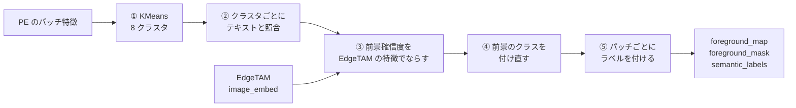

| 段階 | 関数 | 解決する課題 |
|---|---|---|
| ① KMeans | `fit_predict_kmeans` | パッチごとにテキストと照合すると斑点だらけになる → 似たパッチを 8 個にまとめて、判定を 8 回にする |
| ② 照合 | `_judge_clusters` | 学習なしで物体の種類を知る → 前景と背景の両方のプロンプトとの類似度で決める |
| ③ 伝播 | `_propagate_with_edgetam` | クラスタに背景の斑点が混ざる → EdgeTAM の特徴が似たパッチどうしで確信度を平均する |
| ④ 付け直し | `_relabel_foreground` | 1 つの物体が似たプロンプトの別クラスに割れる・種類の違う物体が同じクラスになる・隣り合う部品の境目でクラスが入り混じる → 前景だけのブロックの根拠で、名前を判定し直し・統合し・境目を整える |
| ⑤ ラベル | `assign_semantic_labels` | 次の段階に渡す形にする → パッチごとの連番ラベル |

**クラスタ単位で判定する代償**は、クラスタに前景と背景が混ざると全体が誤判定されること。③ がこれを減らす。

以下、コイン（3024×3024。前景が 1 種類）で示す。512×512 に縮小し、PE のパッチ 16 画素で 32×32 = 1024 パッチ。

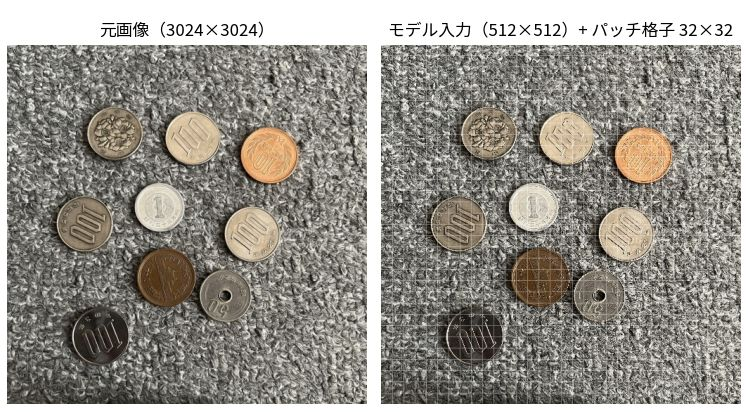

## ① 特徴抽出と KMeans

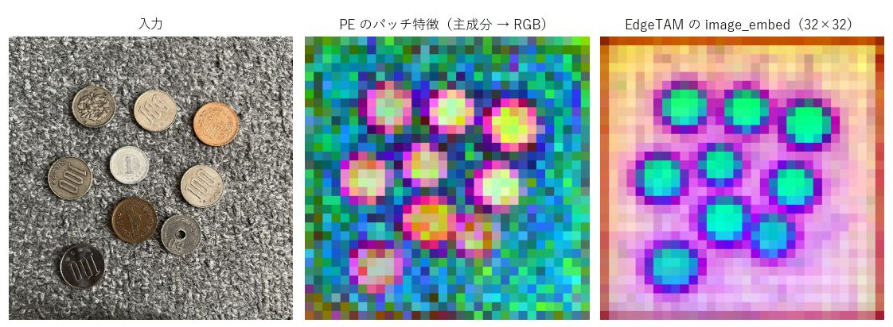

| 特徴 | 形 | 使い道 |
|---|---|---|
| PE `fused_patch_features`（中間層を連結。第 6 層のモデルでは 192 次元、既定の第 8・9・10 層では 576 次元） | 1024 × 192 | KMeans でクラスタにまとめる |
| PE `patch_features` | 1024 × 192 | クラスタの代表ベクトルを作る（テキストと比べられる特徴） |
| EdgeTAM `image_embed` | 256 × 32 × 32 | ③ の伝播。② の EdgeTAM デコーダにも使う |

- 左は入力、中央は PE の特徴、右は EdgeTAM の特徴（主成分 3 つを RGB に）。PE の特徴は背景にもまだらな模様が出る。EdgeTAM の特徴は物体の輪郭に沿ってまとまる。
- クラスタを作る特徴と、テキストと比べる特徴は別。クラスタリングに使う層は、モデルの変換時に固定される（`convert_openvino.py --cluster-layers`）。

- faiss の KMeans で 8 クラスタ（`k_clusters`）。シード固定なので同じ入力は同じ結果になる。
- K は粗さを決める。大きいと純粋なクラスタになるが判定が不安定になる。8 は前景精度のバランス（[method_history.md](method_history.md)）。

## ② クラスタの判定

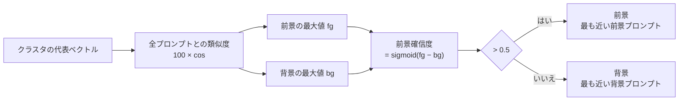

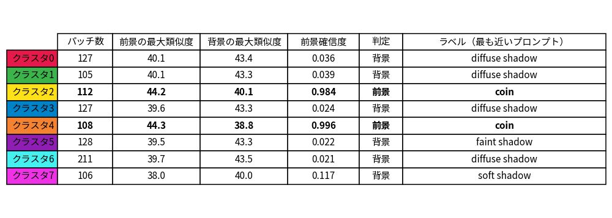

- クラスタ 2・4 は前景の最大類似度（coin）が背景より 4 ロジット以上高く、確信度 0.984・0.996 で前景。残り 6 クラスタは背景の語（shadow 系・gray metallic surface）が上回り、確信度は 0.02〜0.04。
- グループの得点は**平均でなく最大**。プロンプトは言い換えではなく選択肢の列挙なので、最も近い 1 つで代表させる。個数を変えても判定が偏らない。
- 前景と背景の差が 1 ロジット未満のクラスタは、プロンプトの小さな変更で反転する。

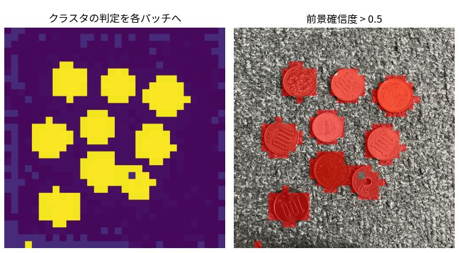

左は、クラスタの判定を全パッチに書き込んだ前景確信度（クラスタごとの階段状）。右はしきい値 0.5 で 2 値にしたもの。

## ③ 確信度の伝播（EdgeTAM の特徴）

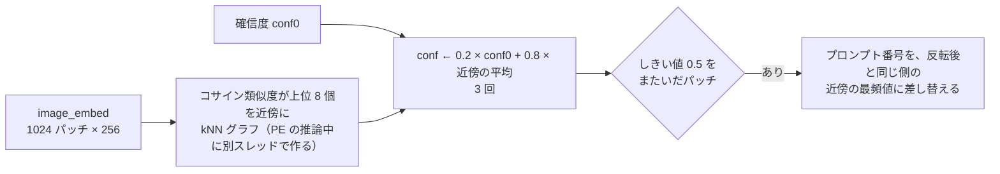

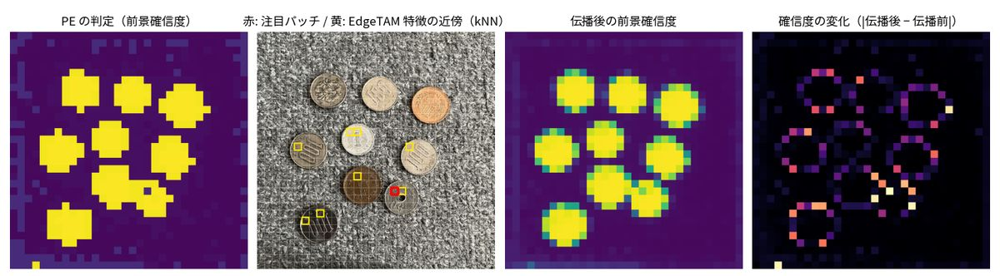

- 左から、PE の判定・近傍の例（赤: 注目パッチ、黄: kNN の近傍）・伝播後・変化の大きさ。変化は物体の縁に集中し、物体の内側・背景の内側はほとんど動かない。
- 注目パッチ (18, 21) は、確信度 0.024 から 0.780 に上がって前景になった。しきい値をまたいだパッチは 16 個。

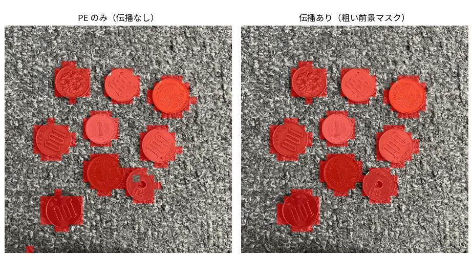

左は伝播なし、右は伝播あり（粗い前景マスク）。

**AND ではなく伝播にした理由。** 以前の「PE と EdgeTAM の両方が前景のときだけ前景」は、前景を消す方向にしか働かず、物体の一部が背景のクラスタと混ざるとその部分を失った。伝播は確信度を平均するだけなので、大きな物体は崩れにくい。追加は約 9ms。

## ④ 前景のクラスの付け直し

`region_relabel.py`。② は画像全体を K = 8 個にクラスタリングして、クラスタごとにプロンプトを選ぶ。クラスタは背景を含み、代表トークンは画像全体の CLS に引っ張られるので、次の 3 つが起こる。

| 起こること | 例 |
|---|---|
| 1 つの物体が、似たプロンプトの別クラスに割れる | tube と transparent tubes・pill と capsule |
| 種類の違う物体が、同じクラスになる | 画像に散らばった複数の種類の部品が、どれも 1 つのクラス（`screw` など）になる |
| 見た目も言葉も近い部品の境目で、クラスがパッチ単位で入り混じる | ふた（`white plastic lid`）とカップ（`round white food container`）。ロジット差は 1〜2 でノイズと同程度 |

前景のパッチだけを部品ごとのブロックに分け直し、CLS を含まない `extract_region_tokens` で前景プロンプトと照合して、3 段で整える（前景マスクは変えない）。

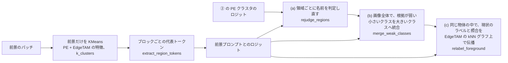

ふた・カップ・麺・包装（隣り合う部品の境目）:

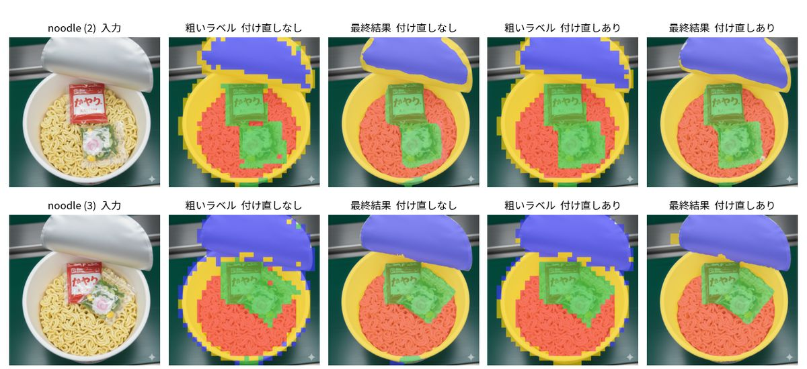

左から、入力・粗いラベル（なし）・最終結果（なし）・粗いラベル（あり）・最終結果（あり）。「なし」は ④ を切った（② のクラスタが付けたラベルのまま）もの。ふたの縁・カップの縁に混ざっていた別のクラスが整う。

種類の違う物体（MVTec の部品を背景に貼り付けた合成画像。どれも複数の種類の部品）:

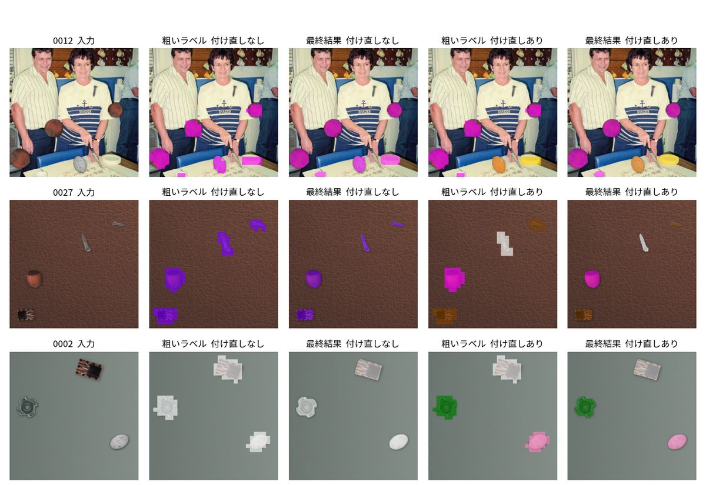

「なし」は 1 種類のクラスにまとまっていたものが、種類ごとに別のクラスになる。

| 段 | 関数 | 内容 |
|---|---|---|
| ブロック | `_relabel_foreground` | 前景のパッチだけを、PE の fused 特徴と EdgeTAM の `image_embed`（それぞれ L2 正規化して並べる）で KMeans する。ブロック数は `k_clusters`。EdgeTAM の特徴が部品の輪郭に沿うので、PE だけより純度が高い（カップ麺で homogeneity 0.82 → 0.93）。ブロックの代表トークンは `extract_region_tokens`（パッチの value の平均。CLS を含まない）なので、数パッチの小さなブロックでも画像全体の CLS に引っ張られず、それらしい前景プロンプトに紐づく |
| (a) 判定し直し | `rejudge_regions` | 領域（物体 = 前景の 8 連結成分 × 今のクラス）ごとに、領域のパッチで平均した **PE クラスタのロジット + ブロックのロジット** が最も強い前景プロンプトを付け直す。新しい名前も許すので、種類の違う物体が分かれる。PE クラスタのロジットは今のラベルを選んだ根拠なので、ブロックの根拠が決め手になるときだけ名前が変わる。**1 ブロックの平均面積（前景のパッチ数 / `k_clusters`）より小さい領域は、独立した根拠を持てない（ノイズに引きずられる）ので、今のラベルのまま** |
| (b) 統合 | `merge_weak_classes` | 画像全体の前景で、面積の小さいクラスから順に、領域のブロックのロジットを平均した対数オッズ `mean[L(c) − L(b)] + log(面積 c / 面積 b)` が正で最大の、より大きいクラス c へ、まるごと移す（繰り返す）。ロジットは CLIP の確率の対数の単位なので、「大きいクラスに有利か」は面積比（事前分布）と足し引きするだけで、僅差の幅（しきい値）は要らない。根拠が僅差の割れ（tube と transparent tubes）は消え、ブロックの根拠が自分のクラスを大きく上回る別の部品（ふたとカップ）は残る |
| (c) 付け直し | `relabel_foreground` | 同じ物体の中だけで、0.5 × 現状のラベル（one-hot）+ 0.5 × ブロックの照合の softmax（候補は、同じ物体の中に現状のラベルがあるクラスだけ）を、その物体の前景のパッチどうしの辺だけを残した EdgeTAM の kNN グラフで、③ と同じ α・反復（0.8・3 回）で伝播して、パッチごとに最も強いクラスを選ぶ。部品の境目で入り混じったクラスが整う |

領域が 1 つしか無い画像（1 つの物体が 1 クラス）は、比べる相手が無いので何もしない（KMeans も照合も省く）。どの物体も 1 クラスなら (c) を省く。

効果。カップ麺 3 枚は、ふた・カップ・麺・包装を手作りの正解と比べた最終マップの画素単位。全 622 枚は、前景 IoU・クラスの数・種類別合成（部品の種類の正解つき）での種類の分離（V 値）:

| | 旧: 僅差・同義語の統合のみ | **現在** |
|---|---|---|
| カップ麺 3 枚 部品の分離（V） / クラス名の正解率 | 0.829 / 0.929 | **0.892 / 0.960** |
| 種類別合成 120 枚 種類の分離（V）/ homogeneity / completeness | 0.241 / 0.238 / 0.907 | **0.424** / 0.386 / 0.934 |
| 前景 IoU: MVTec / verify / 種類別合成 / 格子 | 0.8397 / 0.8192 / 0.6989 / 0.3621 | 0.8404 / 0.8186 / 0.6986 / 0.3587 |
| 2 クラス以上に割れる単一物体の画像（351 枚） | 67 | **63** |
| COCO・D2S 1 画像あたりのクラス数 | 1.425 | **1.192** |

- 前景 IoU は変わらない（旧との差の 95% 区間はすべて 0 を含む。IoU が 0.05 以上動いた画像は悪化 6・改善 6 枚で偏りが無い）。種類別合成の V は +0.19（95% 区間 +0.12〜+0.26）。
- パラメータは **2 つ減った**（`PROMPT_TIE_TOLERANCE`・`PROMPT_SYNONYM_DISTANCE`）。新しいパラメータは無い（`k_clusters`・`CLIP_LOGIT_SCALE`・`EDGE_PROPAGATION_ALPHA`・`_ITERATIONS` を使う）。同義語の組は、テキストの類似度 0.92 のふた・カップと 0.94 の tube / transparent tubes の間で切っていた（0.02 の差）が、根拠の強さで分けるので、プロンプトを足しても調整が要らない。
- **ブロックの根拠だけで決めない**。本体のトークン（CLS 込み）よりロジットのノイズが大きく（1 つの物体を半分にしたときの差の中央値 0.96 対 0.67）、照合だけだと単一の物体が 1.4 → 3.0 クラスに割れる。(a) は PE クラスタの根拠と足し、(c) は現状のラベルと混ぜる。(b) では PE クラスタの根拠を足さない（今のラベルは、その根拠の最大で選ばれているので、足すと割れを残す方向に偏る。足すと割れる画像が 65 → 86 枚）。
- 処理時間: 段階 1 回で平均 2〜4ms（最大 8ms。KMeans 3ms・region トークン 1.2ms・伝播 1.2ms）。旧（統合 + 付け直し）との差は 1 画像あたり +2.4ms（207 枚を交互に 3 周測定）。
- 効果の測定と、採らなかった案は [method_history.md](method_history.md)。

## ⑤ ラベルの付与

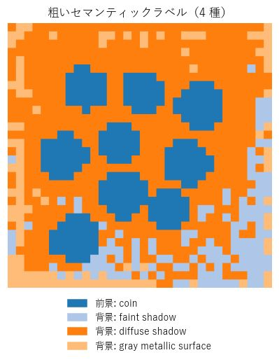

クラスタ（PE のクラスタ × 伝播後のプロンプトの組）の対応プロンプトを、パッチごとの連番ラベルにする。この画像のラベルは 4 種（前景 `coin`、背景は `faint shadow`・`diffuse shadow`・`gray metallic surface`）。② が使うのは前景ラベルのパッチだけで、前景のラベルごとに 1 クラスとして別々に切り出す。

## 複数のクラスがある画像（MVTec cable）

前景が複数のラベルになる例。1024×1024。

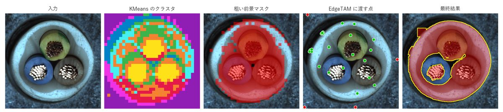

- 左から、入力・KMeans・粗い前景マスク・EdgeTAM に渡す点・最終結果。
- 前景は `nut` と `pill` の 2 ラベル（クラスタ 0〜2 が `nut`、確信度 0.81〜1.00。クラスタ 4 が `pill`、確信度 0.546）。クラスタ 3（0.313）は背景。判定が拮抗するクラスタは、プロンプトの選び方で前景にも背景にもなる。
- 伝播でしきい値をまたいだパッチは 64 個（コインは 16 個）。

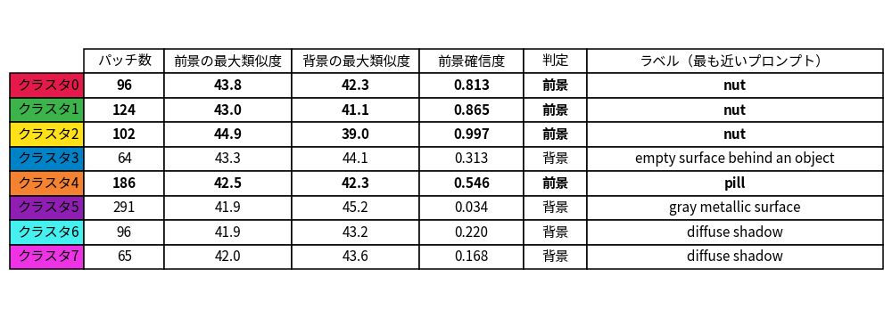

クラスタの判定。コインと違い、前景と背景の差が小さい（拮抗する）クラスタがある。

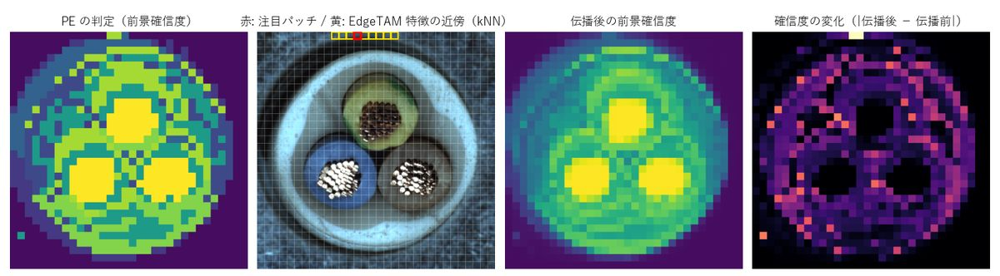

## 設定

| キー（`configs/ov_config.yaml`） | 値 | 意味 |
|---|---|---|
| `k_clusters` / `n_iter` | 8 / 10 | KMeans のクラスタ数・反復回数（④ の前景のブロック数にも使う） |
| `foreground_threshold` | 0.5 | 前景のしきい値 |
| `prompts_dir` | `prompts` | 前景・背景プロンプト |
| `model_dir` | `weights/openvino_models` | モデルのフォルダ。クラスタリングに使う PE の層は変換時に固定される（既定は第 8・9・10 層）。**この資料の画像は第 6 層のモデル（`weights/openvino_models_l6`）で作った**（作り方は [overview.md](overview.md#画像の作り方)） |

`core/common/params.py` の固定値:

| 名前 | 値 | 意味 |
|---|---|---|
| `CLIP_LOGIT_SCALE` | 100 | 類似度に掛ける係数 |
| `EDGE_PROPAGATION_ALPHA` / `_NEIGHBORS` / `_ITERATIONS` | 0.8 / 8 / 3 | 伝播の重み・近傍の数・反復（α 0.7〜0.9・近傍 4〜8 で結果は同程度、反復は 5 回でも変わらない）。④ のクラスの伝播も α・反復を使う |

## プロンプトの設計

前景は `prompts/foreground.yaml`、背景は `background.yaml`。

| 方針 | 理由 |
|---|---|
| 1 プロンプト = 1 つの概念。同義語を並べない（screw と bolt など） | 同じ物体が別クラスに割れる（④ で減らすが、戻しきれないこともある） |
| 前景と背景の語を重ねない | 差が 1 ロジット未満になると判定が反転する |
| 背景に色の語を入れない | 同じ色の物体（灰色のふたなど）が背景に引かれる |
| 影の語を背景に置く | 物体の周りの影が前景に混ざるのを減らす |
| 追加は、検出できないときだけ | 増やすほど別クラスに割れやすい。**追加したら、前景マスクだけでなくクラスの数・名前も確かめる** |

透明な筒が格子に並ぶ画像（006_syringe）のために `a photo of transparent tubes.` を足している。具体名（syringe・vial）は効かず、複数形の `tubes` だけが効く。

## 限界

- クラスタに前景と背景が混ざると全体が誤判定される。③ で減らすが、消えない。
- 粗い誤りは ② で直せない（背景を前景と判定したクラスには、正例点が背景に置かれる）。
- 1 つの物体の別の部品が 1 つのクラスにまとめられていれば、④ は分けられない（(a) は領域ごと、(c) は候補が現状のクラスだけ）。
- (a) は新しい名前を作る。1 ブロックより大きい領域は、その領域だけの根拠で名前が変わる（種類別合成で割れた種類が 21 → 22）。1 ブロックより小さい領域（前景の誤検出の数パッチなど）は今のラベルのまま残る。
- MVTec の transistor・metal_nut・bottle・capsule などで、ブロックの根拠が 1 つの物体の中で分かれ、2 クラスのまま残ることがある（単一物体の画像 351 枚のうち 63 枚）。
- ふたの折り返しの縁のように、背景に接する 1 パッチ幅の帯は、特徴が背景と混ざって根拠が弱く、隣の部品のクラスのまま残ることがある。
- クラスの意味の区別は弱い。名前の区別は前景プロンプトの語彙で決まる（hazelnut と metal nut がどちらも `nut` になるなど）。
- 過去の実験（パッチごとの照合・Tiling・背景混入の軽減など）は [method_history.md](method_history.md)。
