# ① 粗いセマンティックセグメンテーション

画像を 32×32 のパッチ格子に分け、**パッチごとの前景らしさ**と**粗いラベル（何の物体か）**を求める。`core/common/coarse_segmentation.py`（`CoarseSegmenter`）。

全体は [overview.md](overview.md)、この結果を受け取る段階は [detailed_segmentation.md](detailed_segmentation.md)。

| | 内容 |
|---|---|
| 入力 | PE のパッチ特徴・EdgeTAM の `image_embed`・前景/背景プロンプト |
| 出力 | `foreground_map`（前景確信度 0〜1）・`foreground_mask`（確信度 > 0.5）・`semantic_labels`（粗いラベル）。すべて 32×32 |
| 役割 | 「だいたいどこに何があるか」。**輪郭は決めない**（最終的な形は EdgeTAM が決める） |

## フロー

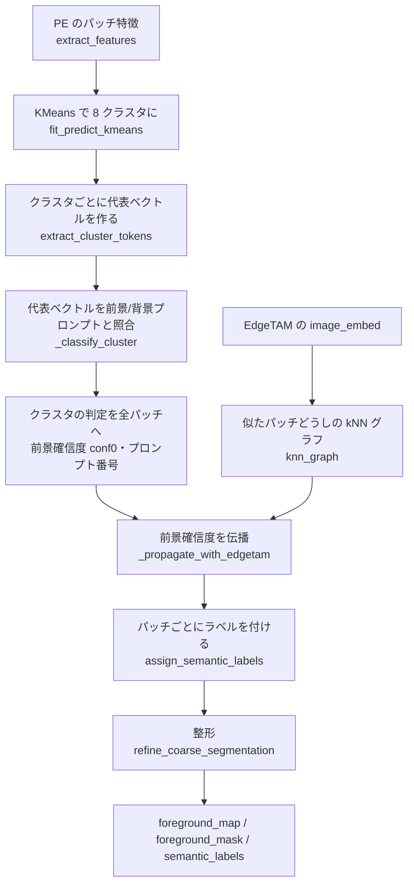

## なぜこのフローなのか

各ステップは、次の課題に 1 つずつ答える形でできている。

| 課題 | 対策 | メリット |
|---|---|---|
| 学習なしで物体の種類を知りたい | PE の特徴とテキストを比べる（前景/背景プロンプト） | 物体の種類を増やすときは文を足すだけ。学習もアノテーションも要らない |
| パッチごとにテキストと照合すると、結果が斑点だらけになる | **KMeans でクラスタにまとめ、クラスタ単位で 1 回判定** | 代表ベクトルでノイズが平均され、判定が安定。判定は 8 回で済み、領域がまとまる |
| 前景プロンプトだけだと、全部が前景になる | **背景のプロンプトも置いて**、どちらに近いかで決める | 背景に何を書くかで、前景/背景の境目を決められる |
| クラスタに背景の斑点・織り目が混ざる（PE のクラスタは意味は近いが、空間的にばらける） | **EdgeTAM の特徴が似たパッチどうしで確信度をならす（伝播）** | EdgeTAM の特徴は物体の輪郭に沿ってまとまる。斑点は周りの背景に引かれて消え、大きな物体は崩れない |
| 反射・透明部で、前景の内側に穴が開く | 穴埋め（端に接しない背景を前景に） | 物体を 1 つの連結成分にできる |
| 物体の縁・影に、別クラスの細い輪ができる | 細いクラス領域を接するクラスに統合 | 1 つの物体が複数クラスに割れるのを防ぐ |
| 32×32 では輪郭が荒い | **形は決めすぎない**。根拠（類似度）は変えず、連結成分だけ整える | 輪郭は後段の EdgeTAM に任せる |

**クラスタ単位で判定する代償**は、クラスタに前景と背景が混ざると、そのクラスタ全体が誤判定されること。これを補うのが伝播と整形。

## 処理の流れ（コイン画像とカップ麺の画像）

各ステップを**コイン画像**（3024×3024）で示し、直下に**カップ麺の画像**（1024×1024、同じ設定）の場合を併記する。コインは「前景が 1 種類で背景が単純」、カップ麺は「前景が複数種類で、白い物体が背景に近い」例。

### 0. 前処理

関数: `make_layout` / `ImageLayout.apply` / `normalize_image`（`image_layout.py`・`core/utils.py`）

- 3024×3024 を 512×512 にリサイズ（`resize_mode: fit`。正方形なので縦横比は変わらない）。
- PE のパッチサイズは 16px。**32×32 = 1024 パッチ**になる。以降の「粗い結果」はすべてこの格子の上にある。
- 正方形でない画像では、格子は長方形になる（`layout.valid_grid`）。

**カップ麺の場合**

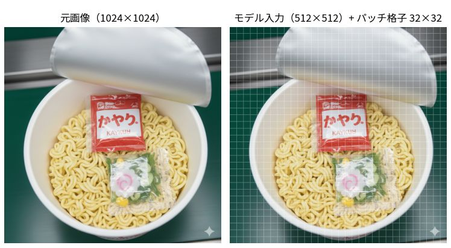

- 1024×1024 を 512×512 に縮小。同じ 32×32 の格子になる。

### 1. 特徴抽出

関数: `SegmentationRunner.segment` → `predict_encoder`（EdgeTAM）・`extract_features`（PE）

主成分 3 つを RGB にして可視化した。

| 特徴 | 次元 | 使い道 |
|---|---|---|
| PE `fused_patch_features`（中間層 6 のパッチ特徴） | 1024 × 192 | KMeans でクラスタにまとめる |
| PE `patch_features`（生のパッチ特徴） | — | クラスタの代表ベクトルを作る（テキストと比べられる特徴） |
| EdgeTAM `image_embed` | 256 × 32 × 32 | 前景確信度の伝播。②の EdgeTAM デコーダにも使う |

- PE の特徴はコインと背景を分けるが、**背景にもまだらな模様が出る**（カーペットの織り目）。
- EdgeTAM の特徴は**コインの輪郭に沿ってきれいにまとまる**。PE にない性質なので、伝播に使う。
- クラスタを作る特徴（中間層）と、テキストと比べる特徴（生のパッチ特徴）は別。クラスタリングに使う層を変えるだけで粗い判定の誤りが変わるので、独立に調整できるようにしてある。
- EdgeTAM のエンコードは、ここで 1 回だけ実行して②でも使い回す。

**カップ麺の場合**

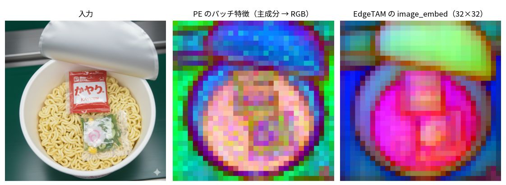

- PE の特徴は、麺（桃）・フタ（青）・容器の縁（青紫）を分けるが、フタの中は**濃淡がまだら**になる。
- EdgeTAM の特徴は、フタが**一様な緑**、麺が一様な桃でまとまる。まだらなフタを EdgeTAM の特徴でならせる、というのが伝播（§4）の狙い。

### 2. KMeans

関数: `fit_predict_kmeans`

- 1024 パッチを、faiss の KMeans で `k_clusters = 8` 個に分ける。シード固定なので、同じ入力は同じ結果になる。
- コインは**内側（橙）と縁（黄）の 2 つのクラスタ**に分かれ、残り 6 つはカーペットに使われた。
- コインの周りを囲む赤いクラスタは、物体の縁・影のパッチ（物体と背景の特徴が混ざる）。これが後の「細い領域の統合」が対象にする輪になりうる。
- **K は粗さを決める。** 大きいと純粋なクラスタになるが、判定の数が増えて不安定になる。実験では 12・16 で改善する画像もあったが、cable・zipper が崩れた。8 は両者のバランス。

**カップ麺の場合**

- フタ（青）・容器の縁（水色）・麺（緑と黄）が、それぞれ別のクラスタになる。
- **麺は緑と黄の 2 つに割れる**。黄のクラスタは、かやく袋・スープ袋と、その右側の麺の一部をまとめて含む。袋と麺は、PE の特徴では別のクラスタにならない。
- 背景（緑の面・金属の台）は、赤・紫・桃などに分かれる。

### 3. クラスタの判定

関数: `extract_cluster_tokens` → `_judge_clusters` → `_classify_cluster`

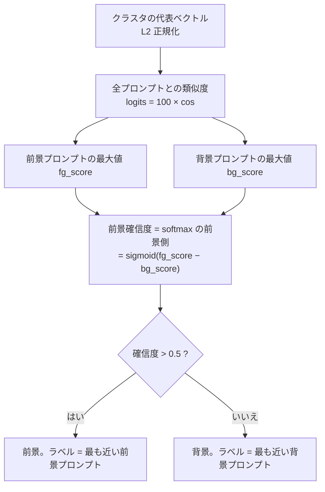

- コインの 2 クラスタ（2・4）は、前景の最大類似度（coin）が背景より 4 ロジット以上高く、確信度 0.98〜1.00 で前景になった。
- カーペットの 6 クラスタは、背景（shadow 系）が 2〜4 ロジット高く、確信度 0.02〜0.12 で背景になった。
- **最大値を使う理由**: プロンプトは「言い換え」ではなく「選択肢」の列挙（screw と washer は別の物体）。最も近い 1 つで代表させる。平均だと、プロンプトの個数を変えただけで判定が偏る。
- **判定が拮抗するクラスタは不安定**: 前景と背景の差が 1 ロジット未満だと、プロンプトの小さな変更で反転する。前景と背景のプロンプトの意味を重ねないのは、このため（[プロンプトの設計](#プロンプトの設計)）。

**カップ麺の場合**

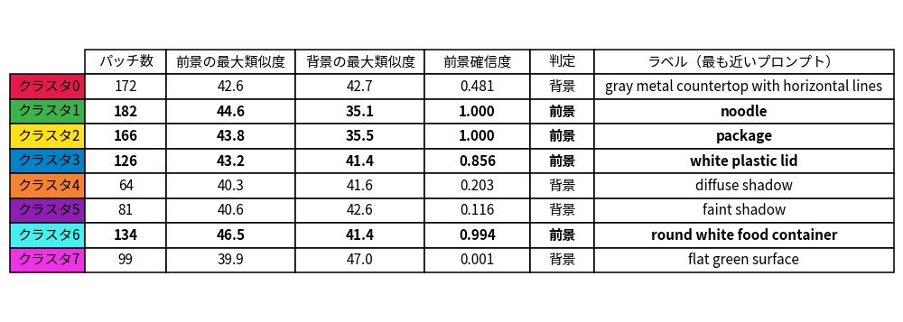

- 前景は 4 クラスタで、ラベルは `noodle`・`package`・`white plastic lid`・`round white food container`。背景は影・緑の面・金属の台。
- コインと違い、**判定が拮抗するクラスタがある**。クラスタ 0（金属の台）は前景 42.6・背景 42.7 で、確信度 0.481。しきい値の手前で背景になっただけで、プロンプトを少し変えると反転する。
- フタ（クラスタ 3）は前景 43.2 に対し、背景（faint shadow）も 41.4 と高く、差は 2 ロジット以下。確信度は 0.856 にとどまる。コインの 2 クラスタ（4 ロジット以上の差）ほど前景に寄らない。

クラスタの判定を、そのクラスタの全パッチに書き込む。

- 左は**クラスタごとの階段状**の確信度。右のように、コインの四方に 1 パッチの出っ張り（縁のパッチ）が付き、左下の端に 1 パッチの斑点が混ざる。
- 50 円玉の中心の穴は背景のクラスタで、前景の中に抜けが空いている。

**カップ麺の場合**

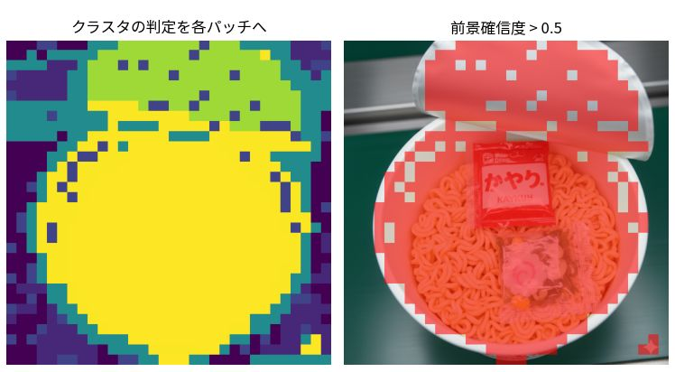

- フタの確信度は、麺より低い（緑）。右では、フタに**格子状の穴**（しきい値を超えないパッチ）が空き、容器の縁もまだらになる。

### 4. 確信度の伝播（EdgeTAM の特徴）

関数: `_propagate_with_edgetam`（`use_edgetam_clustering: true` のとき）

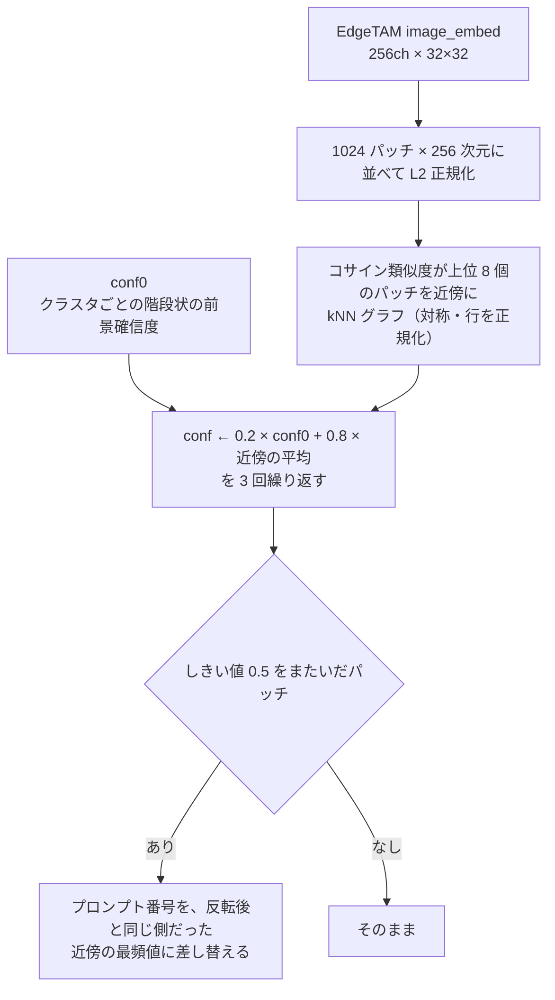

- 注目パッチ（赤）は 50 円玉の縁のパッチ。PE の判定では背景のクラスタ（確信度 0.117）だったが、EdgeTAM の特徴が似た近傍（黄）には 50 円玉の内部が多く、**確信度 0.80 で前景に**なった。
- 右端の図のとおり、変化は**物体の縁に集中**する。物体の内側・背景の内側は、近傍が同じ側なのでほとんど動かない。
- この画像でしきい値をまたいだパッチは 16 個。

**カップ麺の場合**

- コインでは斑点を消す方向に効いたが、ここでは**フタを前景へ引き上げる**方向に効いた。注目パッチ（赤）はフタの上のパッチで、PE の確信度は 0.203（背景）。EdgeTAM の特徴が似た近傍（黄）はフタの中が多く、**0.762 で前景**になった。
- しきい値をまたいだパッチは **111 個**（コインは 16 個）。確信度の変化（右端）は、フタ・容器の縁に沿って大きい。

- 左（伝播なし）は、左下に 1 パッチの斑点が残り、50 円玉の中に前景でないパッチがある。
- 右（伝播あり）は、斑点が消え、50 円玉の抜けも前景になる。

**カップ麺の場合**

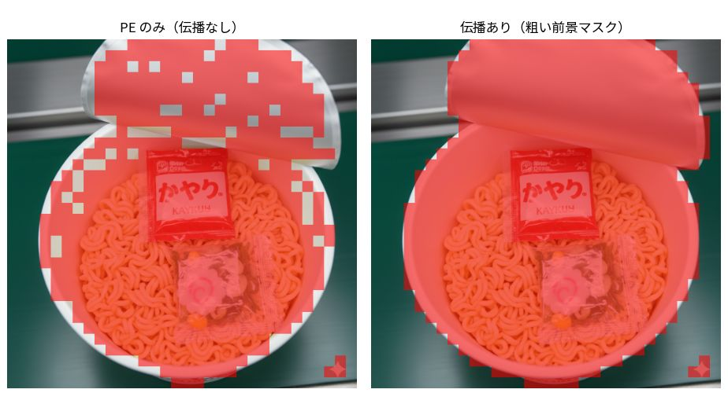

- 左（伝播なし）は、フタの格子状の穴と、容器の縁のまだらが残る。
- 右（伝播あり）は、フタ全体が 1 つの前景になる。
- 右下の星印（画像に入っているロゴ）は、伝播後も前景のまま残る（誤検出）。

**なぜ AND ではなく伝播か。** 以前は「PE と EdgeTAM の両方が前景のパッチだけ前景」（AND）にしていた。AND は前景を**消す方向にしか働かず**、物体の一部が背景のクラスタと混ざると、その部分を失った（cable で大きく下がった）。伝播は**確信度を平均するだけ**なので、大きな物体は周りも前景であり崩れない。二回目の KMeans も要らず、追加は約 9ms。

### 5. ラベルの付与

関数: `assign_semantic_labels`

クラスタ（PE のクラスタ × 伝播後のプロンプトの組。この画像では 14 個）の対応プロンプトを、パッチごとの連番ラベルに直す。

- ラベルは 4 種。前景は `coin` だけで、背景は `diffuse shadow`・`faint shadow`・`soft shadow`。
- ②が使うのは**前景ラベルのパッチだけ**。背景のラベルは使わない。
- 前景のプロンプトが複数あれば、そのぶんクラス（②で別々に切り出す単位）が増える。

**カップ麺の場合**

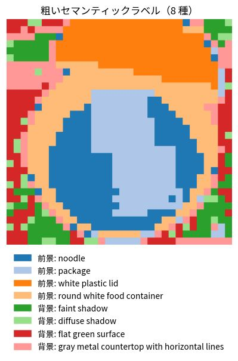

- ラベルは 8 種（前景 4・背景 4）。前景が 4 種なので、②は **4 クラス**を別々に切り出す。
- 薄青の `package` は、袋だけでなく**右側の麺も含む**（KMeans の黄のクラスタがそのままラベルになったため）。粗い段階では袋と麺を分けきれず、②で EdgeTAM が画像を見て分け直す。

### 6. 整形

関数: `refine_coarse_segmentation`（`_fill_holes` → `_merge_thin_regions`）

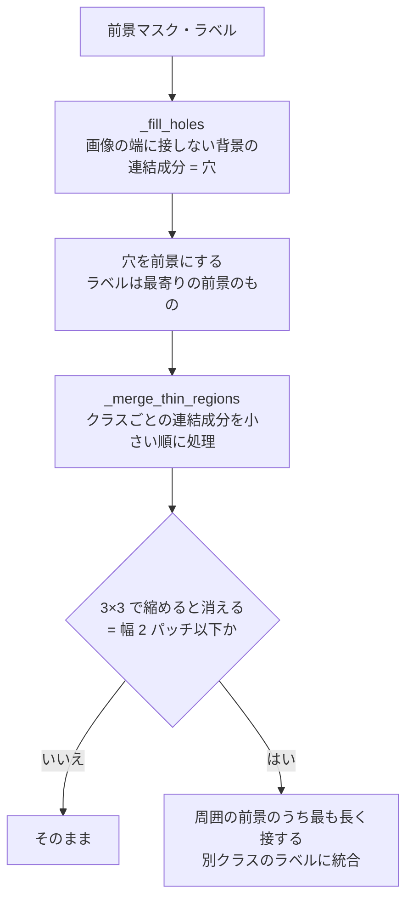

| 処理 | 直すもの | 理由 |
|---|---|---|
| 穴埋め | 反射・透明部による、前景の内側の穴 | 穴は物体の内側にある。端に接しない背景は、穴とみなせる |
| 細い領域の統合 | 物体の縁・影にできる、別クラスの細い輪 | 縁のパッチは物体と背景の特徴が混ざり、別のクラスタ（別プロンプト）になりやすい |

- **コイン画像では変化なし**（伝播の段階で、50 円玉の穴も斑点も解消済み）。効く例は下のカップ麺（42 パッチが変わる）。
- 穴埋めは「粗いマスクを物体単位でつなぐ」ためのもの。ワッシャーの穴のような本物の穴を埋めても、②の EdgeTAM が除く。
- 「他のクラスに囲まれた小さなクラスの統合」は**入れていない**。基板の上のねじのような、本当に別の物体が消えるため。

**カップ麺の場合**

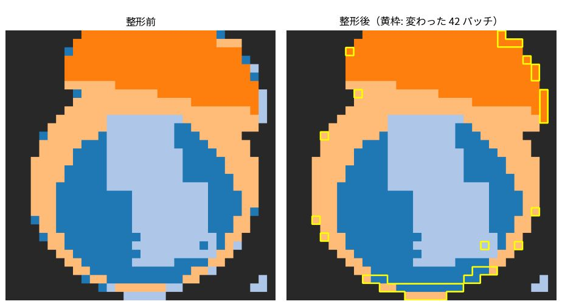

- 整形で **42 パッチ**が変わる（黄枠）。コインでは 0 だった。
  - フタと容器の境目や容器の縁にある、**幅 1 パッチの細いクラス領域**が、接するクラスに統合される（縁のパッチは別のクラスタ・別プロンプトになりやすい）。
  - 画面下端の細い帯も、隣のクラスに統合される。

## 出力（②への受け渡し）

| 値 | 内容 | ②での使い方 |
|---|---|---|
| `foreground_mask` | 整形後の前景マスク | クラスごとの連結成分・正例点・負例点の元 |
| `semantic_labels` | 整形後の粗いラベル | クラスの分け方（前景ラベルごとに 1 クラス） |
| `foreground_map` | 前景確信度（連続値） | 負例点の選択、重なり解決のスコア |
| `labels_list` | 連番 → プロンプト番号 | 出力のクラス名 |

## プロンプトの設計

`prompts_dir`（`prompts/`）の `foreground.yaml` と `background.yaml`。

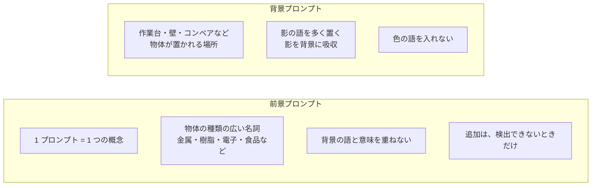

| 方針 | 理由 |
|---|---|
| 同義語を並べない（screw と bolt など） | 同じ物体が別のクラスタ・別のラベルに割れる |
| 前景と背景の語を重ねない | 差が 1 ロジット未満になると判定が反転する（例: fabric とタオル） |
| 背景に色の語を入れない | 同じ色の物体（灰色のふたなど）が背景に引かれる |
| 影の語を背景に置く | 物体の周りの影が前景に混ざるのを減らす |

`a photo of a fabric.` は、タオル・カーペットなどの背景が前景になるため無効化している（代償: zipper の IoU が 0.96 → 0.92）。

## 設定

| キー | 値 | 意味 |
|---|---|---|
| `k_clusters` / `n_iter` | 8 / 10 | KMeans のクラスタ数・反復回数 |
| `foreground_threshold` | 0.5 | 前景のしきい値 |
| `prompts_dir` | `prompts` | プロンプト |
| `use_edgetam_clustering` | true | 伝播を使うか。`false` なら PE の判定だけ |
| `model_dir` | `weights/openvino_models_l6` | PE のクラスタリングに使う層（第 6 層）が固定されたモデル |

`core/common/params.py` の固定値:

| 名前 | 値 | 意味 |
|---|---|---|
| `CLIP_LOGIT_SCALE` | 100 | 類似度に掛ける係数 |
| `EDGE_PROPAGATION_ALPHA` | 0.8 | 近傍の平均の重み |
| `EDGE_PROPAGATION_NEIGHBORS` | 8 | 近傍の数 |
| `EDGE_PROPAGATION_ITERATIONS` | 3 | 伝播の反復回数 |
| `PATCH_NEIGHBORHOOD` | 3 | 「内側」「細い領域」を判定する近傍（1 パッチ分） |

伝播は α 0.7〜0.9・近傍 4〜8 で結果が同程度で、反復は 5 回でも変わらない（平坦な範囲から選んだ）。

## 限界

- **クラスタに前景と背景が混ざると、全体が誤判定される。** 伝播と整形で減らすが、完全には消えない。
- **伝播は、確信度がしきい値付近の大きな領域を丸ごと落とすことがある**（bottle の一部）。
- **粗い誤りは②で直せない。** 背景を前景と判定したクラスには正例点が背景に置かれ、EdgeTAM もそれに従う。
- 処理時間: 特徴抽出（PE 約 80ms・EdgeTAM 約 35ms）が大半で、判定・伝播・整形は合計 約 14ms。

過去の実験（パッチごとの照合・Tiling・背景混入の軽減・PE と EdgeTAM の別々のクラスタリングなど）の記録は [method_history.md](method_history.md)。
