# ① 粗いセマンティックセグメンテーション

画像を 32×32 のパッチ（1 パッチ = 16 画素）に分け、**パッチごとの前景らしさ**と**粗いラベル（何の物体か）**を求める。輪郭は決めない。
コードは `core/common/coarse/`（進行役 `segmenter.py` の `CoarseSegmenter`）。全体は [overview.md](overview.md)、次の段階は [detailed_segmentation.md](detailed_segmentation.md)。

| | 内容 |
|---|---|
| 入力 | PE のパッチ特徴・EdgeTAM の `image_embed`・前景/背景プロンプト（`prompts/`） |
| 出力 | `foreground_map`（前景確信度 0〜1）・`foreground_mask`（確信度 > 0.5）・`semantic_labels`（粗いラベル）。すべて 32×32 |

## フロー

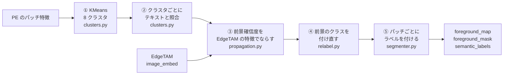

| 段階 | 関数 | 解決する課題 |
|---|---|---|
| ① KMeans | `clusters.kmeans_labels` | パッチごとにテキストと照合すると斑点だらけになる → 似たパッチを 8 個にまとめて、判定を 8 回にする |
| ② 照合 | `clusters.judge_clusters` | 学習なしで物体の種類を知る → 前景と背景の両方のプロンプトとの類似度で決める |
| ③ 伝播 | `propagation.propagate_confidence` | クラスタに背景の斑点が混ざる → EdgeTAM の特徴が似たパッチどうしで確信度を平均する |
| ④ 付け直し | `relabel.ForegroundRelabeler.relabel` | 1 つの物体が似たプロンプトの別クラスに割れる・種類の違う物体が同じクラスになる・隣り合う部品の境目でクラスが入り混じる → 前景だけのブロックの根拠で、名前を判定し直し・統合し・境目を整える |
| ⑤ ラベル | `segmenter.CoarseSegmenter.assign_semantic_labels` | 次の段階に渡す形にする → パッチごとの連番ラベル |

進行は `CoarseSegmenter.generate_foreground_map`（①〜④ を順に呼ぶ）と `assign_semantic_labels`（⑤）。**クラスタ単位で判定する代償**は、クラスタに前景と背景が混ざると全体が誤判定されること。③ がこれを減らす。

## 0. 入力と特徴量

画像は 512×512 に縮めてから、PE（パッチ 16 画素 → 32×32 = 1024 パッチ）と EdgeTAM のエンコーダに入れる。

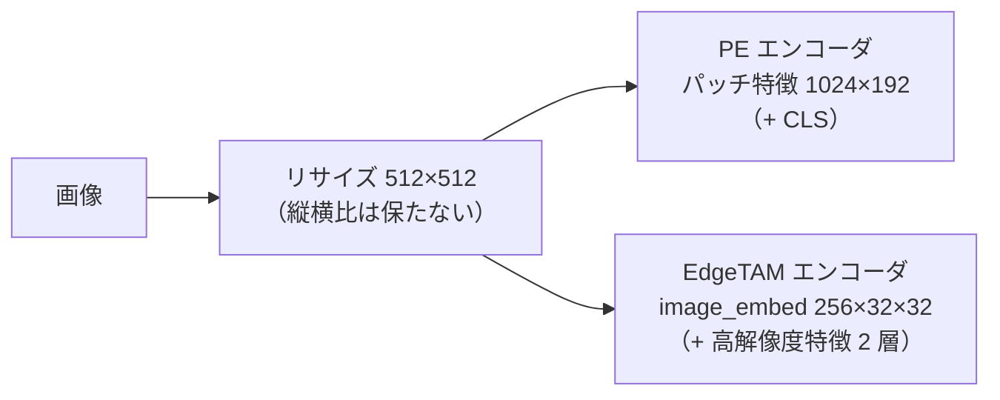

コイン（左: 元画像、右: モデル入力にパッチ格子を重ねたもの）:

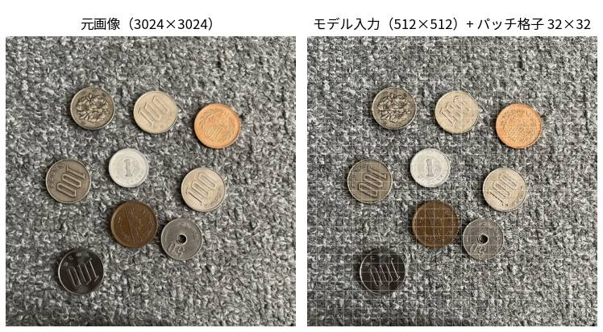

カップ麺:

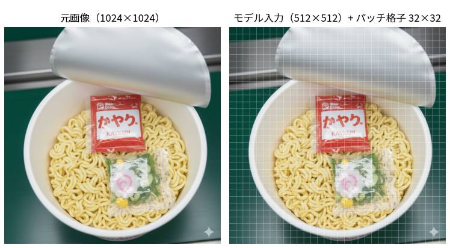

左から入力・PE のパッチ特徴（主成分 3 つを RGB に）・EdgeTAM の `image_embed`（同）。コイン:

カップ麺:

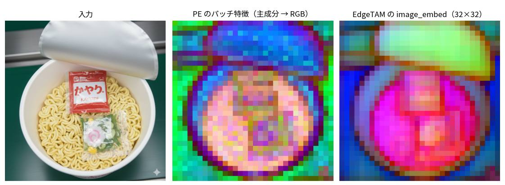

- PE の特徴は、背景（カーペット・机）にもまだらな模様が出る。EdgeTAM の特徴は、コインの輪郭・カップの縁・ふたの形に沿ってまとまる。
- クラスタを作る特徴と、テキストと比べる特徴は別。クラスタリングに使う層は、モデルの変換時に固定される（`convert_openvino.py --cluster-layers`）。

| 特徴 | 形 | 使い道 |
|---|---|---|
| PE `fused_patch_features`（中間層を連結。第 6 層のモデルでは 192 次元、既定の第 8・9・10 層では 576 次元） | 1024 × 192（+ CLS） | ① KMeans でクラスタにまとめる |
| PE `patch_features` | 1024 × 192（+ CLS） | クラスタ・領域の代表トークンを作る（テキストと比べられる特徴） |
| EdgeTAM `image_embed` | 256 × 32 × 32 | ③ の伝播・④ のブロック分け。② 詳細段階のデコーダにも使う |

## ① KMeans

PE の `fused_patch_features` を、faiss の KMeans で 8 クラスタ（`k_clusters`）にまとめる。シード固定なので、同じ入力は同じ結果になる。

コイン（左から: 入力・クラスタ・重ね合わせ）:

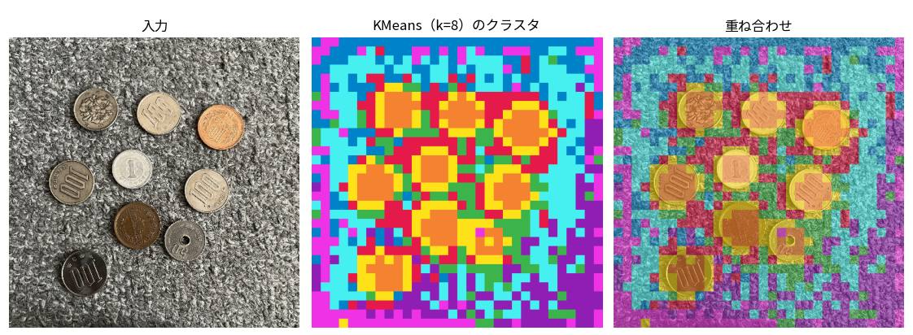

カップ麺:

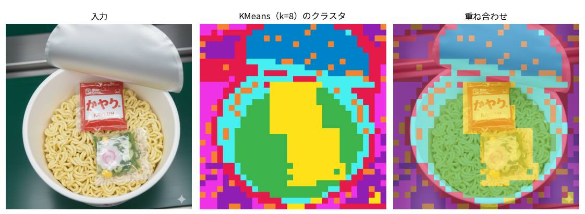

- クラスタは意味が近いパッチを集めるが、空間的にはばらける。コインは、背景（カーペット）の 6 クラスタとコインの 2 クラスタに分かれた。カップ麺は、麺・包装・ふた・カップがそれぞれ別のクラスタを持つ（下の ② の表）。
- K は粗さを決める。大きいと純粋なクラスタになるが判定が不安定になる。8 は前景精度のバランス（[method_history.md](method_history.md)）。

## ② クラスタの判定

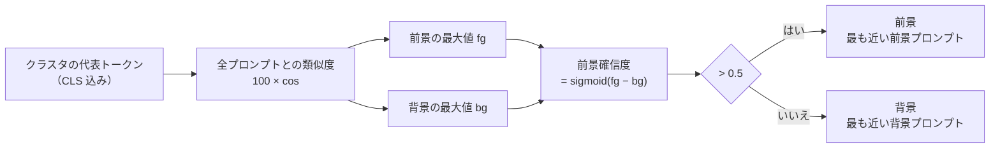

コイン:

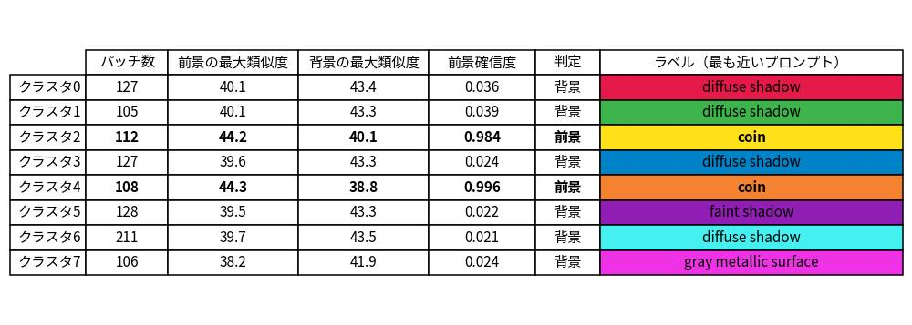

カップ麺:

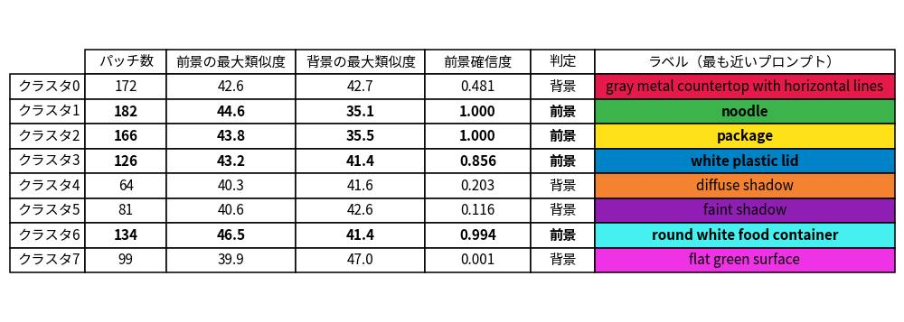

- コインはクラスタ 2・4 が前景（`coin`。前景の最大類似度が背景より 4 ロジット以上高く、確信度 0.984・0.996）。残り 6 クラスタは背景の語（shadow 系・`gray metallic surface`）が上回り、確信度は 0.02〜0.04。
- カップ麺は 4 クラスタが前景（`noodle` 1.000・`package` 1.000・`white plastic lid` 0.856・`round white food container` 0.994）。**クラスタ 0 は前景 42.6 と背景 42.7 でほぼ同点（確信度 0.481）で背景になった**。このように拮抗するクラスタは、プロンプトの小さな変更で反転する。
- グループの得点は**平均でなく最大**。プロンプトは言い換えではなく選択肢の列挙なので、最も近い 1 つで代表させる。個数を変えても判定が偏らない。

左は、クラスタの判定を全パッチに書き込んだ前景確信度（クラスタごとの階段状）、右はしきい値 0.5 で 2 値にしたもの。コイン:

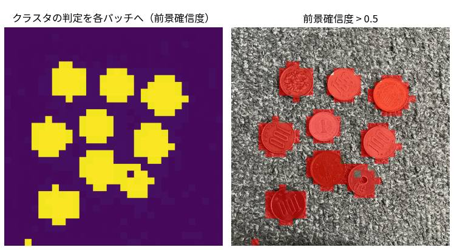

カップ麺:

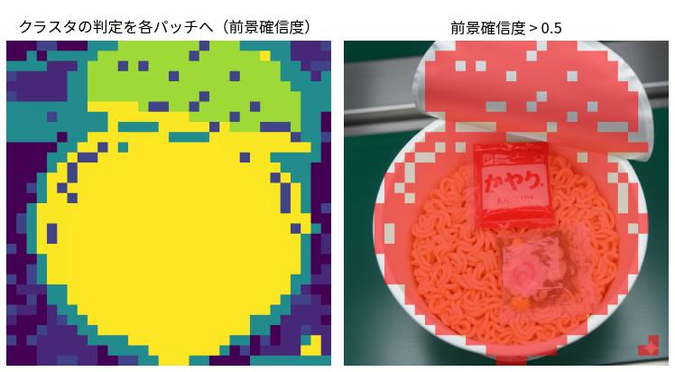

## ③ 確信度の伝播（EdgeTAM の特徴）

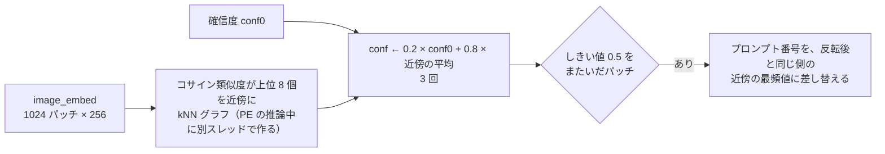

左から、PE の判定・近傍の例（赤: 注目パッチ、黄: kNN の近傍）・伝播後・変化の大きさ。コイン:

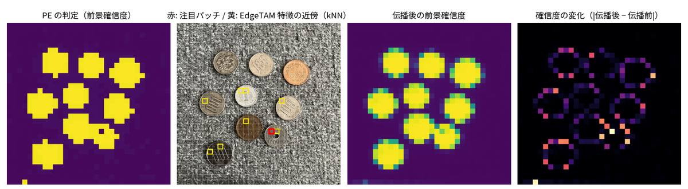

カップ麺:

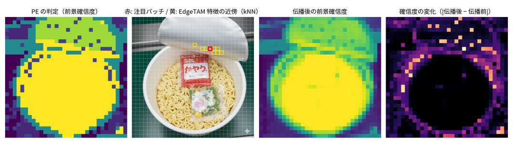

- 変化は物体の縁に集中し、物体の内側・背景の内側はほとんど動かない。
- コイン: 注目パッチ (18, 21) は確信度 0.024 から 0.780 に上がって前景になった。しきい値をまたいだパッチは 16 個（前景に 11・背景に 5）。
- カップ麺: 注目パッチ (20, 8)（ふた）は 0.203 から 0.762。しきい値をまたいだパッチは 111 個で、すべて前景になった（ふたの確信度が拮抗するクラスタ 4 のパッチが、ふたとして揃う）。

伝播なし（左）と伝播あり（右）の粗い前景マスク。コイン:

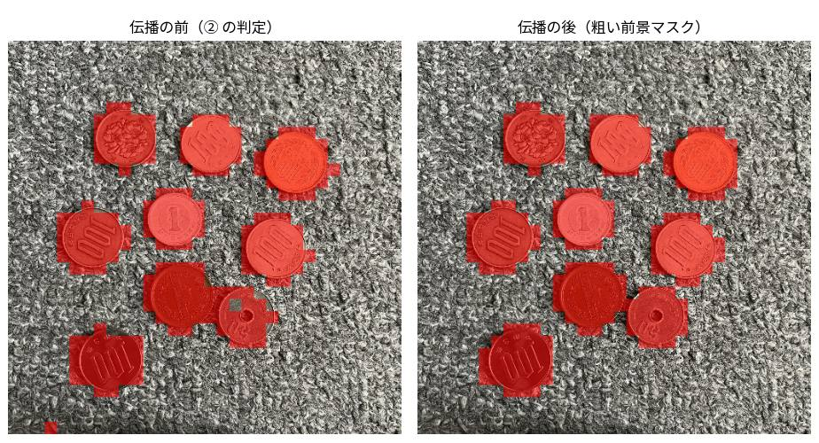

カップ麺:

| 項目 | 内容 |
|---|---|
| なぜ AND でなく伝播か | PE と EdgeTAM の両方が前景のときだけ前景にする案は、前景を消す方向にしか働かず、物体の一部が背景のクラスタと混ざるとその部分を失う。伝播は確信度を平均するだけなので、大きな物体は崩れにくい |
| 追加の時間 | kNN グラフは PE の推論と重ねて別スレッドで作る。伝播そのものは 0.2〜0.4 ms |

## ④ 前景のクラスの付け直し

② は画像全体を K = 8 個にクラスタリングして、クラスタごとにプロンプトを選ぶ。クラスタは背景を含み、代表トークンは画像全体の CLS に引っ張られるので、次の 3 つが起こる。

| 起こること | 例 |
|---|---|
| 1 つの物体が、似たプロンプトの別クラスに割れる | tube と transparent tubes・pill と capsule |
| 種類の違う物体が、同じクラスになる | 画像に散らばった複数の種類の部品が、どれも 1 つのクラス（`screw` など）になる |
| 見た目も言葉も近い部品の境目で、クラスがパッチ単位で入り混じる | ふた（`white plastic lid`）とカップ（`round white food container`）。ロジット差は 1〜2 でノイズと同程度 |

前景のパッチだけを部品ごとのブロックに分け直し、CLS を含まない `extract_region_tokens` で前景プロンプトと照合して、3 段で整える（前景マスクは変えない）。

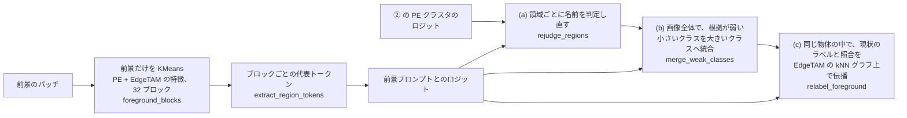

領域 =（物体 = 前景の 8 連結成分, 今のクラス）。各段のラベル（色 = 前景プロンプト。「変わったパッチ」は、1 つ前の段との差）。コイン:

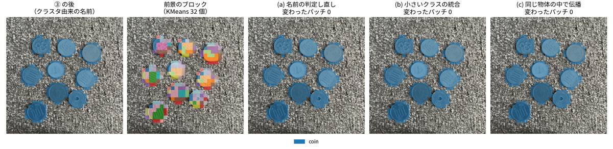

カップ麺:

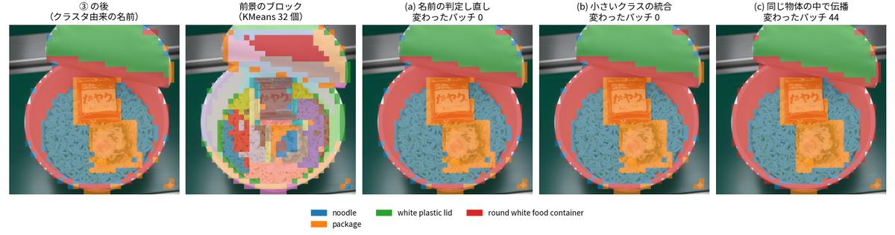

- コインは領域が 7 つ（物体 7 × クラス 1）あるのでブロックを作る（前景 226 パッチ → 32 ブロック）が、**名前はどの段でも変わらない**（`coin` のまま）。どの物体も 1 クラスなので (c) は省かれる（`has_split_object`）。
- カップ麺は領域が 5 つ（前景 719 パッチ → 32 ブロック）。(a)・(b) で名前は変わらず、**(c) で 44 パッチが入れ替わる**。内訳は、麺 → カップ 12・カップ → ふた 11・包装 → カップ 9・包装 → 麺 4・カップ → 麺 3・麺 → 包装 3・麺 → ふた 2。部品どうしが接する境目で、パッチ単位のクラスが整う。
- 領域が 1 つしか無い画像（1 つの物体が 1 クラス）は、比べる相手が無いので何もしない（KMeans も照合も省く）。

④ を切った場合（「なし」）と入れた場合（「あり」）の、粗いラベルと最終結果。左から、入力・粗いラベル（なし）・最終結果（なし）・粗いラベル（あり）・最終結果（あり）。色は、麺 = 赤・包装 = 緑・ふた = 青・カップ = 黄。最終結果は、④ だけの効果を見るため、② の最後の名前付けを外して作った（`tools/docs/make_relabel_doc_image.py`）:

| 段 | 関数 | 内容 |
|---|---|---|
| ブロック | `ForegroundRelabeler.foreground_blocks` | 前景のパッチだけを、PE の fused 特徴と EdgeTAM の `image_embed`（それぞれ L2 正規化して並べる）で KMeans する。ブロック数は `RELABEL_BLOCK_COUNT`（32。`params.py`。画像全体の `k_clusters` = 8 より細かい）。EdgeTAM の特徴が部品の輪郭に沿うので、PE だけより純度が高い。ブロックの代表トークンは `extract_region_tokens`（パッチの value の平均。CLS を含まない）なので、数パッチの小さなブロックでも画像全体の CLS に引っ張られず、それらしい前景プロンプトに紐づく |
| (a) 判定し直し | `rejudge_regions` | 領域ごとに、領域のパッチで平均した **PE クラスタのロジット + ブロックのロジット** が最も強い前景プロンプトを付け直す。新しい名前も許すので、種類の違う物体が分かれる。**前景のパッチ数 / `k_clusters`（= 前景の 1/8。ブロック数とは別の基準）より小さい領域は、独立した根拠を持てない（ノイズに引きずられる）ので、今のラベルのまま** |
| (b) 統合 | `merge_weak_classes` | 画像全体の前景で、面積の小さいクラスから順に、領域のブロックのロジットを平均した対数オッズ `mean[L(c) − L(b)] + log(面積 c / 面積 b)` が正で最大の、より大きいクラス c へ、まるごと移す（繰り返す）。ロジットは CLIP の確率の対数の単位なので、しきい値は要らない。根拠が僅差の割れ（tube と transparent tubes）は消え、ブロックの根拠が自分のクラスを大きく上回る別の部品（ふたとカップ）は残る |
| (c) 付け直し | `relabel_foreground` | 同じ物体の中だけで、0.5 × 現状のラベル（one-hot）+ 0.5 × ブロックの照合の softmax（候補は、同じ物体の中に現状のラベルがあるクラスだけ）を、その物体の前景のパッチどうしの辺だけを残した EdgeTAM の kNN グラフで、③ と同じ α・反復（0.8・3 回）で伝播して、パッチごとに最も強いクラスを選ぶ。部品の境目で入り混じったクラスが整う |

- **ブロックの根拠だけで決めない。** (a) は PE クラスタの根拠と足し、(c) は現状のラベルと混ぜる。(b) は PE クラスタの根拠を足さない（今のラベルは、その根拠の最大で選ばれているので、足すと割れを残す方向に偏る）。
- ④ で決めたクラスは、② 詳細段階のデコードの単位になる（クラスごとに 1 回）。**名前は、② の最後にもう一度決め直す**（[detailed_segmentation.md](detailed_segmentation.md#7-最終の名前付け)）。
- 処理時間は、コイン 4.4 ms・カップ麺 8.6 ms（この PC。[overview.md](overview.md#処理時間)）。効果の測定（前景 IoU は変わらず、種類別合成の種類の分離 V が上がる）と、採らなかった案は [method_history.md](method_history.md)。

## ⑤ ラベルの付与

クラスタ番号は、（PE のクラスタ, 伝播・付け直し後のプロンプト）の組で振り直してある（伝播で判定が変わったパッチは、同じ PE のクラスタの中でもプロンプトが違うため）。`assign_semantic_labels` が、その対応プロンプトを、パッチごとの連番ラベルにする。

コイン:

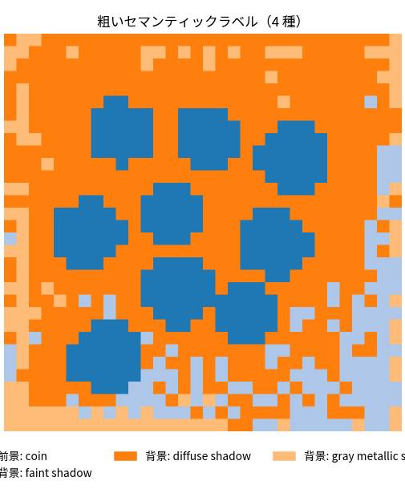

カップ麺:

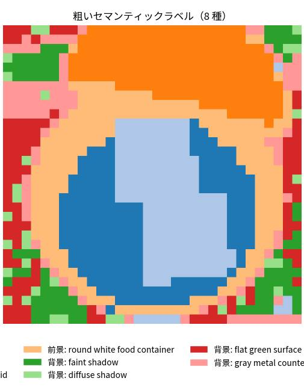

- コインのラベルは 4 種（前景 `coin`、背景は `faint shadow`・`diffuse shadow`・`gray metallic surface`）。カップ麺は 8 種（前景は `noodle`・`package`・`white plastic lid`・`round white food container`、背景は `faint shadow`・`diffuse shadow`・`flat green surface`・`gray metal countertop with horizontal lines`）。
- ② 詳細段階が使うのは前景ラベルのパッチだけで、前景のラベルごとに 1 クラスとして別々に切り出す。背景のラベルは ② では使わない（粗い結果の図示にだけ使う）。
- カップ麺の `package` は、赤い包装と透明な包装の 2 つが同じクラスになる（ラベルは前景プロンプトの語彙で決まる）。

## 設定

| キー（`configs/ov_config.yaml`） | 値 | 意味 |
|---|---|---|
| `k_clusters` / `n_iter` | 8 / 10 | KMeans のクラスタ数・反復回数（④ の前景のブロックの KMeans は、反復回数を共有し、ブロック数は `params.py` の `RELABEL_BLOCK_COUNT` = 32） |
| `foreground_threshold` | 0.5 | 前景のしきい値 |
| `prompts_dir` | `prompts` | 前景・背景プロンプト（この環境では前景 33・背景 26） |
| `model_dir` | `weights/openvino_models` | モデルのフォルダ。クラスタリングに使う PE の層は変換時に固定される（既定は第 8・9・10 層）。**この資料の画像は第 6 層のモデル（`weights/openvino_models_l6`）で作った**（作り方は [overview.md](overview.md#画像の作り方)） |

`core/common/params.py` の固定値:

| 名前 | 値 | 意味 |
|---|---|---|
| `CLIP_LOGIT_SCALE` | 100 | 類似度に掛ける係数 |
| `EDGE_PROPAGATION_ALPHA` / `_NEIGHBORS` / `_ITERATIONS` | 0.8 / 8 / 3 | 伝播の重み・近傍の数・反復（α 0.7〜0.9・近傍 4〜8 で結果は同程度、反復は 5 回でも変わらない）。④ のクラスの伝播も α・反復を使う |
| `RELABEL_BLOCK_COUNT` | 32 | ④ の前景のブロックの数 |

## プロンプトの設計

前景は `prompts/foreground.yaml`、背景は `background.yaml`。

| 方針 | 理由 |
|---|---|
| 1 プロンプト = 1 つの概念。同義語を並べない（screw と bolt など） | 同じ物体が別クラスに割れる（④ で減らすが、戻しきれないこともある） |
| 前景と背景の語を重ねない | 差が 1 ロジット未満になると判定が反転する |
| 背景に色の語を入れない | 同じ色の物体（灰色のふたなど）が背景に引かれる |
| 影の語を背景に置く | 物体の周りの影が前景に混ざるのを減らす |
| 追加は、検出できないときだけ | 増やすほど別クラスに割れやすい。**追加したら、前景マスクだけでなくクラスの数・名前も確かめる** |

透明な筒が格子に並ぶ画像（006_syringe）のために `a photo of transparent tubes.` を足している。具体名（syringe・vial）は効かず、複数形の `tubes` だけが効く。

## 限界

- クラスタに前景と背景が混ざると全体が誤判定される。③ で減らすが、消えない。
- 粗い誤りは ② 詳細段階で直せない（背景を前景と判定したクラスには、正例点が背景に置かれる）。
- 1 つの物体の別の部品が 1 つのクラスにまとめられていれば、④ は分けられない（(a) は領域ごと、(c) は候補が現状のクラスだけ）。
- (a) は新しい名前を作る。前景の 1/8 より大きい領域は、その領域だけの根拠で名前が変わる。1/8 より小さい領域（前景の誤検出の数パッチなど）は今のラベルのまま残る（② の最後の名前付けでも同じ基準）。
- ふたの折り返しの縁のように、背景に接する 1 パッチ幅の帯は、特徴が背景と混ざって根拠が弱く、隣の部品のクラスのまま残ることがある。
- クラスの意味の区別は弱い。名前の区別は前景プロンプトの語彙で決まる（hazelnut と metal nut がどちらも `nut` になるなど）。
- 過去の実験（パッチごとの照合・Tiling・背景混入の軽減など）と、④ の効果の測定は [method_history.md](method_history.md)。
