# ② 詳細セグメンテーション

粗い結果（32×32 のパッチ）を**ヒント**にして、EdgeTAM で画素単位の輪郭を切り出し、1 枚のセマンティックマップにまとめる。
`core/common/semantic_refiner.py`（進行役 `SemanticRefiner`）と `region_estimator.py`（1 領域の推定 `RegionEstimator`）。全体は [overview.md](overview.md)、前の段階は [coarse_segmentation.md](coarse_segmentation.md)。

| | 内容 |
|---|---|
| 入力 | ① の出力（前景マスク・粗いラベル・前景確信度）・EdgeTAM の特徴・リサイズ済みの入力画像 |
| 出力 | `semantic_map`（元画像と同じ大きさ。0 = 背景、1〜 = 前景クラス）・EdgeTAM に与えた点 |

粗い結果は「だいたいどこに何があるか」は分かるが、**輪郭は信用できない**（縁・影で最大 1 パッチ太り、縁のパッチは物体と背景が混ざって落ちる）。そこで、内側は確実・縁とその外側 1 パッチは「不明」・それより外は背景として EdgeTAM に渡す。

## フロー

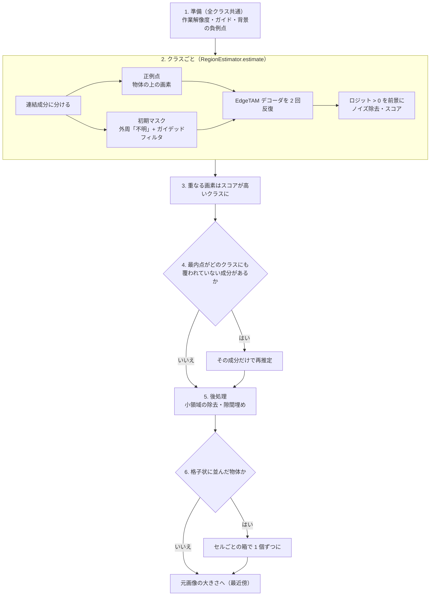

クラスごとの推定（2）は読むだけの処理なので、`worker_threads` があれば、次のクラスのデコードと重ねて走る。結果の反映（3）は常にクラス番号の順で、出力はスレッドの有無で変わらない。

| 段階 | 関数 | 解決する課題 |
|---|---|---|
| 1 準備 | `RegionEstimator.prepare` | 全クラスに共通の入力を 1 回だけ作る |
| 2 推定 | `RegionEstimator.estimate` | 粗い格子の輪郭を画素単位にする |
| 3 重なり | `SemanticRefiner._refine_classes` | EdgeTAM は 1 回に 1 マスク → クラスごとに推定し、スコアで決める |
| 4 再推定 | `_rescue_uncovered` | 切り出せなかった物体を拾う |
| 5 後処理 | `remove_small_regions`・`fill_narrow_gaps` | 小さな斑点・クラス境界の割れ目 |
| 6 格子 | `LatticeSeparator` | 隙間が 1 パッチ未満の物体の集まり |

## 1. 準備

| 準備 | 内容 |
|---|---|
| 作業解像度 | `scale = min(1, 1024 / 長辺)`。マスク演算は長辺 1024 以下で行い、最後に元画像サイズへ戻す |
| ガイド | 入力画像の輝度を、EdgeTAM の高解像度特徴量の大きさ（128×128）に縮小したもの |
| 背景の負例点 | 全クラス共通で 4 点（`select_background_points`） |

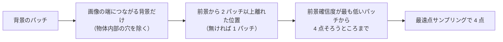


左から、粗い前景マスク・前景確信度・選ばれた負例点（赤枠）。点は画像の端に寄る。伝播で確信度が連続値になり、「最も低いパッチ 4 個」がそのまま候補になるため（点をばらしても精度は上がらなかった）。

## 2. クラスごとの推定

### 連結成分と正例点

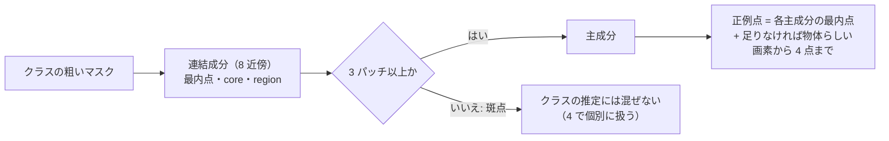

| 用語 | 意味 |
|---|---|
| 最内点（`peak`） | 成分の中で、背景から最も遠い位置（距離変換が最大） |
| core | 成分を 1 パッチ内側へ縮めたもの（縮めると消える成分では成分そのもの） |
| region | 成分のマスク |


- 左: 7 つの連結成分（水色の線が core、黄点が最内点）。右: EdgeTAM に渡す点。正例（緑）7 点、負例（赤）4 点。
- コインは 9 枚あるが成分は 7 つ。右下の 3 枚は粗いマスクでつながって 1 つの成分（76 パッチ）になり、最内点は 1 つだけ。
- 最内点の数が `edgetam_foreground_points_per_class`（4）を超えるので、追加の点は選ばれない。

**正例点の選び方（物体らしさ）。** 点をパッチの中心に置くと、縁のパッチでは物体の外に落ち、細い物体では一部に偏る。EdgeTAM は点のある領域だけをマスクにするので、偏りは欠けになる。そこで、EdgeTAM の高解像度特徴量（128×128）の**画素**から選ぶ（`object_points.py`）。

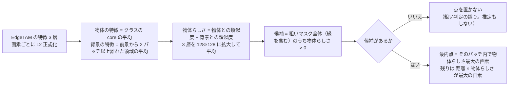

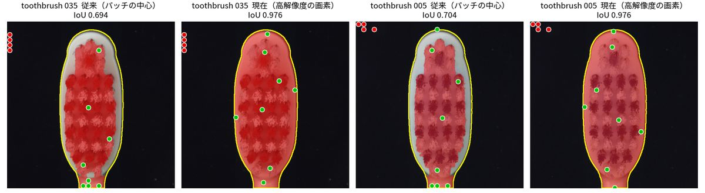

toothbrush の例（黄線: 正解の輪郭、赤: 最終結果、緑: 正例点）。パッチの中心（左の 2 枚）は点が毛に集まり、ヘッドの縁と柄が欠ける（IoU 0.694・0.704）。物体の上の画素（右の 2 枚）は点が縁・柄まで届く（0.976・0.976）。背景の特徴が作れないときは、パッチの中心から選ぶ。

**物体の特徴は、領域自身の core ではなく、クラスの本体の core を基準にする（極小の成分）。** 取りこぼしの再推定の対象になる 1〜2 パッチの成分は、領域自身の core が成分そのものになる。成分が背景のパッチ（カップの外の影・テーブル）だと、基準も背景になり、候補の約 100% が「物体らしい」になって、点が背景に置かれていた（最内点は、物体らしさに関係なく必ず選ぶ）。クラスの本体の core を基準にすると、背景のパッチには物体らしい画素が無く、点を置かない（推定もしない）。カップ麺（noodle (3)）の例（左: 外周の背景に点が並び、外側の影が前景になっていた。右: 点はカップの壁の上。前景 74.6% → 68.8%）:

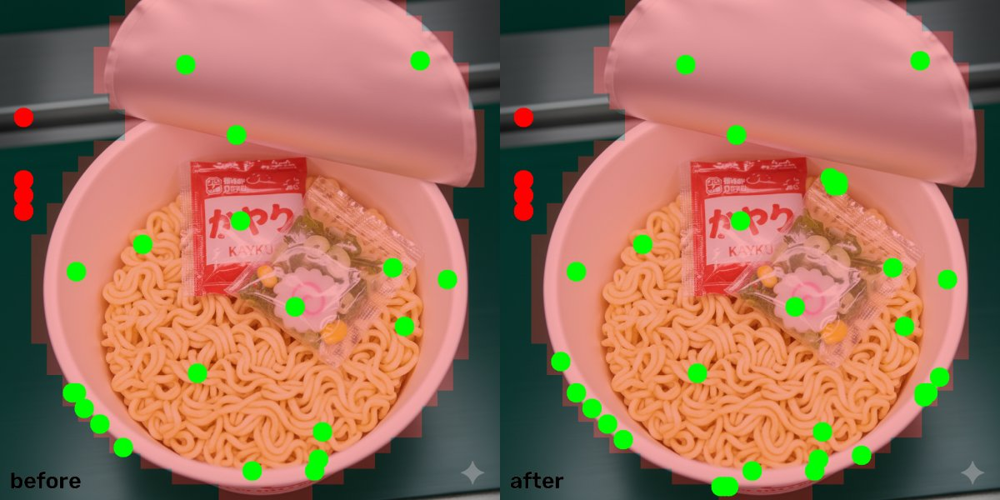

### 初期マスク（事前確率）

粗いマスクを「正解」にすると太りも欠けも引き継ぐ。**core は前景・縁とその外側 1 パッチは不明・それより外は背景**として渡す。

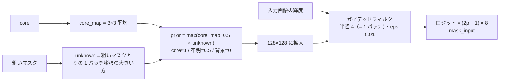


①core ②粗いマスクと外側 1 パッチ ③事前確率（32×32 のまま）④128×128 に拡大 ⑤ガイデッドフィルタ後。


1 つのコインの周りを拡大すると、格子の形だった「不明」の縁が、画像の縁に沿って整う。

- **外側 1 パッチも「不明」にする理由**: 粗いマスクは物体より内側に入ることがある（縁のパッチは落ちやすい）。外側を背景にすると縁が戻らず削れる。
- **ガイデッドフィルタの理由**: 外側を一律に不明にすると、小物体では不明の領域が物体と同じ大きさになり背景へ膨らむ。画像の明るさの縁に沿って物体側・背景側へ倒す。

### デコーダの反復

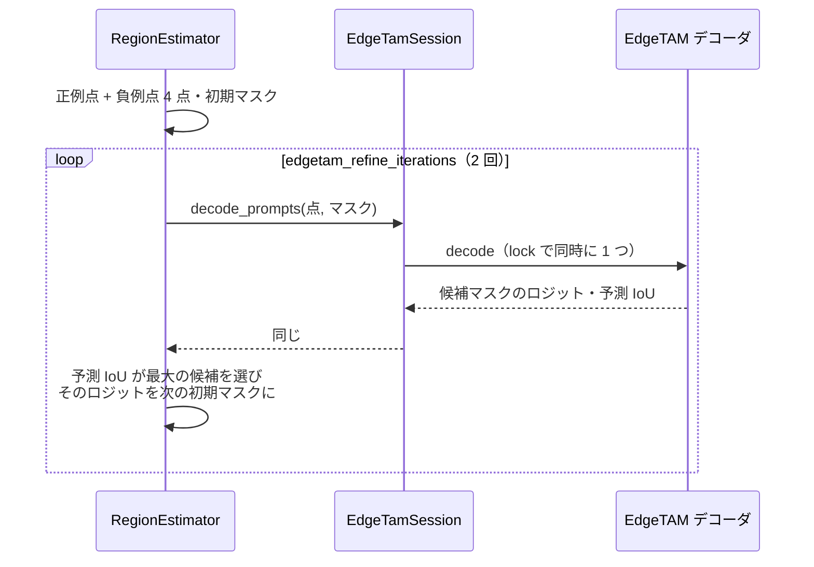


初期マスクは山があるだけで輪郭はぼんやりしている。1 回目で輪郭が出るが、点のない右下の 2 枚は確率が低くまだら。2 回目（前回のロジットを初期マスクに）で整う。右は、ロジット > 0 を前景にした結果。

### 二値化とスコア


- 二値化: ロジットを作業解像度へ拡大して > 0 を前景にし、`clean_mask` で 1 パッチ未満の成分を除いて、メディアンフィルタ（3×3）で輪郭をならす。
- 左（粗いマスク）はコインより一回り大きい。中央（EdgeTAM のマスク）はコインの縁に沿う。
- 右は重なり解決用のスコア: `EdgeTAM の確信度 × (0.5 + 0.5 × 粗い前景らしさ)`。両方が確信できる所を高くする。

## 3. 重なりの解決

```python
win = result.binary & (result.score > state.best_score)
state.semantic_map[win] = class_id
state.best_score[win] = result.score[win]
```

クラスは独立に推定するので、同じ画素を複数のクラスが主張しうる。スコアが高いクラスを優先する（同点は先のクラス）。コインは前景クラスが 1 つなので重ならない。

## 4. 取りこぼしの再推定

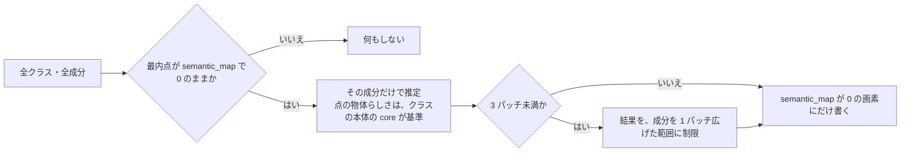

- 覆われているかは、成分の**最内点 1 点**だけで決める。確定した画素は上書きしない。
- クラスの反映が済んだ時点で覆われていない成分は、先にまとめて推定を始める（投機的）。反映の時点で、先の再推定に覆われていたら結果を捨てる。

コインでは発動しない（7 つの成分の最内点は、すべてクラスのマスクに覆われた）。MVTec cable で発動する例:

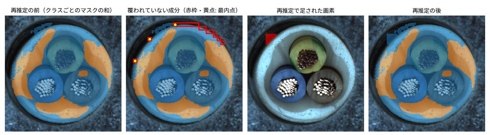

左から、再推定の前（クラスごとのマスクの和）・覆われていない成分（赤枠、黄点: 最内点）・再推定で足された画素・再推定の後。クラス 1 の 1 パッチの成分 2 つ（最内点 (6, 6) と (2, 12)）が再推定され、8,261 画素が足された。

cable の推定の内訳: 前景 2 クラス（`nut`・`pill`）、正例 22 点・負例 16 点、デコーダ呼び出し 8 回（（2 クラス + 再推定 2）× 2 回）。

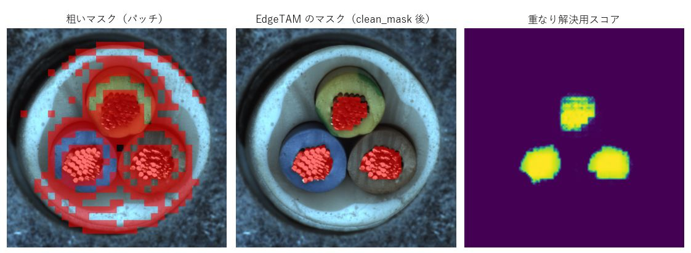

取りこぼしの救済は、粗い判定の誤りを救うことがある。極小成分の制限（3 パッチ未満）は、3 パッチ以上の成分には働かない。ただし、成分が背景のパッチなら、前景点を置く物体らしい画素が無く、再推定されない（上の「物体の特徴は、クラスの本体の core」）。

## 5. 後処理

| 処理 | 内容 |
|---|---|
| `remove_small_regions` | ① クラスごとに、1 パッチ未満の連結成分を背景に戻す（クラスごとの検出はスレッドで並行）。② 背景に残った小さな穴を、周囲で最も多いクラスで埋める |
| `fill_narrow_gaps` | 前景内部の、**幅 1 パッチ未満で両側が 2 クラス以上に接する**背景の隙間を、最寄りのクラスで埋める |
| 元画像サイズへ | 最近傍補間（クラス番号を補間で壊さない） |

隙間は、1 つの物体が複数クラスに分かれ、その境界が画像の強い縁（ハイライト線など）に重なると、どのクラスのマスクもそこで止まって残る。粗い前景の分解能（1 パッチ）より細い背景は、背景と言えないので埋める。1 クラスの物体の凹み・穴（両側が同じクラス）は埋めない。


最終結果（左: クラスごとの色、右: 輪郭を元画像に重ねたもの）。

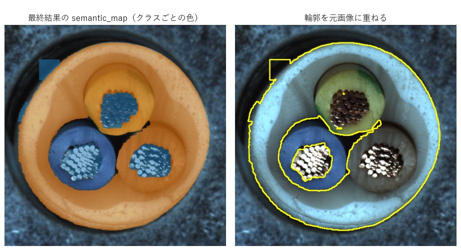

## 6. 格子状に並んだ小物体の分離

隙間が 1 パッチ未満の物体の集まり（トレイ・巣・ブリスターの同じ物体）は、粗い前景が 1 つの塊になり、EdgeTAM は点に従って塊全体を返す。**画像の勾配の自己相関で格子を検出したときだけ**、セルごとの箱プロンプトで 1 個ずつに分ける。検出の段階は [lattice_detection.md](lattice_detection.md)。

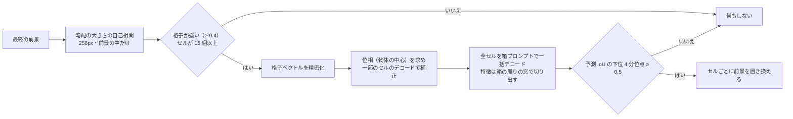

- 判定（格子の検出）は毎回走り、約 14ms（この資料を作った PC）。作動は稀で、通ると約 +150ms（80 個の巣。006 の記録）。
- デコーダーは画像サイズ可変なので、窓ごとに別の画像として一括実行できる。`ov_static_shape` のときも、この呼び出しだけは動的形状のモデルで推論する。
- 006（シリンジの巣 80 個）で IoU 0.69 → 0.91。作動する条件は狭く、MVTec・実画像・COCO128・D2S ではほとんど作動しない。

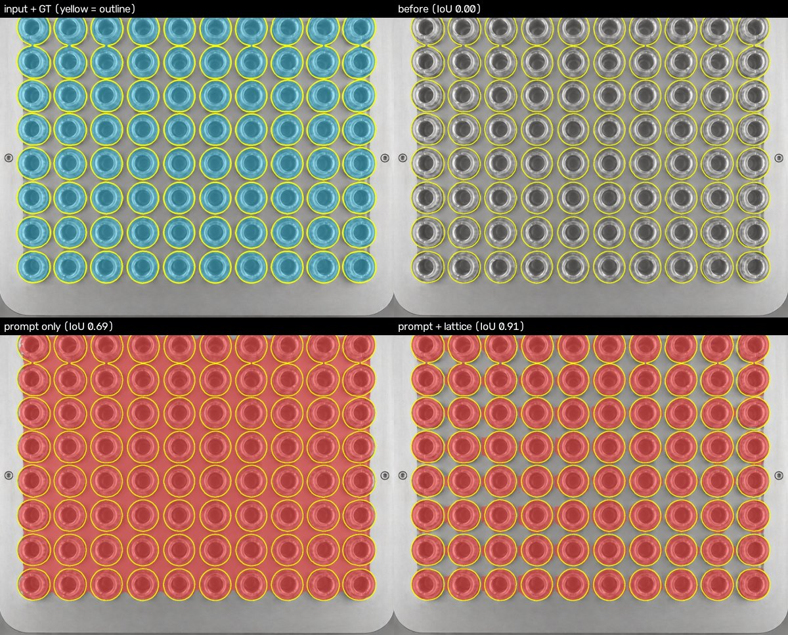

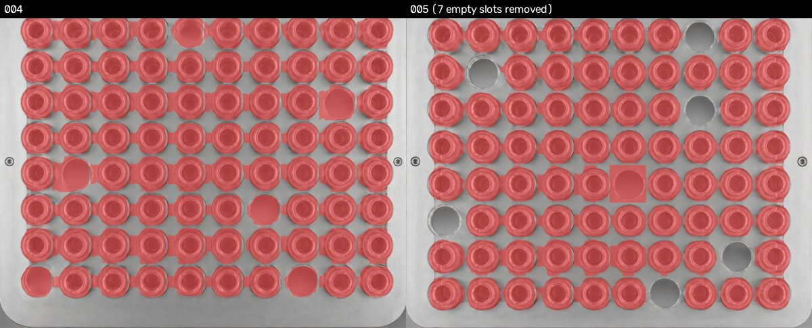

## 出力

| 値 | 内容 |
|---|---|
| `semantic_map` | 元画像と同じ大きさの `uint8`。0 = 背景、1〜 = 前景クラス |
| `prompt_indices` | クラス 1〜 に対応する前景プロンプトの番号 |
| `point_coords` / `point_labels` | EdgeTAM に与えた点（画像座標、全領域分）と、ラベル（1 = 正例、0 = 負例） |
| `debug_images` | 中間画像（クラスごとの粗いマスク・core・EdgeTAM のマスク・スコアなど） |

## 設定

| キー（`configs/ov_config.yaml`） | 値 | 意味 |
|---|---|---|
| `edgetam_foreground_points_per_class` | 4 | クラスごとの正例点（各成分の最内点は必ず含む） |
| `edgetam_background_point_count` | 4 | 背景の負例点 |
| `edgetam_refine_iterations` | 2 | デコーダの反復回数 |
| `semantic_max_side` | 1024 | マスク演算の作業解像度（長辺） |
| `worker_threads` | 2 | 領域の推定などを重ねるスレッド数（0 で重ねない。出力は変わらない） |
| `dense_instances` | false | 長方形の物体を 1 個ずつに分ける処理を、② の後に行うか（[rect_instances.md](rect_instances.md)） |

`core/common/params.py` の固定値:

| 名前 | 値 | 意味 |
|---|---|---|
| `PRIOR_LOGIT_RANGE` | 8 | 初期マスクのロジット幅（(2p − 1) × 8。0.5 = 不明 = ロジット 0） |
| `GUIDED_FILTER_EPS` | 0.01 | ガイデッドフィルタの正則化（0.001〜0.01 で結果は同程度） |
| `EDGETAM_FEATURE_STRIDES` | (4, 8, 16) | EdgeTAM の特徴の縮小倍率（512 入力で 128・64・32） |
| `MIN_ISOLATED_PATCHES` | 3 | これ未満の孤立成分は、クラスの推定に混ぜない |
| `BACKGROUND_POINT_MARGIN` | 2 | 負例点を前景から離す距離（パッチ） |
| `SCORE_PRIOR_WEIGHT` | 0.5 | スコアで、粗い前景らしさに置く重み |
| `GAP_FILL_PIXELS_PER_PATCH` | 8 | 隙間の探索に使う縮小倍率（1 パッチ = 8 画素） |
| `LATTICE_*` | — | 格子の検出・位相・デコードの値（意味は `params.py` のコメント） |

## 限界

- 粗い誤りは直せない（背景を前景と判定したクラスは前景のまま。後から再判定して消す案は悪化した）。
- 点は連結成分ごと。接した複数の物体は 1 つの成分になり、点も 1 つ（このコイン画像の右下の 3 枚）。切り出せるかは初期マスクと反復に依る。
- 正例点を物体の上に選ぶ効果は、細長く領域が分かれた物体（toothbrush など）に偏る。
- 負例点は端に寄る（ばらしても精度は上がらなかった）。
- 透明・低コントラストの物体は、ガイデッドフィルタの手がかり（輝度の縁）が弱く、背景への広がりが残ることがある。
- デコード（1 回 約 10ms。この資料を作った PC で、capsule は 4 回で 41ms）の回数は「（クラス数 + 再推定した成分数）× 反復回数」。クラスが多い画像ほど遅い。

過去の実験（外周「不明」・ガイデッドフィルタ・SAM2.1・点数・割れの穴埋めなど）は [method_history.md](method_history.md)。
