# ② 詳細セグメンテーション

粗いセグメンテーション（32×32 のパッチ）を、**EdgeTAM で画素単位の輪郭**にして、1 枚のセマンティックマップにまとめる。`core/common/semantic_refiner.py`（`SemanticRefiner`）。

全体は [overview.md](overview.md)、前の段階は [coarse_segmentation.md](coarse_segmentation.md)。

| | 内容 |
|---|---|
| 入力 | ①の出力（前景マスク・粗いラベル・前景確信度）・EdgeTAM の特徴・リサイズ済みの入力画像 |
| 出力 | `semantic_map`（元画像と同じ大きさ。0 = 背景、1〜 = 前景クラス）・EdgeTAM に与えた点 |
| 役割 | 粗い結果を**ヒント**にして、輪郭を画像から決める |

## フロー

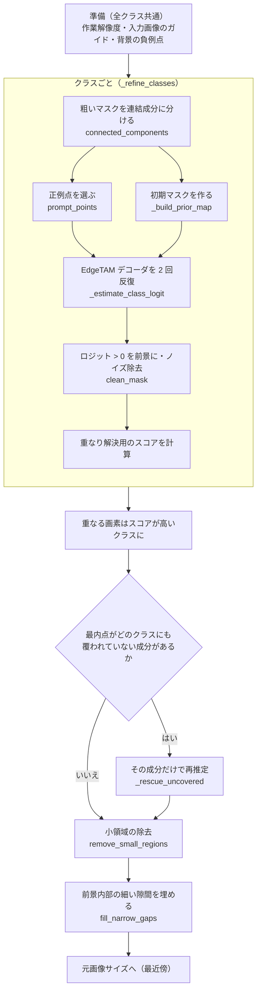

## なぜこのフローなのか

粗い結果は「だいたいどこに何があるか」は分かるが、**輪郭は信用できない**（1 パッチ = 16px の格子で、縁・影では最大 1 パッチ太り、縁のパッチは物体と背景が混ざって落ちる）。各ステップは、次の課題に答える形でできている。

| 課題 | 対策 | メリット |
|---|---|---|
| 粗い格子の輪郭を、画素単位にしたい | EdgeTAM に点と初期マスクを与える | 画像を見て輪郭が決まる |
| 粗い結果の太り・欠けを引き継ぎたくない | 粗いマスクを**ヒント**にする。内側は確実・縁とその外側 1 パッチは「不明」・それより外は背景 | 太りは削れ、縁のパッチが落ちていても縁が戻る |
| 小さい・細い物体にも点を置きたい | 正例点に、**各連結成分の最内点を必ず含める** | 漏れなく点が置かれる |
| 背景の斑点から、物体が背景へ広がる | 孤立した極小成分（3 パッチ未満）は、クラスの推定に混ぜない | 斑点に置いた点を経由した広がりを防ぐ |
| 点を置く場所が悪いと結果が壊れる（正例が縁だと背景へ広がり、負例が物体の近くだと欠ける） | 正例は core（内側）、負例は**前景から離れた、最も背景と確信できる場所** | 点が結果を壊さない |
| 縁が 16px の格子に縛られる | 初期マスクを 128×128 に拡大して、**入力画像の輝度でガイデッドフィルタ** | 「不明」の縁が、画像の明るさの縁に沿って物体側・背景側へ倒れる。小物体で背景へ膨らむのも防ぐ |
| EdgeTAM は 1 回に 1 つのマスクしか返さない | **クラスごとに別々に推定**し、重なりはスコアで決める | クラス間で公平に決められる |
| 切り出せなかった物体がある | 最内点が覆われていない成分を、**単独で再推定** | 取りこぼしを拾える |
| 速くしたい | エンコーダは 1 回・反復は 2 回・マスク演算は作業解像度（長辺 1024 以下） | 約 30ms |

**背景の判定はここでは直せない。** 背景を前景と判定したクラスには正例点が背景に置かれ、EdgeTAM もそれに従う。クラスタの誤判定やクラスの割れは粗い段階で対処する。

## 処理の流れ（コイン画像とカップ麺の画像）

各ステップを**コイン画像**で示し、直下に**カップ麺の画像**（1024×1024、4 クラス）の場合を併記する。粗い段階の結果は [coarse_segmentation.md](coarse_segmentation.md)。

| | コイン | カップ麺 |
|---|---|---|
| 前景クラス | 1（coin） | 4（noodle・package・white plastic lid・round white food container） |
| 麺クラスの連結成分 | — | 2（52 と 143 パッチ） |
| 正例点 / 負例点 | 7 / 4 | 25 / 28 |
| 再推定した成分 | 0 | 3 |
| EdgeTAM デコーダの呼び出し | 2 回 | 14 回（(4 クラス + 再推定 3) × 2 回） |

### 1. 準備

関数: `refine`（作業解像度）・`_make_guide`・`select_background_points`

| 準備 | 内容 |
|---|---|
| 作業解像度 | `scale = min(1, 1024 / 長辺)`。マスク演算を長辺 1024 以下で行い、最後に元画像サイズへ戻す（3024 → 1024） |
| ガイド | 入力画像の輝度（RGB の平均）を、EdgeTAM の高解像度特徴量の大きさ（128×128）に縮小したもの。初期マスクの縁を整えるのに使う |
| ノイズの面積 | 1 パッチ未満の領域はノイズ（粗いマスクの分解能以下）。作業解像度で約 1024 画素 |
| 背景の負例点 | 全クラス共通で 4 点 |

背景の負例点の選び方（`select_background_points`）:

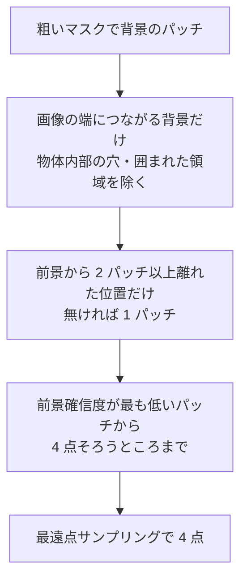

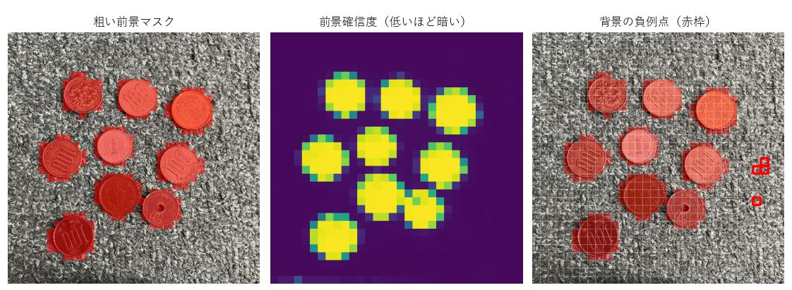

| 絞り込み | 理由 |
|---|---|
| 端につながる背景だけ | 物体の穴・影の中に負例を置くと、物体が欠ける |
| 前景から離す | 粗いマスクは縁・影で最大 1 パッチ太る |
| 確信度が低い所 | 確信の弱い「背景」は、実際は物体（濃い布など）のことがある。そこに負例を置くと物体を打ち消す |

- 赤枠が選ばれた 4 点。**画像の右端に寄っている**。伝播で前景確信度が連続値になり、「最も低いパッチ 4 個」がそのまま候補になるため（点をばらしても精度は上がらないことを確認済み）。

**カップ麺の場合**

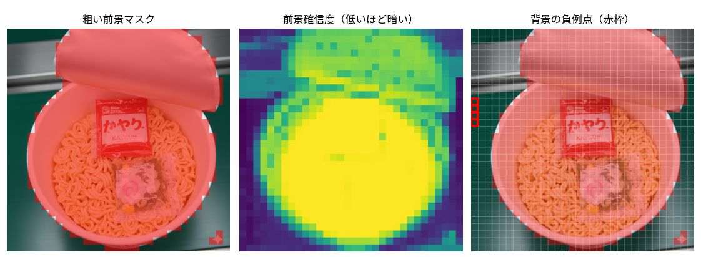

- 4 点は**画像の左端に縦に並ぶ**。背景（緑の面）は左右・上にもあるが、確信度が最も低い 4 パッチがそこにある。
- 負例点は全クラス共通なので、4 クラスにも、再推定にも同じ 4 点が付く。

### 2. クラスごとの連結成分と正例点

関数: `_refine_classes` → `connected_components` → `prompt_points`

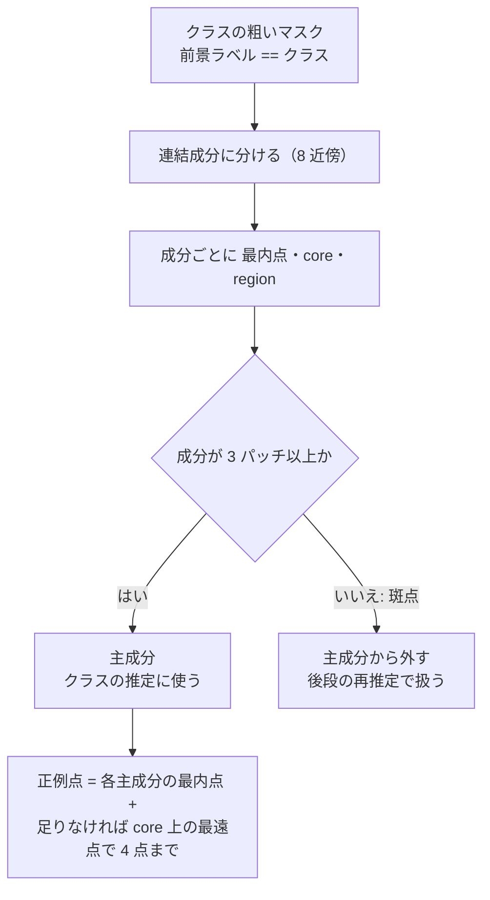

| 用語 | 意味 |
|---|---|
| 最内点（`peak`） | 成分の中で、距離変換が最大の位置（背景から最も遠い） |
| core | 成分を 1 パッチ内側へ縮めたもの。縮めると消える細い成分では、成分そのもの |
| region | 成分のマスク |

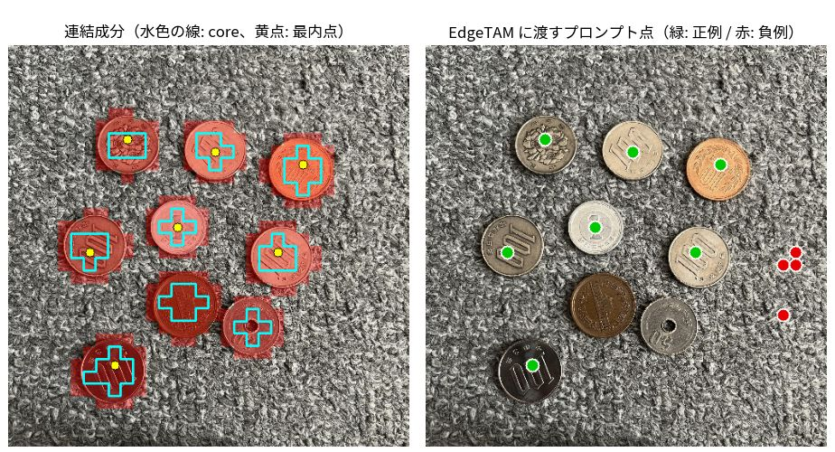

- 左: 7 つの連結成分。水色の線が core、黄点が最内点。
- 右: EdgeTAM に渡す点。正例（緑）は **7 点**、負例（赤）は 4 点。
- コインは 9 枚あるのに点は 7 つ。右の 3 枚（右のコイン・茶色の 10 円玉・50 円玉）は粗いマスクでつながって**1 つの成分**（76 パッチ）になり、最内点は 1 つだけだから。点がない 2 枚も、最終的には切り出せている（[4. の反復の図](#4-edgetam-デコーダの反復)）。
- 最内点の数が `edgetam_foreground_points_per_class`（4）を超えるので、最遠点による追加は無い。

**カップ麺の場合**

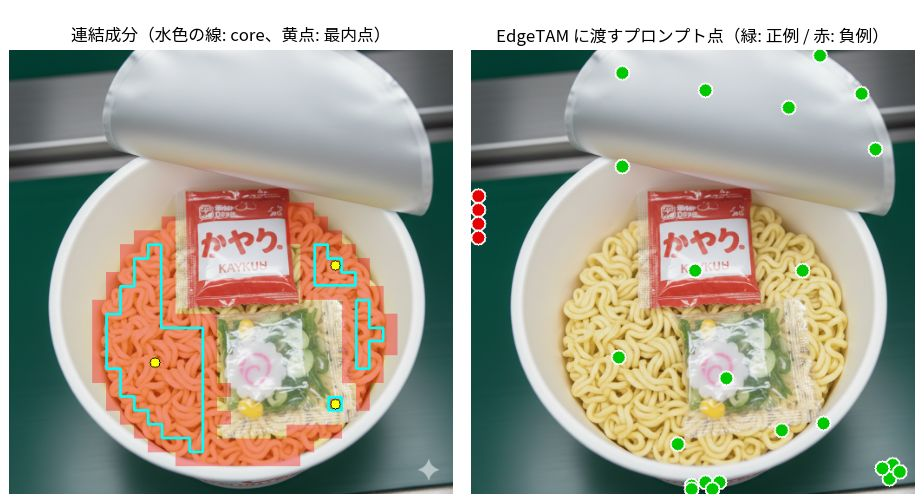

- 左は**麺クラス**だけ。成分は 2 つ（52・143 パッチ）。core は麺の左側と右上に広がり、中央から右下は抜けている（そこは粗いラベルが `package` で、別クラスだから）。
- 右は全クラスの点。正例（緑）はフタ・容器・麺・袋に置かれ、合計 25 点。負例（赤）は 4 点を 7 回（4 クラス + 再推定 3）使うので 28 点。
- 正例点は画像の**下端にも並ぶ**。粗い前景が画面下端まで伸びているため。

### 3. 初期マスク（事前確率）

関数: `_build_prior_map`（`patch_mean`・`guided_filter`）

粗いマスクを「正解」にすると、太りも欠けも引き継ぐ。そこで **core は前景・縁とその外側 1 パッチは不明・それより外は背景**として EdgeTAM に渡す。

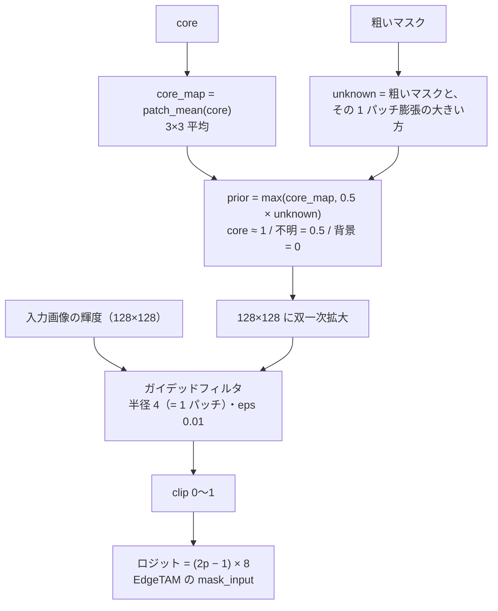

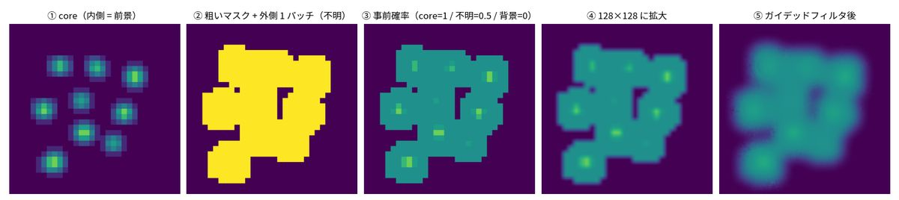

| 図 | 内容 |
|---|---|
| ① | core（内側）。1 パッチ内側へ縮めた所だけが 1 に近い |
| ② | 粗いマスクと、その外側 1 パッチ。ここが「不明」になる |
| ③ | 事前確率。core ≈ 1、不明 = 0.5、それより外 = 0（32×32 のパッチ格子のまま） |
| ④ | 128×128 に拡大。縁がなめらかになるが、まだ格子の形 |
| ⑤ | ガイデッドフィルタ後。画像の縁に沿って整う |

1 つのコインの周りを拡大すると、格子の形だった「不明」が、画像の縁に沿って整うのが分かる。

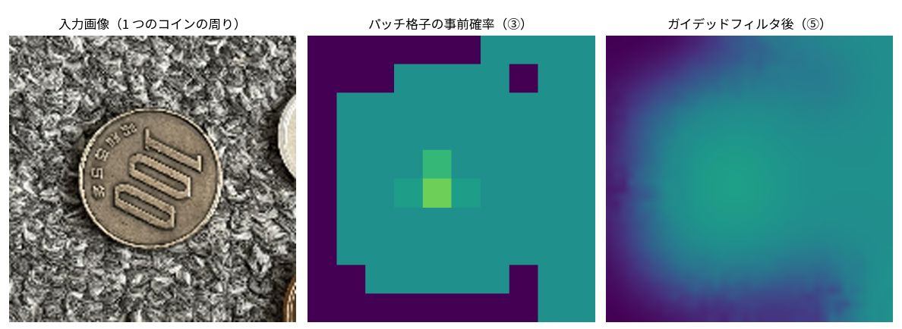

**外側 1 パッチも「不明」にする理由。** 粗いマスクは物体より内側に入ることがある（縁のパッチは物体と背景のトークンが混ざり、落ちやすい）。外側を背景（0）にすると、EdgeTAM が縁を戻せず**縁が削れる**（toothbrush・capsule・cable で顕著）。膨らませた分を前景とは言わない。

**ガイデッドフィルタをかける理由。** 外側 1 パッチを一律に「不明」にすると、小物体では不明の領域が物体と同じ大きさになり、背景へ膨らむ。画像の明るさの縁に沿って物体側・背景側へ倒せば、これを防げる。

**カップ麺の場合**（麺クラスの初期マスク）

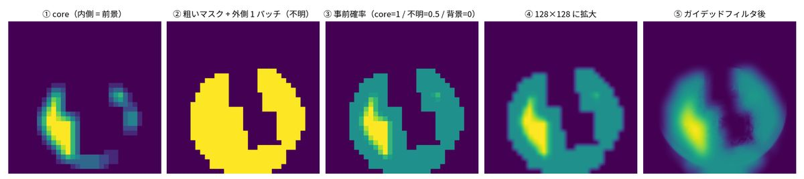

- core（①）は麺の左側が中心で、粗いマスク（②）は中央から右下が欠けている。欠けは `package` クラスの領域。
- そのため事前確率（③）も欠けたまま。**欠けた所は背景（0）から始まる**ので、麺クラスはこの領域を初期マスクからは前景と言われない。
- ⑤では、ガイデッドフィルタで縁が画像に沿って整う。

### 4. EdgeTAM デコーダの反復

関数: `_estimate_class_logit` → `predict_decoder`

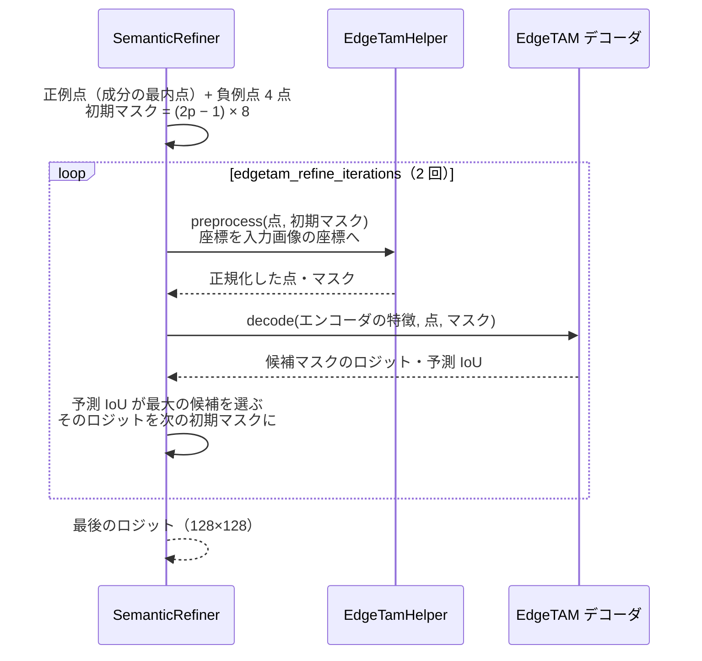

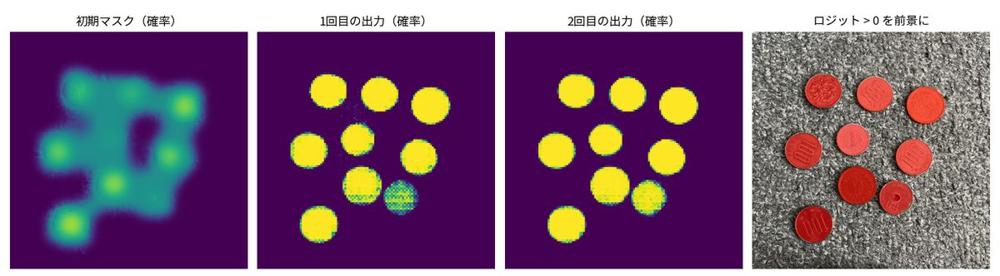

- 初期マスクは、コインの中心に山があるだけで、輪郭はぼんやりしている。
- **1 回目の出力**で、コインの輪郭が出る。ただし右下の茶色の 10 円玉と 50 円玉は、**確率が低くまだら**（点が置かれていない）。
- **2 回目の出力**で、前回のロジットを初期マスクにして再推定すると、この 2 枚も上がり、輪郭が整う。
- 右: ロジット > 0 を前景にした結果。9 枚すべてが前景になった。

反復を 3 → 2 回にしても精度はほぼ同じで、デコードの時間が約 1/3 減った。デコード 1 回は 6〜7ms。

**カップ麺の場合**（麺クラス）

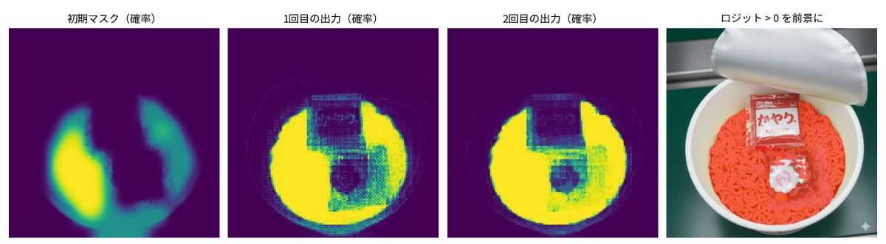

- 初期マスクは、麺の左側と右上に山があり、中央から右下が抜けている。
- **1 回目の出力で、抜けていた右側の麺も前景になる**（かやく袋・スープ袋は除かれる）。点は麺に置かれていて、EdgeTAM は画像を見て麺として拾う。
- 2 回目で、輪郭がそろい、袋の周りのまだらが減る。
- 右: ロジット > 0 を前景にした結果。麺の全体が前景になり、袋は除かれた。

### 5. 二値化とスコア

関数: `_refine_region`（`clean_mask`）

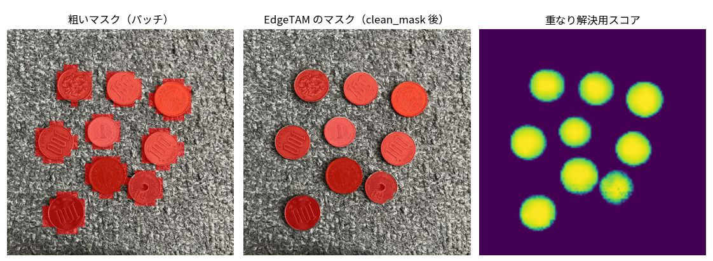

- **二値化**: ロジットを作業解像度へ拡大し、> 0 を前景にする。`clean_mask` で、1 パッチ未満の小さな成分を除き、メディアンフィルタ（3×3）で輪郭の細かなノイズをならす。
- 左（粗いマスク）はコインより一回り大きく、四方に出っ張りがある。中央（EdgeTAM のマスク）は、**コインの縁に沿った丸い輪郭**になり、出っ張りは消えた。
- 右の**重なり解決用スコア**:

```
スコア = EdgeTAM の確信度 × (0.5 + 0.5 × 粗い前景らしさ)
確信度 = sigmoid(ロジット)　　粗い前景らしさ = 粗いマスクの周辺平均 × 前景確信度
```

EdgeTAM の確信度だけだと、粗い段階で自信のなかった所でも高くなりうる。粗い前景らしさを掛けて、**両方が確信できる所**を高くする。スコアマップでは、点のない右下の 2 枚（茶色の 10 円玉・50 円玉）が他のコインより低い。

**カップ麺の場合**（麺クラス）

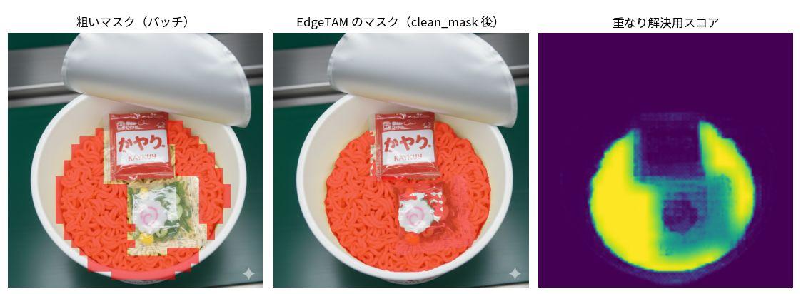

- 左（粗いマスク）は、中央から右側が欠けた形。中央（EdgeTAM のマスク）は、**格子の形を離れて麺の領域**になる。かやく袋は除かれ、スープ袋のあたりは麺がまだらに残る。
- スコア（右）は、麺の左側が高く、袋のそばで低い。袋との境目は、他のクラス（package）と競り合う所。

### 6. 重なりの解決

関数: `_refine_classes`

```python
win = binary & (score > ctx.best_score)
ctx.semantic_map[win] = class_id
ctx.best_score[win] = score[win]
```

クラスは独立に推定するので、同じ画素を複数のクラスが主張しうる。**スコアが高いクラスを優先**する。この画像は前景クラスが `coin` の 1 つだけなので、重なりは起きない。複数クラスの画像では、ここで境界が決まる。

**カップ麺の場合**

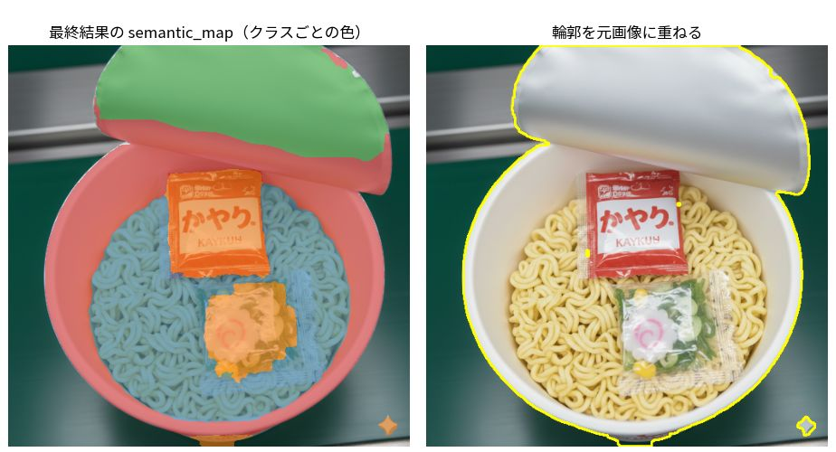

- 4 クラスの結果を重ね合わせた結果（左）。色は、青 = noodle、橙 = package、緑 = white plastic lid、赤 = round white food container。
- フタ（緑）・容器（赤）・麺（青）・袋（橙）が、輪郭に沿って分かれた。**境界は、重なる画素でスコアが高いクラスが取る**。
- 麺と袋は、粗い段階では `package` が麺の一部も含んでいた（[coarse_segmentation.md](coarse_segmentation.md#2-kmeans)）が、ここでは**袋だけ**が `package` になった。EdgeTAM が画像から分け直した結果。
- かやく袋とスープ袋は、同じ `package` クラス。インスタンスは分けない。

### 7. 取りこぼしの再推定

関数: `_rescue_uncovered`

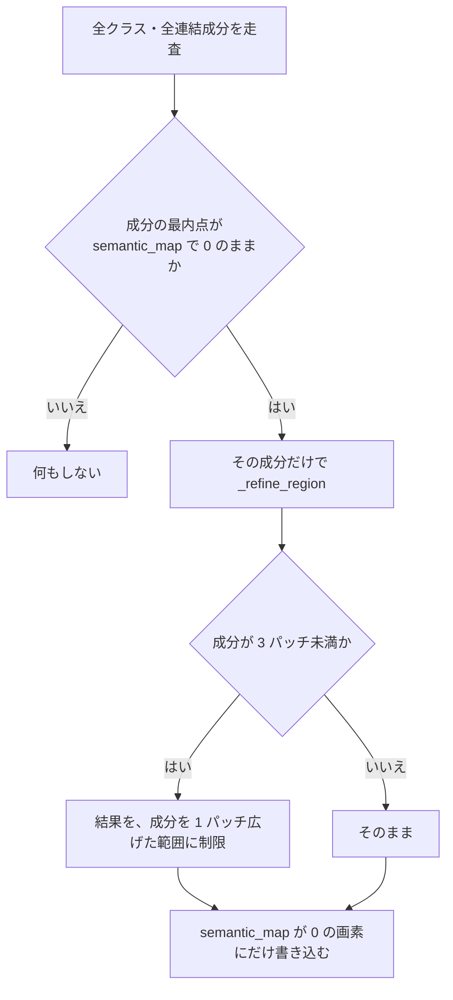

- 覆われているかは、成分の**最内点 1 点**だけで決める（成分全体ではない）。
- **確定した画素は上書きしない**（`semantic_map == 0` のみ）。
- 極小成分は、周囲の背景まで広がらないよう範囲を制限する。1〜2 パッチの孤立成分は、背景の斑点であることが多い。
- **コイン画像では発動しない**。7 つの成分の最内点は、どれもクラスのマスクに覆われていた。発動する例はカップ麺の画像（次の図）。

**カップ麺の場合**（4 クラス。覆われていない成分が 3 つ）:

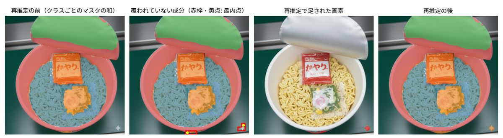

| クラス | 成分（最内点） | パッチ数 | 範囲の制限 |
|---|---|---|---|
| 2（package） | (30, 29)。右下の星印のロゴ | 3 | なし（3 パッチ以上） |
| 4（round white food container） | (11, 30)。画面下端 | 2 | あり（1 パッチ広げた範囲まで） |
| 4（round white food container） | (14, 31)。画面下端 | 5 | なし（3 パッチ以上） |

- 左: 各クラスのマスクをすべて重ねた状態（再推定の前）。上の 3 つの成分には、最内点にどのクラスのマスクも届いていない（赤枠）。
- 右から 2 番目: 再推定で足された画素（赤）。成分ごとに単独で EdgeTAM を実行して、`semantic_map` が 0 の画素にだけ書き込んでいる。**星印のロゴ**と、**画面下端の四角い塊**（約 1 万画素。作業解像度の 1%）が足された。
- **ここでは再推定が誤検出を足している。** 星印は物体ではなく、画面下端の塊も物体の輪郭に沿わない四角形。取りこぼしの救済は、粗い判定の誤りもそのまま救ってしまう。極小成分の制限（3 パッチ未満）は、5 パッチの成分には働かない。
- 取りこぼしが本物の小物体のときは効く（この仕組みを入れた理由）。画像ごとの得失は、粗い段階の誤検出の多さに依る。

### 8. 後処理

関数: `remove_small_regions` → `fill_narrow_gaps` → `cv2.resize(INTER_NEAREST)`

| 処理 | 内容 |
|---|---|
| `remove_small_regions` | ① クラスごとに、1 パッチ未満の連結成分を背景に戻す。② 背景に残った小さな穴を、周囲で最も多いクラスで埋める |
| `fill_narrow_gaps` | 前景内部の、**幅 1 パッチ未満で両側が 2 クラス以上に接する**背景の隙間を、最寄りのクラスで埋める |
| 元画像サイズへ | 最近傍補間。クラス番号を補間で壊さない |

**`fill_narrow_gaps` が埋めるもの。** 1 つの物体が複数クラスに分かれたとき、その境界が画像の強い縁（ハイライト線など）に重なると、どのクラスのマスクもそこで止まって、細い割れ目が残る。

```
クラス A | 割れ | クラス B           穴埋め後
 ####### . ####### ← 縁で両方止まる    ####### # #######
```

- 粗い前景の分解能（1 パッチ）より細い背景は、粗い判定からは背景と言えないので埋める。
- 1 クラスの物体の凹みや穴は、本当の背景のことがあるので埋めない（両側が同じクラス）。
- 前景だった画素は変えないので、マスクはシャープなまま。

**この画像では、どちらも変化なし**（クラスが 1 つで、割れ目がない）。

**カップ麺の場合**: どちらも効く（作業解像度 1024×1024 の画素数）。

| 処理 | 前景の変化 |
|---|---|
| `remove_small_regions` | +2,094 画素（小さな成分の除去と、小さな穴の穴埋めの差し引き。穴の埋まる分が上回った） |
| `fill_narrow_gaps` | +10,991 画素（前景内部の細い隙間が、最寄りのクラスで埋まる） |

隙間埋めは、クラスが複数ある画像で、境界が画像の強い縁に重なるときに効く。コインは 1 クラスなので、割れ目が生まれない。

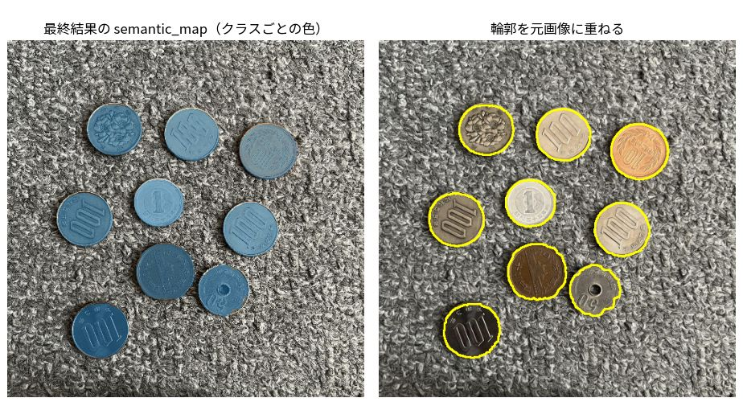

最終結果。9 枚のコインが、縁に沿って切り出された。前景の面積比は 16%。

- 50 円玉の縁は、他のコインよりやや荒い（1 回目の出力で確率が低かった 2 枚のうちの 1 枚）。

**カップ麺の場合**

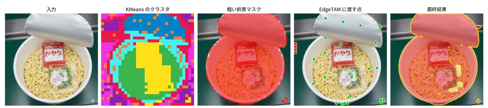

- 左から、入力・KMeans・粗い前景マスク・EdgeTAM に渡した点・最終結果。カップ・フタ・麺・袋が、輪郭に沿って切り出された。
- 残る誤りは、再推定の節の 2 つ（星印のロゴ・画面下端の四角い塊）。粗い段階の誤検出が、そのまま最終結果に残る。

## 出力

| 値 | 内容 |
|---|---|
| `semantic_map` | 元画像と同じ大きさの `uint8`。0 = 背景、1〜 = 前景クラス |
| `prompt_indices` | クラス 1〜 に対応する前景プロンプトの番号 |
| `point_coords` / `point_labels` | EdgeTAM に与えた点（画像座標、全クラス分）と、ラベル（1 = 正例、0 = 負例） |
| `debug_images` | 中間画像（クラスごとの粗いマスク・core・EdgeTAM のマスク・スコアなど） |

## 設定

| キー | 値 | 意味 |
|---|---|---|
| `edgetam_foreground_points_per_class` | 4 | クラスごとの正例点（各成分の最内点は必ず含む） |
| `edgetam_background_point_count` | 4 | 背景の負例点 |
| `edgetam_refine_iterations` | 2 | デコーダの反復回数 |
| `semantic_max_side` | 1024 | マスク演算の作業解像度（長辺） |
| `edgetam_high_res_feature_downscale_factor` | 4 | 高解像度特徴量の縮小倍率（初期マスク・ガイドの大きさ。512 入力で 128×128） |

`core/common/params.py` の固定値:

| 名前 | 値 | 意味 |
|---|---|---|
| `PRIOR_LOGIT_RANGE` | 8 | 初期マスクのロジット幅（ロジット = (2p − 1) × 8） |
| `PRIOR_NON_CORE_PROBABILITY` | 0.5 | 「不明」の確率 |
| `GUIDED_FILTER_EPS` | 0.01 | ガイデッドフィルタの正則化（0.001〜0.01 で結果は同じ） |
| `MIN_ISOLATED_PATCHES` | 3 | これ未満の孤立成分は、クラスの推定に混ぜない |
| `BACKGROUND_POINT_MARGIN` | 2 | 負例点を前景から離す距離（パッチ） |
| `SCORE_PRIOR_WEIGHT` | 0.5 | スコアで、粗い前景らしさに置く重み |
| `MASK_LOGIT_THRESHOLD` | 0 | 前景にするロジットのしきい値 |
| `GAP_FILL_PIXELS_PER_PATCH` | 8 | 隙間埋めの探索を行う縮小倍率（1 パッチ = 8 画素） |

## 限界

- **粗い誤りは直せない。** 背景を前景と判定したクラスは、そのまま前景になる。後から再判定して消す案も試したが、悪化した。
- **点は連結成分ごと。** 接した複数の物体は 1 つの成分になり、点も 1 つ（このコイン画像の右の 3 枚）。切り出せるかは初期マスクと反復に依る。
- **負例点が端に寄る。** 画像の中央の背景には置かれない。ばらしても精度は上がらなかった。
- **透明・低コントラストの物体**は、ガイデッドフィルタの手がかり（輝度の縁）が弱く、背景への広がりが残ることがある。
- 処理時間: デコード（1 回 約 6〜7ms）の回数は「クラス数 × 反復回数 +（再推定した成分数 × 反復回数）」。クラスが多い画像ほど遅い。

過去の実験（外周「不明」・ガイデッドフィルタ・SAM2.1 への切り替え・点数・割れの穴埋めなど）の記録は [method_history.md](method_history.md)。
