# ② 詳細セグメンテーション

粗い結果（32×32 のパッチ）を**ヒント**にして、EdgeTAM で画素単位の輪郭を切り出し、1 枚のセマンティックマップにまとめる。
コードは `core/common/detail/`（進行役 `refiner.py` の `SemanticRefiner`、1 領域の推定 `region_estimator.py` の `RegionEstimator`）。全体は [overview.md](overview.md)、前の段階は [coarse_segmentation.md](coarse_segmentation.md)。

| | 内容 |
|---|---|
| 入力 | ① の出力（前景マスク・粗いラベル・前景確信度）・EdgeTAM の特徴・リサイズ済みの入力画像・PE のパッチ特徴（最後の名前付け） |
| 出力 | `semantic_map`（元画像と同じ大きさ。0 = 背景、1〜 = 前景クラス）・EdgeTAM に与えた点 |

粗い結果は「だいたいどこに何があるか」は分かるが、**輪郭は信用できない**（縁・影で最大 1 パッチ太り、縁のパッチは物体と背景が混ざって落ちる）。そこで、内側は確実・縁とその外側 1 パッチは「不明」・それより外は背景として EdgeTAM に渡す。

## フロー

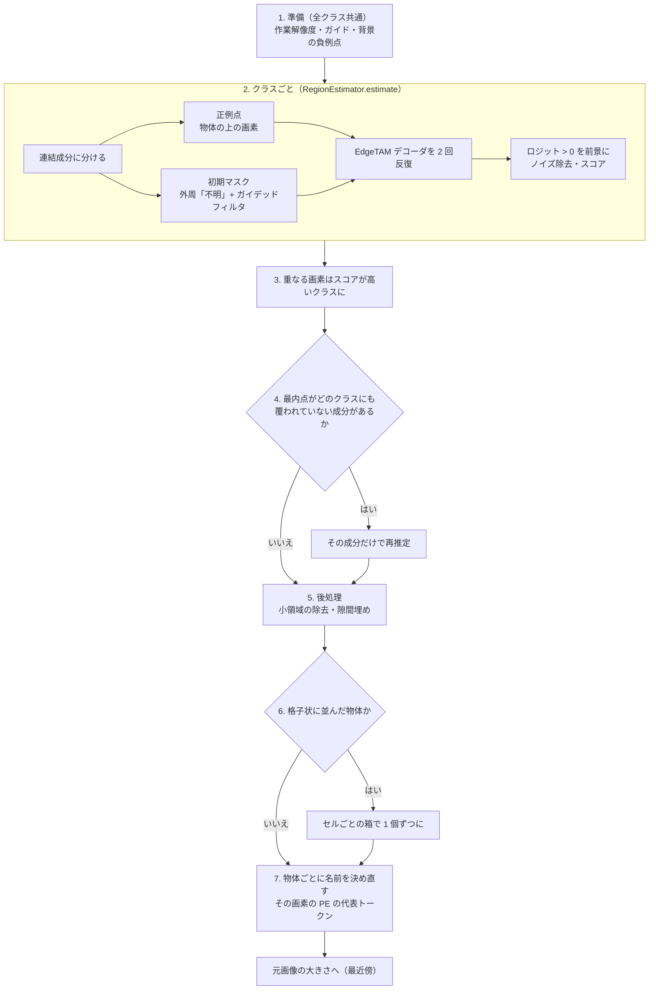

クラスごとの推定（2）は読むだけの処理なので、`worker_threads` があれば、次のクラスのデコードと重ねて走る。結果の反映（3）は常にクラス番号の順で、出力はスレッドの有無で変わらない。

| 段階 | 関数（ファイル） | 解決する課題 |
|---|---|---|
| 1 準備 | `RegionEstimator.prepare`（`region_estimator.py`）・`select_background_points`（`prompt_points.py`） | 全クラスに共通の入力を 1 回だけ作る |
| 2 推定 | `RegionEstimator.estimate`（`region_estimator.py`） | 粗い格子の輪郭を画素単位にする |
| 3 重なり | `SemanticRefiner._refine_classes`（`refiner.py`） | EdgeTAM は 1 回に 1 マスク → クラスごとに推定し、スコアで決める |
| 4 再推定 | `SemanticRefiner._rescue_uncovered`（`refiner.py`） | 切り出せなかった物体を拾う |
| 5 後処理 | `remove_small_regions`・`fill_narrow_gaps`（`mask_cleanup.py`） | 小さな斑点・クラス境界の割れ目 |
| 6 格子 | `LatticeSeparator`（`lattice_separator.py`・`lattice.py`） | 隙間が 1 パッチ未満の物体の集まり |
| 7 名前付け | `RegionNamer.name`（`naming.py`） | 粗い段階の名前は背景の混ざったブロックで決まり、小さな物体は判定し直されない → 種類の違う物体が同じ名前 |

この資料の例は、コイン（クラス 1 つ・9 枚）とカップ麺（クラス 4 つ・取りこぼしの再推定あり）。作業解像度は、どちらも長辺 1024（`semantic_max_side`。コインは 3024 → 1024、カップ麺は元から 1024）。

## 1. 準備

| 準備 | 内容 |
|---|---|
| 作業解像度 | `scale = min(1, 1024 / 長辺)`。マスク演算は長辺 1024 以下で行い、最後に元画像サイズへ戻す |
| 最小面積 `min_area` | 粗いマスクの信頼限界（1 パッチ）に当たる作業解像度の画素数（どちらの例も 1024 画素）。これ未満の領域はノイズとして扱う |
| ガイド | 入力画像の輝度を、EdgeTAM の高解像度特徴量の大きさ（128×128）に縮小したもの |
| 背景の負例点 | 全クラス共通で 4 点（`select_background_points`） |
| 物体らしさの材料 | EdgeTAM の特徴 3 層の画素ごとの L2 正規化と、背景の特徴の平均（画像に 1 回） |

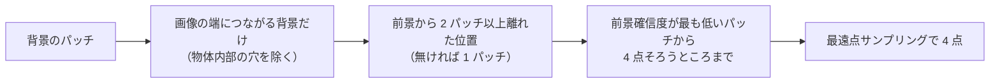

左から、粗い前景マスク・前景確信度・選ばれた負例点（赤枠）。コイン:

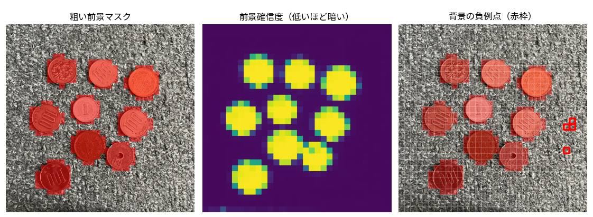

カップ麺:


- どちらも、負例点は画像の端に並ぶ（コインは右端、カップ麺は左端）。伝播で確信度が連続値になり、「最も低いパッチ 4 個」がそのまま候補になるため。点をばらしても精度は上がらなかった（[method_history.md](method_history.md)）。

## 2. クラスごとの推定

### 連結成分と正例点

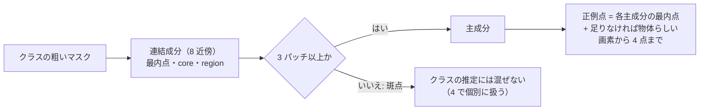

| 用語 | 意味 |
|---|---|
| 最内点（`peak`） | 成分の中で、背景から最も遠い位置（距離変換が最大） |
| core | 成分を 1 パッチ内側へ縮めたもの（縮めると消える成分では成分そのもの） |
| region | 成分のマスク |

左: 連結成分（色 = クラス、白線 = core、黄点 = 最内点）。右: EdgeTAM に最終的に渡した点（緑 = 正例、赤 = 負例。取りこぼしの再推定の点を含む）。コイン:

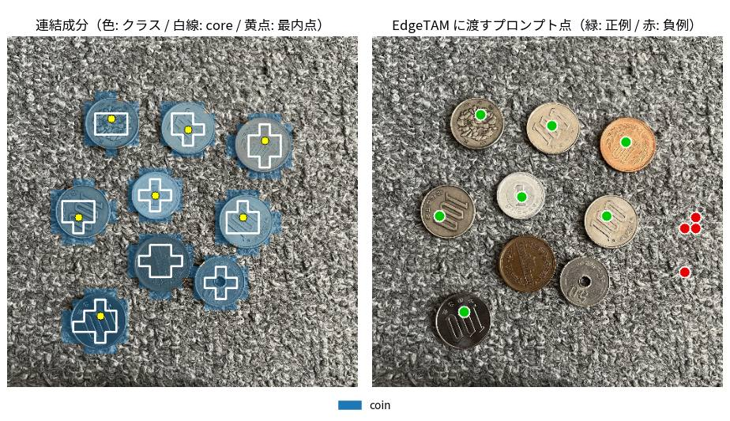

カップ麺:

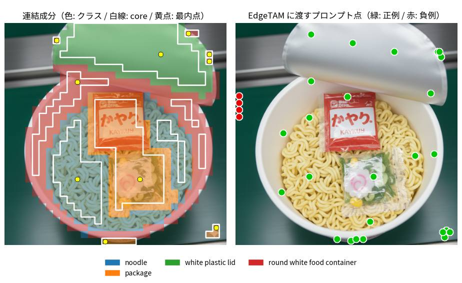

- コインは 9 枚あるが、成分は 7 つ。右側から下側の 3 枚が粗いマスクでつながって 1 つの成分（76 パッチ）になり、最内点は 1 つだけ。最内点の数（7）が `edgetam_foreground_points_per_class`（4）を超えるので、追加の点は選ばれない。正例 7 点・負例 4 点。
- カップ麺はクラス 4 つ。`package` は 4 成分（157・5・3・1 パッチ）、`round white food container` も 4 成分（197・2・1・1 パッチ）。**3 パッチ未満の成分（斑点）は、クラスの推定に混ぜない**（4 で個別に扱う）。
- クラスごとの正例点は 4 点（`edgetam_foreground_points_per_class`）。再推定した 3 成分にも、それぞれ点が置かれる（最終的に正例 28 点・負例 28 点）。

### 正例点の選び方（物体らしさ）

点をパッチの中心に置くと、縁のパッチでは物体の外に落ち、細い物体では一部に偏る。EdgeTAM は点のある領域だけをマスクにするので、偏りは欠けになる。そこで、EdgeTAM の高解像度特徴量（128×128）の**画素**から選ぶ（`prompt_points.py`）。

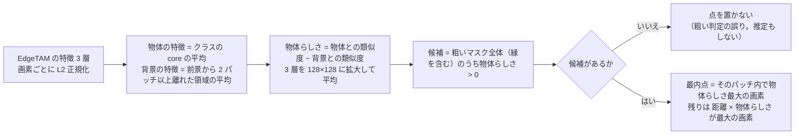

物体らしさのマップ（赤が正 = 物体の特徴に近い。白線 = 粗いマスク、緑点 = 選ばれた正例点）。コイン:

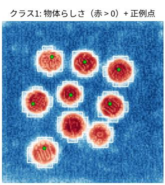

カップ麺（左から、クラス 1〜4）:

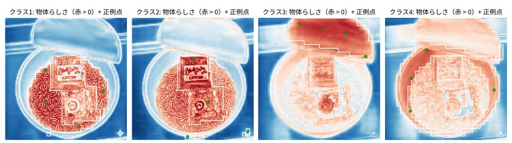

- コインの点（7 点）は、コインの上に置かれる。カップ麺は、クラスごとに違う場所が赤くなる（クラス 1 の麺は麺の模様の上、クラス 3 のふたはふたの上、クラス 4 のカップはカップの縁の輪の上）。点はその赤い所に置かれる。
- 背景の特徴が作れないとき（前景が画像の全体など）は、パッチの中心から選ぶ（`prompt_points`）。
- **物体の特徴は、領域自身の core ではなく、クラスの本体の core を基準にする（極小の成分）。** 取りこぼしの再推定の対象になる 1〜2 パッチの成分は、領域自身の core が成分そのものになる。成分が背景のパッチなら基準も背景になり、ほぼ全画素が「物体らしい」になって点が背景に置かれる。クラスの本体の core を基準にすると、背景のパッチには物体らしい画素が無く、点を置かない（推定もしない）。

### 初期マスク（事前確率）

粗いマスクを「正解」にすると太りも欠けも引き継ぐ。**core は前景・縁とその外側 1 パッチは不明・それより外は背景**として渡す。

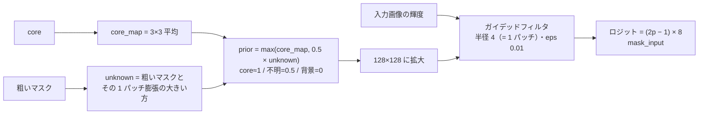

①core ②粗いマスクと外側 1 パッチ ③事前確率（32×32 のまま）④128×128 に拡大 ⑤ガイデッドフィルタ後。面積が最大のクラスで示す（コインは `coin`、カップ麺はカップ）。コイン:

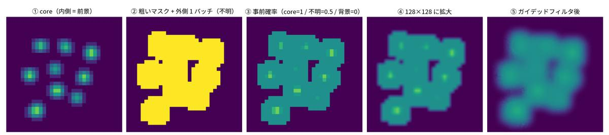

カップ麺:

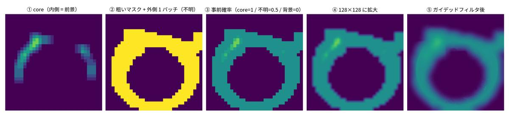

- core（①）は、成分の内側の小さな塊。コインでは各コインの中心の数パッチ、カップ麺のカップは薄い弧が 2 か所に分かれる。② は粗いマスクの外側 1 パッチまで含む（カップ麺は太い輪）。
- ③ は段差のある格子の形。④ で拡大し、⑤ でガイデッドフィルタをかけると、段差が消えて滑らかな縁になる。

面積が中央の成分の周りの拡大（左から、入力・③・⑤。コインは左中段の 1 枚、カップ麺はふた）。コイン:

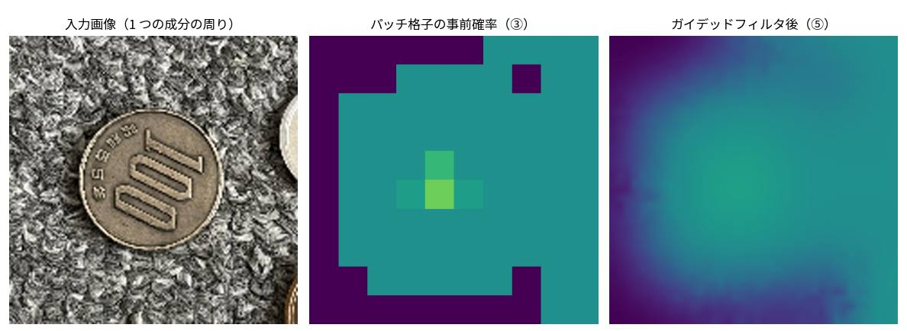

カップ麺:

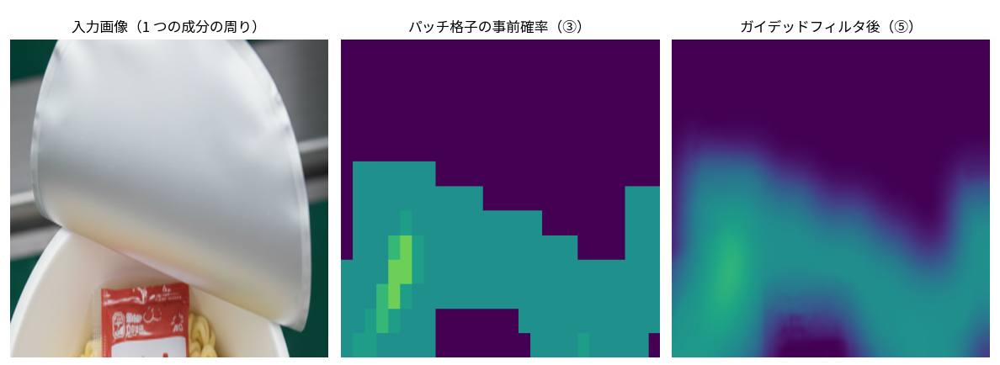

- ⑤ では ③ の段差が消える。このコインの周りは、背景のカーペットに細かい縁が多く、⑤ の縁はコインの輪郭にぴたりと沿うわけではない。**最終の輪郭は、この初期マスクではなく EdgeTAM のデコーダが決める。**
- **外側 1 パッチも「不明」にする理由**: 粗いマスクは物体より内側に入ることがある（縁のパッチは落ちやすい）。外側を背景にすると縁が戻らず削れる。
- **ガイデッドフィルタの狙い**: 外側を一律に不明にすると、小物体では不明の領域が物体と同じ大きさになり背景へ膨らむ。画像の明るさの縁に沿って物体側・背景側へ倒す。

### デコーダの反復

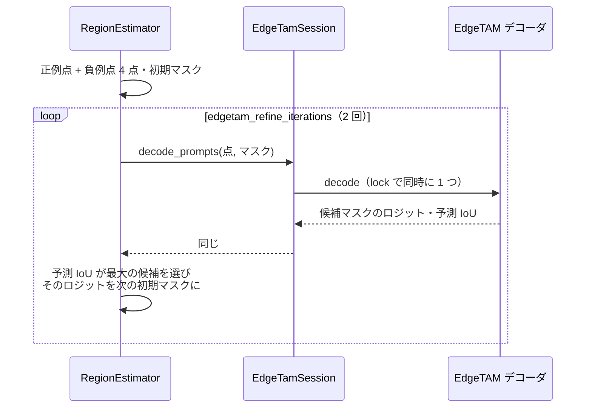

左から、初期マスク・1 回目の出力・2 回目の出力（確率）・ロジット > 0 を前景にした結果。コイン:


カップ麺（カップのクラス）:

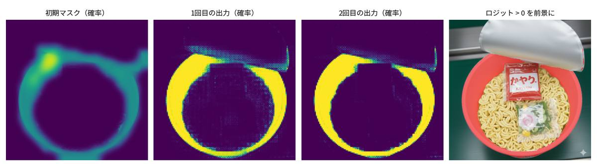

- コイン: 初期マスクは山があるだけで輪郭はぼんやりしている。1 回目で輪郭が出る。右下の 2 枚（点のない側）は確率が低くまだらで、2 回目（前回のロジットを初期マスクにする）で、右下の 1 枚を除いて整う。
- カップ麺: 初期マスクはカップの縁の薄い輪（上側が濃い）。1 回目の出力はカップの縁の輪になり、ふたの下端に沿う細い線（右端で上へ伸びる）が混じる。2 回目で輪が整い、その細い線は右端だけに短くなる。

### 二値化とスコア

- 二値化: ロジットを作業解像度へ拡大して > 0 を前景にし、`clean_mask`（`mask_cleanup.py`）で 1 パッチ未満の成分を除いて、メディアンフィルタ（3×3）で輪郭をならす。
- 重なり解決用のスコア: `EdgeTAM の確信度 × (0.5 + 0.5 × 粗い前景らしさ)`。両方が確信できる所を高くする。

コイン（クラスごとに 1 行。左から、粗いマスク・EdgeTAM のマスク・スコア）:

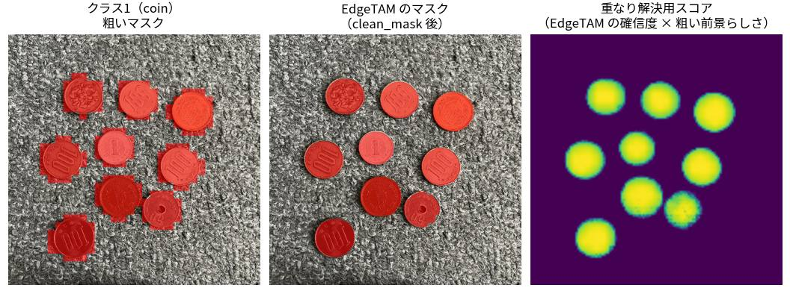

カップ麺（クラス 1〜4 を上から）:

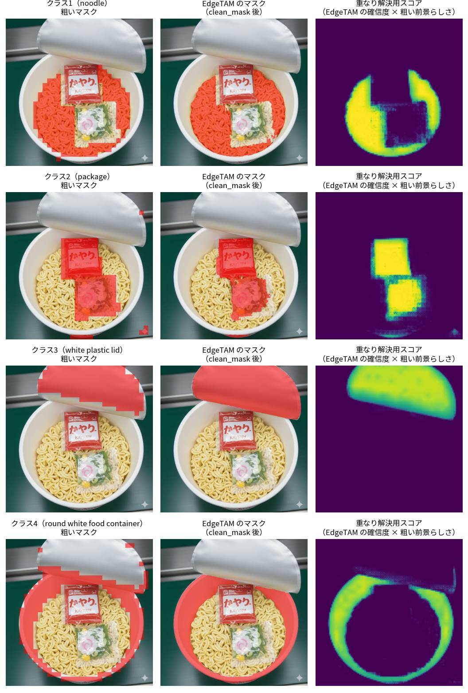

- コインは、粗いマスク（コインより一回り大きい四角い塊）が、EdgeTAM のマスクではコインの縁に沿う。
- カップ麺は、粗いマスクの段差のある形が、EdgeTAM のマスクでは物体の形になる。クラス 1（麺）のマスクは、包装の上を避けている。クラス 4（カップ）のスコアは輪の形で、輪の内側（麺の上）は低い。

## 3. 重なりの解決

```python
win = result.binary & (result.score > state.best_score)
state.semantic_map[win] = class_id
state.best_score[win] = result.score[win]
```

クラスは独立に推定するので、同じ画素を複数のクラスが主張しうる。スコアが高いクラスを優先する（同点は先のクラス）。

コインはクラスが 1 つなので重ならない（主張が重なる画素は 0）。カップ麺（左上から、クラス 1〜3、下段: クラス 4・重なった画素・重なりの解決後）:

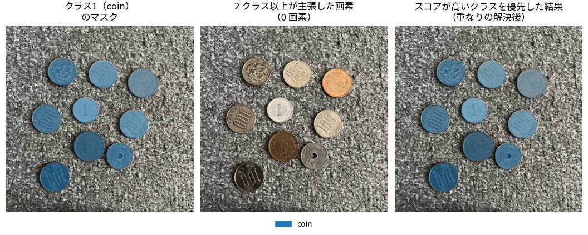

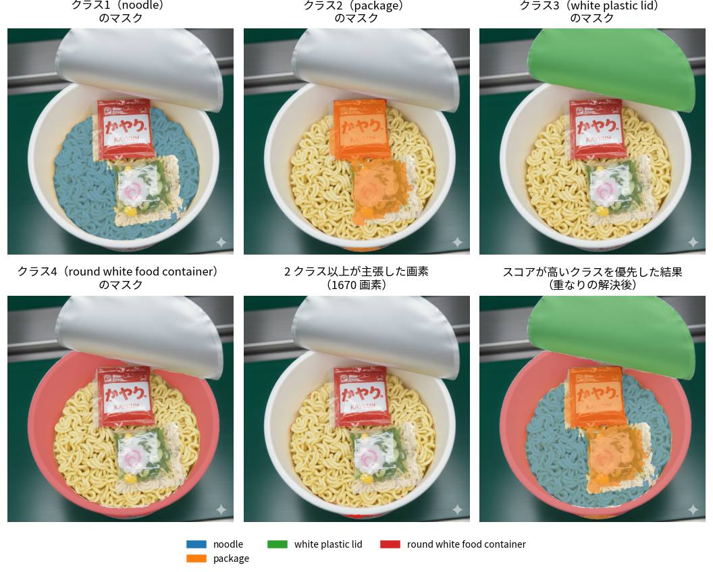

- カップ麺で 2 クラス以上が主張した画素は 1,670 画素（作業解像度）。重なりの解決後は、各画素が 1 つのクラスになる。
- ここまでは、反映はクラス番号の順。デコードと推定はスレッドで重ねて走る（[overview.md](overview.md#並行して走る処理)）。

## 4. 取りこぼしの再推定

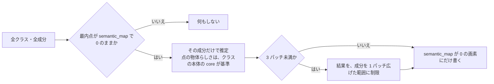

- 覆われているかは、成分の**最内点 1 点**だけで決める。確定した画素は上書きしない。
- クラスの反映が済んだ時点で覆われていない成分は、先にまとめて推定を始める（投機的）。反映の時点で、先の再推定に覆われていたら結果を捨てる。

**コインでは発動しない**（7 つの成分の最内点は、すべてクラスのマスクに覆われた）。カップ麺で発動した（左から、再推定の前・覆われていない成分（赤枠・黄点: 最内点）・再推定で足された画素・再推定の後）:

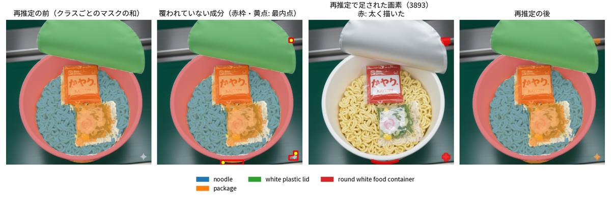

- 覆われていない成分は、すべて `package` の 3 つ（1 パッチの (29, 4)・3 パッチの (30, 29)・5 パッチの (14, 31)）。図の赤枠は、右上の机の縁・右下の星印・下端にある。
- 再推定で足されたのは 3,893 画素（作業解像度。図では赤を太く描いた）。デコードは（4 クラス + 再推定 3 成分）× 2 回 = 14 回。
- 3 パッチ以上の成分には、極小成分の制限（成分を 1 パッチ広げた範囲）は働かない。ただし、成分が背景のパッチなら、前景点を置く物体らしい画素が無く、再推定されない（上の「物体の特徴は、クラスの本体の core」）。

## 5. 後処理

| 処理 | 内容 |
|---|---|
| `remove_small_regions` | ① クラスごとに、1 パッチ未満の連結成分を背景に戻す（クラスごとの検出はスレッドで並行）。② 背景に残った小さな穴を、周囲で最も多いクラスで埋める |
| `fill_narrow_gaps` | 前景内部の、**幅 1 パッチ未満で両側が 2 クラス以上に接する**背景の隙間を、最寄りのクラスで埋める |

どちらも、**EdgeTAM が切り出した後の `semantic_map`（作業解像度の画素）** を整える（`detail/mask_cleanup.py`）。`fill_narrow_gaps` は、隙間が「粗い前景の内部」かの判定にだけ、粗い前景マスクを読む。

隙間は、1 つの物体が複数クラスに分かれ、その境界が画像の強い縁（ハイライト線など）に重なると、どのクラスのマスクもそこで止まって残る。粗い前景の分解能（1 パッチ）より細い背景は、背景と言えないので埋める。1 クラスの物体の凹み・穴（両側が同じクラス）は埋めない。

左から、重ね合わせ + 再推定の後・小領域の除去（赤 = 変わった画素。数画素でも見えるよう太く描いた）・隙間埋め（同）。コイン:

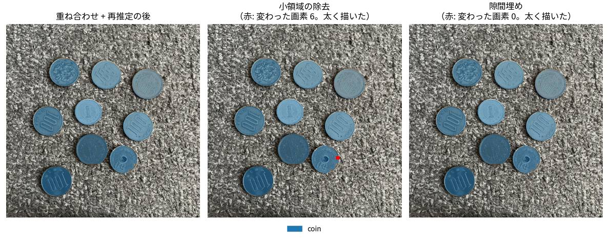

カップ麺:

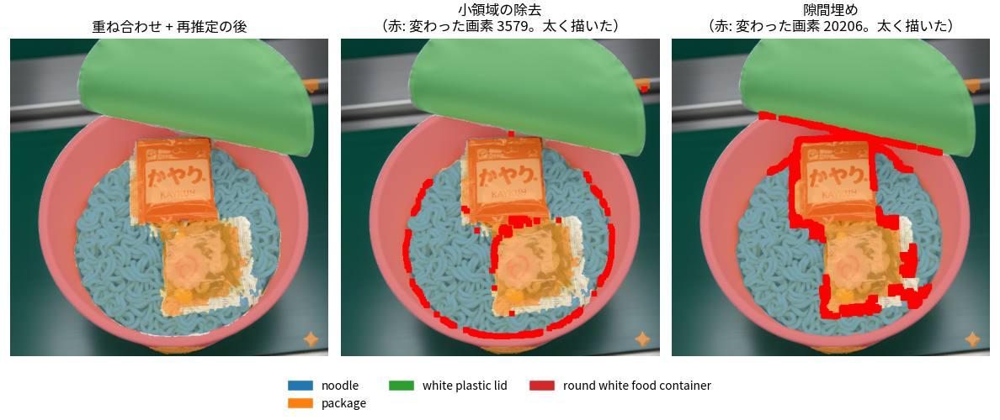

- コインは、小領域の除去で 6 画素、隙間埋めで 0 画素が変わる（ほぼ変化なし）。
- カップ麺は、小領域の除去で 3,579 画素、隙間埋めで 20,206 画素が変わる。図では、除去は麺とカップの境目（円周）と包装の周りの細い切れ端、隙間埋めはふたとカップの境目・包装の周りの隙間に出ている。

## 6. 格子状に並んだ小物体の分離

隙間が 1 パッチ未満の物体の集まり（トレイ・巣・ブリスターの同じ物体）は、粗い前景が 1 つの塊になり、EdgeTAM は点に従って塊全体を返す。**画像の勾配の自己相関で格子を検出したときだけ**、セルごとの箱プロンプトで 1 個ずつに分ける。検出の段階は [lattice_detection.md](lattice_detection.md)。

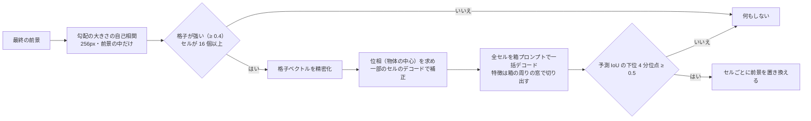

**この 2 枚では作動しない**。左は前景の中の勾配の大きさ、右はその自己相関（中心 = 遅れ 0）。格子なら、周期の位置に強いピークが並ぶ。コイン:

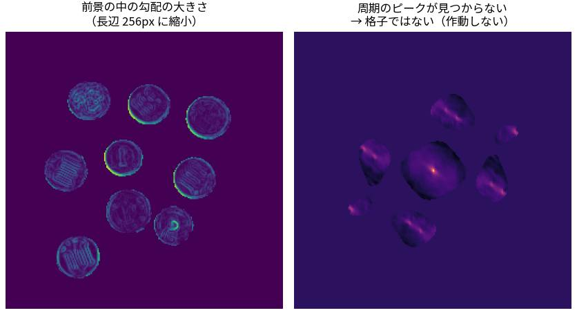

カップ麺:

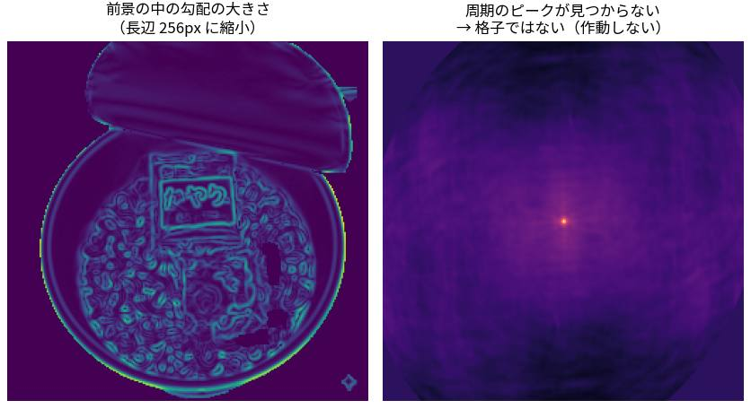

- どちらも、周期の位置に格子の強さ（≥ 0.4）を満たすピークが見つからず、何も変えない（判定は 5 ms 前後）。
- 作動の例は、006（シリンジの巣 80 個）。作動すると、検出 22 ms + 位相の補正 16 ms + セルごとのデコード 76 ms（この PC）。006 で IoU 0.69 → 0.91。作動する条件は狭く、MVTec・実画像・COCO128・D2S ではほとんど作動しない。
- デコーダーは画像サイズ可変なので、窓ごとに別の画像として一括実行できる。`ov_static_shape` のときも、この呼び出しだけは動的形状のモデルで推論する。


## 7. 最終の名前付け

粗い段階の名前（[coarse_segmentation.md](coarse_segmentation.md) ④）は、物体の縁で背景と混ざったブロックの照合で決まり、前景の 1/8 より小さい領域は判定し直されない。そのため、種類の違う物体が同じ名前のまま残る。**精緻化の後に、EdgeTAM が切り出した物体（画素単位）の領域ごとに、その画素だけから作った代表トークンで名前を決め直す**（`RegionNamer.name`、`detail/naming.py`）。変えるのはクラスの名前だけで、前景のマスクは変えない。

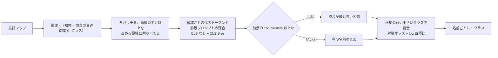

領域ごとの照合の表。コイン:

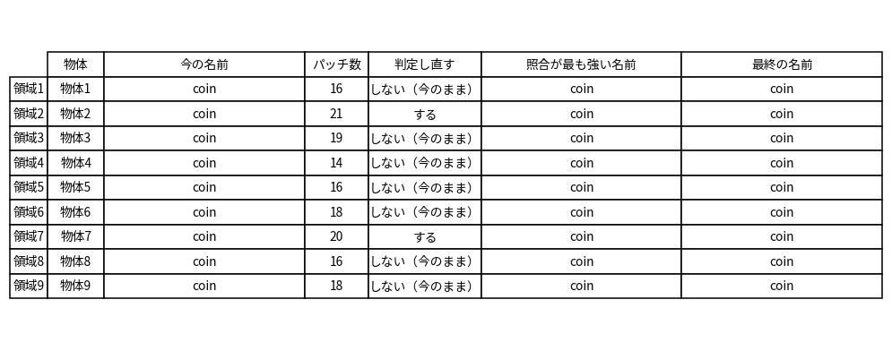

カップ麺:

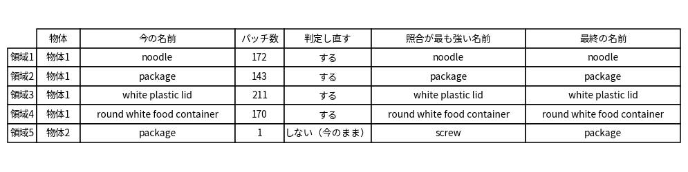

左から、名前付けの前・領域に割り当てたパッチ（色 = 領域。番号は上の表の行）・名前付けの後。コイン:

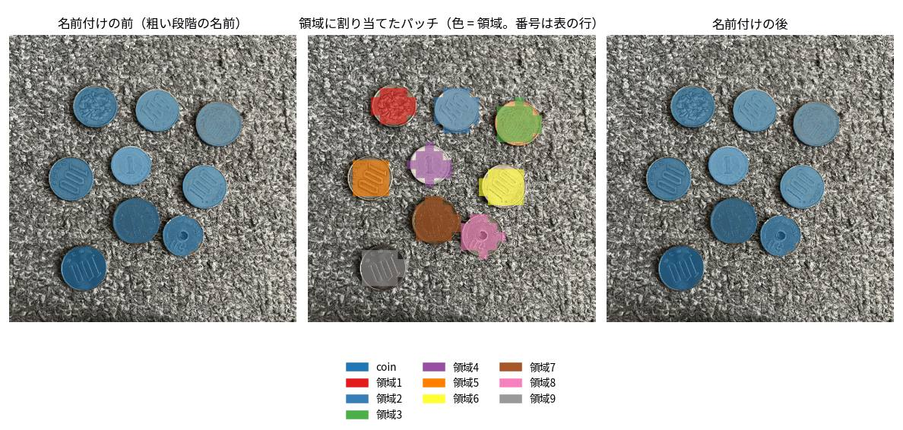

カップ麺:

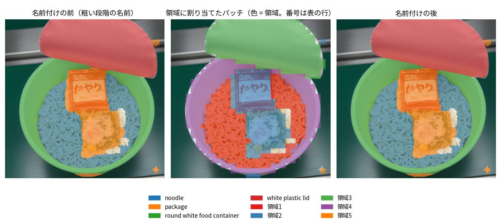

- **どちらの画像も、名前は変わらない。** コインは領域 9 つのうち、判定し直す（前景のパッチ数 / `k_clusters` 以上）のは 2 つで、照合が最も強い名前はどれも `coin`。カップ麺は 4 つの大きな領域が判定し直され、名前は同じ。
- カップ麺の領域 5（別の物体: 右下の星印の 1 パッチ）は、小さすぎるので判定し直さない。判定し直すと照合は `screw` が最も強く、別の名前が付くところだった（これが小さな領域を判定し直さない理由）。
- 名前が変わるのは、種類の違う複数の物体が 1 つのクラスにまとまっていた画像（種類別の合成画像など）。測定は [method_history.md](method_history.md)。

| 段 | 内容 |
|---|---|
| 領域 | 最終マップの前景の 8 連結成分（物体）× クラス。パッチに占める割合は、1 パッチを 8×8 点（`GAP_FILL_PIXELS_PER_PATCH`）の標本で数える |
| 根拠 | `RegionNamer.region_logits`。CLS なしの代表トークン（`extract_region_tokens`）と CLS 込みのトークン（`extract_cluster_tokens`）の、前景プロンプトとのロジットの和 |
| 判定し直し | 照合が最も強い名前にする。前景のパッチ数 / `k_clusters` より小さい領域は、今の名前のまま（④ (a) と同じ基準。1〜2 パッチのトークンの照合はノイズが大きい） |
| 統合 | ④ (b) の `merge_weak_classes` と同じ（画像全体で、小さいクラスから、対数オッズ + log 面積比が正なら大きいクラスへ） |

- 新しいパラメータは無い（`k_clusters`・`CLIP_LOGIT_SCALE`・`GAP_FILL_PIXELS_PER_PATCH` を使う）。
- 処理時間は 8.5 ms（コイン・カップ麺とも。照合のモデル 2 回を含む）。
- 効果の測定と、採らなかった案は [method_history.md](method_history.md)。

## 最終結果

最後に、作業解像度の `semantic_map` を元画像の大きさへ戻す（最近傍補間。クラス番号を補間で壊さない）。左: クラスごとの色、右: 輪郭を元画像に重ねたもの。コイン:

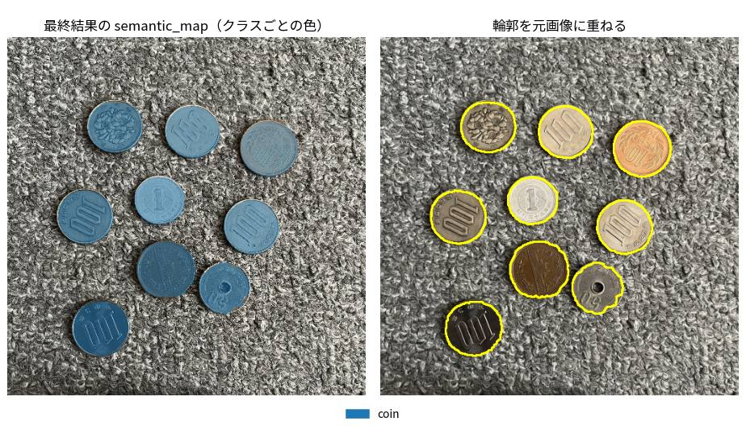

カップ麺:

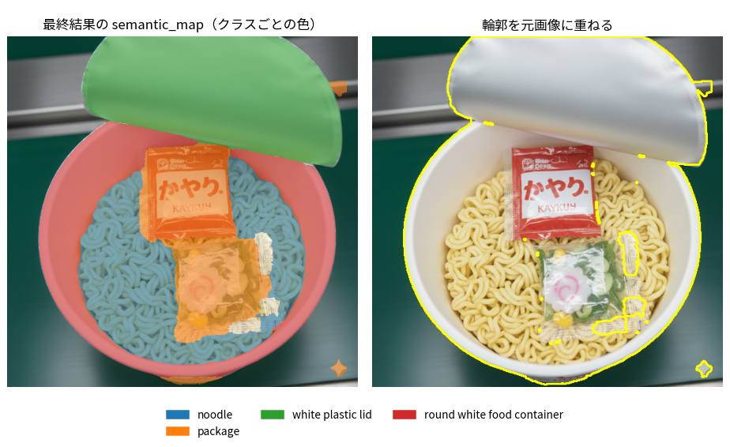

- コイン: 9 枚が 1 つのクラス `coin`。輪郭はコインの縁に沿う。
- カップ麺: ふた・カップ・麺・包装の 4 クラス。右下の星印（`package`）も前景に含まれ、透明な包装の右の縁には細かい輪郭が出ている（右の図の黄線）。

## 出力

| 値 | 内容 |
|---|---|
| `semantic_map` | 元画像と同じ大きさの `uint8`。0 = 背景、1〜 = 前景クラス |
| `prompt_indices` | クラス 1〜 に対応する前景プロンプトの番号 |
| `point_coords` / `point_labels` | EdgeTAM に与えた点（画像座標、全領域分）と、ラベル（1 = 正例、0 = 負例） |
| `debug_images` | 中間画像（クラスごとの粗いマスク・core・EdgeTAM のマスク・スコア・後処理前の `semantic_map` など） |

## 設定

| キー（`configs/ov_config.yaml`） | 値 | 意味 |
|---|---|---|
| `edgetam_foreground_points_per_class` | 4 | クラスごとの正例点（各成分の最内点は必ず含む） |
| `edgetam_background_point_count` | 4 | 背景の負例点 |
| `edgetam_refine_iterations` | 2 | デコーダの反復回数 |
| `semantic_max_side` | 1024 | マスク演算の作業解像度（長辺） |
| `worker_threads` | 2 | 領域の推定などを重ねるスレッド数（0 で重ねない。出力は変わらない） |

`core/common/params.py` の固定値:

| 名前 | 値 | 意味 |
|---|---|---|
| `PRIOR_LOGIT_RANGE` | 8 | 初期マスクのロジット幅（(2p − 1) × 8。0.5 = 不明 = ロジット 0） |
| `GUIDED_FILTER_EPS` | 0.01 | ガイデッドフィルタの正則化（0.001〜0.01 で結果は同程度） |
| `EDGETAM_FEATURE_STRIDES` | (4, 8, 16) | EdgeTAM の特徴の縮小倍率（512 入力で 128・64・32） |
| `MIN_ISOLATED_PATCHES` | 3 | これ未満の孤立成分は、クラスの推定に混ぜない |
| `BACKGROUND_POINT_MARGIN` | 2 | 負例点を前景から離す距離（パッチ） |
| `SCORE_PRIOR_WEIGHT` | 0.5 | スコアで、粗い前景らしさに置く重み |
| `GAP_FILL_PIXELS_PER_PATCH` | 8 | 隙間の探索に使う縮小倍率（1 パッチ = 8 画素）。最終の名前付けで、領域がパッチに占める割合を数える標本（1 パッチ 8×8 点）にも使う |
| `LATTICE_*` | — | 格子の検出・位相・デコードの値（意味は `params.py` のコメント） |

## 限界

- 粗い誤りは直せない（背景を前景と判定したクラスは前景のまま。後から再判定して消す案は悪化した）。
- 点は連結成分ごと。接した複数の物体は 1 つの成分になり、点も 1 つ（このコイン画像の右側から下側の 3 枚）。切り出せるかは初期マスクと反復に依る。
- 正例点を物体の上に選ぶ効果は、細長く領域が分かれた物体（toothbrush など）に偏る。
- 負例点は端に寄る（ばらしても精度は上がらなかった）。
- 透明・低コントラストの物体は、ガイデッドフィルタの手がかり（輝度の縁）が弱く、背景への広がりが残ることがある（カップ麺の透明な包装の縁）。
- デコード 1 回は約 5 ms（この PC。クラスごとに反復の回数だけ）。回数は「（クラス数 + 再推定した成分数）× 反復回数」。クラスが多い画像ほど遅い。
- 最終の名前付けの名前は前景プロンプトの語彙で決まる。語彙に無い物体は、物体ごとに別の名前になりうる。前景の 1/8 未満の小さな物体は、粗い段階の名前のまま。
- クラス単位のデコードは、離れた複数の物体をまとめて 1 回でデコードする。小さな物体が散らばる画像（格子の合成データ）では、物体の間の背景までマスクになる（物体ごとのデコードで改善するが、デコードの回数が物体の数に比例する。保留。[method_history.md](method_history.md)）。

過去の実験（外周「不明」・ガイデッドフィルタ・SAM2.1・点数・割れの穴埋めなど）は [method_history.md](method_history.md)。
