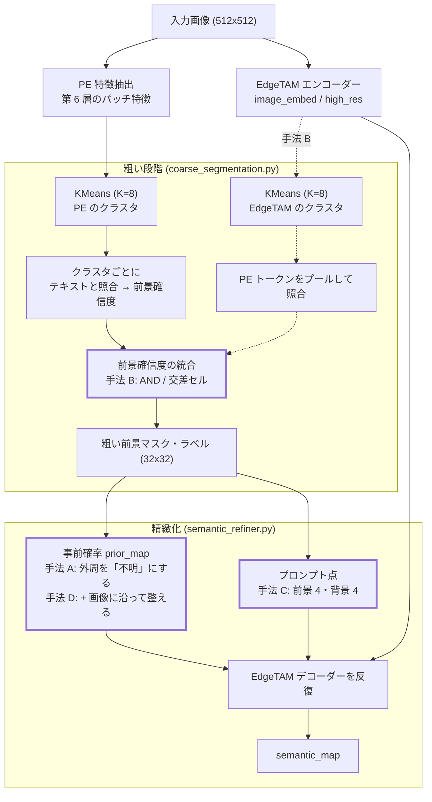
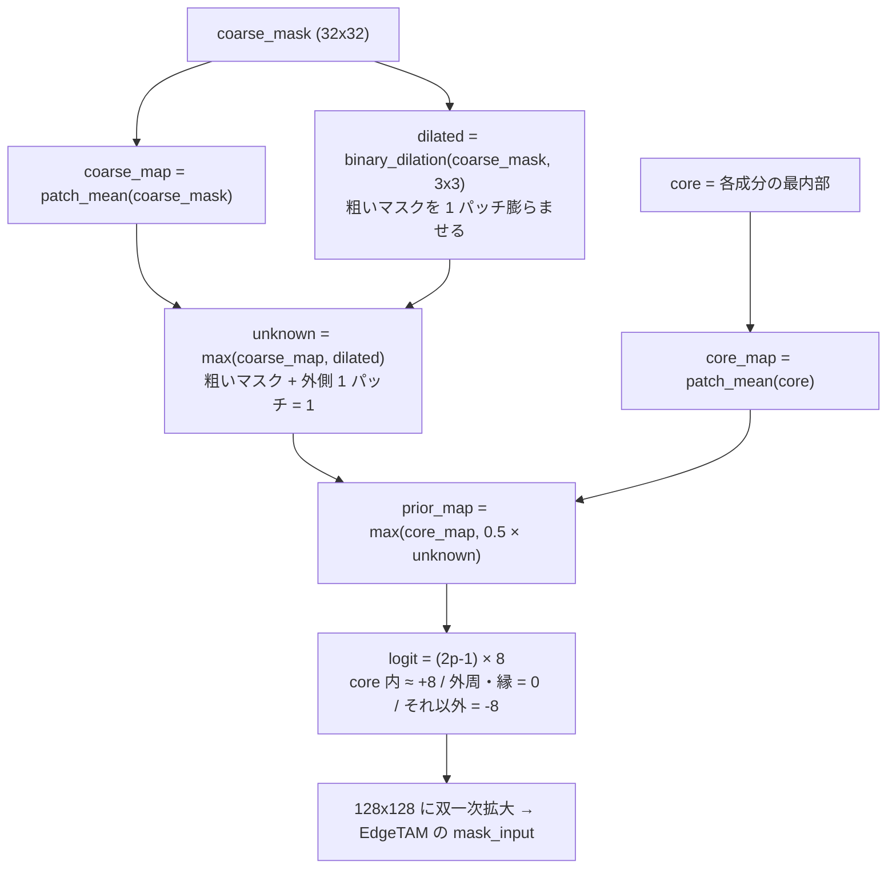
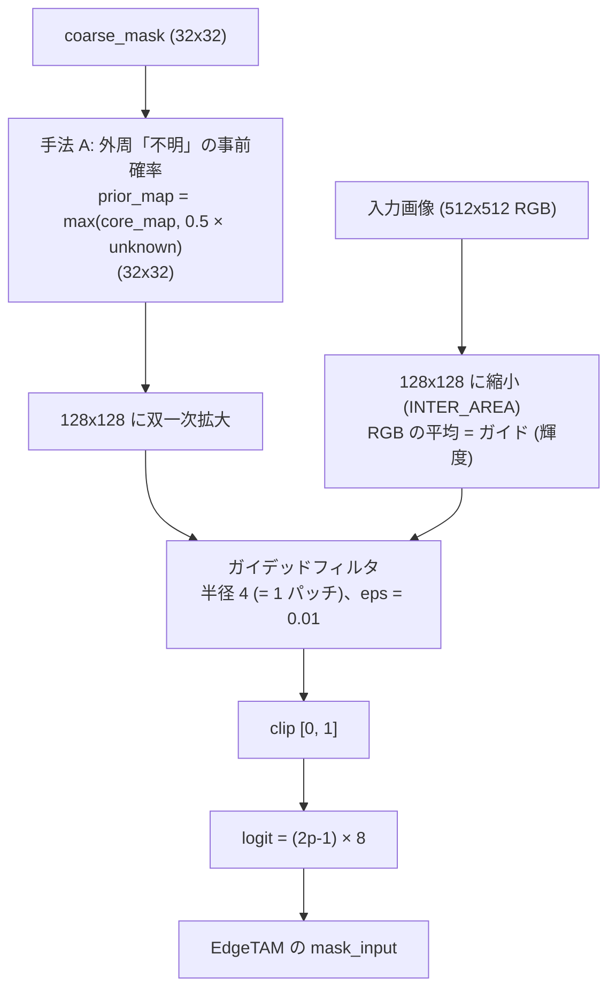
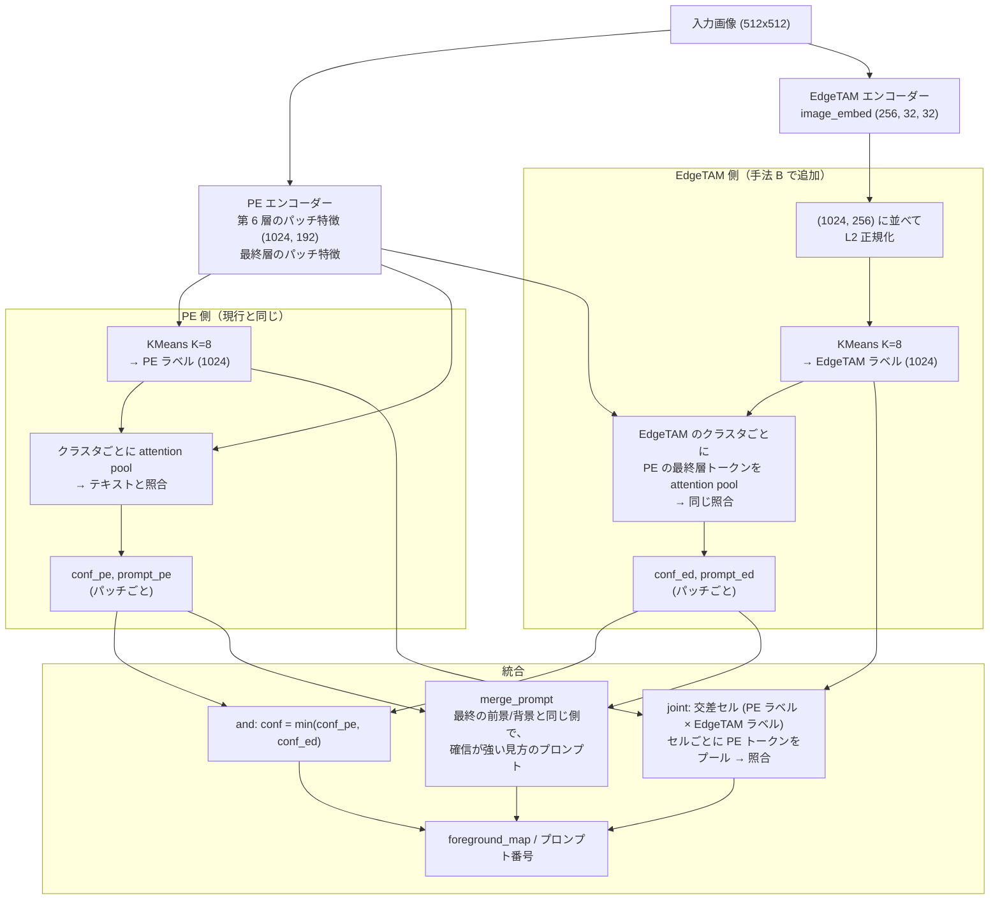
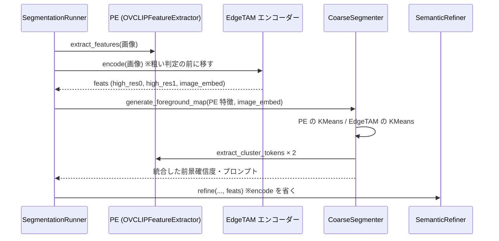
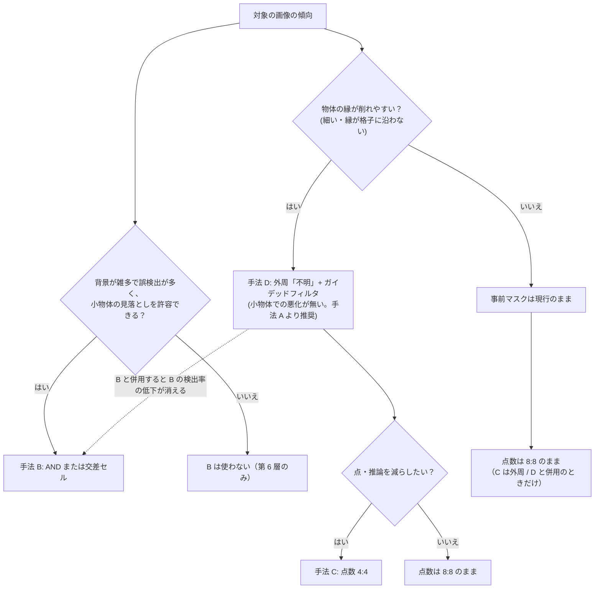

# 性能向上が確認できた手法の詳細

粗い前景/セマンティックセグメンテーション（[coarse_segmentation.md](coarse_segmentation.md)）と、EdgeTAM による精緻化（[semantic_refiner.md](semantic_refiner.md)）に対して、追加実験で**最終 IoU の向上が確認できた手法**（A: 外周「不明」、D: A の改良、B: 粗い判定の統合、C: 点数）を、実装できる粒度で説明する。各手法の検証は実験用のコード（`tools/experiments/`）で行った。**手法 D・B（AND）・C は 2026-10-22 に本体（`core/`）へ組み込み済み**（共通コードなので PyTorch・OpenVINO の両方。§9）。手法 A は D に置き換えた。各章の「差分案」は、組み込みの内容と同じ。効果が無かった手法は §8。

- [0. 前提と測定条件](#0-前提と測定条件)
- [1. 手法の全体像](#1-手法の全体像)
- [2. 手法 A: 精緻化の外周「不明」](#2-手法-a-精緻化の外周不明)
- [3. 手法 D: 外周「不明」+ ガイデッドフィルタ](#3-手法-d-外周不明-ガイデッドフィルタ事前マスクの縁を画像に沿わせる)
- [4. 手法 B: PE と EdgeTAM の別々のクラスタリングの統合](#4-手法-b-pe-と-edgetam-の別々のクラスタリングの統合)
- [5. 手法 C: プロンプト点を減らす（外周「不明」・手法 D と併用）](#5-手法-c-プロンプト点を減らす外周不明手法-d-と併用)
- [6. 手法の使い分け](#6-手法の使い分け)
- [7. 評価方法と再現](#7-評価方法と再現)
- [8. 効果が確認できなかった手法](#8-効果が確認できなかった手法)
- [9. 本体への組み込み（2026-10-22）](#9-本体への組み込み2026-10-22)

---

## 0. 前提と測定条件

### 基準（比較の起点）

現行の運用（`configs/ov_config.yaml` の `model_dir: ./weights/openvino_models_l6`）に合わせ、**PE の第 6 層のみでクラスタリング**（`cluster_layers: [6]`）し、精緻化は EdgeTAM（前景 8 点・背景 8 点・反復 3 回）。以下では「第 6 層のみ」と書く。クラスタ数 K=8（`k_clusters`）、KMeans は faiss（`KMEANS_SEED=42`）。

### 評価データと指標

| データ | 内容 |
|---|---|
| MVTec 108 枚 | `EVAL_CATEGORIES`（zipper を除く 9 カテゴリ）の dev（index 0, 7, 14…）と holdout（3, 10, 17…）を各カテゴリ 6 枚。正解は `fg_mask`（前景）。zipper は fg_mask が画面の 78% で、物体として評価する意味が無いので除く |
| MVTec 独立 54 枚 | 変種を選んだ後の確認用（index 5, 12, 19…。各カテゴリ 6 枚）。dev/holdout と重ならない |
| 合成データ 120 枚 | MVTec の部品を背景に貼り合わせた小物体・複数物体のデータ（`outputs/decontam_followup/data`。small / medium / multi 各 40 枚、背景は plain / textured / pattern / natural）。正解はインスタンスマスク |

- **最終 IoU**: 前景（`semantic_map > 0`）と正解の IoU の画像平均。
- **検出率**: 正解の物体のうち、面積の半分以上が予測に覆われた割合（S: 画像面積の 0.5% 未満、M: 5% 未満）。
- **背景の誤検出**: 予測のうち正解の外にある面積の画像比。**個数の誤差**: 予測の連結成分数と正解の個数の差の絶対値。
- **差の信頼区間**: 同じ画像での対応のある差を、ブートストラップ（3000 回）で 95% 区間にする。区間が 0 を含まないものを「有意」と呼ぶ。
- 実行は PyTorch 版（粗い判定は CPU、EdgeTAM は GPU）。**OpenVINO 版での確認はしていない**（共通コードなので動作は同じはずだが、未確認）。

### 実験の限界（共通）

- 変種を同じ 108 枚で多数比べているので、多重比較の補正は無い（独立 54 枚で一部を確認）。
- 合成データは貼り合わせで、影・照明が無い。natural 背景は実物（人・鳥・家具）を含み、正解は貼り付けた部品だけなので、誤検出の一部は前景の定義の問題。
- MVTec の screw・transistor は `fg_mask` が物体に沿っておらず（screw は一回り大きく、transistor は足の間の背景を含む長方形）、どの手法でも IoU が 0.6 前後で頭打ちになる。カテゴリ別に見る。

---

## 1. 手法の全体像



| 手法 | 段階 | 直すもの | 効果が確認できた条件 | 追加コスト |
|---|---|---|---|---|
| A 外周「不明」 | 精緻化の事前マスク | 粗いマスクが物体より内側に入ったときの縁の削れ | MVTec（大きな単体物体）。第 6 層のみで 0.815 → 0.844。ただし合成データの小物体で悪化（0.573 → 0.521） | なし（1 行） |
| **D 外周 + ガイデッドフィルタ** | 精緻化の事前マスク | A の効果を保ち、A の小物体での悪化を消す（事前マスクの縁を画像に沿わせる） | MVTec 0.844（A と同じ）、合成 0.566（現行 0.573 と有意差なし）。**A に代えて使う** | 約 3ms / 領域（NumPy） |
| B PE × EdgeTAM の統合 | 粗い判定 | 背景のクラスタを前景とする誤り（FP） | 合成データ（小物体・複数物体・雑多な背景）。IoU +0.05〜+0.10。**D と組み合わせると検出率の低下が消える**（交差セル + D: 合成 0.653、検出率 0.909） | 約 4ms（エンコーダーを使い回せば） |
| C 点数 4:4 | 精緻化のプロンプト | 点の数（推論回数・点の総数） | 外周（A）または D と併用したときだけ、8:8 と同等以上のまま点が約半分。**D + 4:4 は MVTec 0.840、合成 0.590 で、どちらも現行（0.815 / 0.573）を上回る** | 減る |

---

## 2. 手法 A: 精緻化の外周「不明」

実装: `tools/experiments/dual_cluster_recheck/exp_recheck.py` の `refine_region`（`ring=True`）。結果: `outputs/dual_cluster_recheck/index.html`、`docs/coarse_segmentation.md` §13。

### 2.1 何を直すか

EdgeTAM には、粗い結果から作った**初期マスク**（`mask_input`）を与える（[semantic_refiner.md §6.1](semantic_refiner.md)）。現行の事前確率は次のとおり。

```
prior_map = max(core_map, 0.5 × coarse_map)        # coarse_map = patch_mean(coarse_mask)（3×3 平均）
```

粗いマスクの**外側**は `coarse_map ≈ 0` なので、確率 0（logit −8、強い背景）から始まる。ところが粗いマスクは、クラスタ単位の判定で作るため、**物体の縁のパッチ（物体と背景のトークンが混ざる）が落ちて、物体より内側に入る**ことがある。縁が「強い背景」から始まると、EdgeTAM は実際の輪郭に沿って縁を戻せず、**縁が削れる**。

粗いマスクを正解（32×32 パッチ）にしても、この問題は残る（上限 0.857）。toothbrush（0.76）・capsule（0.79）・transistor は、物体が細い・縁が格子に沿わないため、特に削れる。

### 2.2 手法

粗いマスクを 3×3 近傍で 1 パッチ膨らませた範囲のうち、core でない部分の事前確率を、背景（0）ではなく**不明（0.5）**にする。



事前確率の変化（物体の内側 → 外側へ、パッチの並び）:

| 領域 | 現行 | 外周「不明」 |
|---|---|---|
| core（物体の内側） | ≈ 1.0 | ≈ 1.0 |
| core の外の粗いマスク（縁・影） | 0.5 | 0.5 |
| **粗いマスクの外側 1 パッチ** | **≈ 0（強い背景）** | **0.5（不明）** |
| それより外 | 0 | 0 |

差分（1 行）:

```python
# 現行（core/common/semantic_refiner.py: _refine_region）
prior_map = np.maximum(core_map, PRIOR_NON_CORE_PROBABILITY * coarse_map)

# 外周「不明」
unknown = np.maximum(coarse_map, binary_dilation(coarse_mask, PATCH_STRUCTURE).astype(np.float32))
prior_map = np.maximum(core_map, PRIOR_NON_CORE_PROBABILITY * unknown)
```

- **新しいパラメータは無い**。外周の幅は粗いマスクの信頼限界（1 パッチ = `PATCH_NEIGHBORHOOD` の 3×3）をそのまま使う。EdgeTAM の呼び出し回数も増えない（追加コストは 0）。
- 「粗いマスク自体を 1 パッチ膨らませる」のとは違う。膨らませると、膨らんだ分を**前景**として扱い、粗い FP が 4.5〜8.1% → 14〜20% に増える。外周「不明」は、膨らませた分を前景とも背景とも言わず、EdgeTAM（画像）に決めさせる。
- 精緻化のスコア・重なり解決・点の選択は変えない。

### 2.3 結果

**上限（粗いマスクを正解にしたとき。MVTec 108 枚）**: 0.857 → **0.903**。toothbrush 0.760 → 0.981、capsule 0.786 → 0.981、cable 0.923 → 0.950。粗いマスクを 1 パッチ広げた（膨張）正解を渡すと 0.916 で、外周「不明」（0.903）と同程度だが、**実際の粗いマスク（FP を含む）に膨張を使うと、下の比較のとおり悪化する**。

**実際の粗い判定（MVTec 108 枚）**:

| 粗い判定 | 外周なし | 外周あり | Δ [95%CI] | 独立 54 枚 なし → あり | Δ [95%CI] |
|---|---|---|---|---|---|
| 第 6 層のみ | 0.815 | **0.844** | +0.030 [+0.009, +0.051] | 0.806 → 0.822 | +0.016 [−0.014, +0.044] |
| 平均（第 6 層） | 0.791 | 0.828 | +0.037 [+0.011, +0.065] | 0.779 → 0.828 | +0.049 [+0.010, +0.092] |
| AND（第 6 層。手法 B） | 0.812 | 0.851 | +0.040 [+0.024, +0.057] | 0.771 → 0.813 | +0.042 [+0.010, +0.079] |
| 投票（第 6 層。手法 B 参考） | 0.820 | 0.853 | +0.033 [+0.017, +0.050] | 0.806 → 0.822 | +0.016 [−0.008, +0.043] |
| 第 8〜10 層（旧運用） | 0.801 | 0.808 | +0.008 [−0.011, +0.026] | 0.802 → 0.813 | +0.010 [−0.029, +0.048] |

評価した 11 変種のうち 9 変種で、外周ありが有意に高い（有意でないのは、第 8〜10 層 +0.008 と、平均（第 8〜10 層）−0.006）。独立 54 枚でも同じ向き（区間が広く、有意なのは一部）。

**粗いマスクの膨張との比較（MVTec 108 枚、最終 IoU）**: 膨張は、粗いマスクを 1 パッチ広げた範囲を**前景**として渡す。

| 粗い判定 | そのまま | 膨張 | 外周「不明」 |
|---|---|---|---|
| EdgeTAM のみ | 0.780 | 0.745 | **0.822** |
| AND | 0.788 | 0.759 | **0.820** |
| 投票 | 0.809 | 0.719 | **0.845** |
| 平均 | 0.830 | 0.682 | 0.824 |

膨張はどの粗い判定でも下がり、外周「不明」は +0.06〜+0.14 高い（いずれも第 8〜10 層の変種）。

**カテゴリ別（第 6 層のみ、108 枚、各 12 枚）**:

| bottle | cable | capsule | hazelnut | metal_nut | pill | screw | toothbrush | transistor |
|---|---|---|---|---|---|---|---|---|
| 0.943 → 0.948 | 0.856 → **0.907** | 0.809 → **0.860** | 0.988 → 0.988 | 0.816 → 0.851 | 0.982 → 0.981 | 0.656 → 0.596 | 0.834 → **0.979** | 0.451 → 0.489 |

縁が削れていたカテゴリ（toothbrush・cable・capsule）が改善する。screw・transistor は `fg_mask` が物体に沿わないので、改良を測れない（screw は下がるが、正解のほうが大きいため）。

### 2.4 副作用と限界

- **小物体では背景へ膨らむ**。合成データでは、第 6 層のみの IoU が 0.573 → **0.521（−0.053 [−0.088, −0.021]）**、背景の誤検出 10.3% → 12.7%。検出率は上がる（0.914 → 0.933）。小物体では、外周の 1 パッチが物体と同じ大きさになり、不明（0.5）の領域が広すぎて EdgeTAM が背景まで広げやすい。
- 実画像（develop.py の 12 枚）では差は小さく、noodle の容器の縁は入る一方、pin の影・circuit の背景が増える。
- 手法 B（誤検出を減らす統合）と併用すると、合成データの悪化が小さくなる（§4.4: AND の IoU 差 −0.022 [−0.049, +0.002]、交差セル −0.015、いずれも有意でない）。
- 大きい物体と小さい物体で、事前マスクに求められる縁の位置が違う。「物体が少しでも入ったパッチまで前景」（`oracle_any`）にすると、MVTec 7 カテゴリの上限は 0.899 → 0.950 に上がるが、合成データの small セットでは 0.847 → 0.755 に下がる。縁を**パッチより細かく**決める改良は、手法 D（§3）で対処した。
- 本体への反映は、共通コード（`core/common/semantic_refiner.py`）の 1 行で、OpenVINO 版にも効く（OpenVINO 版での確認は未実施）。

---

## 3. 手法 D: 外周「不明」+ ガイデッドフィルタ（事前マスクの縁を画像に沿わせる）

実装: `tools/experiments/prior_upsample/exp_prior.py`（`refine_region`、`guided_filter_gray`、モード名 `ring_gg4`）。結果: `outputs/phase2/index.html`、事例は `outputs/prior_upsample/viz_*.jpg`。手法 A の副作用を取り除く改良で、A に代えて使う。

### 3.1 何を直すか

手法 A は MVTec で有意に効く（0.815 → 0.844）が、**小物体では背景へ膨らむ**（合成データ 0.573 → 0.521、−0.053 [−0.088, −0.021]）。外周の 1 パッチ全体を「不明（0.5）」にするので、小物体では不明の領域が物体と同じ大きさになり、EdgeTAM が背景まで広げやすい。

根本の原因は、事前マスクの縁の位置が **32×32 のパッチ格子（512 入力の 16px）に縛られる**こと。現行は 32×32 の事前確率を 128×128 に双一次補間するだけで、画像の縁を見ていない。「縁の 1 パッチを一律に不明にする」のではなく、**縁がどちら側にあるかを画像から決める**。

### 3.2 手法

外周で作った事前確率（手法 A と同じ 32×32）を 128×128 に拡大し、**入力画像をガイドにしたガイデッドフィルタ**（He ら 2010）にかける。縁のパッチの「不明（0.5）」が、その画素の明るさのパターンが物体側と似ていれば 1 に、背景側と似ていれば 0 に倒れる。



ガイデッドフィルタ（輝度 1 チャンネルのガイド。ボックスフィルタと四則演算だけ）:

```python
def guided_filter_gray(guide, src, radius, eps):
    box = lambda x: cv2.boxFilter(x, -1, (2 * radius + 1, 2 * radius + 1), borderType=cv2.BORDER_REFLECT)
    mean_i, mean_p = box(guide), box(src)
    a = (box(guide * src) - mean_i * mean_p) / (box(guide * guide) - mean_i * mean_i + eps)   # 窓内で src ≒ a × guide + b と当てはめる
    b = mean_p - a * mean_i
    return box(a) * guide + box(b)                                                              # 窓ごとの (a, b) を平均して出力
```

`refine_region` での使い方（手法 A の事前確率を作った直後）:

```python
size = self.high_res_feature_size                                                  # 128
guide = cv2.resize(image_512, (size, size), interpolation=cv2.INTER_AREA).astype(np.float32).mean(-1) / 255.0
prior = cv2.resize(prior_map, (size, size), interpolation=cv2.INTER_LINEAR)
prior_map = np.clip(guided_filter_gray(guide, prior, radius=4, eps=1e-2), 0.0, 1.0)  # 128×128 のまま _estimate_class_logit に渡す
```

- `_estimate_class_logit` は事前確率を 128×128 に `cv2.resize` してから logit にするので、128×128 のまま渡せば（同じ大きさへの resize は何もしない）、他は変えずに済む。
- **パラメータ**: 半径は 1 パッチ分（128×128 では `high_res_feature_size / feature_size` = 4 画素）で、粗いマスクの信頼限界。eps は 0.01 に固定（0.001〜0.01 で結果は同じ。正解注入の MVTec で 0.894 / 0.893、0.1 で 0.884）。新しい定数は eps の 1 つだけ。
- **カラー版**（RGB の 3 チャンネルをガイドに、画素ごとに 3×3 の連立方程式を解く）は、グレー版とほぼ同じ結果（MVTec 0.846 対 0.844、合成 0.565 対 0.566）で、約 91ms と重い。**グレー版（約 3ms）で十分**。
- **組み込みの差分案**: ① `SemanticRefiner.refine` で、入力画像（`resized`）から 128×128 のガイドを 1 回だけ作り、`RefineContext` に持たせる。② `_refine_region` の `prior_map` を上のように整える。③ 定数 `GUIDED_FILTER_EPS = 1e-2` を `core/common/params.py` に足す。さらに、ガイドのボックスフィルタ（`mean_i`、`var_i`）を画像ごとに 1 回だけ計算しておけば、領域ごとの計算は 4 回のボックスフィルタで済み、時間はさらに減る（未実装）。
- 共通コード（`core/common/semantic_refiner.py`）の変更なので、OpenVINO 版にも効く（OpenVINO 版での確認は未実施）。

### 3.3 結果

粗い判定は PE 第 6 層（現行）、精緻化は EdgeTAM（前景 8 点・背景 8 点）。GF = ガイデッドフィルタ。

**MVTec（最終 IoU）**:

| 事前マスク | 108 枚 | 7 カテゴリ | Δ 対 現行 [95%CI] | 独立 54 枚 | Δ 対 現行 [95%CI] |
|---|---|---|---|---|---|
| 現行 | 0.815 | 0.890 | — | 0.806 | — |
| 外周（手法 A） | 0.844 | 0.931 | +0.030 [+0.009, +0.051] | 0.822 | +0.016 [−0.014, +0.044] |
| GF のみ（グレー・半径 4） | 0.829 | 0.900 | +0.014 [−0.001, +0.028] | 0.817 | +0.010 [−0.001, +0.023] |
| **外周 + GF（グレー・半径 4）= 手法 D** | **0.844** | 0.924 | **+0.029 [+0.014, +0.047]** | 0.827 | +0.021 [−0.001, +0.043] |
| 外周 + GF（カラー・半径 4） | 0.846 | 0.927 | +0.031 [+0.015, +0.050] | 0.830 | +0.024 [+0.002, +0.046] |
| 外周 + GF（グレー・半径 8） | 0.836 | 0.914 | +0.021 [+0.003, +0.039] | 0.825 | +0.019 [−0.005, +0.042] |

**合成データ（小物体・複数物体 120 枚）**:

| 事前マスク | IoU | Δ 対 現行 [95%CI] | Δ 対 外周 [95%CI] | 検出率 | 背景の誤検出 |
|---|---|---|---|---|---|
| 現行 | 0.573 | — | +0.053 [+0.021, +0.088] | 0.914 | 10.3% |
| 外周（手法 A） | 0.521 | −0.053 [−0.088, −0.021] | — | 0.933 | 12.7% |
| GF のみ（グレー・半径 4） | 0.568 | −0.005 [−0.021, +0.011] | +0.048 [+0.019, +0.078] | 0.918 | 11.8% |
| **外周 + GF（グレー・半径 4）= 手法 D** | **0.566** | **−0.007 [−0.030, +0.012]** | **+0.045 [+0.016, +0.077]** | 0.925 | 10.5% |
| 外周 + GF（グレー・半径 8） | 0.554 | −0.019 [−0.041, −0.000] | +0.033 [+0.004, +0.065] | 0.911 | 11.5% |

- **MVTec では外周（手法 A）の効果（+0.03）を保ち、合成データでは A の悪化（−0.053）が有意でなくなる**（−0.007）。GF のみは、どちらにも小さい（有意でない）。半径 8 は 4 より悪い（外周と組み合わせると、MVTec 0.836、合成 0.554）。
- **正解注入の上限**（粗い判定が完璧なとき）: MVTec 0.857（現行）→ 0.903（外周）→ 0.903（外周 + GF）、合成 0.876 → 0.902 → 0.900。GF のみは MVTec 0.893（半径 4）〜0.900（半径 8）に上がる。
- **カテゴリ別**（現行 → 外周 → 手法 D）: toothbrush 0.834 → 0.979 → 0.928、cable 0.856 → 0.907 → 0.894、capsule 0.809 → 0.860 → 0.879、metal_nut 0.816 → 0.851 → 0.856、screw 0.656 → 0.596 → 0.635、bottle・hazelnut・pill は 0.94〜0.99 で同じ。外周で削れが直った toothbrush は、D で少し下がる（0.979 → 0.928。現行の 0.834 よりは高い）。screw・transistor は `fg_mask` が物体に沿わず、改良を測れない。
- **事例**: plain 背景の小物体（合成 small/0030）で、外周のみは背景へ大きく広がる（IoU 0.05）が、D では現行並み（0.84）に戻る。MVTec の事例では、toothbrush の縁の削れ（023・017 で IoU 0.75・0.77 → 0.98）と、metal_nut/000 の背景への広がり（0.53 → 0.76）は D でも直る。
- **実画像**（develop.py、前景の面積比 現行 → 外周 → D）: circuit 66% → 75% → 64%（外周で増えた背景への広がりが D で戻る）、cap（透明な物体）80% → 71% → 54%、pin の影 11% → 14% → 12%、noodle 52% → 53% → 59%（容器の縁・蓋まで入る。容器を物体とみなすかで評価が分かれる）。coin・hazelnut・clips・cable・bread・dog は差が無い。

### 3.4 限界

- **独立 54 枚では、手法 D の +0.021 [−0.001, +0.043] が有意の境界**（カラー版は +0.024 [+0.002, +0.046]）。変種を同じ画像で多数比べており、多重比較の補正は無い。
- ガイドが輝度だけなので、透明・低コントラストの物体では縁の手がかりが弱い（cap は背景への広がりが残る）。D は事前マスクの縁を整えるだけで、**粗い判定の誤検出そのもの**（pattern・natural 背景の斑点・実物）は変えない。
- PyTorch 版のみ。処理時間は、128×128 のグレー版で 1 回 約 3ms（NumPy・cv2、`_refine_region` の呼び出しごと。1 枚あたり領域の数だけ）を実測した。OpenVINO 版の全体時間への影響は未測定。

---

## 4. 手法 B: PE と EdgeTAM の別々のクラスタリングの統合

実装: `tools/experiments/dual_cluster/exp_dualcluster.py`（`dual()`、`edge_feats()`、`merge_prompt()`）。結果: `outputs/dual_cluster/index.html`、`outputs/dual_cluster_recheck/index.html`、`docs/coarse_segmentation.md` §12・§13。

### 4.1 何を直すか

粗い誤りの主因は、**クラスタ全体の取り違え**（背景のクラスタを前景とする FP）。PE のパッチ特徴のクラスタは、意味は近いが**空間的にばらける**（クラスタあたりの連結成分数が、パッチ数で重み付けして平均 40 個、最大の連結成分に入るパッチは 28%）。背景の斑点・織り目の一部が前景のクラスタに混ざる。

一方、EdgeTAM のエンコーダー出力（`image_embed`、256 次元・32×32）は、物体の輪郭・領域に沿った特徴で、クラスタは**空間的にまとまる**（同じ集計で連結成分数は平均 7.2 個、最大の連結成分に 76%）。ただし EdgeTAM の特徴にはテキストとの対応が無い。

2 つのクラスタ結果の前景/背景判定が食い違うパッチ（全体の 14%）では、EdgeTAM 側が正しい割合が 60%（PE 側 40%）。**両方の見方を組み合わせて、誤検出を減らす**。（この集計は PE の第 8〜10 層、zipper を含む MVTec 120 枚。`outputs/dual_cluster/results_analysis.json`）

### 4.2 手法



手順:

1. **PE 側**: 現行と同じ。第 6 層の特徴（fused パッチ特徴）を KMeans（K=8）→ クラスタごとに最終層のパッチ特徴を attention pool してトークンを作る → テキスト（前景プロンプト・背景プロンプト）と照合し、前景確信度 `conf_pe` と最も近いプロンプト `prompt_pe` を得る（`CoarseSegmenter._classify_cluster`）。
2. **EdgeTAM 側**: EdgeTAM エンコーダーの `image_embed`（256 次元・32×32）を (1024, 256) に並べ替え、L2 正規化して KMeans（K=8、PE 側と同じ設定）。EdgeTAM の特徴はテキストと対応しないので、**そのクラスタに入るパッチの PE トークン（最終層）を attention pool して、PE 側と同じ照合**を行い、`conf_ed`・`prompt_ed` を得る。
3. **統合**（規則）:

| 規則 | 作り方 | 性質 |
|---|---|---|
| **and** | `conf = min(conf_pe, conf_ed)`。両方が前景のときだけ前景 | 誤検出（FP）を大きく減らす。見逃し（FN）は増える |
| **joint**（交差セル） | PE ラベル × EdgeTAM ラベルでパッチを分け（最大 64 セル）、**セルごとに PE トークンをプールして判定し直す** | 誤検出が最も少ない。見逃しは AND より多い |
| mean | `conf = (conf_pe + conf_ed) / 2` | 第 6 層のみとほぼ同じ（効果なし） |
| or | `conf = max(conf_pe, conf_ed)` | FP が増えて悪化 |
| vote | EdgeTAM のクラスタごとに `conf_pe` を平均 | 粗い誤りは最少（11.3%）だが、小物体の検出率が大きく下がる（S 0.735） |

4. **プロンプト**（`merge_prompt`）: 最終の前景/背景と同じ側で、**確信が強い見方**のプロンプトを使う。どちらの見方も同じ側でなければ、その側で最も多いプロンプトにする。プロンプト番号は、精緻化が「どのクラスか」を決めるのに使う（`assign_semantic_labels`）。

実装上の要点（`tools/experiments/dual_cluster/exp_dualcluster.py`）:

```python
pe = v.baseline(ctx)                                        # PE 側 (conf, prompt, labels)
ed = v.baseline(ctx, x=edge_feats(v, ctx, "embed"))         # EdgeTAM 側。特徴を EdgeTAM の image_embed に差し替えるだけ
k_edge = int(ed["labels"].max()) + 1
joint = v.compact(pe["labels"] * k_edge + ed["labels"])     # 交差セル
conf = np.minimum(pe["conf"], ed["conf"])                   # and
prompt = merge_prompt(conf > THRESHOLD, [pe, ed], fg_num)
```

### 4.3 コストと本体への組み込み

| 処理（OpenVINO・FP32、前回測定） | 時間 |
|---|---|
| EdgeTAM 特徴の KMeans | 1.7 ms |
| EdgeTAM のクラスタごとのトークン抽出（PE のプール） | 2.6 ms |
| **増える処理の合計** | **約 4.3 ms** |
| EdgeTAM エンコーダー（精緻化でも必要） | 30.8 ms |

EdgeTAM エンコーダーは精緻化でも実行するので、**粗い判定の前に実行して結果を精緻化に渡せば、増えない**。現状は `SemanticRefiner.refine` の中で実行しているため、呼び出し順を変える必要がある。



必要な変更（案）: ① `CoarseSegmenter.generate_foreground_map` に EdgeTAM の `image_embed` を渡し、2 回目の KMeans とプールを行って統合する。② `SegmentationRunner.segment` で EdgeTAM の `encode` を先に実行し、`SemanticRefiner.refine` に `feats` を渡す（`predict_encoder` の呼び出しを省く）。③ OpenVINO のプールのモデル（`pe_patch_logits_model`）は、交差セル（最大 64 ラベル）を渡したときの動作が**未確認**（AND だけなら、ラベル数は K=8 のまま）。

### 4.4 結果

**粗い判定の誤り（パッチ単位、MVTec 108 枚。画像の面積比）**:

| 粗い判定 | FP | FN | 計 | クラスタ純度の下限 |
|---|---|---|---|---|
| 第 8〜10 層（旧運用） | 7.4% | 9.1% | 16.4% | 6.6% |
| 第 6 層のみ | 7.1% | 5.5% | 12.6% | 5.6% |
| EdgeTAM のみ | 8.1% | 6.7% | 14.8% | 5.4% |
| **AND**（第 6 層） | **4.6%** | 9.3% | 13.8% | 4.5% |
| **交差セル**（第 6 層） | **3.5%** | 18.5% | 21.9% | 4.5% |
| 投票（第 6 層） | 7.4% | 3.9% | 11.3% | 4.5% |

AND・交差セルは FP を大きく減らすが、FN が増える（MVTec のような FN 主体の画像では不利）。

**MVTec の最終 IoU（108 枚）**: 第 6 層のみ 0.815 に対し、AND 0.812・交差セル 0.770・投票 0.820。**MVTec では上がらない**（外周ありどうしでも、AND +0.007 [−0.018, +0.033]、投票 +0.009 [−0.012, +0.031]、交差セル −0.033 [−0.068, −0.001]）。MVTec は大きな単体物体で、粗い誤りは FN 主体、かつ精緻化が FN を補うため。

**合成データ（小物体・複数物体・雑多な背景。120 枚）**:

| 粗い判定 | IoU（外周なし） | 検出率 | S の検出率 | 背景の誤検出 | 個数の誤差 | IoU（外周あり） |
|---|---|---|---|---|---|---|
| 第 6 層のみ | 0.573 | 0.914 | 0.894 | 10.3% | 3.56 | 0.521 |
| **AND**（第 6 層） | **0.623** | 0.880 | 0.841 | 5.8% | 1.54 | **0.601** |
| **交差セル**（第 6 層） | **0.638** | 0.882 | 0.864 | 3.7% | 1.42 | **0.623** |
| 投票（第 6 層） | 0.525 | 0.820 | 0.735 | 7.1% | 2.24 | 0.529 |

第 6 層のみとの差（95% 信頼区間）:

| | 外周なし IoU | 外周なし 検出率 | 外周あり IoU | 外周あり 検出率 |
|---|---|---|---|---|
| AND | **+0.050 [+0.014, +0.087]** | −0.047 [−0.085, −0.015] | **+0.080 [+0.037, +0.124]** | −0.044 [−0.080, −0.016] |
| 交差セル | **+0.065 [+0.022, +0.107]** | −0.038 [−0.077, −0.003] | **+0.102 [+0.051, +0.152]** | −0.028 [−0.076, +0.017] |
| 投票 | −0.049 [−0.094, −0.007] | −0.180 [−0.247, −0.113] | +0.008 [−0.043, +0.059] | −0.179 [−0.243, −0.110] |

- AND・交差セルは、背景の誤検出を半分以下にし、個数の誤差を 3.6 → 1.4〜1.5 に減らして、IoU を有意に上げる。代償は検出率（−0.03〜−0.05）、特に小物体（S 0.894 → 0.841 / 0.864）。
- 外周「不明」（手法 A）は、合成データで第 6 層のみの IoU を下げた（−0.053）が、AND・交差セルでは下げ幅が小さい（−0.022 / −0.015、有意でない）。**手法 A と B を併用すると、A の副作用（小物体の膨らみ）を B が抑える**。外周ありどうしでは、B の IoU の上がり幅が大きい（+0.08〜+0.10）。
- 投票は、検出率（特に小物体）が大きく下がり、IoU も上がらない。

**手法 D との組み合わせ**（粗い判定 × 事前マスク。MVTec 108 枚 / 独立 54 枚 / 合成 120 枚の最終 IoU。Δ は現行 = 第 6 層のみ・外周なしとの差）:

| 粗い判定 | 事前マスク | MVTec 108 枚 | 独立 54 枚 | 合成 IoU | Δ 合成 [95%CI] | 検出率 | S の検出率 | 背景の誤検出 |
|---|---|---|---|---|---|---|---|---|
| 第 6 層のみ（現行） | 現行 | 0.815 | 0.806 | 0.573 | — | 0.914 | 0.894 | 10.3% |
| 第 6 層のみ | 手法 D | 0.844 | 0.827 | 0.566 | −0.007 [−0.030, +0.012] | 0.925 | 0.909 | 10.5% |
| AND | 現行 | 0.812 | 0.771 | 0.623 | +0.050 [+0.014, +0.087] | 0.880 | 0.841 | 5.8% |
| AND | 外周（手法 A） | 0.851 | 0.813 | 0.601 | +0.028 [−0.014, +0.067] | 0.896 | 0.856 | 6.8% |
| **AND** | **手法 D** | 0.837 | 0.797 | **0.634** | **+0.061 [+0.025, +0.098]** | 0.907 | 0.879 | 5.9% |
| 交差セル | 現行 | 0.770 | 0.723 | 0.638 | +0.065 [+0.022, +0.107] | 0.882 | 0.864 | 3.7% |
| 交差セル | 外周（手法 A） | 0.811 | 0.787 | 0.623 | +0.050 [+0.001, +0.096] | 0.905 | 0.871 | 4.7% |
| **交差セル** | **手法 D** | 0.804 | 0.773 | **0.653** | **+0.080 [+0.033, +0.128]** | 0.909 | 0.886 | 3.8% |

- **手法 B の代償だった検出率の低下は、手法 D で消える**: 交差セルの検出率は、事前マスク現行で 0.882（現行比 −0.038）、手法 D で 0.909（−0.005）。誤検出は 3.8% のまま。AND も 0.880 → 0.907。
- 合成データの最良は交差セル + D（0.653、現行に +0.080 [+0.033, +0.128]）。ただし MVTec では 0.804（現行比 −0.011 [−0.049, +0.026]、独立 54 枚は −0.033）で、**MVTec 型では B は上乗せにならない**（前節の結論のまま）。AND + D は MVTec 0.837（現行比 +0.022 [−0.007, +0.054]）だが、独立 54 枚では 0.797 と現行（0.806）を下回る。
- 組み込みは AND のほうが容易（ラベル数が K=8 のまま）。交差セルは最大 64 ラベルで、OpenVINO のプールのモデルが対応するか未確認。

### 4.5 限界

- 検出率が下がる（小物体の見落とし）。FP 主体の画像（背景が雑多で誤検出が多い）向けで、FN 主体の画像（MVTec 型）には不要。どちらが良いかは、FP 主体か FN 主体かで逆転する。
- **cable が大きく下がる**（MVTec。手法 D のまま 0.894 に対し、AND を足すと 0.649。独立 54 枚では 0.749 → 0.402）。物体が画面の大半を占め、EdgeTAM 側のクラスタが物体の一部を背景のクラスタと混ぜるため、AND が前景の大きな部分を消し（粗い FN が画像の 41%）、精緻化が補えない。一方 capsule（0.879 → 0.981）・metal_nut（0.856 → 0.899）・toothbrush（0.928 → 0.954）は上がる。MVTec 全体の平均で差が出ないのは、この増減が相殺するため。
- 24 変種を同じ 120 枚で選んでおり、多重比較の補正は無い（独立した 60 枚で確認したのは 9 変種）。natural 背景の誤検出は、前景の定義の問題を含む参考値。
- OpenVINO 版の実装・確認は未実施。交差セルは最大 64 セルになる（§4.3）。EdgeTAM エンコーダーの使い回しは未実装。
- 精緻化側の問題（粗いマスクが物体にぴったり沿うと縁が削れる）は、手法 A で別に直す。B は、zipper（布が 1 つのまとまりになり背景と判定され、前景が歯の列だけになる）では大きく悪化する（評価からは除外）。

---

## 5. 手法 C: プロンプト点を減らす（外周「不明」・手法 D と併用）

実装: 設定値 `edgetam_foreground_points_per_class` / `edgetam_background_point_count`（`configs/*.yaml`）を変えるだけ。測定: `tools/experiments/sam2/exp_sam2.py`、結果: `outputs/sam2/index.html`、`docs/semantic_refiner.md` §15。

### 5.1 何を確かめたか

プロンプト点（前景はクラスごと 8 点、背景 8 点。連結成分ごとの最内点が加わるので、1 枚あたり約 60 点）が多すぎて精度を下げていないかを確かめた。

### 5.2 結果

**点を減らすだけでは、MVTec は下がる**（外周なし）。EdgeTAM、108 枚、現行の 8:8 との差（95% 信頼区間）:

| 前景:背景 | 4:4 | 2:2 | 1:1 |
|---|---|---|---|
| 差 | −0.019 [−0.043, +0.001]（有意でない） | **−0.037 [−0.062, −0.016]** | **−0.166 [−0.219, −0.118]** |

12:12・16:16 に増やしても変わらず（+0.010 [−0.005, +0.024]、+0.004 [−0.014, +0.021]、有意でない）、8:8 で飽和している。「点が多すぎる」は支持されない。

**外周「不明」（手法 A）と併用すると、点数にほとんど依らなくなる**:

| 設定（EdgeTAM、外周あり） | MVTec 108 枚 | 独立 54 枚 | 点 / 枚 |
|---|---|---|---|
| 8:8（現行の点数） | 0.844 | 0.822 | 63 |
| **4:4** | **0.846**（8:8 との差 +0.002 [−0.010, +0.016]） | 0.829（+0.007 [−0.007, +0.024]） | **32** |
| 2:2 | 0.841 | — | 18 |
| （参考）外周なし 8:8（現行） | 0.815 | 0.806 | 62 |

- **4:4 + 外周は 0.846 で、現行（8:8・外周なし 0.815）に +0.032 [+0.013, +0.052]**。点は約 63 → 32 に減る。
- 合成データ: 外周あり 4:4 の IoU 0.546（現行 0.573 との差 −0.027 [−0.058, +0.000]、有意でない）、検出率 0.916（現行 0.914）。外周あり 8:8（0.521）よりは良い。

**手法 D（外周 + ガイデッドフィルタ）と併用したとき**（EdgeTAM。Δ は現行 = 8:8・外周なしとの差）:

| 設定 | MVTec 108 枚 | 独立 54 枚 | 合成 IoU | 合成の検出率 | 点 / 枚 |
|---|---|---|---|---|---|
| 現行（8:8・外周なし） | 0.815 | 0.806 | 0.573 | 0.914 | 62 |
| 手法 D・8:8 | 0.844（+0.029 [+0.014, +0.047]） | 0.827（+0.021 [−0.001, +0.043]） | 0.566（−0.007 [−0.030, +0.012]） | 0.925 | 63 |
| **手法 D・4:4** | **0.840（+0.026 [+0.006, +0.045]）** | **0.828（+0.022 [−0.002, +0.045]）** | **0.590（+0.017 [+0.003, +0.034]）** | 0.909 | **32** |
| 手法 A（外周のみ）・4:4 | 0.846（+0.032 [+0.013, +0.052]） | 0.829 | 0.546（−0.027 [−0.058, +0.000]） | 0.916 | 32 |
| 外周なし・4:4 | 0.795（−0.019 [−0.043, +0.001]） | 0.781 | 0.591（+0.018 [+0.004, +0.035]） | 0.909 | 30 |

- **手法 D + 4:4 は、MVTec・合成データの両方で現行を上回り、点が約半分（62 → 32）になる**。合成データは、D の 8:8（0.566）より 4:4（0.590）が有意に高い（+0.024 [+0.007, +0.046]）。MVTec は 8:8 と同等（−0.004 [−0.018, +0.008]）。検出率の低下は無い（0.914 → 0.909）。
- 外周のみ（手法 A）の 4:4 は、合成で 0.546（現行を下回る）。D が小物体での悪化を消すので、4:4 の利点（合成の IoU 上昇）が出る。

### 5.3 時間への効果は小さい

PyTorch・CPU・4 スレッドで、EdgeTAM のデコーダーは 1 回 約 9ms で、点数にほぼ依らない（16 点 8.8ms、4 点 8.2ms）。点を 8+8 → 2+2 にしても、デコード回数は 1 枚あたり 12.2 → 9.0 回で、削れる時間は約 30ms。点数を減らす主な意味は、**精度を保ったまま推論の入力を軽くする**ことで、時間の大幅な短縮にはならない。

### 5.4 限界

- 外周「不明」とセットでのみ成立する（外周なしでは 8:8 が最良）。
- 前景の最内点は連結成分ごとに必須なので、成分が多いと点数を下げても点は減らない。
- 合成データでは、IoU が上がる一方で検出率が少し下がる（外周あり 4:4 と 8:8 の比較で −0.017）。

---

## 6. 手法の使い分け



| 画像の傾向 | 推奨の組み合わせ | 期待できる効果（測定値） |
|---|---|---|
| 大きな単体物体（MVTec 型）。縁が重要 | D（+ 必要なら C） | MVTec 0.815 → 0.844（独立 54 枚 0.806 → 0.827）、合成は同等（0.573 → 0.566、有意差なし） |
| 背景が雑多・小物体・複数物体。誤検出が問題 | B（AND または交差セル）+ D | 合成 IoU 0.573 → 0.634 / 0.653、検出率はほぼ同じ（0.914 → 0.907 / 0.909）、背景の誤検出 10.3% → 5.9% / 3.8% |
| 小物体の見落としが許されない | D のみ（B は使わない） | 合成の検出率 0.914 → 0.925 |
| 点・推論を減らしたい（または、迷ったら） | **D + C（4:4）** | MVTec 0.815 → 0.840（独立 54 枚 0.806 → 0.828）、合成 0.573 → 0.590（+0.017 [+0.003, +0.034]）、点 62 → 32 |

注意: D・B（AND）・C は本体に組み込み済み（§9）。MVTec 型と合成型で最適が逆になる（B）ので、実画像で見比べて `use_edgetam_clustering` を決める。手法 D は、MVTec 型でも合成型でも現行を下回らず、単独でも使いやすい。

---

## 7. 評価方法と再現

```bash
# 手法 A（外周「不明」）と手法 B（統合）。第 6 層のみ・統合の各変種を、外周なし / ありで測る（手法 D は下）
python tools/experiments/dual_cluster_recheck/exp_recheck.py --task oracle                         # 正解を粗い結果としたときの上限
python tools/experiments/dual_cluster_recheck/exp_recheck.py --task mvtec --variants pe_L6,dual_and_embed_L6,dual_joint_embed_L6 --setting default
python tools/experiments/dual_cluster_recheck/exp_recheck.py --task mvtec --variants pe_L6,dual_and_embed_L6,dual_joint_embed_L6 --setting ring
python tools/experiments/dual_cluster_recheck/exp_recheck.py --task synthetic --variants pe_L6,dual_and_embed_L6,dual_joint_embed_L6 --setting ring
python tools/experiments/dual_cluster_recheck/report_recheck.py                                    # outputs/dual_cluster_recheck/index.html

# 手法 B の元の実験（24 変種・粗い誤り・コスト）
python tools/experiments/dual_cluster/exp_dualcluster.py --task {m1,mvtec,synthetic,cost} --variants ...
python tools/experiments/dual_cluster/report_dualcluster.py                                        # outputs/dual_cluster/index.html

# 手法 D（外周 + ガイデッドフィルタ）と、手法 B との組み合わせ。--modes は ring_gg4 = 外周 + グレーガイド・半径 4（gf = カラー、gg = グレー、数字は半径）
python tools/experiments/prior_upsample/exp_prior.py --task mvtec --modes default,ring,gg4,ring_gg4,ring_gf4 [--verify]
python tools/experiments/prior_upsample/exp_prior.py --task synthetic --modes default,ring,gg4,ring_gg4,ring_gf4
python tools/experiments/prior_upsample/exp_prior.py --task mvtec|synthetic --coarse dual_and_embed_L6 --modes default,ring,ring_gg4  # 手法 B（AND）との組み合わせ。交差セルは dual_joint_embed_L6
python tools/experiments/prior_upsample/exp_prior.py --task oracle --data-set mvtec|synthetic --modes default,ring,gf4,ring_gf4           # 正解注入
python tools/experiments/prior_upsample/viz_prior.py --task develop|mvtec|synthetic                                                      # 事例画像
python tools/experiments/prior_upsample/exp_prior.py --task mvtec|synthetic [--verify] --points 4:4 --modes default,ring,ring_gg4         # 点数 4:4 と事前マスクの組み合わせ
python tools/experiments/phase2/report_phase2.py                                                                                         # outputs/phase2/index.html

# 手法 C（点数）。EdgeTAM の点数を 前景:背景 で指定
python tools/experiments/sam2/exp_sam2.py --task mvtec --backend edgetam --points 8:8,4:4,2:2 [--setting ring] [--verify]
python tools/experiments/sam2/report_sam2.py                                                       # outputs/sam2/index.html
```

- 結果は画像ごとに `outputs/<実験名>/results_*.json` に残る（キー: `<変種>|ring` など）。信頼区間は `tools/experiments/decontam_followup/report_followup.py` の `boot_diff`。
- 本体に組み込むときは、PyTorch 版（`python test_pytorch.py`）で、実験と同じ最終マスクになることを確認してから OpenVINO 版へ進める（前回の第 6 層の OpenVINO 化では、粗いマスクの一致 99.8%・最終の前景 IoU 0.983 を確認した）。

---

## 8. 効果が確認できなかった手法

同じ検証で、改善が確認できなかった・悪化した手法。再提案の前に参照する。

| 手法 | 結果 | 詳細 |
|---|---|---|
| 精緻化を SAM2.1 tiny（公式）に替える | MVTec は差なし（0.815 → 0.819）、合成は有意に低下（0.573 → 0.551）。エンコーダーは約 3 倍重い（213ms 対 66.6ms） | `outputs/sam2/index.html`、semantic_refiner.md §15 |
| 点を減らすだけ（外周なし） | 2:2 以下は有意に悪化（−0.037、−0.166。4:4 −0.019 は有意でない）。増やしても変わらない | §5 |
| 粗いマスクを 1 パッチ膨らませる | 粗い FP が 4.5〜8.1% → 14〜20% に増え、外周「不明」より +0.06〜+0.14 低い | §2.3、coarse_segmentation.md §13 |
| 統合の mean / or / vote | mean は第 6 層のみと同等、or は FP が増える、vote は小物体の検出率が大きく下がる | §4.4 |
| EdgeTAM の特徴だけでクラスタリング | MVTec で 0.726〜0.78、zipper・toothbrush が大きく悪化 | coarse_segmentation.md §12 |
| クラスタのトークン・特徴の改変（CLS 除去、背景除去、attention 制限など） | 粗い誤りは 20 → 14% に減るが、最終 IoU は改善しない | coarse_segmentation.md §10 |
| 粗い判定を、切り抜きの CLIP 埋め込みで行う（C1。成分ごとに切り抜き、テキストと照合） | 成分単位では誤りを減らす（合成 9.2% → 4.1%）が、前景を多数消す。最終 IoU は合成 0.573 → 0.496〜0.567（検出率 0.914 → 0.656〜0.816）、MVTec 0.815 → 0.255〜0.820。1 領域 14ms（224px） | `outputs/phase2/index.html` |
| クラスタリングの特徴を PE-Spatial-T に替える・EdgeTAM と連結する（C2） | PE-Spatial-T は MVTec 0.712・合成 0.539。PE 第 6 層 + EdgeTAM の連結は合成 0.590（有意でない）・MVTec 0.803。別々のクラスタリングを統合する手法 B（合成 0.623〜0.638）に届かない | `outputs/phase2/index.html` |
| ガイデッドフィルタだけ（外周なし） | MVTec +0.012〜+0.014（有意でない）、合成は変化なし。外周と組み合わせて初めて効く（手法 D） | §3 |
| Overlapping Tiling | cable・metal_nut は改善するが toothbrush が悪化、処理時間 約 2.7 倍 | coarse_segmentation.md §9 |
| リファイン後のマスクの再判定・候補選択・他クラスの負例点 | MVTec で悪化（前景の見逃しが誤検出の減少を上回る） | semantic_refiner.md §14 |

---

## 9. 本体への組み込み（2026-10-22）

手法 D（外周 + ガイデッドフィルタ）・手法 C（点数 4:4）・手法 B の AND（PE × EdgeTAM）を、共通コードに実装した。PyTorch 版・OpenVINO 版のどちらも、同じコードで動く（新しいモデルの変換は要らない）。

### 9.1 変更したファイル

| ファイル | 変更 |
|---|---|
| `core/common/mask_utils.py` | `guided_filter`（輝度ガイドのガイデッドフィルタ。ボックスフィルタのみ）を追加 |
| `core/common/params.py` | `GUIDED_FILTER_EPS = 0.01`（半径は 1 パッチ = `high_res_feature_size // feature_size` = 4 画素で、定数にしない） |
| `core/common/semantic_refiner.py` | `_refine_region` の事前マスクを、外周「不明」+ ガイデッドフィルタにした。入力画像の輝度を 128×128 に縮小したガイド（`RefineContext.guide`）を `refine` で 1 回だけ作る。`refine(..., feats=None)` が EdgeTAM の特徴を受け取れる（渡されたらエンコーダーを再実行しない） |
| `core/common/coarse_segmentation.py` | `generate_foreground_map(..., edge_embed=None)`。`edge_embed` があれば、EdgeTAM の `image_embed` でも KMeans してクラスタの判定を行い、前景確信度の小さい方（AND）を採る。プロンプトは、確信が強い方（背景なら弱い方）の見方 |
| `core/common/segmentation_runner.py` | `use_edgetam_clustering` のとき、EdgeTAM のエンコードを粗い判定の前に 1 回だけ実行し、粗い判定と精緻化に渡す |
| `configs/ov_config.yaml`・`configs/torch_config.yaml` | `edgetam_foreground_points_per_class: 4`、`edgetam_background_point_count: 4`（以前は 8:8）、`use_edgetam_clustering: true`（新設） |
| `tools/evaluation/eval_pipeline.py`（新規） | 本体のパイプライン（PyTorch / OpenVINO）を MVTec・合成データで評価する（設定の上書き可） |
| `tools/experiments/decontam_followup/exp_followup.py` | 実験の基準を従来の運用（8:8・粗い判定は変種で差し替え）に固定（本体の既定が変わったため） |

交差セル（PE ラベル × EdgeTAM ラベル）は、合成データでは AND より誤検出が少ないが、MVTec で下がり、OpenVINO のプールのモデルがラベル数 64 に対応するか未確認なので、実装していない。

### 9.2 結果（本体のパイプラインで測り直した値）

粗い判定は PE 第 6 層（OpenVINO は `weights/openvino_models_l6`、PyTorch は `cluster_layers: [6]`）。Δ は従来の運用（8:8・外周なし・EdgeTAM クラスタリングなし。PyTorch の実験値 MVTec 0.815 / 独立 54 枚 0.806 / 合成 0.573）との差（95% 信頼区間）。

| 設定 | backend | MVTec 108 枚 | 独立 54 枚 | 合成 IoU | 合成の検出率 | 背景の誤検出 | 点 / 枚 |
|---|---|---|---|---|---|---|---|
| 従来 | PyTorch（実験） | 0.815 | 0.806 | 0.573 | 0.914 | 10.3% | 62 |
| D・8:8（B なし） | PyTorch | 0.847（+0.032 [+0.016, +0.050]） | 0.827（+0.021） | 0.565（−0.008） | 0.920 | 10.5% | 63 |
| D・4:4（`use_edgetam_clustering: false`） | PyTorch | 0.840（+0.026 [+0.007, +0.045]） | 0.828（+0.022 [−0.002, +0.045]） | 0.590（+0.017 [+0.003, +0.034]） | 0.907 | 10.8% | 32 |
| | OpenVINO | 0.839（+0.024） | 0.824（+0.018） | 0.589（+0.016） | 0.916 | 10.7% | 30 |
| **D・4:4・B（AND）= 新しい既定** | PyTorch | 0.833（+0.018 [−0.011, +0.050]） | 0.793（−0.013 [−0.061, +0.031]） | **0.637（+0.063 [+0.029, +0.099]）** | 0.889 | 5.7% | 26 |
| | OpenVINO | 0.832（+0.017） | 0.794（−0.012） | **0.638（+0.065 [+0.031, +0.101]）** | 0.894 | 5.8% | 26 |

- **実験の数値を再現できた**: 実験での D・4:4 は MVTec 0.840 / 独立 54 枚 0.828 / 合成 0.590、AND + D・8:8 は 0.837 / 0.797 / 0.634 で、本体のパイプライン（PyTorch）の 0.840 / 0.828 / 0.590、0.836 / 0.796 / 0.631 とほぼ一致する（本体は変換済みと同じグラフ `TorchCLIPBackend`、実験は途中の特徴を取り出す `TorchCLIPProbe`）。
- **OpenVINO は PyTorch とほぼ同じ精度**。同じ 30 枚での一致は、B あり: 粗いマスク 99.3%、最終の前景 97.9%（IoU 0.958）、B なし: 99.75%、99.6%（IoU 0.990）。B ありは、2 回目の KMeans と AND が、PyTorch と OpenVINO の小さな数値差を増やすので、一致が少し下がる。
- **B（AND）は、合成データで IoU +0.05（D・4:4 比。[+0.015, +0.080]）、背景の誤検出を半分に**する一方、MVTec では上乗せにならず（独立 54 枚は D・4:4 比 −0.035 [−0.083, +0.009]）、検出率が下がる（0.907 → 0.889）。カテゴリ別では、capsule 0.830 → 0.963・metal_nut 0.852 → 0.895 が上がる一方、**cable が 0.898 → 0.642 と大きく下がる**（OpenVINO）。
- **実画像**（develop.py の 17 枚、OpenVINO、前景の面積比 B なし → B あり）: capsule 24% → 22%（下の誤検出が消える）、pin 13% → 10%（影が減る）、cap 51% → 32%（背景への広がりが減る）、cable 7% → 5%（誤検出のブロックが消える）で良くなる。**circuit は 57% → 74% と背景への広がりが増える**。noodle3 67% → 72%、syringe 89% → 95%（どちらも広がりすぎ）。他は同じ。事例は `outputs/implementation/index.html`。

### 9.3 処理時間（OpenVINO・FP32・4 スレッド、実画像 17 枚と合成データ 24 枚の中央値）

| 設定 | 合計 | PE | EdgeTAM エンコーダー | 粗い判定（KMeans・トークン） | デコード（回数） | 精緻化の NumPy |
|---|---|---|---|---|---|---|
| 従来（8:8・外周なし） | 227 ms | 86 | 34 | 5 | 61（9 回） | 36 |
| D・4:4（B なし） | 229 ms | 87 | 34 | 5 | 63（9 回） | 36 |
| **新しい既定（D・4:4・B）** | **206 ms**（実画像 228、合成 203） | 86 | 34 | 11（EdgeTAM の KMeans 2.4 + プール 3.4 を含む） | 40（6 回） | 26 |

- 新しい既定は、従来より約 21ms 速い。B が誤検出の領域を減らし、**デコードの回数が 9 → 6 回**になるため（点を 8:8 → 4:4 にしてもデコード 1 回あたりの時間はほぼ変わらない）。粗い判定は +6ms（EdgeTAM の KMeans とプール）。ガイデッドフィルタは領域ごとに約 3ms（精緻化の NumPy の中）。
- 200ms にはあと約 6ms（中央値）。実画像は 228ms で、領域・デコードが多い（9 回）。次の短縮の候補は、デコードの反復（3 → 2 で約 1/3 減）、精緻化の NumPy（作業解像度 `semantic_max_side` 1024 → 512）、INT8 モデル、EdgeTAM エンコーダーと PE の並列実行。

### 9.4 使い方と既知の問題

- **`use_edgetam_clustering` を決める**: 背景が雑多・小物体・複数物体の画像では `true`（既定）。大きな単体物体（cable のような、画面の大半を占める物体）が中心なら `false`。`false` でも、手法 D と点数 4:4 は効く（MVTec 0.839、独立 54 枚 0.824、合成 0.589。従来の 0.815 / 0.806 / 0.573）。
- 点数は、設定値を戻せば 8:8 にできる（D と併用で、MVTec 0.847、合成 0.565）。
- B ありで cable のような大きな物体が崩れる問題は未解決。EdgeTAM 側の判定が、物体の一部を背景と混ぜるのが原因なので、改善するなら EdgeTAM 側のクラスタの判定（プールの範囲）か、AND を弱める条件（前景が大きく消えたときは PE 側を採るなど。新しいパラメータが要る）を検討する。
- 実画像の正解は無く、上の実画像の評価は目視。

### 9.5 2026-10-24 の更新: 手法 B（AND）を確信度の伝播に置き換え、反復を 2 回に

背景プロンプトに影の語が 13 個足されたため、手法 B（AND）の MVTec（cable を除く 8 カテゴリ）が 0.855 → 0.784 に下がった。そこで、EdgeTAM の特徴の類似度（kNN、k=8）で PE の前景確信度を伝播する方式（α=0.8、3 回）に置き換えた（[coarse_segmentation.md §3.5・§16](coarse_segmentation.md)）。MVTec 0.849、独立 48 枚 0.861、合成 0.658。AND の合成の効果（誤検出の削減）を保ち、MVTec を下げない。二回目の KMeans とプールは要らない。反復は 3 → 2 回（精度ほぼ同じ、デコード約 −1/3）。**本節以前の §4 の手法 B（AND）の記述は、検証の記録として残す（本体の実装は伝播に替わった）**。

### 9.6 2026-10-24 の更新（続き）: 割れの修正・BLAS のスレッド制限

- **クラスの境界の割れ**（`capsule/test/good/000.png` の「500」の下の切れ目）: 最終マップで、粗い前景の内部の幅 1 パッチ未満で、両側が 2 クラス以上に接する背景の隙間を、最寄りのクラスで埋める（[semantic_refiner.md](semantic_refiner.md) §10.1）。この画像の核の穴 2.06% → 0.05%。前景だった画素は変えない（マスクのシャープさは同じ）。IoU は MVTec 0.8373 → 0.8380、合成は同じ。事前マスクで他クラスの前景を「不明」にする案（IoU +0.0035）は、マスクが周囲へ広がるので採らなかった。
- **処理時間**: 伝播の行列積が BLAS の 20 スレッドを起こし、OpenVINO の推論とコアを取り合っていた。BLAS を 1 スレッドに制限して 約 252ms → 約 180ms、NumPy 段の外接矩形処理と隙間埋めで約 177ms（[performance.md](performance.md)）。OpenVINO のスレッド数は 4 のまま。
- **背景の負例点・128×128 の事前マスク（2026-10-24。効果なし）**: 背景の負例点が隅に密集するのは、伝播で確信度が連続値になり、候補が「最も低い count パッチ」になるため。ばらしても精度は上がらない（[semantic_refiner.md](semantic_refiner.md) §4.3）。EdgeTAM の 128×128 特徴で事前マスクを高分解能にする案 H1〜H4 は、正解注入でも合成が下がり、採用しない。上限（正解の 128×128）は MVTec 6 カテゴリで差なし、合成 +0.026（[coarse_segmentation.md](coarse_segmentation.md) §17）。

