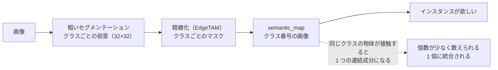
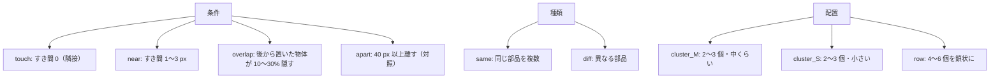
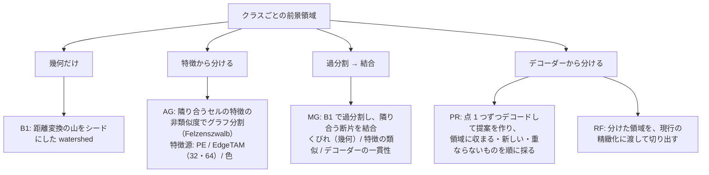
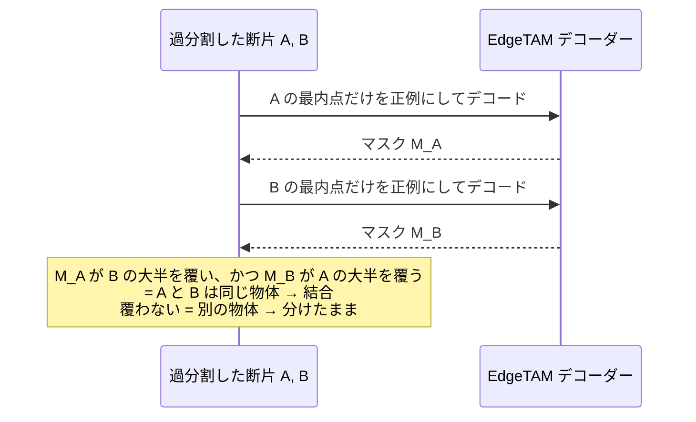
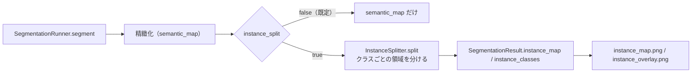

# インスタンス分離の検証（接触・近接・重なりを 1 個ずつに分けられるか）

セマンティックの精度が上がってきたので、**同じ種類の物体が接触・近接・重なったときに、1 個ずつに分けられるか**を、PE と EdgeTAM の特徴から（速度は度外視で）探した。
実験は `tools/experiments/instance_split/`、結果は `outputs/instance_split/index.html`。有望な 2 方式（提案の選別 PR、過分割 → 結合 MG）は、**2026-10-25 に本体（`core/common/instance_splitter.py`）へ組み込んだ**（[§9](#9-本体への組み込み)）。

- [1. 結論](#1-結論)
- [2. 何が問題か](#2-何が問題か)
- [3. 検証の方法](#3-検証の方法)
- [4. 試した手法](#4-試した手法)
- [5. 結果](#5-結果)
- [6. 分かったこと](#6-分かったこと)
- [7. 次の手順の候補](#7-次の手順の候補)
- [8. 再現](#8-再現)
- [9. 本体への組み込み](#9-本体への組み込み)

---

## 1. 結論

| 条件 | 現状（連結成分） | 分けられる手法 | 備考 |
|---|---|---|---|
| **同種の物体が接触** | PQ 0.10 | **分けられる**: PQ 0.72〜0.84（デコーダーの一貫性、提案の選別） | 分離率 0.82〜0.98。上限（正解の領域を渡す）は 0.88 |
| **近接**（1〜3 px 空き） | 正解の意味的な結果なら 1.0 | 同等（0.89〜0.99） | 本体の意味的な結果だと、粗いマスクが近接した物体をつなぐので B0 は 0.10 |
| **同種の物体が重なる（10〜30% 隠す）** | PQ 0.14 | **分けられない**: 最良でも 0.25〜0.35 | 上限は 0.69〜0.83。領域（シード）を見つける段階が難所 |
| 異種・離れた物体（対照） | 1.0 | 過分割に注意（幾何のみは 0.70〜0.78 に悪化） | |

- **PE の特徴だけでは、同種の接触物体は区別できない**（AUC 0.76、グラフ分割の同種接触 PQ 0.21）。**EdgeTAM の特徴は、区別する手がかりを持つ**（AUC 0.93、同種接触 PQ 0.56）。ただし特徴の類似だけで分けると過分割しやすい。
- **最も効いたのは、EdgeTAM のデコーダー**を使う方式（物体らしさの判定）。
- **本体の意味的な結果から分けると、分離以前に頭打ち**。合成データの前景 IoU が 0.47〜0.65 で、個数がずれる。分離の評価は、前景とクラスを正解にした条件で行った。

---

## 2. 何が問題か



`semantic_map` はクラス単位で、インスタンスを分ける処理は無い。同じ種類の物体が接していると 1 つの塊になり、連結成分で数えると過小になる（接触した同種の物体は、現状で 1 個にまとまる）。

---

## 3. 検証の方法

### 3.1 合成データ

`tools/dataset/make_touching_dataset.py`。MVTec の部品を背景に貼り合わせ、**接触・近接・重なり・離れた対照**を意図的に作る。インスタンスごとの ID 画像と、物体どうしのすき間・接触の情報を `meta.jsonl` に残す。



dev 192 枚（手法の選択）、verify 72 枚（別の部品・背景・seed で確認）。

### 3.2 指標（`tools/evaluation/instance_metrics.py`）

| 指標 | 意味 |
|---|---|
| PQ | 予測と正解を IoU > 0.5 で対応づけた Panoptic Quality（SQ × F1） |
| 分離率 | 接触している正解のペアのうち、別の予測インスタンスになった割合 |
| 個数一致 / 誤差 | 予測の個数が正解と一致した割合 / 差 |
| 過分割率 | 1 つの正解が 2 つ以上の予測に（それぞれ 25% 以上）分かれた割合 |
| 前景 IoU | 分離で前景が変わっていないかの確認 |

### 3.3 2 つの条件

- **正解の意味的な結果**: 前景とクラス（部品のカテゴリ）を正解にして、**分離の能力だけ**を測る。
- **本体の意味的な結果**: 現状のパイプラインの前景・クラスから分ける。実際に近いが、前景の誤りが混ざる。

---

## 4. 試した手法



### デコーダーの一貫性による結合（MG の dec）



「A を指したときのマスクに B が入るか」で、同じ物体かをモデル自身に判定させる。過分割で増えた断片を、同じ物体のものだけ戻せるので、**離れた物体や 1 個の物体を過分割しにくい**（対照 PQ 0.96〜0.99）。

### 上限（切り分けのための参考値）

| 名前 | 内容 |
|---|---|
| RO | 正解の物体の領域（パッチ格子）を、現行の精緻化に渡す。**領域が正しければ分けられるか** |
| O1 | 正解の物体の最内点だけをシードに、デコーダーで分ける |

---

## 5. 結果

PQ（正解の意味的な結果、dev 各条件 48 枚。verify も同じ向き）。詳細は `outputs/instance_split/index.html`。

| 手法 | 接触 | 近接 | 重なり | 離れている | 同種の接触 | 同種の重なり |
|---|---|---|---|---|---|---|
| B0 連結成分（現状） | 0.54 | 1.00 | 0.56 | 1.00 | 0.10 | 0.14 |
| B1 距離変換 watershed | 0.78 | 0.71 | 0.34 | 0.78 | 0.78 | 0.14 |
| AG EdgeTAM 特徴 | 0.72 | 0.85 | 0.58 | 0.91 | 0.56 | 0.29 |
| AG PE 特徴 | 0.56 | 0.93 | 0.53 | 0.93 | 0.21 | 0.16 |
| MG くびれ | 0.74 | 0.98 | 0.57 | 1.00 | 0.48 | 0.17 |
| **MG デコーダー + くびれ** | **0.86** | 0.94 | 0.52 | 0.99 | 0.73 | 0.14 |
| PR 提案の選別 | 0.83 | 0.71 | 0.51 | 0.91 | 0.75 | 0.25 |
| （RO 上限） | 0.88 | 0.84 | 0.74 | 0.88 | 0.89 | 0.69 |

verify の同種の接触は、B0 0.00 → B1 0.74 / MG 0.72 / **PR 0.84** / RO 0.88。

### 特徴は、接触した別の物体を区別できるか

隣り合うセルのペア（同じ物体の中 / 別の物体にまたがる）を、特徴の非類似度で見分けられるかの AUC（dev。verify も同じ向き）。

| 特徴 | AUC |
|---|---|
| EdgeTAM image_embed（32×32） | 0.94（verify 0.93） |
| EdgeTAM 高解像度（64×64） | 0.88（verify 0.90） |
| EdgeTAM 高解像度（128×128） | 0.81（verify 0.88） |
| PE 第 6 層（32×32） | 0.79（verify 0.76） |
| PE 最終層（32×32） | 0.66（verify 0.65） |
| 色（64×64。対照） | 0.71（verify 0.70） |

32×32 の別物体ペアは数が少なく（dev 18、verify 13）、信頼性は低い。

### 本体の意味的な結果から分けたとき（verify）

| 手法 | 接触 | 近接 | 重なり | 離れている |
|---|---|---|---|---|
| B0 | 0.05 | 0.10 | 0.06 | 0.56 |
| AG EdgeTAM 特徴 | 0.23 | 0.37 | 0.25 | 0.53 |
| MG デコーダー + くびれ | 0.14 | 0.24 | 0.04 | 0.53 |
| **PR** | **0.41** | **0.42** | 0.23 | 0.51 |

離れた物体でも 0.5〜0.56 にとどまる。前景そのものの誤り（前景 IoU 0.47〜0.65）が上限を決めている。

---

## 6. 分かったこと

1. **接触した同種の物体は、EdgeTAM のデコーダーで分けられる。** 過分割した断片を「デコーダーが同じ物体と判定したものだけ結合」する方式（MG dec）と、点ごとの提案を選別する方式（PR）が、現状（PQ 0.10）を 0.72〜0.84 に上げた。
2. **PE の特徴は、同じ種類の物体を区別する手がかりをほぼ持たない**（同種は同じ特徴になる）。EdgeTAM の特徴は、輪郭に沿って不連続が出るので、手がかりを持つ（AUC 0.93 対 0.76）。**クラスタリングのように「特徴だけで分ける」と、物体内の見た目の違い（頭と軸など）で過分割する**ので、特徴は分割の根拠より、結合の判定（デコーダー）に使う方がよい。
3. **幾何（距離変換）は強い基準**。接触した同種の物体は、くびれがあれば 0.78 まで分けられる。ただし、離れた物体や細長い物体を過分割する（対照 0.70〜0.78）。デコーダーの一貫性で結合すると、これが 0.96〜0.99 に戻る。
4. **重なり（隠し合い）は分けられない。** 領域さえ正しければ（RO）分けられる（0.69〜0.83）ので、**分離の手がかり（領域・シード）を見つける段階**が難所。重なりでは、くびれが浅く、特徴の連続性が保たれ、デコーダーが 2 つを 1 つの物体と判定する。
5. **本体の意味的な結果から分けると、分離以前に頭打ち**。小さい物体が前景から落ち、近接した物体は粗い格子（16 px）でつながる。分離を実運用に入れるなら、粗い段階の改善（A の限界）が先に効く。
6. 精緻化に渡す前の領域（パッチ格子）が粗いと、境界が 16 px ずれて SQ が下がる（RF の PQ は結合のみより下がる）。物体ごとの境界の精度は、領域をデコーダーに渡して切り出す段階で決まる。

---

## 7. 次の手順の候補

- **PR を土台に、領域に収まる提案の選別を改良する**（本体の意味的な結果でも最良。重なりの同種で 0.25〜0.30 にとどまる）。提案の点を、特徴の不連続（EdgeTAM の境界）から選ぶ。
- **重なりに対処する**: 凹み（凸欠損）の点、物体内の強い輝度エッジ、デコーダーを「他の点を負例にして」繰り返す自己整合。上限（RO）が高いので、シードの発見が課題。
- **粗い段階（前景 IoU）の改善**と組み合わせて、本体の意味的な結果での評価を上げる。
- 実画像（合成ではない）の接触例での確認（正解が無いので目視）。
- 有望な方式が決まったら、`core/common/` への組み込みを別に計画する（速度は未評価。PR は点ごとのデコードが多く重い）。

---

## 8. 再現

```bash
# データ（部品・背景は outputs/decontam_followup/assets/ を使う）
python tools/dataset/make_touching_dataset.py --parts outputs/decontam_followup/assets/parts \
    --backgrounds outputs/decontam_followup/assets/backgrounds --out outputs/instance_split/data/dev --split dev --per-cell 8 --seed 100
python tools/dataset/make_touching_dataset.py ... --out outputs/instance_split/data/verify --split verify --per-cell 3 --seed 200

# 指標の検算
python tools/evaluation/instance_metrics.py --selftest

# 特徴の識別力
python tools/experiments/instance_split/diag_affinity.py --split dev

# 手法の比較（--semantic gt: 前景とクラスを正解にする / pred: 本体の結果）
OPENBLAS_NUM_THREADS=1 python tools/experiments/instance_split/exp_instance.py --split dev --semantic gt --tag final \
    --methods "B0,B1,AG:source=edge;k=1.0;min_size=4,MG:rule=dec_and_neck,PR"

python tools/experiments/instance_split/report_instance.py     # outputs/instance_split/index.html
python tools/experiments/instance_split/viz_preds.py --split dev --ids 0001,0005 --methods "B1,MG_ruledec_and_neck"   # 事例（--save-preds で予測を保存してから）
```

### 限界

- 合成は MVTec の部品の貼り合わせ。実画像の接触（影・反射・密集）とは違う。結果は手法の序列の判断に使う。
- 手法が多く、同じ画像で比べているので、多重比較の補正は無い（dev で選び verify で確認した。向きは一致）。
- PyTorch 版のみ。速度は評価していない。
- 同種の接触の「正解の意味的な結果」は、クラスを部品のカテゴリにしている（異種でも同じカテゴリの部品は同じクラス）。

---

## 9. 本体への組み込み

実験の PR（提案の選別）と MG（デコーダー + くびれの結合）を、`core/common/instance_splitter.py` の `InstanceSplitter` に移した（PyTorch・OpenVINO の共通コード）。**既定は無効**（`instance_split: false`）。EdgeTAM のデコーダーを断片の数だけ追加で実行するため。



| 設定（`configs/*.yaml`） | 値 | 意味 |
|---|---|---|
| `instance_split` | false | true にすると `SegmentationResult.instance_map`（(H, W) int32、0 = 背景、1~ = インスタンス）と `instance_classes`（インスタンス k のクラス）が入る。`run()` は `instance_map.png`（ID 画像）と `instance_overlay.png`（輪郭と番号）も保存する |
| `instance_method` | `proposals` | `proposals`: 接触した同種の物体で最も安定（提案の選別）。`merge`: 離れた物体・1 個の物体を過分割しにくい（過分割 → 結合） |

固定値（`core/common/params.py` の `INSTANCE_*`）: 過分割の山の高さ 0.1、提案の収まる割合 0.85・新しい面積 0.5・重複 IoU 0.5、結合の覆う割合 0.5・くびれ 0.7。

- **意味的な前景は変えない**。semantic_map のクラスごとの領域の中を分けるだけ（PE の特徴は使わない。理由は §6）。
- **EdgeTAM のエンコードは 1 回**。粗い判定・精緻化・インスタンス分離で同じ特徴を共有する（`EdgeTamSession`）。
- **実験との一致**: 実験（`tools/experiments/instance_split/methods.py` の PR・MG）と、同じ意味的な結果・同じ特徴から、**インスタンスの分割が一致**（verify の 11 枚で確認。意味的な前景が空の 2 枚は両方とも 0 個）。OpenVINO 版でも動作する（`develop.py` と同じ構成で `run()` が保存まで通る）。
- **pe+edgetam の構成（`EdgeTamSession`・`RegionEstimator`）への移植（2026-11-05）**: `InstanceSplitter(estimator, config)` は精緻化と同じ `RegionEstimator` から EdgeTAM の口・パッチ格子・背景点の数・デコードの反復回数・座標変換を借りる。初期マスクは、ロジット 0 の空のマスク（旧と同じ）。verify 72 枚（正解の意味的な結果）で旧実装の保存結果と比べて、**PyTorch 版は個数・PQ が 72/72 枚とも完全に一致**（proposals・merge とも）。OpenVINO 版は個数が 70/72（proposals）・71/72（merge）で、PQ は各条件で ±0.03 以内（数値の差による）。
- **`dense_instances`（[rect_instances.md](rect_instances.md)）と同時に有効にできる**。結果の入れ物と保存名は別（こちらは `instance_map` / `instance_classes` と `instance_map.png`・`instance_overlay.png`、あちらは `instances` と `rect_instance_map.png`・`rect_instance_overlay.png`）。
- **処理時間**（OpenVINO、FP32、4 スレッド。小さい物体が多い 1 枚の例）: 断片 19 個で、デコード 38 回 約 340ms、距離変換の watershed 約 60ms、合計 約 0.5 秒。物体が少なければ 0.1〜0.2 秒。**断片の数（領域の大きさと形）に比例する**ので、リアルタイム用途には重い。断片の最内点の距離変換は、外接矩形の中だけで計算する（全体と同じ結果で、1 断片 40ms → 3ms）。
- **限界**: §5・§6 のとおり、重なった同種の物体は分けられない。本体の意味的な結果が前景を落とす・つなぐ画像（小さい物体、雑多な背景）では、分離の前に頭打ちになる。
- 実験用のコード（`tools/experiments/instance_split/`）は、検証の再現のために残す。
