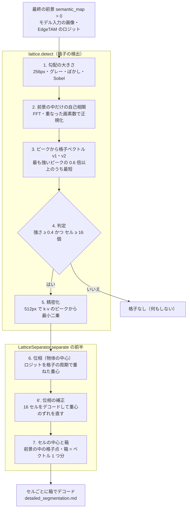
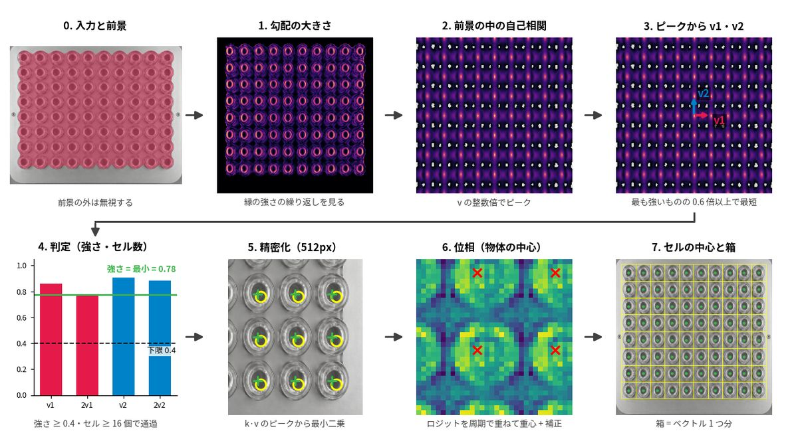
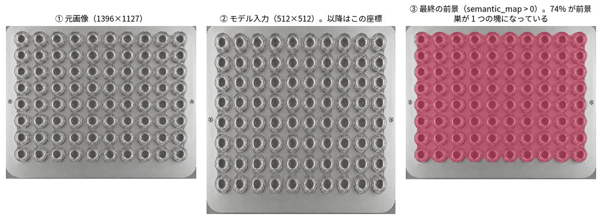
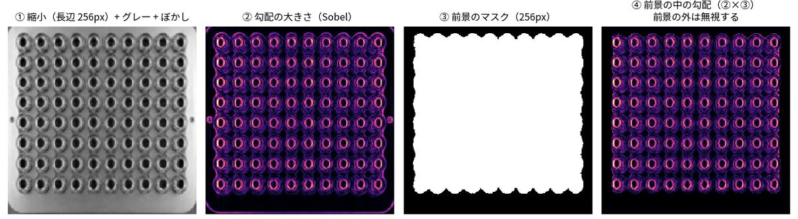
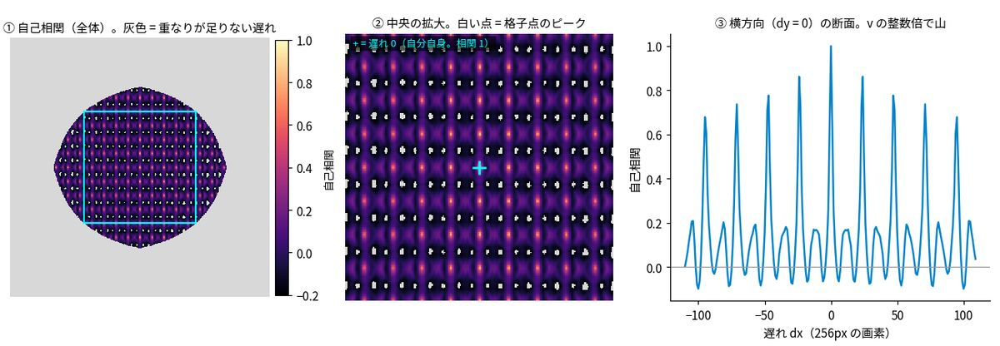
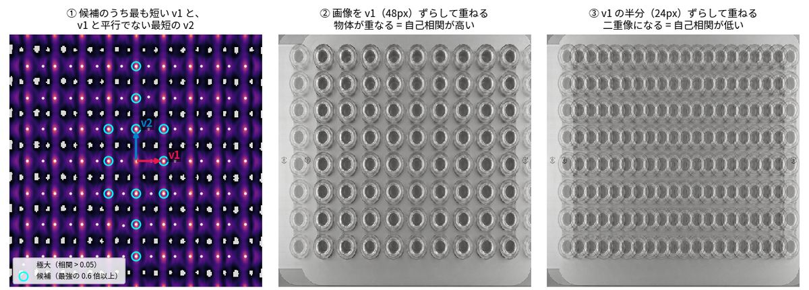
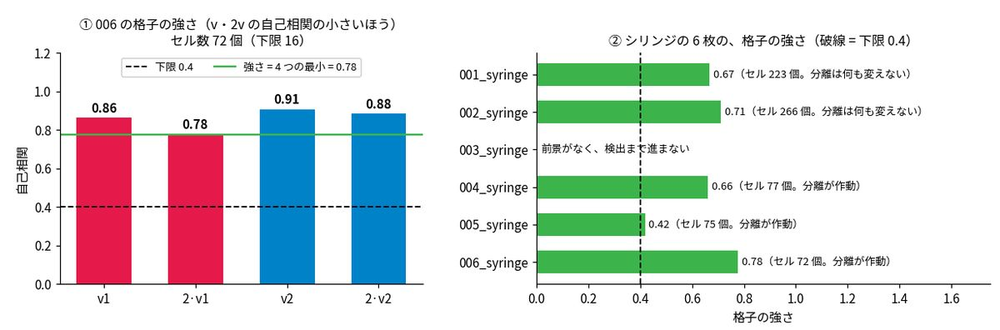
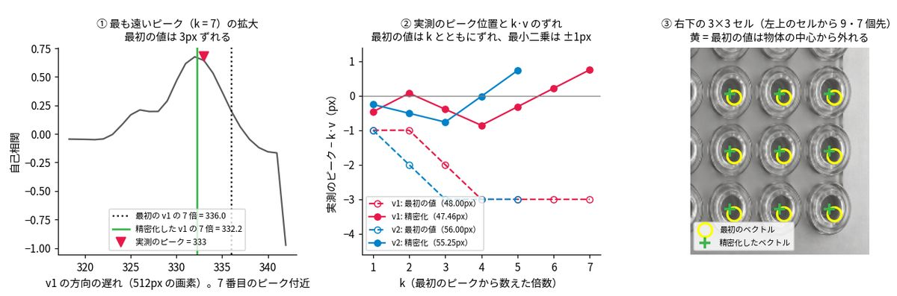
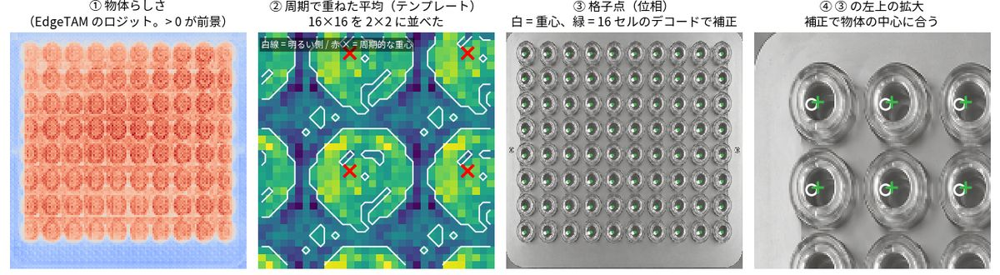
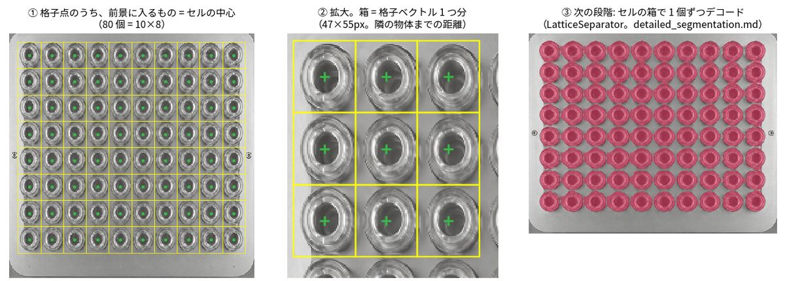

# 格子の検出方法

規則的に並んだ同じ物体（巣・トレイ・ブリスター）の**格子（並びの周期）を画像から見つけ、各物体の中心と箱を求める**。`core/common/lattice.py`（`detect`・`find_phase`・`cell_centers`・`cell_half_size`）と、`LatticeSeparator.separate`（`core/common/lattice_separator.py`）の前半。

全体は [overview.md](overview.md)、この結果を使う「セルごとのデコード」は [detailed_segmentation.md](detailed_segmentation.md) の「格子状に並んだ小物体の分離」。この資料は、その前段の**検出**を、シリンジの巣（`006_syringe.png`。10×8 = 80 個）の画像で段階ごとに説明する。

| | 内容 |
|---|---|
| 入力 | モデル入力の画像（512×512・RGB）・最終の前景（`semantic_map > 0`）・EdgeTAM のロジット（全クラスの最大。位相に使う） |
| 出力 | 格子ベクトル `v1`・`v2`（入力画像の画素）・セルの中心（N 個）・箱の大きさ |
| 役割 | 「同じ物体が規則的に並んでいるか」と「各物体の中心がどこか」。**輪郭は決めない**（輪郭は次の段階で、箱を使って EdgeTAM が決める） |

## なぜ必要か

隙間が 1 パッチ（16px）未満の物体の集まりは、粗い前景が 1 つの塊になり、クラス単位のデコードは塊全体を返す。EdgeTAM は**点や箱に従う**ので、1 個ずつ取り出すには**物体ごとの箱**が要る。箱の位置は、物体が規則的に並んでいることを使えば、画像から得られる。**格子が見つかったときだけ**使い、見つからない画像（ほとんどの画像）では何もしない。

## フロー



各段階の画像（006_syringe。上のフローの 0〜7 に対応する。次の節以降で、1 段階ずつ拡大して説明する）:



| 段階 | 関数 | 内容 | 時間（006） |
|---|---|---|---|
| 1〜4 | `lattice.detect`（前半） | 小さい画像で、格子が強いか・前景に十分な数のセルが入るかを調べる | 約 6〜9ms（**毎回**実行する判定） |
| 5 | `lattice.detect`（後半） | 通ったときだけ、画像の大きさで格子ベクトルを精密化 | 合わせて約 30ms |
| 6 | `lattice.find_phase` | 物体の中心の位置（位相） | 約 1ms |
| 6' | `LatticeSeparator.separate` | 一部のセルをデコードして位相を補正 | 約 23ms |
| 7 | `lattice.cell_centers`・`cell_half_size` | セルの中心と箱 | 1ms 未満 |

## 例: 006_syringe（透明な筒が 10×8 = 80 個並ぶ巣）

### 0. 入力



- 検出が使うのは、②**モデル入力（512×512）**と、③最終の前景。リサイズは `square`（縦横比を無視）なので、元画像（1396×1127）より横に縮んだ形になる。**以降のベクトル・座標は、この 512×512 の画素**。
- ③の前景は、巣が **1 つの塊**（画像の 74%）。粗い判定は物体を拾えたが、隙間（1 パッチ未満）が前景に埋まっている。検出は、この前景の**中だけ**で行う（外の模様に引きずられない）。

### 1. 勾配の大きさ



- 画像を長辺 256px に縮小（`LATTICE_DETECT_SIZE`。毎回実行する判定を軽くするため）し、グレーにして、ガウスぼかし（σ = 0.75）をかけ、Sobel で**勾配の大きさ**を作る。
- 輝度そのものではなく**勾配（縁の強さ）**を使うのは、照明のむらや背景の明るさに左右されず、**物体の形（縁）の繰り返し**だけを取り出すため。②では、筒の縁（円）だけが明るく残る。
- 前景のマスクも同じ大きさに縮める（最近傍）。**前景の外の勾配は、④のように無視する**。

### 2. 前景の中だけの自己相関



- **自己相関** = 画像を (dx, dy) ずらして重ねたときの、勾配の一致度。物体が規則的に並んでいれば、**格子のずれ（v・2v・3v…）で、縁が別の物体の縁に重なり、強いピークが出る**。
- 前景の平均を引いて、前景の外を 0 にしたものを FFT（2 倍にゼロ詰め）で計算する。ずらしたときに前景が重なる画素の数で割り（重なった画素の平均になる）、遅れ 0 の値で割って、**遅れ 0 を 1 に正規化**する。
- 重なりが前景の面積の **25% 未満**の遅れは信用しない（①の灰色。値は −1 にして、以降は使わない）。
- ②の白い点が**格子点のピーク**（k·v1 + j·v2）。③の横方向の断面は、v1 の整数倍で山が並ぶ（遅れ 0 で 1、v1 で 0.86、2·v1 で 0.78…と、遠いほど少しずつ下がる）。

### 3. ピークから格子ベクトルを選ぶ



1. **極大**: 近傍（半径 `LATTICE_PEAK_RADIUS` = 7）の最大で、相関が 0.05 より大きく、有効な遅れ（①の白い点）。
2. **短すぎるものを除く**: 長さが `LATTICE_MIN_LAG`（12 画素。0.75 パッチ）未満のピークは、物体の縁の二重線などで、物体の間隔ではない。
3. 強い順に 16 個を取り、**最も強いピークの `LATTICE_PEAK_RATIO`（0.6）倍以上**に絞る（①の水色の丸）。その中で**最も短い**ものを **v1** にする。最も強いピークが 2v や 3v のとき（v の相関のほうが少し低いとき）でも、v を選べる。
4. v1 と**平行でない**（v1 との外積が、長さの積の 0.3 倍より大きい。角度が約 17° より大きい）最短のものを **v2** にする。無ければ格子なし。
5. v2 の向きは、符号が決まらない（006 では v2 の y が負。逆向きでも同じ格子）。

②・③は、ピークの意味を画像で確かめたもの。**v1（48px）ずらして重ねる**と、物体が重なって見える（自己相関が高い）。**半分（24px）ずらす**と、二重像になる（低い）。

### 4. 判定: 格子か、物体の並びでないか



- **強さ** = v1・2·v1・v2・2·v2 の 4 点の自己相関（各点の ±2 画素の最大）の**最小**。**2 倍まで見る**のは、物体が 2 つあるだけでは v で相関が高くても 2v では下がるので、**周期性**（遠くまで続くこと）を確かめるため。006 は 0.86・0.78・0.91・0.88 で、強さ **0.78**。
- 強さの下限は `LATTICE_MIN_STRENGTH` = 0.4。巣は 0.42〜0.8、格子でない画像（MVTec・合成・COCO128・D2S・実画像）は 0.32 以下。
- **セル数** = 前景の面積 ÷ |v1 × v2|（セル 1 個の面積）。006 は 72 個（実際の 80 個より少ない。前景は、端の物体の外側で終わるため）。下限は `LATTICE_MIN_CELLS` = 16。これより少ない物体は、隙間が 1 パッチ以上あれば分かれるので、クラス単位のデコードで足りる。
- どちらかを満たさなければ、**ここで終わり（何もしない）**。判定までは約 6〜9ms で、ほとんどの画像はここで終わる。

図の右は、シリンジ 6 枚の強さ（下の表も同じ）。

| 画像 | 前景 | 格子ベクトル（入力の画素） | 強さ | セル数 | 結果 |
|---|---|---|---|---|---|
| 001 | 71% | 26 × 32 | 0.67 | 223 | 格子は検出する。セルが小さく（1.6〜2 パッチ）、デコーダーの予測 IoU が低いので、何も変えない |
| 002 | 84% | 26 × 32 | 0.71 | 266 | 同上 |
| 003 | なし | – | – | – | 粗い前景がゼロで、検出まで進まない |
| 004 | 79% | 48 × 56 | 0.66 | 77 | 作動 |
| 005 | 76% | 46 × 58 | 0.42 | 75 | 作動（強さは下限に近い） |
| 006 | 74% | 47 × 55 | 0.78 | 72 | 作動（IoU 0.91） |

### 5. 精密化



- 判定は 256px で行うので、**ベクトルは整数画素**（006 は 24・28px = 入力で 48・56px）。256px の 1 画素は入力の 2 画素なので、丸め誤差は最大 ±1px。006 では v1 が 0.54px・v2 が 0.75px 長く、**右下のセル（v1 方向に 9 個・v2 方向に 7 個先）で約 5px ずれる**（セルの約 1/10）。
- そこで**入力と同じ 512px**で自己相関を作り直し、**k 倍（k = 1, 2, …）の位置の近く（±3 画素）のピーク**を探して、(k, 遅れ) を集める。**原点を通る最小二乗** v = Σ k·遅れ ÷ Σ k² で、ベクトルを求める。**k が大きいほど、丸め誤差が 1/k になる**ので、遠いピークほど、ベクトルの精度が効く。
- 相関が 0.25 より低い、または探す窓に重なりが足りない画素が入ると、そこで打ち切る（k ≤ 12）。006 は v1 で k = 7、v2 で k = 5 まで使える。
- 結果は、v1 = 48.00 → **47.46**px、v2 = 56.00 → **55.25**px。①は、7 番目のピークの拡大。最初の値の 7 倍（336.0）は実測のピーク（333）から 3px ずれるが、精密化した値の 7 倍（332.2）は合う。②は、実測と k·v のずれ。最初の値は k とともにずれ（最大 3px）、最小二乗は ±1px（整数画素の丸め）に収まる。③は、左上のセルから 9 個・7 個先の右下のセルで、最初のベクトルが指す位置（黄）は物体の中心から外れ、精密化したベクトル（緑）は合う。

### 6. 位相: 物体の中心はどこか



自己相関が教えるのは**周期（v1・v2）だけ**で、**物体がどの位置にあるか（位相）**は分からない。位相は、EdgeTAM のロジットから求める。

1. ①のロジット（クラス単位のデコードの、**全クラスの最大**。入力の 1/4 = 128×128）が、**0 より大きい画素**の位置を、格子の座標（v1・v2 を基底とした係数）に直して、**小数部（周期の中の位置）**を取る。
2. 小数部を 16×16 のビン（`LATTICE_PHASE_BINS`）に分けて、ロジットを平均する。②の**セルのテンプレート**（全セルを重ねた、1 セルの平均像。周期的なので 2×2 に並べて表示）。
3. テンプレートの**明るい側**（最大と最小の中点より上）を重みに、**周期的な重心**（角度の円周平均。物体が周期の境目をまたいでも、正しく求まる）を、v1 方向・v2 方向で求める。これを物体の中心とする。
4. 重心は、デコード結果の偏りで、物体の中心から少しずれる。そこで、**前景の中の格子点から等間隔に 16 個**（`LATTICE_PHASE_PROBES`）を選び、**箱でデコード**して、結果の**重心と格子点のずれ**（格子の座標で、周期の整数倍を除く）の**中央値**で位相を直す（3 個以上で結果が出たとき）。006 は、約 4px 動く。③の白い丸（重心）が、緑の + （補正後）で物体の中心に合う（④）。

### 7. セルの中心と箱



- **格子点**（位相 + i·v1 + j·v2。画像の内側）のうち、**前景に入るもの**がセルの中心。006 は **80 個（10×8）**。前景の外の格子点（板の余白）は使わない。
- **箱** = 格子ベクトル 1 つ分（`cell_half_size`。半分の幅・高さ = 各ベクトルの x・y 成分の最大値の半分）。006 は **47×55px**（隣の物体までの距離）。箱を大きくしても小さくても IoU が下がる（セルそのものが最適。+8% で 0.86、−6% で 0.81）。
- 次の段階（`LatticeSeparator`）が、この箱を**箱プロンプト**にして、EdgeTAM の特徴を箱の周りの窓で切り出して**全セルを一括でデコード**する（③。80 個で約 95ms）。デコーダーの予測 IoU の確認・空きスロットの扱いは [detailed_segmentation.md](detailed_segmentation.md)。

## 定数（`core/common/params.py`）

| 名前 | 値 | 意味・根拠 |
|---|---|---|
| `LATTICE_DETECT_SIZE` | 256 | 判定をする画像の長辺。毎回実行するので小さくする（256 で約 6〜9ms、512 で約 35ms。測るたびに ±3ms ばらつく）。通ったときだけ、画像の大きさで精密化 |
| `LATTICE_MIN_STRENGTH` | 0.4 | 格子と判定する強さの下限。巣 0.42〜0.8 / 格子でない画像 0.32 以下 |
| `LATTICE_MIN_CELLS` | 16 | 前景に入るセル数の下限 |
| `LATTICE_MIN_LAG` | 12 | ベクトルの最小の長さ（入力の画素）。物体の縁の二重線を除く |
| `LATTICE_PEAK_RADIUS` | 7 | ピークを探す近傍の半径（自己相関の画素） |
| `LATTICE_PEAK_RATIO` | 0.6 | 候補にするピークの強さ（最も強いピークに対する比）。この比以上で最短を選ぶので、2v・3v のピークが最も強くても v を選べる |
| `LATTICE_PHASE_BINS` | 16 | セルのテンプレートの分割数（1 辺） |
| `LATTICE_PHASE_PROBES` | 16 | 位相の補正に使うセルの数の上限（全セルでなく、等間隔の一部で足りる） |

## 検出されないもの・限界

- **規則的でない並び**（不規則な配置・複数のピッチが混ざる）は、自己相関に強いピークが出ない。格子でない画像の強さは 0.32 以下で、**誤って作動したことはない**（MVTec・合成・COCO128・D2S・実画像の 559 枚で 0 件）。
- **検出は前景の中だけ**で行うので、粗い判定が前景を落とすと検出されない（003）。
- **背景に模様・テクスチャがある**格子は、背景の縁が自己相関に混ざり、検出が背景に負ける（合成の格子 120 枚で作動したのは 3 枚）。
- **ピッチが 2 パッチ未満**の高密度の格子（001〜002）は、検出はできるが、セルが小さく、次の段階のデコーダーの予測 IoU が低くて何も変えない。
- 格子は**ベクトル 2 本の 1 つだけ**（2 種類のピッチが混ざる並びは扱わない）。**箱は軸に平行**（ベクトルの成分から作る）なので、大きく傾いた格子は未検証。
- 判定は 256px の整数画素なので、ベクトルが短い（隣の物体が近い）と、丸めの誤差が大きい。精密化で直すが、精密化は強いピークが続く範囲（006 は k = 5〜7）に限られる。
- **C++ 版（`cppsrc/`）は未対応**。

## 画像の再現

```bash
python tools/docs/make_lattice_doc_images.py                                    # 006 の 8 枚（docs/images/latdet_*.jpg）と、シリンジ 6 枚の強さ
python tools/docs/make_lattice_doc_images.py --image /home/llm/datasets/02_object_detection/syringe/004_syringe.png --prefix latdet004   # 別の巣で
python tools/docs/lint_docs.py
```

スクリプトは、本体の `lattice.py`・`LatticeSeparator.separate` と同じ手順を段階ごとに再現して図を作り、最後に**精密化したベクトル・補正後のセルの中心が本体の出力と一致する**ことを確かめる（一致しなければ止まる）。数値（強さ・ベクトル・時間）は、2026-10-28 の OpenVINO 版（`configs/ov_config.yaml`）で測ったもの。
