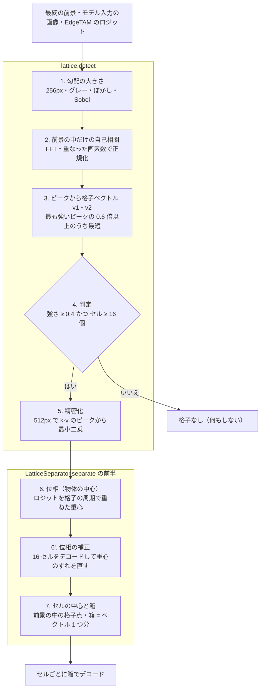

# 格子の検出方法

規則的に並んだ同じ物体（巣・トレイ・ブリスター）の**格子（並びの周期）を画像から見つけ、各物体の中心と箱を求める**。
`core/common/lattice.py`（`detect`・`find_phase`・`cell_centers`・`cell_half_size`）と、`LatticeSeparator.separate`（`lattice_separator.py`）の前半。
全体は [overview.md](overview.md)、この結果を使うセルごとのデコードは [detailed_segmentation.md](detailed_segmentation.md)。

| | 内容 |
|---|---|
| 入力 | モデル入力の画像（512×512・RGB）・最終の前景（`semantic_map > 0`）・EdgeTAM のロジット（全クラスの最大。位相に使う） |
| 出力 | 格子ベクトル `v1`・`v2`（入力の画素）・セルの中心（N 個）・箱の大きさ |
| 役割 | 「同じ物体が規則的に並んでいるか」と「各物体の中心がどこか」。**輪郭は決めない**（輪郭は次の段階で、箱を使って EdgeTAM が決める） |

**なぜ必要か。** 隙間が 1 パッチ（16 画素）未満の物体の集まりは、粗い前景が 1 つの塊になり、クラス単位のデコードは塊全体を返す。EdgeTAM は点や箱に従うので、1 個ずつ取り出すには物体ごとの箱が要る。物体が規則的に並んでいることを使えば、箱の位置は画像から得られる。**格子が見つかったときだけ**使う（ほとんどの画像では何もしない）。

## フロー




| 段階 | 関数 | 内容 |
|---|---|---|
| 1〜4 | `lattice.detect`（前半） | 小さい画像で、格子が強いか・前景に十分な数のセルが入るかを調べる。**毎回**実行する判定 |
| 5 | `lattice.detect`（後半） | 通ったときだけ、画像の大きさで格子ベクトルを精密化 |
| 6・6' | `find_phase`・`LatticeSeparator` | 物体の中心（位相）。一部のセルをデコードして補正 |
| 7 | `cell_centers`・`cell_half_size` | セルの中心と箱 |

以下、006_syringe（透明な筒が 10×8 = 80 個並ぶ巣）。数値は 2026-10-28 に測ったもの（シリンジの画像はこの資料の再生成時には使えなかったので、画像はそのとき作ったものを使っている。格子のコードは変えていない）。

## 0. 入力


検出が使うのは、②モデル入力（512×512）と、③最終の前景。以降のベクトル・座標はこの 512×512 の画素。前景は巣全体が 1 つの塊（画像の 74%）。検出は前景の中だけで行う（外の模様に引きずられない）。

## 1. 勾配の大きさ


長辺 256px に縮小（`LATTICE_DETECT_SIZE`。毎回の判定を軽くするため）→ グレー → ガウスぼかし → Sobel で勾配の大きさ。輝度でなく**縁の強さ**を使うので、照明のむらに左右されず、物体の形の繰り返しだけが残る。

## 2. 前景の中だけの自己相関


- 自己相関 = 画像を (dx, dy) ずらして重ねたときの、勾配の一致度。規則的に並んだ物体は、格子のずれ（v・2v・3v…）で強いピークを持つ。
- 前景の平均を引き、外を 0 にして FFT。重なった画素数で割り、遅れ 0 を 1 に正規化する。重なりが前景の 25% 未満の遅れは使わない（−1 にする）。

## 3. ピークから格子ベクトルを選ぶ


1. 近傍（半径 7）の極大で、相関 > 0.05、有効な遅れのもの。長さ 12 画素（0.75 パッチ）未満は、物体の縁の二重線なので除く。
2. 強い順に 16 個を取り、最も強いピークの 0.6 倍以上に絞って、**最短**を v1 にする（最強のピークが 2v・3v でも v を選べる）。
3. v1 と平行でない（角度 約 17° 超）最短を v2 にする。無ければ格子なし。

## 4. 判定


- 強さ = v1・2·v1・v2・2·v2 の自己相関（各点の ±2 画素の最大）の**最小**。2 倍まで見るのは、物体が 2 つだけなら v で高くても 2v で下がるので、周期性を確かめるため。006 は 0.78。
- 下限 `LATTICE_MIN_STRENGTH` = 0.4（巣は 0.42〜0.8、格子でない画像は 0.32 以下）。セル数 = 前景の面積 ÷ |v1 × v2|（下限 16。006 は 72 個）。
- どちらかを満たさなければここで終わり。判定は約 14ms（この資料を作った PC）で、ほとんどの画像はここで終わる。

| 画像 | 前景 | 格子ベクトル | 強さ | セル数 | 結果 |
|---|---|---|---|---|---|
| 001 | 71% | 26 × 32 | 0.67 | 223 | 検出するが、セルが小さく（1.6〜2 パッチ）予測 IoU が低いので何も変えない |
| 002 | 84% | 26 × 32 | 0.71 | 266 | 同上 |
| 003 | なし | – | – | – | 粗い前景がゼロで、検出まで進まない |
| 004 | 79% | 48 × 56 | 0.66 | 77 | 作動 |
| 005 | 76% | 46 × 58 | 0.42 | 75 | 作動（強さは下限に近い） |
| 006 | 74% | 47 × 55 | 0.78 | 72 | 作動（IoU 0.91） |

## 5. 精密化


判定は 256px の整数画素なので、ベクトルに最大 ±1px の丸め誤差が出て、遠いセルほどずれる（006 の右下のセルで約 5px = セルの約 1/10）。入力と同じ 512px で自己相関を作り直し、k 倍の位置（±3 画素）のピークから、原点を通る最小二乗 v = Σ k·遅れ ÷ Σ k² でベクトルを求める。k が大きいほど丸め誤差が 1/k になる（k ≤ 12）。006 は v1 = 48.00 → **47.46**px、v2 = 56.00 → **55.25**px。

## 6. 位相（物体の中心）


自己相関が教えるのは周期だけで、物体の位置（位相）は分からない。EdgeTAM のロジットから求める。

1. ロジット > 0 の画素を格子の座標に直し、周期の中の位置（小数部）を 16×16 のビンに平均 → **セルのテンプレート**。
2. テンプレートの明るい側を重みに、周期的な重心（角度の円周平均）を求め、物体の中心とする。
3. 重心はデコードの偏りで少しずれるので、前景の中の格子点から等間隔に 16 個を箱でデコードし、重心のずれの中央値で位相を直す（006 は約 4px）。

## 7. セルの中心と箱


格子点（位相 + i·v1 + j·v2）のうち前景に入るものがセルの中心（006 は 80 個）。**箱 = 格子ベクトル 1 つ分**（006 は 47×55px）。箱は、大きくても小さくても IoU が下がる（セルそのものが最適。+8% で 0.86、−6% で 0.81）。

## 定数（`core/common/params.py`）

| 名前 | 値 | 意味 |
|---|---|---|
| `LATTICE_DETECT_SIZE` | 256 | 判定をする画像の長辺。毎回実行するので小さくする。通ったときだけ画像の大きさで精密化 |
| `LATTICE_MIN_STRENGTH` | 0.4 | 格子と判定する強さの下限 |
| `LATTICE_MIN_CELLS` | 16 | 前景に入るセル数の下限 |
| `LATTICE_MIN_LAG` | 12 | ベクトルの最小の長さ（入力の画素） |
| `LATTICE_PEAK_RADIUS` / `LATTICE_PEAK_RATIO` | 7 / 0.6 | ピークを探す近傍の半径 / 候補にするピークの強さの比 |
| `LATTICE_PHASE_BINS` / `LATTICE_PHASE_PROBES` | 16 / 16 | テンプレートの分割数 / 位相の補正に使うセルの数 |
| `LATTICE_WINDOW_TOKENS` | 12 | セルごとのデコードで特徴を切り出す窓（トークン数）。大きいほど正確だが遅い |
| `LATTICE_MIN_PREDICTED_IOU` | 0.5 | 予測 IoU がこれ未満のセルは変えない |

## 限界

- 規則的でない並びは検出されない。格子でない画像で誤って作動したことはない（559 枚で 0 件）。
- 検出は前景の中だけで行うので、粗い判定が前景を落とすと検出されない（003）。
- 背景に模様がある格子は、背景の縁が自己相関に混ざり、検出が背景に負ける。
- ピッチが 2 パッチ未満の高密度の格子（001〜002）は、検出できても何も変えない。
- 格子はベクトル 2 本の 1 つだけ。箱は軸に平行なので、大きく傾いた格子は未検証。
- C++ 版（`cppsrc/`）は未対応。

## 画像の再現

```bash
python tools/docs/make_lattice_doc_images.py   # 006 の 8 枚（docs/images/latdet_*.jpg）と、シリンジ 6 枚の強さ（シリンジの画像が要る）
python tools/docs/lint_docs.py
```

本体の `lattice.py`・`LatticeSeparator.separate` と同じ手順を再現して図を作り、最後に精密化したベクトル・補正後のセルの中心が本体の出力と一致することを確かめる。
