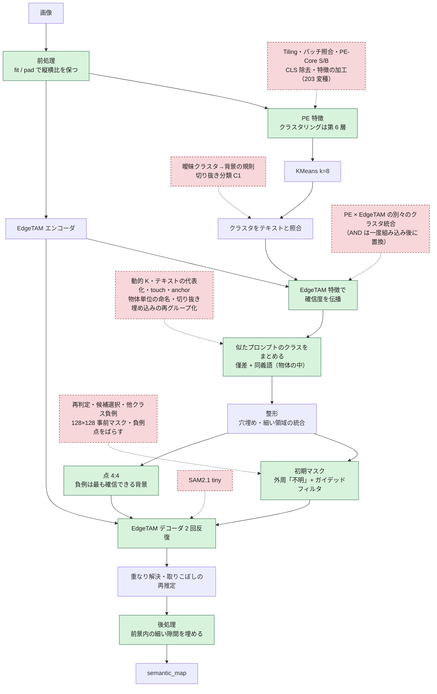
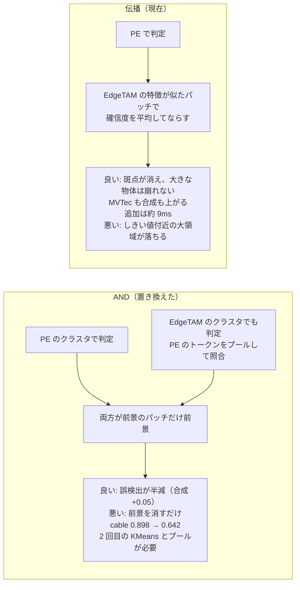
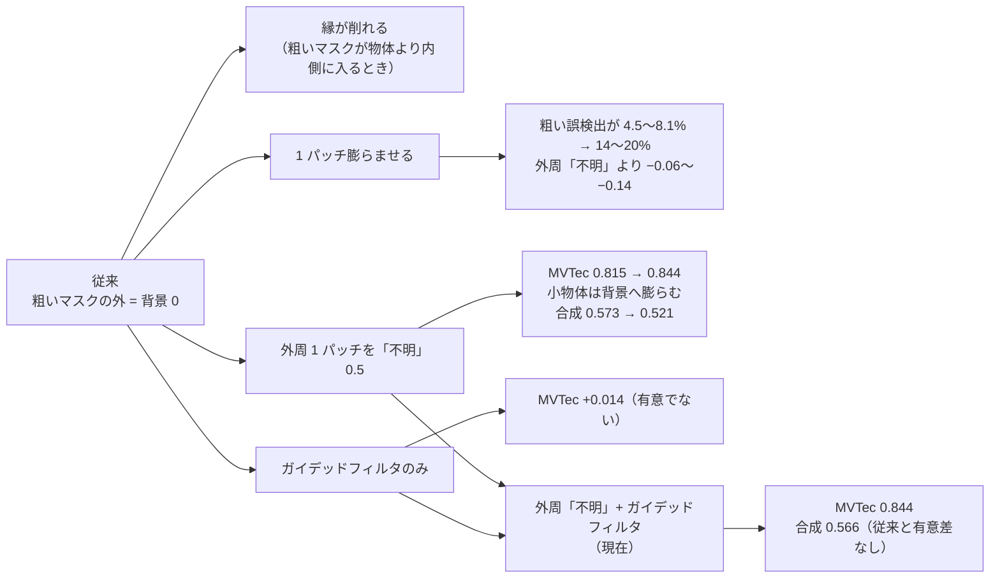
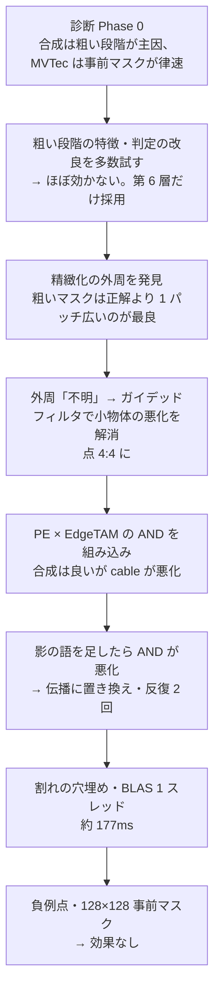

# 手法の変遷: これまで何を試し、現在の手法はどこが違うのか

現在の手法（[overview.md](overview.md)）に至るまでに、**何を変え、何が良くなり、何が悪くなったか**を 1 枚にまとめる。試して採用しなかった手法も、同じ案を繰り返さないために残す。

詳しい実験記録は `outputs/<実験名>/index.html`（各実験のレポート）。

## 要点

- **効いたのは「粗い段階の誤検出を減らすこと」と「精緻化の事前マスクの扱い」の 2 点**。モデルの入れ替え・特徴の加工・判定ルールの追加は、ほぼ効かなかった。
- 粗い結果を正解にした上限（正解注入）は、合成データで IoU 0.573 → 0.876、MVTec は 0.815 → 0.857。**合成データ（小物体・雑多な背景）は粗い段階が主因、MVTec は精緻化の縁の扱いが律速**だった。
- 「判定して消す」系（再判定・成分の除外・粗いマスクへの一致で候補選択）は、前景の見逃しが誤検出の減少を上回り、**例外なく悪化**した。
- 現在の手法にも弱点が残る（[残る課題](#現在の手法の弱点と残る課題)）。

## どこを変えたか（パイプライン上の位置）

緑 = 現在の手法で変更した箇所（採用）。赤の破線 = 試して採用しなかった案。

## 採用した変更（従来 → 現在）

| # | 変更箇所 | 従来 | 現在 | メリット | デメリット・代償 |
|---|---|---|---|---|---|
| 1 | PE のクラスタリングに使う層 | 第 8〜10 層 | **第 6 層** | 粗い判定の誤りが 20.2% → 16.7%。合成の IoU が有意に上がる（0.514 → 0.579） | toothbrush・zipper が下がる（−0.09・−0.12）。層はモデルの変換時に固定される（`--cluster-layers`） |
| 2 | 前景確信度の統合 | PE のみ（一時は AND） | **EdgeTAM の特徴の kNN で確信度を伝播** | 背景の斑点を消し、大きな物体は崩さない。MVTec 0.825 → 0.849、合成 0.613 → 0.658。追加 約 9ms | 確信度がしきい値付近の大きな領域を丸ごと落とすことがある（bottle）。星印のロゴのような、まとまった誤検出は消えない |
| 3 | 精緻化の初期マスク | 粗いマスクの外は背景（確率 0） | **外周 1 パッチを「不明」+ 入力画像の輝度でガイデッドフィルタ** | 縁の削れが直る（toothbrush 0.83 → 0.93〜0.98）。MVTec 0.815 → 0.844。小物体で背景へ膨らまない | 1 領域あたり 約 3ms。ガイドが輝度だけなので、透明・低コントラストの物体では縁の手がかりが弱い |
| 4 | プロンプト点の数 | 前景 8・背景 8 | **前景 4・背景 4** | 点が 62 → 32 に減る。合成 0.566 → 0.590 | 手法 3 と併用が前提（外周なしで減らすと下がる）。時間の短縮は小さい |
| 5 | EdgeTAM の反復 | 3 回 | **2 回** | 精度は同じ（MVTec −0.002）で、デコードが 7.2 → 4.8 回 | なし（確認した範囲では） |
| 6 | 後処理 | なし | **前景内部の細い隙間を埋める** | クラス境界の割れが消える（核の穴 2.06% → 0.05%）。前景だった画素は変えず、マスクはシャープなまま | 粗い前景が誤っているときは、その誤りの隙間も埋める（capsule 40: 0.917 → 0.895） |
| 7 | 処理時間 | 252ms | **約 177ms** | BLAS を 1 スレッドに制限して、OpenVINO とのコア競合をなくす。NumPy 段を外接矩形の中だけで処理 | なし（結果は画素差 0） |
| 8 | 負例点の選び方 | 背景の任意の点 | **端につながる背景のうち、前景確信度が最も低い所** | 物体（濃い布など）に負例を置いて打ち消すのを避ける | 点が画像の端に密集する（ばらしても精度は上がらない） |
| 9 | 入力サイズ | 正方形に固定 | **`fit` / `pad` で縦横比を保つ**（デコーダを画像サイズ可変に再変換） | 縦横比が崩れない | C++ 版は未対応（`square` のみ）。INT8 モデルは前景 0%（原因未調査） |
| 10 | 前景プロンプト（透明な筒） | なし | **`a photo of transparent tubes.`** を追加 | 006_syringe（透明な筒 80 個の巣）が全面背景（IoU 0.0）から、前景が出る（0.69）。MVTec・独立 48 枚は変化なし、合成 0.656 → 0.663 | 複数形でないと効かない。COCO128・D2S 278 枚のうち 23 枚で最終結果が変わる（前景が増えたもの 15・減ったもの 8。工業系の実画像 16 枚は一致） |
| 11 | 格子状の小物体の分離 | クラス単位のデコードのみ（隙間 1 パッチ未満の物体は 1 つの塊） | **画像の勾配の自己相関で格子を検出したときだけ、セルごとの箱プロンプトで 1 個ずつデコード**（`lattice.py`・`lattice_separator.py`） | 006 の IoU 0.69 → **0.91**（前景 FP 23% → 3.8%）。005 は空きスロット 7 個を除ける。PyTorch 版も同じ | 作動は狭い（検証 559 枚では 006 のみ。ほかに巣の 004・005、合成の格子 120 枚中 3 枚）。作動時 約 +150ms（判定は毎回 約 6ms）。箱の大きさに敏感（+8% で 0.86、−6% で 0.81、±12% で 0.71〜0.75）。高密度（ピッチ 2 パッチ未満）は未対応。C++ 版は未対応 |
| 12 | 1 つの物体のクラスの割れ | クラスタごとに最も近いプロンプトを選ぶだけ（似たプロンプトに割れる） | **PE のクラスタのロジットが僅差（1.0 以内）のプロンプトを、より大きいクラスへ統合 + 1 つの物体の中の同義語（テキスト埋め込みの距離 0.08 以内）をまとめる**（`semantic_merge.py`） | 透明なボトル（cap）が 2 クラス（tube / transparent tubes）に割れるのを直す。部品の種類が 1 つの画像で 2 クラス以上に割れる枚数 81 → 50（351 枚）。カップ麺の 4 クラス（麺・袋・ふた・容器）は保つ。前景 IoU は変わらない（MVTec +0.0019・独立 48 枚 +0.0041・合成 ±0。いずれも有意差なし）。処理時間は変わらない（173 → 166ms） | 統合してからデコードするので、格子分離が作動しなくなる画像がある（合成の格子 1 枚で −0.59）。部品の種類の区別は強まらない（V 0.25）。D2S（食品）の 150 枚のうち 54 枚で前景が変わる（一致 IoU < 0.99。29 枚は < 0.9。正解がなく良し悪しは目視。目視した 8 枚では、2 枚で机の面を前景にする誤りが減り、ほかは同程度）。C++ 版は未対応 |

### 精度の推移（本体のパイプライン、同じ条件）

PE 第 6 層・当時のプロンプト・OpenVINO/PyTorch の測定値（本体のパイプラインで測り直した値）。IoU の棒は 0.5〜0.9 を 20 マスで表した。

| 段階 | MVTec 108 枚 | 合成 120 枚 | 背景の誤検出 | 点 / 枚 |
|---|---|---|---|---|
| 従来（8:8・外周なし） | 0.815 `████████████████░░░░` | 0.573 `████░░░░░░░░░░░░░░░░` | 10.3% | 62 |
| + 外周 + ガイデッドフィルタ（8:8） | 0.847 `█████████████████░░░` | 0.565 `███░░░░░░░░░░░░░░░░░` | 10.5% | 63 |
| + 点 4:4 | 0.840 `█████████████████░░░` | 0.590 `████░░░░░░░░░░░░░░░░` | 10.8% | 32 |
| + AND（一時的な統合） | 0.833 `█████████████████░░░` | 0.637 `███████░░░░░░░░░░░░░` | 5.7% | 26 |

その後、AND を伝播に置き換えた（プロンプトに影の語を足した後の条件。cable を除く MVTec 96 枚 + 独立 48 枚、合成 120 枚）:

| 統合の方法 | MVTec 96 枚 | 独立 48 枚 | 合成 120 枚 |
|---|---|---|---|
| PE のみ | 0.825 | 0.851 | 0.613 |
| AND | 0.784 | 0.785 | 0.656 |
| **伝播（現在）** | **0.849** | **0.861** | **0.658** |

条件が段ごとに違う（プロンプト・cable の有無）ので、表をまたいだ数値は比べない。

## 変更ごとの比較（図解）

### 2. 確信度の統合: AND と伝播

- 他にも、PE と EdgeTAM の結果を「平均・OR・投票・交差セル」で統合する案を測った。交差セルは合成で最も高い（0.638〜0.653）が、MVTec で下がる。OR は誤検出が増え、投票は小物体の検出率が大きく下がる。
- EdgeTAM の特徴だけでクラスタリングすると、MVTec 0.726〜0.78 に悪化する（zipper・toothbrush）。**EdgeTAM の特徴は「判定」ではなく「確信度をならす」ために使うのが安全**だった。

### 3. 精緻化の初期マスク

- 粗いマスクが**正解より約 1 パッチ広いときが最良**（正解を粗い結果にしても 0.870、1 パッチ膨張で 0.924、収縮で 0.669）。外周を「不明」にするのは、膨らませた分を前景とは言わず、縁の位置だけ EdgeTAM に任せるため。
- ガイデッドフィルタは、グレー（輝度）で十分（カラー版は結果が同じで約 30 倍重い）。半径は 1 パッチ（4 画素）で、8 は悪い。

### 4. プロンプト点の数

| 前景:背景 | 外周なし | 外周あり（現在） |
|---|---|---|
| 8:8 | 基準（最良） | 0.844 |
| 4:4 | −0.019 | 0.846（差なし。点は半分） |
| 2:2 | −0.037 | 0.841 |
| 1:1 | −0.166 | — |

外周ありのときだけ、点数に依らなくなる。12:12・16:16 に増やしても変わらない（8 点で飽和）。

## 試して採用しなかった手法

### 粗い段階

| 変更箇所 | 内容 | 結果 | 現在の手法と比べて |
|---|---|---|---|
| 判定ルール | 曖昧なクラスタを背景にする（閾値・言い換えの合意・散らばり・画像の枠など） | 誤り 19.3% → 20〜30%（背景の誤りは減るが、前景の見逃しが増える） | 診断だけで否定できた。誤判定クラスタは、どの指標でも正しいクラスタと分けられない |
| 判定ルール | 前景確信度の平滑化 | zipper の布のような、まばらな前景が消える | 伝播は「EdgeTAM の特徴が似たパッチ」だけで平均するので、消えにくい |
| 特徴の加工 | CLS を除く・CLS 方向を除く・画像全体との差 | 誤り 34〜46% | 背景のパッチに画像全体（物体）の意味が混ざる性質は、取り除けない |
| 特徴の加工 | パッチごとにテキストと照合（MaskCLIP / ClearCLIP 型） | 誤り 34〜49% | クラスタにまとめて平均するほうが、ノイズが少ない |
| 特徴の加工 | 背景混入の軽減 203 変種（トークン側の背景除去・attention 制限・EdgeTAM での特徴の平滑化など） | 粗い誤りは 20 → 14% に減るが、最終 IoU は改善しない。背景が一様でない画像で誤検出が増える（dog 27% → 43〜54%） | 粗い誤りの減少と最終 IoU は別。最終 IoU は誤検出に約 2 倍敏感。採用したのは第 6 層だけ |
| モデル | PE-Core を S・B に大きくする | 誤り 21.9%・29.1%（T は 19.3%） | 大きいほど悪い。S は時間も 2.6 倍 |
| モデル | PE-Spatial-T・DINOv3 | PE-Spatial-T は MVTec 0.712・合成 0.539。DINOv3-S は PE の 2.1 倍遅い | 速度が同じで精度が低い |
| 入力 | 入力を 768 に | 誤り 18.3%（僅かに改善） | 時間が約 3.5 倍 |
| 入力 | Overlapping Tiling（4 タイル + 全体縮小） | cable +0.17・metal_nut +0.12 だが toothbrush −0.11。特徴量抽出 87 → 240ms | 時間が約 2.7 倍。~200ms に収まらない。対照実験で、改善はタイル（局所の視野）によるもの |
| 成分の確認 | EdgeTAM の予測 IoU で成分を確認して外す | 小さな物体を大量に消す（見逃し 11 → 49 / 166） | 判定して消す系は悪化する |
| 領域の分類 | 切り抜いた領域を CLIP 埋め込みで分類（C1） | 成分単位の誤りは減る（9.2% → 4.1%）が、前景を多数消す。合成 0.496〜0.567 | 1 領域 14ms かかる。判定の限界は変わらない |
| 特徴源 | クラスタリングの特徴を PE-Spatial-T に替える・EdgeTAM と連結（C2） | MVTec 0.712〜0.803、合成 0.519〜0.590 | 伝播（合成 0.658）に届かない。少数枚（9 枚）では PE-Spatial が良く見えたが、120 枚では逆 |
| 統合 | PE と EdgeTAM の別々のクラスタを、平均・OR・投票・交差セルで統合 | 交差セルは合成 0.638〜0.653 だが MVTec が下がる。OR は誤検出が増え、投票は小物体を落とす | 伝播のほうが、MVTec・合成の両方で上。コードも少ない |
| 統合 | EdgeTAM の過分割（K=16・32）+ AND | MVTec 0.673・0.249 | 判定を細かくするほど崩れる |
| プロンプト | 汎用の形の語を足す（long thin・electronic device など） | 悪化（0.754）または変化なし | CLIP は「round object」のような抽象語では具体名に勝てない |
| プロンプト | 具体名を汎用語に置き換える | 0.747 / 0.774 に悪化（coin が nut、cap が tube に落ちる） | 具体名は保険としてしか置き換えられない |
| プロンプト | 006 向けに具体名（syringe・vial・glass vial・test tube・ampoule・transparent syringes ...）を足す | 006 のパッチ IoU 0〜0.3（物体のクラスタの前景側の最良に勝てない）。効いたのは複数形の tubes 系（transparent tubes 0.71・cylinders viewed from above 0.71・tubes viewed from above 0.71）だけ | 1 語の僅差（約 0.7 ロジット）に依る。他の画像への影響が最小の `transparent tubes` を採用 |
| 判定ルール | 前景の判定のしきい値を下げる（006 の物体のクラスタの前景確信度 0.17〜0.40） | 背景クラスタの前景側の差の上位 10%（−1.4〜−2.0）と、シリンジのクラスタ（−1.5）が重なる | しきい値では解けない |
| クラスの割れ | 動的な K（画像ごとに最良の K を選ぶ天井でも） | クラス数はほぼ変わらず（K=4〜12 で 1.2〜1.27）。前景 IoU が大きく動く（K=6: MVTec 0.8627、K=10・12: 0.75・0.73）。画像ごとの最良 K の天井でも MVTec 0.873・合成 0.705（固定 K=6・10 比 +0.01〜0.03） | 割れは、クラスタの数ではなく、ロジットの僅差で起きる。K は前景の精度を決める値で、クラスの割れの手段にならない |
| クラスの割れ | 静的な代表プロンプト（テキスト埋め込みの階層クラスタで同義語を 1 つに置き換える） | 複数クラスの画像 48 → 35（assemblies を除くと 36 → 24）。種類の区別は変わらない | 代表への置き換えは、名前を変える欠点がある（animal → clip）。同義語は、**1 つの物体の中にあるときだけ**まとめれば足りる（現在の手法） |
| クラスの割れ | 距離の近い物体どうし（touch）・EdgeTAM の埋め込みでまとめる（ペア特徴の AUC 0.33〜0.43） | touch は何でも結合して V 0.17。EdgeTAM の埋め込みは偶然以下 | 同じ物か否かを区別できる信号は、テキストの類似度（AUC 0.72〜0.81）・CLIP トークンの類似度（0.75〜0.81）・切り抜きの埋め込み |
| クラスの割れ | 僅差の許容を大きくする（δ ≥ 2） | カップ麺の 4 クラスが潰れる | 別の部品を指す語まで統合する。1.0（ノイズの範囲）が上限 |
| クラスの割れ | 物体単位で 1 クラスにする（物体の最頻クラスを全体に付ける） | V 0.70 だが、カップ麺が 1 クラスに潰れ、合成の IoU が下がる（平均 −0.010、最悪 −0.36） | 1 つの物体が複数の部品でできている画像で、部品の区別が消える |
| クラスの割れ | 全前景を 1 クラスで一括デコード（allone） | IoU は同じかやや上（MVTec 0.8424・独立 0.8624・合成 0.6649）で速くなるが、クラスが無い | クラスを区別する目的に合わない。速度だけが目的なら有望（別の検討） |
| 種類の区別 | 物体の切り抜き（マスクで背景を除いて 224px）の PE 埋め込みを平均連結でグループ化し（距離 0.08）、クラスを付け直す（現在のクラスが 1 つだけの連結成分に適用） | 部品の種類の指標 V 0.25 → 0.83〜0.95（同じ名前を 1 つと数える名前の V は 0.21 → 0.5）。前景は変えない。ただし、**単一種類の画像で 2 クラス以上に割れる枚数が 17 → 28〜31 に増える**（コインの透明な台座・格子の背景の回路基板など小さな断片が別クラスになる）。1 物体あたり 約 14ms（最大 8 切り抜き） | 種類の区別は強まるが、単一種類の画像の割れが増え、時間・定数（距離・切り抜きの大きさ・最大数）が増える。本体には入れていない。必要になったら、`tools/experiments/semantic_merge/` の `obj08` 系を元にできる |

### 詳細段階

| 変更箇所 | 内容 | 結果 | 現在の手法と比べて |
|---|---|---|---|
| 事前マスク | 粗いマスクを 1 パッチ膨らませる | 粗い誤検出が増え、外周「不明」より −0.06〜−0.14 | 外周「不明」は膨らませた分を前景とは言わない |
| 事前マスク | EdgeTAM の 128×128 特徴で、不明の帯を高分解能にする（H1〜H4） | MVTec は +0.010〜+0.015 だが、合成が −0.012〜−0.018（有意）。前景の消失も出る | 上限（正解の 128×128）でも MVTec は差なし。ガイデッドフィルタで足りる |
| 事前マスク | 他クラスの前景も「不明」にして割れを防ぐ | 割れは消えるが、クラスのマスクが周囲へ広がる（前景が平均 0.39%、最大 11% 変わる） | 現在の隙間埋めは、前景だった画素を変えない |
| モデル | EdgeTAM → SAM2.1 tiny | MVTec は差なし、合成は −0.022（有意）。エンコーダが約 3 倍重い（213ms 対 66.6ms） | 精度が上がらず、遅い |
| 判定 | 精緻化後のマスクを再判定して背景なら消す | 0.817 → 0.749 | 誤って消す前景が、正しく消す背景の約 3 倍 |
| 候補選択 | 候補を、事前マスクとの一致度で選ぶ | 0.76〜0.77 | 粗いマスクの core に引きずられ、物体の一部しか取れない |
| 負例 | 他クラスの正例点を負例に加える | 0.77 | 同じ物体が複数クラスに割れている画像で、割れ目が固定される |
| 負例 | 負例点をばらす（候補の拡大・EdgeTAM の特徴で 4 つに分ける） | MVTec・合成で有意な改善なし。確信度を使わない選び方は有意に悪化（MVTec −0.0036、独立 −0.0108） | 密集の理由は伝播の副作用だが、結果に影響しない |
| 点 | 点を増やす（12:12・16:16） | 8:8 と差なし | 8 点で飽和 |
| 点 | 外周なしで点を減らす | 2:2 以下は有意に悪化 | 外周ありでのみ減らせる |
| ガイデッドフィルタ | カラー版・半径 8・フィルタのみ | カラーは同じで重い（約 91ms）。半径 8 は悪い。フィルタのみは有意でない | グレー・半径 4・外周と併用が最良 |
| 詳細側のプロンプト | 近接した負例・箱・自己プロンプト・成分ごとの推定 | MVTec・合成の両方で安定して上がるものが無い | 正解注入の上限（0.886 / 0.894）に対し、伸びしろが小さい |
| 後処理 | 1 クラスの隙間も埋める | 合成の小物体で凹みを埋めて IoU が下がる（−0.0016） | 現在は「両側が 2 クラス以上に接する隙間」だけ |
| 隙間の復元（006） | 事前マスクを正解の 128×128 にする | 4 点では 0.688（変わらない）。正例点が物体の中心 80 点なら 0.867 | EdgeTAM は点に従う。必要なのは物体ごとの点（箱） |
| 隙間の復元（006） | 隙間に負例点を置く | 16 点で 0.866、32 点以上で崩壊（マスクが消える） | 点の数に敏感で、位置は正解が要る |
| 隙間の復元（006） | EdgeTAM の特徴で画素を分類（2-means・背景との距離・ロジスティック回帰）・ロジットのしきい値上げ・輝度勾配の平坦領域を外から辿る | 0.53〜0.76。最良（0.744〜0.761）もパラメータに敏感 | 粗いマスクを種にした画素分類は、種に隙間が混ざって不安定 |
| 隙間の復元（006） | 入力を拡大（約 1.8 倍の切り出し） | 0.67〜0.70 | 解像度ではなく、点が塊を返すことが原因 |
| 隙間の復元（006） | 窓の 1 点を格子状に多数デコード | 0.60（輪の一部か板全体を返す） | 透明な物体は、単一点では部分しか取れない。箱が要る |
| 格子分離 | セルごとに箱をデコード結果の重心へ動かして再実行・1 回目のマスクを入力に 2 回目 | 0.901〜0.909（変化なし）。合成では悪化 | 位相の補正（一部のセルの重心の中央値）で足りる |
| 格子分離 | 粗い前景確信度が低いセルをすべて消す | 合成の格子で物体まで消える（再現率 0.90 → 0.46） | 確信度の中央値が閾値を超える格子（粗い判定が信頼できるとき）に限る |
| 格子分離 | 窓を大きくする | 8: 0.88、12: 0.91、16: 0.92、全体: 0.94（時間は 110 → 200 → 350 → 1,500ms） | 12 を採用（時間と精度の中間） |

### 処理時間

| 変更箇所 | 内容 | 結果 |
|---|---|---|
| OpenVINO のスレッド | 4 → 6・8 | 合計 162 → 143ms。**方針として増やさない**（4 のまま） |
| 並列 | PE と EdgeTAM エンコーダの並列実行 | 4 スレッドで −22ms。ピン止めありでは悪化。実装が複雑で見送り |
| デコード | クラスのバッチ化 | −5%。点数が違うクラスは、パディングで単独実行と結果が一致しない |
| 伝播 | kNN を空間窓に限る | −3ms。近傍が空間的に限られ、精度の保証がない |
| 量子化 | INT8 | 既存のモデルは重みの圧縮のみで効果が小さい。活性化の量子化は未実施 |

## 現在の手法の弱点と残る課題

| 弱点 | 内容 | 出典 |
|---|---|---|
| 粗い誤りは直せない | 背景を前景と判定したクラスには、正例点が背景に置かれ、EdgeTAM もそれに従う。再判定で消す案はすべて悪化した | 詳細段階の試行 |
| 伝播が大きな領域を落とす | 確信度がしきい値付近の大きな領域が、丸ごと落ちることがある（bottle の一部） | 伝播の検証 |
| まとまった誤検出が残る | 星印のロゴなど、EdgeTAM の特徴でもまとまる誤検出は、伝播で消えない。さらに、取りこぼしの再推定がそれを前景として足すことがある（カップ麺の例、[detailed_segmentation.md](detailed_segmentation.md)） | 今回の資料作成で確認 |
| 取りこぼしの再推定の効果が未測定 | 発生頻度と IoU への寄与は測っていない。無効にしたときの差は、`eval_pipeline.py` で比べられる | 取りこぼしの再推定 |
| クラス単位の区別が弱い | 部品の種類が複数ある画像で、正解の種類 3.6 に対し予測クラス 1.5。結果はほぼ前景 / 背景 | 診断 Phase 0 |
| 負例点が端に寄る | 画像の中央の背景には置かれない（精度への影響は確認できていない） | 負例点の検証 |
| 縁の手がかりが輝度だけ | 透明・低コントラストの物体は、背景への広がりが残る | ガイデッドフィルタの検証 |
| 評価の限界 | 合成データは貼り合わせで、natural 背景には実物が写る。screw・transistor は正解が物体に沿わず、改良を測れない。zipper は画面の 78% が前景で、評価から除く（cable も除く運用）。多くの実験は、同じ画像で変種を多数比べており、多重比較の補正がない | 各実験の限界 |
| 数値が連続しない | プロンプトに影の語を足した前後で、同じ手法でも数値が動く（AND は MVTec 0.855 → 0.784）。プロンプトを変えたら測り直す | 伝播の検証 |
| 格子分離の適用範囲 | 巣・トレイのような、背景が一様で同じ物体が規則的に並ぶ画像に限る。合成の格子（部品を貼り合わせた 120 枚）は、粗い判定の失敗・格子の検出・予測 IoU の低さで 3 枚しか作動しない（その 3 枚は IoU が同等〜+0.20）。高密度（ピッチ 2 パッチ未満。001〜003）は、粗い判定が出ない・セルが小さすぎて未対応 | 格子分離の検証 |
| 空きスロットの区別 | 005 は除けるが、004 は物体のあるセルと粗い前景確信度が区別できず、前景のまま | 格子分離の検証 |
| 小さな物体の見逃し（合成） | 画面の 0.5% 未満の物体の見逃しは 25%（33/132）。そのうち 28 は粗い判定が前景にしていない。背景が一様な画像では 0 件で、複雑な背景（natural 18・pattern 9・textured 6）に集中する。大きさそのものは原因ではない | 格子分離の検証 |
| クラスの統合の副作用 | 統合してからデコードするので、デコードの結果が変わる。格子分離は、デコードのロジットの形から位相を探すので、統合で 1 つの塊になると作動しない（合成の格子 1 枚で −0.59。平均 −0.005）。部品の種類が複数ある画像では、種類の区別は強まらない（予測 1.1 クラスに対し正解 3.1 種類） | クラスの統合の検証 |
| C++ 版 | `resize_mode: square` のみ対応。格子分離・クラスのまとめ（`semantic_merge.py`）は未対応（プロンプトは共通の yaml を読むなら反映される） | `CLAUDE.md` |

## 評価の前提

- **データ**: MVTec AD の物体カテゴリ（`EVAL_CATEGORIES` の 9 種。zipper を除く。最近は cable も除く）と、合成データ（MVTec の部品 × 背景 4 種、120 枚）。実画像（`develop.py` のサンプル）は目視のみ。
- **指標**: 最終セマンティックマップの前景（> 0）と正解の IoU。信頼区間は 95%（ブートストラップ）。
- **粗い誤り**: パッチ単位の前景 / 背景の誤り（FP + FN）。最終 IoU は FP に約 2 倍敏感で、粗い FN と最終 IoU の相関はほぼ 0（EdgeTAM が FN を補う）。
- **環境**: 多くの実験は PyTorch 版。本体に組み込んだ後に OpenVINO で測り直し、PyTorch との一致を確認した（粗いマスク 99.9%、最終の前景 IoU 0.93〜0.98）。

## 判断の流れ

