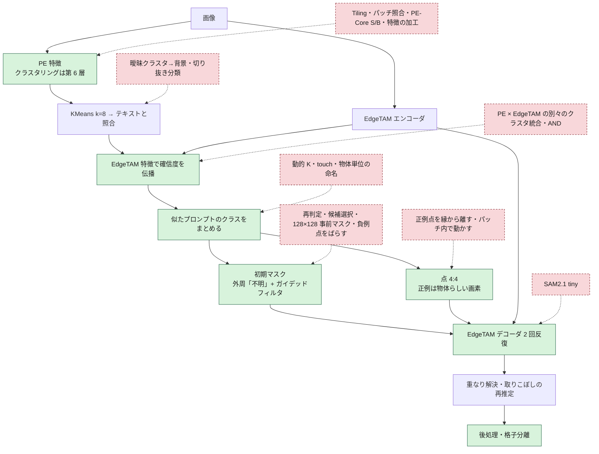

# 手法の変遷: これまで何を試し、現在の手法はどこが違うのか

現在の手法（[overview.md](overview.md)）に至るまでに、**何を変え、何が良くなり、何が悪くなったか**の記録。採用しなかった案も、同じ案を繰り返さないために残す。
詳しい実験記録は `outputs/<実験名>/index.html`（別のマシンにある）。数値は、記載のある測定条件のもの（この資料の再生成では測り直していない）。

## 要点

- **効いたのは「粗い段階の誤検出を減らすこと」と「精緻化の初期マスクの扱い」の 2 点。** モデルの入れ替え・特徴の加工・判定ルールの追加は、ほぼ効かなかった。
- 粗い結果を正解にした上限は、合成データで IoU 0.573 → 0.876、MVTec は 0.815 → 0.857。**合成（小物体・雑多な背景）は粗い段階が主因、MVTec は精緻化の縁の扱いが律速**。
- 「判定して消す」系（再判定・成分の除外・粗いマスクとの一致で候補選択）は、前景の見逃しが誤検出の減少を上回り、**例外なく悪化**した。

## パイプライン上の位置

緑 = 現在の手法で変更した箇所（採用）。赤の破線 = 試して採用しなかった案。

## 採用した変更（従来 → 現在）

| # | 変更箇所 | 従来 → 現在 | 効果 | 代償 |
|---|---|---|---|---|
| 1 | PE のクラスタリングの層 | 第 8〜10 層 → **第 6 層** | 粗い判定の誤り 20.2% → 16.7%。合成 IoU 0.514 → 0.579 | toothbrush・zipper が下がる（−0.09・−0.12）。層は変換時に固定 |
| 2 | 前景確信度の統合 | PE のみ（一時は AND）→ **EdgeTAM の特徴の kNN で伝播** | MVTec 0.825 → 0.849、合成 0.613 → 0.658。追加 約 9ms | しきい値付近の大きな領域を落とすことがある（bottle）。まとまった誤検出は消えない |
| 3 | 精緻化の初期マスク | 粗いマスクの外は背景 → **外周 1 パッチを「不明」+ 輝度でガイデッドフィルタ** | toothbrush 0.83 → 0.93〜0.98。MVTec 0.815 → 0.844 | 1 領域 約 3ms。透明・低コントラストは縁の手がかりが弱い |
| 4 | プロンプト点の数 | 8:8 → **4:4** | 点 62 → 32。合成 0.566 → 0.590 | 3 と併用が前提（外周なしで減らすと下がる） |
| 5 | EdgeTAM の反復 | 3 回 → **2 回** | 精度は同じ（MVTec −0.002）。デコード 7.2 → 4.8 回 | なし |
| 6 | 後処理 | なし → **前景内部の細い隙間を埋める** | クラス境界の割れが消える（核の穴 2.06% → 0.05%） | 粗い前景が誤りなら、その隙間も埋める（capsule 40: 0.917 → 0.895） |
| 7 | 処理時間 | 252ms → **約 177ms** | BLAS を 1 スレッドに（OpenVINO とのコア競合をなくす）。NumPy 段を外接矩形の中だけで | なし（画素差 0） |
| 8 | 負例点 | 背景の任意の点 → **端につながる背景で、前景確信度が最も低い所** | 物体（濃い布）を打ち消さない | 点が端に密集する（ばらしても精度は上がらない） |
| 9 | 前景プロンプト（透明な筒） | なし → **`a photo of transparent tubes.`** | 006_syringe（巣）が全面背景（IoU 0.0）から 0.69 に | 複数形でないと効かない。COCO128・D2S 278 枚のうち 23 枚で最終結果が変わる |
| 10 | 格子状の小物体 | クラス単位のデコードのみ → **格子を検出したときだけ、セルごとの箱で 1 個ずつ** | 006 の IoU 0.69 → **0.91** | 作動は狭い（559 枚では 006 と巣 2 枚、合成の格子 3/120 枚）。作動時 +約 150ms。箱の大きさに敏感 |
| 11 | クラスの割れ | 最も近いプロンプトを選ぶだけ → **僅差（1.0 以内）を大きいクラスへ + 1 つの物体の中の同義語をまとめる** | 2 クラス以上に割れる枚数 81 → 50（351 枚）。前景 IoU は変わらない。173 → 166ms | 統合後のデコードで、格子分離が作動しなくなる画像がある（合成の格子 1 枚で −0.59） |
| 12 | 正例点の位置 | パッチの中心 → **EdgeTAM の 128×128 特徴の画素から、物体らしさで重みづけした最遠点** | MVTec +0.0155・独立 +0.0234・合成 +0.0104（すべて有意）。toothbrush 0.67〜0.70 → 0.96〜0.98 | 改善は toothbrush・transistor に偏る。+約 6ms |
| 13 | デコーダーの実行 | 変換したままのグラフ。領域ごとに順に実行 → **グラフから Reorder を除く + 領域ごとの NumPy の整形を次のデコードと重ねる** | 出力は同じ。デコード 1 回 16 → 9ms。cable/000 が 約 783 → 472ms（Ryzen 5 5500U） | Python のスレッドを 2 つ使う。グラフが想定と違うと例外（`ov_static_shape: false` で書き換えない） |
| 14 | **コードの整理（2026-10-31）** | 実験用の切替・無効な処理・使わない出力が残っていた → **削除・整理** | 出力は同じ（42 枚の全項目が一致）。PE の未使用出力の削除で 約 −2ms | 下の「整理で測ったこと」 |

### 精度の推移

PE 第 6 層・当時のプロンプト（本体のパイプラインで測り直した値）。棒は IoU 0.5〜0.9 を 20 マスで表した。

| 段階 | MVTec 108 枚 | 合成 120 枚 | 背景の誤検出 | 点 / 枚 |
|---|---|---|---|---|
| 従来（8:8・外周なし） | 0.815 `████████████████░░░░` | 0.573 `████░░░░░░░░░░░░░░░░` | 10.3% | 62 |
| + 外周 + ガイデッドフィルタ | 0.847 `█████████████████░░░` | 0.565 `███░░░░░░░░░░░░░░░░░` | 10.5% | 63 |
| + 点 4:4 | 0.840 `█████████████████░░░` | 0.590 `████░░░░░░░░░░░░░░░░` | 10.8% | 32 |
| + AND（一時的） | 0.833 `█████████████████░░░` | 0.637 `███████░░░░░░░░░░░░░` | 5.7% | 26 |

その後、AND を伝播に置き換えた（影の語を足した後の条件。cable を除く MVTec 96 枚 + 独立 48 枚、合成 120 枚）:

| 統合の方法 | MVTec 96 枚 | 独立 48 枚 | 合成 120 枚 |
|---|---|---|---|
| PE のみ | 0.825 | 0.851 | 0.613 |
| AND | 0.784 | 0.785 | 0.656 |
| **伝播（現在）** | **0.849** | **0.861** | **0.658** |

条件が段ごとに違うので、表をまたいだ数値は比べない。

## 整理で測ったこと（2026-10-31）

コードの整理（不要な処理の削除・scipy の置き換え・構造の整理）で、**出力が変わらないこと**と**速度が落ちないこと**を測った。基準は整理前のコード。画像は MVTec 各カテゴリ 2 枚 + 手元の実画像 + 合成の格子 2 枚の 42 枚。

| 項目 | 結果 |
|---|---|
| 出力 | 第 8〜10 層・第 6 層のモデルとも、42 枚の最終マップ・プロンプト点・中間画像が**全項目一致**（`np.array_equal`） |
| 削除 | `resize_mode`（fit / pad）・`ov_optimize_graph`（常に有効）・粗い整形（呼び出しが無効のままだった）・旧パイプライン・実験用の切替属性（`tie_tolerance` など）・PE の未使用出力 |
| scipy → cv2 | label・erode・dilate・maximum_filter・点の距離変換。ランダムマスク 3,000 件で一致を確認。**距離変換は、二乗して整数に丸めて比べる**（cv2 の float32 は、等しい距離でも最後の桁がずれて、最内点の同点の順が変わる） |
| scipy のまま | FFT（numpy・cv2 では約 6ms 遅く、出力も微差）・疎行列・階層クラスタリング・隙間のラベル付き距離変換（cv2 では 1.8% の画素のラベルが変わる） |
| `raw_image_features` | PE の使わない出力を OpenVINO のグラフから外す。PE が約 1.5〜2ms（約 2%）速くなる。出力は変わらない |
| `worker_threads` の用途 | クラスごとの小領域の検出を重ねないと、合計で **+4.4% 遅い**（8 枚 × 5 周）。kNN の重ね・領域の推定の重ねは、測定のばらつき（±数 %）の中で分離できなかったので、そのまま残す |
| 速度 | 測定のばらつきが大きい（同じコードどうしでも画像ごとに ±1〜2%）。実行順を入れ替えて測った結果は [overview.md](overview.md#処理時間) |

**パラメータを外せるか**（基準の最終マップと比べた。値でなく処理を外した）:

| 外した処理 | 最終マップが完全一致 | 最小の一致率 | 判断 |
|---|---|---|---|
| なし（対照） | 42 / 42 | 100% | – |
| スコアの粗い前景らしさ（`SCORE_PRIOR_WEIGHT` = 0） | 30 / 42 | 75.1%（metal_nut） | 外せない |
| メディアンフィルタ（輪郭の平滑化） | 10 / 42 | 98.6% | 外せない |
| 孤立成分の除外（`MIN_ISOLATED_PATCHES` = 1） | 28 / 42 | 67.6%（cable） | 外せない |
| 伝播の反復 3 → 2 | 10 / 42 | 88.8%（zipper） | 外せない |
| ガイデッドフィルタの eps 0.01 → 0.003 | 10 / 42 | 96.6% | 値は変えられるが、パラメータは減らない |
| 隙間埋め（`fill_narrow_gaps`） | 38 / 42 | 99.9% | 4 枚で変わる。残す |

この環境には正解マスクが無いので、「性能が下がらない」は基準との一致でしか確かめられない。外すと出力が変わるものは採らなかった。

## 試して採用しなかった手法

### 粗い段階

| 案 | 結果 | 理由 |
|---|---|---|
| 曖昧なクラスタを背景にする（閾値・合意・散らばり・画像の枠） | 誤り 19.3% → 20〜30% | 前景の見逃しが増える。誤判定クラスタは、どの指標でも分けられない |
| 前景確信度の平滑化 | zipper の布のような、まばらな前景が消える | 伝播は「EdgeTAM の特徴が似たパッチ」だけで平均するので消えにくい |
| CLS を除く・CLS 方向を除く・画像全体との差 | 誤り 34〜46% | 背景のパッチに物体の意味が混ざる性質は取り除けない |
| パッチごとにテキストと照合（MaskCLIP / ClearCLIP 型） | 誤り 34〜49% | クラスタにまとめて平均するほうがノイズが少ない |
| 背景混入の軽減 203 変種 | 粗い誤りは 20 → 14% に減るが、最終 IoU は改善しない | 最終 IoU は誤検出に約 2 倍敏感。採用は第 6 層だけ |
| PE-Core を S・B に | 誤り 21.9%・29.1%（T は 19.3%） | 大きいほど悪い。S は時間も 2.6 倍 |
| PE-Spatial-T・DINOv3 | MVTec 0.712・合成 0.539。DINOv3-S は 2.1 倍遅い | 速度が同じで精度が低い |
| 入力を 768 に | 誤り 18.3% | 時間が約 3.5 倍 |
| Overlapping Tiling（4 タイル + 全体縮小） | cable +0.17・metal_nut +0.12、toothbrush −0.11。87 → 240ms | 約 2.7 倍遅い。~200ms に収まらない |
| EdgeTAM の予測 IoU で成分を確認して外す | 小物体を大量に消す（見逃し 11 → 49 / 166） | 判定して消す系は悪化する |
| 切り抜いた領域を CLIP 埋め込みで分類（C1） | 成分の誤り 9.2% → 4.1% だが前景を多数消す（合成 0.496〜0.567） | 1 領域 14ms |
| クラスタリングの特徴を PE-Spatial-T に・EdgeTAM と連結（C2） | MVTec 0.712〜0.803、合成 0.519〜0.590 | 伝播（合成 0.658）に届かない。少数枚（9 枚）では良く見えたが 120 枚では逆 |
| PE と EdgeTAM の別々のクラスタを、平均・OR・投票・交差セルで統合 | 交差セルは合成 0.638〜0.653 だが MVTec が下がる | 伝播のほうが両方で上。EdgeTAM の特徴だけのクラスタリングは MVTec 0.726〜0.78 に悪化 |
| EdgeTAM の過分割（K=16・32）+ AND | MVTec 0.673・0.249 | 判定を細かくするほど崩れる |
| 汎用の形の語を足す・具体名を汎用語に置き換える | 悪化（0.747〜0.774）または変化なし | CLIP は抽象語では具体名に勝てない |
| 006 向けの具体名（syringe・vial…） | 006 のパッチ IoU 0〜0.3。効いたのは複数形の tubes 系だけ | 1 語の僅差（約 0.7 ロジット）に依る。影響が最小の `transparent tubes` を採用 |
| 前景のしきい値を下げる | 背景クラスタの差の上位 10%（−1.4〜−2.0）とシリンジ（−1.5）が重なる | しきい値では解けない |
| 動的な K | クラス数はほぼ変わらず、前景 IoU が大きく動く（K=6: 0.8627、K=10・12: 0.75・0.73） | K は前景の精度を決める値で、割れの手段にならない |
| 静的な代表プロンプト（同義語を 1 つに置き換える） | 複数クラスの画像 48 → 35 | 名前を変える欠点（animal → clip）。同義語は 1 つの物体の中だけでまとめれば足りる |
| touch・EdgeTAM の埋め込みでまとめる | touch は何でも結合して V 0.17。EdgeTAM の埋め込みは偶然以下 | 区別できる信号はテキストの類似度・CLIP トークンの類似度 |
| 僅差の許容を大きくする（δ ≥ 2）・物体単位で 1 クラスに | カップ麺の 4 クラスが潰れる。合成 IoU が下がる（最悪 −0.36） | 別の部品まで統合する。1.0 が上限 |
| 物体の切り抜きの埋め込みでグループ化し、クラスを付け直す | 種類の指標 V 0.25 → 0.83〜0.95。ただし単一種類の画像の割れが 17 → 28〜31 枚に増える | 1 物体 約 14ms。割れが増える。本体には入れていない |

### 詳細段階

| 案 | 結果 | 理由 |
|---|---|---|
| 粗いマスクを 1 パッチ膨らませる | 外周「不明」より −0.06〜−0.14 | 外周「不明」は膨らませた分を前景とは言わない |
| 不明の帯を 128×128 特徴で高分解能に（H1〜H4） | MVTec +0.010〜+0.015、合成 −0.012〜−0.018（有意） | 上限（正解の 128×128）でも MVTec は差なし |
| 他クラスの前景も「不明」にする | 割れは消えるが、クラスのマスクが周囲へ広がる | 現在の隙間埋めは、前景だった画素を変えない |
| EdgeTAM → SAM2.1 tiny | MVTec は差なし、合成 −0.022（有意）。エンコーダが約 3 倍重い | 精度が上がらず遅い（`test_pytorch_sam2.py` で試せる） |
| 精緻化後のマスクを再判定して背景なら消す | 0.817 → 0.749 | 誤って消す前景が、正しく消す背景の約 3 倍 |
| 候補を事前マスクとの一致度で選ぶ | 0.76〜0.77 | core に引きずられ、物体の一部しか取れない |
| 他クラスの正例点を負例に加える | 0.77 | 割れ目が固定される |
| 負例点をばらす・点を増やす（12:12・16:16） | 有意な改善なし（8 点で飽和） | 密集の理由は伝播の副作用だが、結果に影響しない |
| 外周なしで点を減らす | 2:2 以下は有意に悪化 | 外周ありでのみ減らせる |
| 正例点を縁から離す | 深さが増すほど悪化（MVTec 0.8338 → 0.7926） | 点が厚い部分に集まり、EdgeTAM は点のある領域だけをマスクにする |
| 正例点をパッチの中だけで動かす | +0.0001〜+0.0111 | 高解像度の画素から選ぶほうが上（MVTec +0.0155） |
| ガイデッドフィルタのカラー版・半径 8・フィルタのみ | カラーは同じで重い（約 91ms）。半径 8 は悪い | グレー・半径 4・外周と併用が最良 |
| 1 クラスの隙間も埋める | 合成の小物体で凹みを埋めて IoU が下がる | 現在は「両側が 2 クラス以上に接する隙間」だけ |
| 006 の隙間の復元（事前マスクを正解に・隙間に負例・特徴で画素分類・入力の拡大・窓の 1 点の多数デコード） | 0.53〜0.76 | EdgeTAM は点に従う。必要なのは物体ごとの箱 → 格子分離 |
| 格子分離: 重心へ動かして再実行・確信度の低いセルをすべて消す | 変化なし・物体まで消える | 位相の補正と、確信度の中央値の条件で足りる |
| 格子分離: 窓を大きくする | 8: 0.88、12: 0.91、16: 0.92、全体 0.94（110 → 200 → 350 → 1,500ms） | 12 を採用 |

### 処理時間

| 案 | 結果 | 判断 |
|---|---|---|
| OpenVINO のスレッドを 4 → 6・8 | 合計 162 → 143ms | 方針として増やさない |
| PE と EdgeTAM エンコーダの並列実行 | 4 スレッドで −22〜29ms。ピン止めありでは悪化 | OpenVINO のスレッドが合計 6 になるので採らない |
| クラスのバッチ化 | −5% | 点数が違うクラスは、パディングで単独実行と結果が一致しない |
| kNN を空間窓に限る | −3ms | 精度の保証がない |
| INT8（Ryzen 5 5500U・AVX2） | PE は速くならず出力が約 27% ずれ、エンコーダーは出力が壊れる | VNNI の無い CPU では採らない |
| 取りこぼしの再推定の反復を 1 回に | cable/000 −約 70ms。最終マップの一致率 95.3〜99.8% | 基準 99.9% を満たさない。2 回目が縁を直している |
| 起動時のウォームアップ | 初回も 2 回目以降と同程度（517ms 対 489〜574ms） | 見送り |
| `normalize_image` を連続配列へ書く | 6.4 → 1.4ms ×2 回。bit 一致 | **採用** |

## 現在の手法の弱点と残る課題

| 弱点 | 内容 |
|---|---|
| 粗い誤りは直せない | 背景を前景と判定したクラスは、EdgeTAM もそれに従う。再判定で消す案はすべて悪化した |
| 伝播が大きな領域を落とす | 確信度がしきい値付近の大きな領域が、丸ごと落ちることがある（bottle） |
| まとまった誤検出が残る | 星印のロゴなど、EdgeTAM の特徴でもまとまる誤検出は消えない。取りこぼしの再推定がそれを足すこともある |
| クラス単位の区別が弱い | 部品の種類が複数ある画像で、正解 3.6 種類に対し予測 1.5 クラス |
| 正例点の改善が偏る | toothbrush・transistor に集中。正解の物体画素へ点を動かす上限でも MVTec +0.001 |
| 縁の手がかりが輝度だけ | 透明・低コントラストの物体は、背景への広がりが残る |
| 格子分離の適用範囲 | 背景が一様で同じ物体が規則的に並ぶ画像に限る。高密度（ピッチ 2 パッチ未満）は未対応 |
| 小さな物体の見逃し（合成） | 画面の 0.5% 未満の物体の見逃しは 25%。複雑な背景に集中する |
| C++ 版 | 未追従（`cppsrc/` は別ブランチ。square のみ。格子分離・クラスのまとめ・前景点の選び方は未対応） |
| 評価の限界 | 合成は貼り合わせ。zipper は画面の 78% が前景で評価から除く（cable も除く運用）。同じ画像で多数の変種を比べており、多重比較の補正がない。プロンプトを変えたら測り直す |

## 評価の前提

- **データ**: MVTec AD の物体カテゴリ（zipper を除く 9 種。最近は cable も除く）と、合成データ（MVTec の部品 × 背景 4 種、120 枚）。実画像は目視のみ。
- **指標**: 最終セマンティックマップの前景（> 0）と正解の IoU。信頼区間は 95%（ブートストラップ）。粗い誤りは、パッチ単位の前景 / 背景の誤り（FP + FN）。
- **環境**: 多くの実験は PyTorch 版。本体に組み込んだ後に OpenVINO で測り直し、PyTorch との一致を確認した（粗いマスク 99.9%、最終の前景 IoU 0.93〜0.98）。
