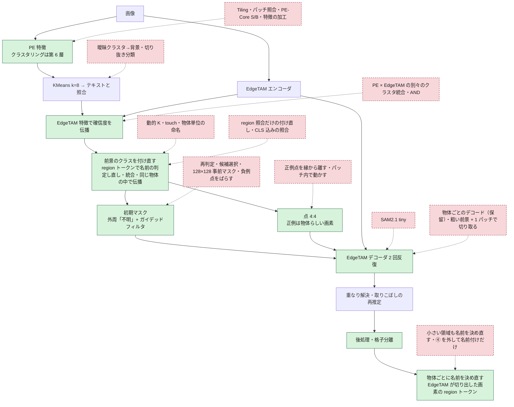

# 手法の変遷: これまで何を試し、現在の手法はどこが違うのか

現在の手法（[overview.md](overview.md)）に至るまでに、**何を変え、何が良くなり、何が悪くなったか**の記録。採用しなかった案も、同じ案を繰り返さないために残す。
詳しい実験記録は `outputs/<実験名>/index.html`（別のマシンにある）。数値は、記載のある測定条件のもの（この資料の再生成では測り直していない）。

## 要点

- **効いたのは「粗い段階の誤検出を減らすこと」と「精緻化の初期マスクの扱い」の 2 点。** モデルの入れ替え・特徴の加工・判定ルールの追加は、ほぼ効かなかった。
- 粗い結果を正解にした上限は、合成データで IoU 0.573 → 0.876、MVTec は 0.815 → 0.857。**合成（小物体・雑多な背景）は粗い段階が主因、MVTec は精緻化の縁の扱いが律速**。
- 「判定して消す」系（再判定・成分の除外・粗いマスクとの一致で候補選択）は、前景の見逃しが誤検出の減少を上回り、**例外なく悪化**した。

## パイプライン上の位置

緑 = 現在の手法で変更した箇所（採用）。赤の破線 = 試して採用しなかった案。

## 採用した変更（従来 → 現在）

| # | 変更箇所 | 従来 → 現在 | 効果 | 代償 |
|---|---|---|---|---|
| 1 | PE のクラスタリングの層 | 第 8〜10 層 → **第 6 層** | 粗い判定の誤り 20.2% → 16.7%。合成 IoU 0.514 → 0.579 | toothbrush・zipper が下がる（−0.09・−0.12）。層は変換時に固定 |
| 2 | 前景確信度の統合 | PE のみ（一時は AND）→ **EdgeTAM の特徴の kNN で伝播** | MVTec 0.825 → 0.849、合成 0.613 → 0.658。追加 約 9ms | しきい値付近の大きな領域を落とすことがある（bottle）。まとまった誤検出は消えない |
| 3 | 精緻化の初期マスク | 粗いマスクの外は背景 → **外周 1 パッチを「不明」+ 輝度でガイデッドフィルタ** | toothbrush 0.83 → 0.93〜0.98。MVTec 0.815 → 0.844 | 1 領域 約 3ms。透明・低コントラストは縁の手がかりが弱い |
| 4 | プロンプト点の数 | 8:8 → **4:4** | 点 62 → 32。合成 0.566 → 0.590 | 3 と併用が前提（外周なしで減らすと下がる） |
| 5 | EdgeTAM の反復 | 3 回 → **2 回** | 精度は同じ（MVTec −0.002）。デコード 7.2 → 4.8 回 | なし |
| 6 | 後処理 | なし → **前景内部の細い隙間を埋める** | クラス境界の割れが消える（核の穴 2.06% → 0.05%） | 粗い前景が誤りなら、その隙間も埋める（capsule 40: 0.917 → 0.895） |
| 7 | 処理時間 | 252ms → **約 177ms** | BLAS を 1 スレッドに（OpenVINO とのコア競合をなくす）。NumPy 段を外接矩形の中だけで | なし（画素差 0） |
| 8 | 負例点 | 背景の任意の点 → **端につながる背景で、前景確信度が最も低い所** | 物体（濃い布）を打ち消さない | 点が端に密集する（ばらしても精度は上がらない） |
| 9 | 前景プロンプト（透明な筒） | なし → **`a photo of transparent tubes.`** | 006_syringe（巣）が全面背景（IoU 0.0）から 0.69 に | 複数形でないと効かない。COCO128・D2S 278 枚のうち 23 枚で最終結果が変わる |
| 10 | 格子状の小物体 | クラス単位のデコードのみ → **格子を検出したときだけ、セルごとの箱で 1 個ずつ** | 006 の IoU 0.69 → **0.91** | 作動は狭い（559 枚では 006 と巣 2 枚、合成の格子 3/120 枚）。作動時 +約 150ms。箱の大きさに敏感 |
| 11 | クラスの割れ | 最も近いプロンプトを選ぶだけ → 僅差（1.0 以内）を大きいクラスへ + 1 つの物体の中の同義語をまとめる（**2026-11-03 に #15 に置き換えた。`PROMPT_TIE_TOLERANCE`・`PROMPT_SYNONYM_DISTANCE` は削除**） | 2 クラス以上に割れる枚数 81 → 50（351 枚）。前景 IoU は変わらない。173 → 166ms | 統合後のデコードで、格子分離が作動しなくなる画像がある（合成の格子 1 枚で −0.59）。同義語の組は、類似度 0.92（ふた・カップ）と 0.94（tube / transparent tubes）の間で切っていて、プロンプトを足すたびに調整が要った |
| 12 | 正例点の位置 | パッチの中心 → **EdgeTAM の 128×128 特徴の画素から、物体らしさで重みづけした最遠点** | MVTec +0.0155・独立 +0.0234・合成 +0.0104（すべて有意）。toothbrush 0.67〜0.70 → 0.96〜0.98 | 改善は toothbrush・transistor に偏る。+約 6ms |
| 13 | デコーダーの実行 | 変換したままのグラフ。領域ごとに順に実行 → **グラフから Reorder を除く + 領域ごとの NumPy の整形を次のデコードと重ねる** | 出力は同じ。デコード 1 回 16 → 9ms。cable/000 が 約 783 → 472ms（Ryzen 5 5500U） | Python のスレッドを 2 つ使う。グラフが想定と違うと例外（`ov_static_shape: false` で書き換えない） |
| 14 | 取りこぼしの成分の前景点 | 物体らしさの基準 = 成分自身の core（極小の成分は背景のパッチでも、ほぼ全画素が候補） → **クラスの本体の core が基準。物体らしい画素が無ければ点を置かず推定しない** | noodle (3) の外周の点・外側の影の前景が消える（前景 74.6% → 68.8%）。MVTec は変わらず（dev −0.0001・holdout −0.0008・独立 +0.0003）、合成は 3 セットとも上がる（small +0.020・medium +0.015・multi +0.001。検出率は同じ）。再推定が減る分、noodle (3) 約 298 → 270ms・cable 約 243 → 226ms | MVTec transistor が −0.004（正解の fg_mask が基板の穴を含む四角形で、消えた誤検出が正解として数えられていたため）。クラスが異なる見た目の部品に分かれるとき、基準と違う部品の極小成分は再推定されない |
| 15 | 粗いクラスの付け直し（#11 の統合を置き換え） | クラスタ（画像全体の K 個）ごとに選んだクラスのまま、僅差・同義語の統合 → **前景だけを PE + EdgeTAM の特徴でブロックに分け、`extract_region_tokens`（CLS なし）の照合で、(a) 領域（物体 × クラス）ごとに名前を判定し直し（1 ブロックより小さい領域は除く）、(b) 画像全体で根拠の弱い小さいクラスを大きいクラスへ統合（対数オッズ + log 面積比）、(c) 同じ物体の中で伝播**（パラメータは 2 つ減り、新しいものは無い） | カップ麺 3 枚の最終マップの部品の分離（V）0.829 → 0.892、名前の正解率 0.929 → 0.960。種類別合成の種類の分離（V）0.241 → **0.424**（95% 区間 +0.12〜+0.26）。単一物体で複数クラスの画像 67 → 63 枚、COCO・D2S のクラス数 1.425 → 1.192。前景 IoU は変わらない（差の 95% 区間が 0 を含む。0.05 以上の悪化 6・改善 6 枚） | 1 画像あたり +2.4ms（旧の統合 + 付け直し比）。1 つの物体の別の部品が 1 クラスにまとまっていれば分けられない。種類別合成で割れた種類が 21 → 22。ふたの折り返しの縁（1〜3 パッチ幅）は残る |
| 16 | 付け直しのブロック数（#15 を細かく。2026-11-05） | 前景を K=8 のブロックに分ける → **K=32（`RELABEL_BLOCK_COUNT`）** | 種類別合成の種類の分離 V 0.424 → 0.563（+0.139、95% 区間 +0.086〜+0.195）・homogeneity 0.386 → 0.511。前景 IoU は平均で不変（MVTec 0.8404 → 0.8394 など。0.05 以上動いたのは改善 1・悪化 5 枚 / 385 枚）。処理時間 約 +1ms | 単一物体で複数クラス 63 → 67 枚（/351）・COCO・D2S のクラス数 1.19 → 1.26。新しいクラスの領域が物体の外へはみ出すことがある（ブレッドボード）。判定し直しと統合の両方に使わないと効かない。64・128 ブロックは V がさらに上がる（0.599・0.609）が割れも増える |
| 17 | 最終の名前付け（2026-11-06） | 名前は粗い段階のクラスのまま → **精緻化の後、最終マップの（物体, クラス）の領域ごとに、その画素の代表トークン（CLS なし + CLS 込みの照合の和）で名前を決め直し、④ (b) と同じ規則で統合**（前景の 1/`k_clusters` 未満の領域は今の名前のまま。前景のマスクは変えない。パラメータは増えない） | 種類別合成の種類の分離 V 0.563 → **0.795**（+0.232、95% 区間 +0.162〜+0.307）・homogeneity 0.511 → 0.774。単一物体で複数クラス 67 → 55 枚（/351）、MVTec 32 → 29 枚。単一物体の名前の正解率 0.845 → 0.875。前景 IoU は全画像で同じ。カップ麺 V も同じ（0.891） | 1 画像あたり +6.8ms（段階 平均 7.5ms）。COCO・D2S のクラス数 1.26 → 1.50（語彙に無い人などに、物体ごとに別の名前）。completeness 0.945 → 0.914（同じ種類の 2 個に別の名前）。transistor の名前の正解率 0.95 → 0.89 |
| 18 | **コードの整理（2026-10-31）** | 実験用の切替・無効な処理・使わない出力が残っていた → **削除・整理** | 出力は同じ（42 枚の全項目が一致）。PE の未使用出力の削除で 約 −2ms | 下の「整理で測ったこと」 |
| 19 | **コードの構成の整理（2026-11-07）** | `core/common/` に 1 階層で並んでいたファイルと、何でも入っていた `mask_utils.py` → **段階ごとのパッケージ（`coarse/`・`detail/`）に分け、共通部品を `prompts.py`・`mask_utils.py`・`utils.py` に** | 出力は同じ（OpenVINO 150 枚・PyTorch 2 枚の全項目が一致）。処理は変えない | 下の「構造の整理で測ったこと」 |

### 精度の推移

PE 第 6 層・当時のプロンプト（本体のパイプラインで測り直した値）。棒は IoU 0.5〜0.9 を 20 マスで表した。

| 段階 | MVTec 108 枚 | 合成 120 枚 | 背景の誤検出 | 点 / 枚 |
|---|---|---|---|---|
| 従来（8:8・外周なし） | 0.815 `████████████████░░░░` | 0.573 `████░░░░░░░░░░░░░░░░` | 10.3% | 62 |
| + 外周 + ガイデッドフィルタ | 0.847 `█████████████████░░░` | 0.565 `███░░░░░░░░░░░░░░░░░` | 10.5% | 63 |
| + 点 4:4 | 0.840 `█████████████████░░░` | 0.590 `████░░░░░░░░░░░░░░░░` | 10.8% | 32 |
| + AND（一時的） | 0.833 `█████████████████░░░` | 0.637 `███████░░░░░░░░░░░░░` | 5.7% | 26 |

その後、AND を伝播に置き換えた（影の語を足した後の条件。cable を除く MVTec 96 枚 + 独立 48 枚、合成 120 枚）:

| 統合の方法 | MVTec 96 枚 | 独立 48 枚 | 合成 120 枚 |
|---|---|---|---|
| PE のみ | 0.825 | 0.851 | 0.613 |
| AND | 0.784 | 0.785 | 0.656 |
| **伝播（現在）** | **0.849** | **0.861** | **0.658** |

条件が段ごとに違うので、表をまたいだ数値は比べない。

## 整理で測ったこと（2026-10-31）

コードの整理（不要な処理の削除・scipy の置き換え・構造の整理）で、**出力が変わらないこと**と**速度が落ちないこと**を測った。基準は整理前のコード。画像は MVTec 各カテゴリ 2 枚 + 手元の実画像 + 合成の格子 2 枚の 42 枚。

| 項目 | 結果 |
|---|---|
| 出力 | 第 8〜10 層・第 6 層のモデルとも、42 枚の最終マップ・プロンプト点・中間画像が**全項目一致**（`np.array_equal`） |
| 削除 | `resize_mode`（fit / pad）・`ov_optimize_graph`（常に有効）・粗い整形（呼び出しが無効のままだった）・旧パイプライン・実験用の切替属性（`tie_tolerance` など）・PE の未使用出力 |
| scipy → cv2 | label・erode・dilate・maximum_filter・点の距離変換。ランダムマスク 3,000 件で一致を確認。**距離変換は、二乗して整数に丸めて比べる**（cv2 の float32 は、等しい距離でも最後の桁がずれて、最内点の同点の順が変わる） |
| scipy のまま | FFT（numpy・cv2 では約 6ms 遅く、出力も微差）・疎行列・階層クラスタリング・隙間のラベル付き距離変換（cv2 では 1.8% の画素のラベルが変わる） |
| `raw_image_features` | PE の使わない出力を OpenVINO のグラフから外す。PE が約 1.5〜2ms（約 2%）速くなる。出力は変わらない |
| `worker_threads` の用途 | クラスごとの小領域の検出を重ねないと、合計で **+4.4% 遅い**（8 枚 × 5 周）。kNN の重ね・領域の推定の重ねは、測定のばらつき（±数 %）の中で分離できなかったので、そのまま残す |
| 速度 | 測定のばらつきが大きい（同じコードどうしでも画像ごとに ±1〜2%）。実行順を入れ替えて測った結果は [overview.md](overview.md#処理時間) |

**パラメータを外せるか**（基準の最終マップと比べた。値でなく処理を外した）:

| 外した処理 | 最終マップが完全一致 | 最小の一致率 | 判断 |
|---|---|---|---|
| なし（対照） | 42 / 42 | 100% | – |
| スコアの粗い前景らしさ（`SCORE_PRIOR_WEIGHT` = 0） | 30 / 42 | 75.1%（metal_nut） | 外せない |
| メディアンフィルタ（輪郭の平滑化） | 10 / 42 | 98.6% | 外せない |
| 孤立成分の除外（`MIN_ISOLATED_PATCHES` = 1） | 28 / 42 | 67.6%（cable） | 外せない |
| 伝播の反復 3 → 2 | 10 / 42 | 88.8%（zipper） | 外せない |
| ガイデッドフィルタの eps 0.01 → 0.003 | 10 / 42 | 96.6% | 値は変えられるが、パラメータは減らない |
| 隙間埋め（`fill_narrow_gaps`） | 38 / 42 | 99.9% | 4 枚で変わる。残す |

この環境には正解マスクが無いので、「性能が下がらない」は基準との一致でしか確かめられない。外すと出力が変わるものは採らなかった。

## 構造の整理で測ったこと（2026-11-07）

コードの置き場所の整理（処理は変えない）。**出力が変わらないこと**だけを確かめた。基準は整理前のコード（`develop/pe+edgetam` の 4cd5784）。

| 項目 | 結果 |
|---|---|
| 出力（OpenVINO、既定のモデル） | 設定の画像一覧の 150 枚（MVTec・独立・実画像・COCO128。格子分離が作動する 006 を含む。取りこぼしの再推定が働く 76 枚・2 クラス以上の 46 枚）で、`semantic_map`・クラスの名前・プロンプト点・粗い前景・クラスタ・精緻化の中間画像が**全項目一致**（`np.array_equal`）。基準を 2 回測って、基準どうしも一致（処理は決定的） |
| 出力（第 6 層のモデル・PyTorch） | コイン・カップ麺 (2) の 2 枚で全項目一致（第 6 層の OpenVINO・PyTorch の両方） |
| 関数の本体 | 移した関数 74 個は、構文木（docstring・型注釈を除く）が整理前と同一。違うのは、引数のつなぎ替えをした関数（`generate_foreground_map`・`judge_clusters`・`classify_logits`・`refine`・`segment` など）と、`_as_uint8` → `as_uint8` の名前の変更だけ |
| 定数 | `params.py` の 53 個の名前と値が一致（並びを、共通 → ① → ② → 実行環境 → 表示の順にした） |
| 主な移動 | `coarse_segmentation.py` → `coarse/segmenter.py`（KMeans・判定は `clusters.py`、伝播は `propagation.py`）／`region_relabel.py` → `coarse/relabel.py`（精緻化の後の名前付けは `detail/naming.py` へ）／`semantic_refiner.py` → `detail/refiner.py`／`region_estimator.py` → `detail/region_estimator.py`／`object_points.py` と `mask_utils.py` の点のサンプリング → `detail/prompt_points.py`／`mask_utils.py` の `clean_mask`・`remove_small_regions`・`fill_narrow_gaps` → `detail/mask_cleanup.py`／`lattice*.py` → `detail/`／テキストプロンプトと照合 → `prompts.py`（`PromptBank`）／`normalize_rows`・`softmax` → `core/utils.py` |
| 小領域の除去・隙間埋め | EdgeTAM が切り出した後の `semantic_map`（作業解像度）が対象なので、粗い段階ではなく詳細段階（`detail/mask_cleanup.py`）に置いた |
| 呼び出しの変更 | `SemanticRefiner.refine(region_logits=)` → `refine(patch_features=)`、`SemanticRefiner(..., namer)`、`CoarseSegmenter.foreground_prompts` → `coarse.prompts.foreground`。`CoarseSegmenter(extractor, config)` の呼び方は変えていない |

`tools/experiments/` の実験用スクリプトは、内部名（`CoarseSegmenter._relabel_foreground` の差し替えなど）に依存しているものが多く、整理では追従していない（再実行するときに直す）。`tools/docs/`・`tools/visualizer/`・`tools/evaluation/diag_*.py` は追従した。

## 前景のクラスの付け直しと最終の名前付けの測定

処理の資料（[coarse_segmentation.md](coarse_segmentation.md) ④・[detailed_segmentation.md](detailed_segmentation.md) 7）から、測定の詳細をここに移した。検証は `tools/experiments/region_relabel/`・`fine_coarse/`・`seg_review/`。

**付け直し（2026-11-03。旧の統合 = 僅差・同義語を置き換え）。** カップ麺 3 枚は、ふた・カップ・麺・包装を手作りの正解と比べた最終マップの画素単位。全 622 枚は、前景 IoU・クラスの数・種類別合成（部品の種類の正解つき）での種類の分離（V 値）:

| | 旧: 僅差・同義語の統合のみ | **付け直し** |
|---|---|---|
| カップ麺 3 枚 部品の分離（V） / クラス名の正解率 | 0.829 / 0.929 | **0.892 / 0.960** |
| 種類別合成 120 枚 種類の分離（V）/ homogeneity / completeness | 0.241 / 0.238 / 0.907 | **0.424** / 0.386 / 0.934 |
| 前景 IoU: MVTec / verify / 種類別合成 / 格子 | 0.8397 / 0.8192 / 0.6989 / 0.3621 | 0.8404 / 0.8186 / 0.6986 / 0.3587 |
| 2 クラス以上に割れる単一物体の画像（351 枚） | 67 | **63** |
| COCO・D2S 1 画像あたりのクラス数 | 1.425 | **1.192** |

- 前景 IoU は変わらない（旧との差の 95% 区間はすべて 0 を含む。IoU が 0.05 以上動いた画像は悪化 6・改善 6 枚で偏りが無い）。種類別合成の V は +0.19（95% 区間 +0.12〜+0.26）。
- パラメータは **2 つ減った**（`PROMPT_TIE_TOLERANCE`・`PROMPT_SYNONYM_DISTANCE`）。新しいパラメータは無い（`k_clusters`・`CLIP_LOGIT_SCALE`・`EDGE_PROPAGATION_ALPHA`・`_ITERATIONS` を使う）。同義語の組は、テキストの類似度 0.92 のふた・カップと 0.94 の tube / transparent tubes の間で切っていた（0.02 の差）が、根拠の強さで分けるので、プロンプトを足しても調整が要らない。
- **ブロックの根拠だけで決めない**。本体のトークン（CLS 込み）よりロジットのノイズが大きく（1 つの物体を半分にしたときの差の中央値 0.96 対 0.67）、照合だけだと単一の物体が 1.4 → 3.0 クラスに割れる。(a) は PE クラスタの根拠と足し、(c) は現状のラベルと混ぜる。(b) では PE クラスタの根拠を足さない（今のラベルは、その根拠の最大で選ばれているので、足すと割れを残す方向に偏る。足すと割れる画像が 65 → 86 枚）。
- 処理時間: 段階 1 回で平均 2〜4ms（最大 8ms。KMeans 3ms・region トークン 1.2ms・伝播 1.2ms）。旧（統合 + 付け直し）との差は 1 画像あたり +2.4ms（207 枚を交互に 3 周測定）。

**ブロック数 8 → 32（2026-11-05）。** 前景のブロックを細かくすると、領域ごとの「パッチごとのプロンプト類似度」が細かくなる（極端にはパッチ単位）。種類別合成 120 枚で、種類の違う物体が別のクラスになる。判定し直し (a) と統合 (b) の両方が細かい根拠を使って初めて効く（片方だけでは V +0.05）。

| | 8 ブロック（それまで） | **32 ブロック（現在）** |
|---|---|---|
| 種類別合成 種類の分離（V）/ homogeneity / completeness | 0.424 / 0.386 / 0.934 | **0.563** / 0.511 / 0.945 |
| 種類が混ざったクラス / 割れた種類（332 種類） | 101 / 22 | **92** / 21 |
| 前景 IoU: MVTec / verify / 種類別合成 / 格子 | 0.8404 / 0.8186 / 0.6986 / 0.3587 | 0.8394 / 0.8183 / 0.6975 / 0.3585 |
| 2 クラス以上に割れる単一物体の画像（351 枚） | 63 | 67 |
| COCO・D2S 1 画像あたりのクラス数 | 1.192 | 1.258 |
| カップ麺 3 枚 部品の分離（V） | 0.892 | 0.891 |

V の差は +0.139（画像ごとの対応のあるブートストラップの 95% 区間 +0.086〜+0.195）。前景のマスクは変えないので、前景 IoU は平均で動かない（正解のある 385 枚で 0.05 以上動いたのは改善 1・悪化 5 枚。クラスが増えると、新しいクラスの領域が物体の外へはみ出すことがある）。処理時間は +約 1ms（画像 23 枚を交互に測定）。64・128 ブロックは V がさらに上がる（0.599・0.609）が、単一物体の割れも増える（69・68 枚）。判定し直しの「小さすぎる領域」の基準（前景の 1/`k_clusters`）はブロック数に連動させない（連動させると小さな領域に別の名前が付く）。

**最終の名前付け（2026-11-06）。** 全 622 枚。前景のマスクは全画像で同じ:

| | 名前付けなし | **あり** |
|---|---|---|
| 種類別合成 120 枚 種類の分離（V）/ homogeneity / completeness | 0.563 / 0.511 / 0.945 | **0.795** / 0.774 / 0.914 |
| 種類が混ざったクラス / 割れた種類（333 種類） | 92 / 21 | **75** / 35 |
| 2 クラス以上に割れる単一物体の画像（351 枚） | 67 | **55** |
| 単一物体の名前の正解率（MVTec 7 カテゴリ・コイン。正しい名前の前景の面積） | 0.845 | **0.875** |
| カップ麺 3 枚 部品の分離（V） / クラス名の正解率 | 0.891 / 0.959 | 0.891 / 0.959 |
| COCO・D2S 1 画像あたりのクラス数 | 1.26 | 1.50 |

- 種類の分離 V の差は +0.232（画像ごとの対応のあるブートストラップの 95% 区間 +0.162〜+0.307。改善 52・悪化 7 枚）。悪化は、同じ種類の 2 個に別の名前が付く・違う種類が 1 つにまとまる、という照合のばらつき。
- 根拠は、CLS なしの代表トークンと CLS 込みのトークンのロジットの和。正解の物体の領域で名前を付けると、種類の分離 V は CLS なし 0.561・CLS 込み 0.527・和 0.580。
- 処理時間は段階 1 回で平均 7.5ms（中央値 6.7ms、最大 17ms。照合のモデル 2 回で約 2.3ms）。同じ画像 46 枚を交互に 5 周測って、1 画像あたり +6.8ms（+4.5%）。
- COCO・D2S は、語彙に無い物体（人など）が物体ごとに別の名前（`cap`・`gear` など）になって、クラスが増える。犬とフリスビー・商品とトレイの縁の誤検出は、別の名前に分かれる。
- **判定し直しを小さい領域にも行う**と V は 0.856 に上がるが、単一物体で複数クラスの画像が増える（実画像 81 枚で 3 → 12 枚。コイン画像の下端に見切れた白い物体の誤検出に `white plastic lid` が付く）。**粗い段階の付け直し（④）を外して名前付けだけにする**と、MVTec の割れが 32 → 41 枚に増え、カップ麺の部品の分離が 0.891 → 0.855 に下がる。

## 試して採用しなかった手法

### 粗い段階

| 案 | 結果 | 理由 |
|---|---|---|
| 曖昧なクラスタを背景にする（閾値・合意・散らばり・画像の枠） | 誤り 19.3% → 20〜30% | 前景の見逃しが増える。誤判定クラスタは、どの指標でも分けられない |
| 前景確信度の平滑化 | zipper の布のような、まばらな前景が消える | 伝播は「EdgeTAM の特徴が似たパッチ」だけで平均するので消えにくい |
| CLS を除く・CLS 方向を除く・画像全体との差 | 誤り 34〜46% | 背景のパッチに物体の意味が混ざる性質は取り除けない |
| パッチごとにテキストと照合（MaskCLIP / ClearCLIP 型） | 誤り 34〜49% | クラスタにまとめて平均するほうがノイズが少ない |
| 背景混入の軽減 203 変種 | 粗い誤りは 20 → 14% に減るが、最終 IoU は改善しない | 最終 IoU は誤検出に約 2 倍敏感。採用は第 6 層だけ |
| PE-Core を S・B に | 誤り 21.9%・29.1%（T は 19.3%） | 大きいほど悪い。S は時間も 2.6 倍 |
| PE-Spatial-T・DINOv3 | MVTec 0.712・合成 0.539。DINOv3-S は 2.1 倍遅い | 速度が同じで精度が低い |
| 入力を 768 に | 誤り 18.3% | 時間が約 3.5 倍 |
| Overlapping Tiling（4 タイル + 全体縮小） | cable +0.17・metal_nut +0.12、toothbrush −0.11。87 → 240ms | 約 2.7 倍遅い。~200ms に収まらない |
| EdgeTAM の予測 IoU で成分を確認して外す | 小物体を大量に消す（見逃し 11 → 49 / 166） | 判定して消す系は悪化する |
| 切り抜いた領域を CLIP 埋め込みで分類（C1） | 成分の誤り 9.2% → 4.1% だが前景を多数消す（合成 0.496〜0.567） | 1 領域 14ms |
| クラスタリングの特徴を PE-Spatial-T に・EdgeTAM と連結（C2） | MVTec 0.712〜0.803、合成 0.519〜0.590 | 伝播（合成 0.658）に届かない。少数枚（9 枚）では良く見えたが 120 枚では逆 |
| PE と EdgeTAM の別々のクラスタを、平均・OR・投票・交差セルで統合 | 交差セルは合成 0.638〜0.653 だが MVTec が下がる | 伝播のほうが両方で上。EdgeTAM の特徴だけのクラスタリングは MVTec 0.726〜0.78 に悪化 |
| EdgeTAM の過分割（K=16・32）+ AND | MVTec 0.673・0.249 | 判定を細かくするほど崩れる |
| 汎用の形の語を足す・具体名を汎用語に置き換える | 悪化（0.747〜0.774）または変化なし | CLIP は抽象語では具体名に勝てない |
| 006 向けの具体名（syringe・vial…） | 006 のパッチ IoU 0〜0.3。効いたのは複数形の tubes 系だけ | 1 語の僅差（約 0.7 ロジット）に依る。影響が最小の `transparent tubes` を採用 |
| 前景のしきい値を下げる | 背景クラスタの差の上位 10%（−1.4〜−2.0）とシリンジ（−1.5）が重なる | しきい値では解けない |
| 動的な K | クラス数はほぼ変わらず、前景 IoU が大きく動く（K=6: 0.8627、K=10・12: 0.75・0.73） | K は前景の精度を決める値で、割れの手段にならない |
| 静的な代表プロンプト（同義語を 1 つに置き換える） | 複数クラスの画像 48 → 35 | 名前を変える欠点（animal → clip）。同義語は 1 つの物体の中だけでまとめれば足りる |
| touch・EdgeTAM の埋め込みでまとめる | touch は何でも結合して V 0.17。EdgeTAM の埋め込みは偶然以下 | 区別できる信号はテキストの類似度・CLIP トークンの類似度 |
| 僅差の許容を大きくする（δ ≥ 2）・物体単位で 1 クラスに | カップ麺の 4 クラスが潰れる。合成 IoU が下がる（最悪 −0.36） | 別の部品まで統合する。1.0 が上限 |
| 物体の切り抜きの埋め込みでグループ化し、クラスを付け直す | 種類の指標 V 0.25 → 0.83〜0.95。ただし単一種類の画像の割れが 17 → 28〜31 枚に増える | 1 物体 約 14ms。割れが増える。本体には入れていない |
| 前景のパッチを `extract_region_tokens` の照合だけで付け直す（候補の制限なし） | 種類別合成の V 0.22 → 0.52 だが、単一物体が 1 画像あたり 1.4 → 3.0 クラスに割れる | region トークンのロジットのノイズ（半分にしたときの差の中央値 0.96）が本体のトークン（0.67）より大きく、僅差が名前を変える。候補を現状のクラスに限り、同じ物体の中で伝播して採用（#15） |
| 付け直しのブロックの照合を CLS 込みのトークンに | 同じ設定でカップ麺 V 0.926 → 0.900 | 小さなブロックで CLS が注意の大半を受ける |
| 付け直しの伝播を物体で区切らない・空間の隣接辺を足す・前景の縁を内側から受け継ぐ | 種類別合成 V 0.252 → 0.196 / カップ麺 V 0.903 → 0.891 / 0.868 | 小さな物体のクラスが隣に吸収される・部品の境目の誤りが増える |
| 統合（(b)）を物体の中だけで行う | 格子の合成画像で複数クラス 8 → 18 枚（最終）。物体をまたいだ割れを戻せない | 僅差の統合は画像全体だった。(b) は画像全体にする |
| 統合（(b)）の根拠に PE クラスタのロジットも足す | 割れる画像 65 → 86 枚（粗い段階） | 今のラベルは PE クラスタのロジットの最大で選ばれているので、足すと今のラベルを残す方向に偏る。(b) は独立なブロックの根拠だけ |
| 判定し直し（(a)）を 1 ブロックより小さい領域にも行う | 単一物体で複数クラス 62 → 77 枚。コイン画像の下端の前景の誤検出（4〜5 パッチ）に別の名前（`pin`・`white plastic lid`）が付く | 数パッチの領域の根拠はノイズが大きい。1 ブロックの平均面積（前景のパッチ数 / `k_clusters`）より小さい領域は今のラベルのまま |
| 統合だけ（(a) を除く）・統合を付け直しの後にもう 1 回 | 単一物体で複数クラス 60 / 56 枚（最少）。ただし種類別合成の V 0.255 → 0.244（有意）/ 0.236。種類の違う物体が 1 クラスに寄る | 割れの少なさより、種類の分離を採る（V +0.17、IoU は同じ） |
| 統合のブロックの温度を 2 に（ロジットを 2 で割る） | 割れる画像 65 → 46 枚（粗い段階）。ただし 3 以上でカップ麺のふたが潰れる（名前の正解率 0.967 → 0.871） | モデルの確率の単位（1）のままにする。調整値を増やさず、崖から 2 倍離れる |
| 付け直しの伝播を収束するまで（反復を無限回）・α を 0.95・30 回 | カップ麺 V 0.903 → 0.906 / 0.915。他は変わらない | 差が小さく、新しい定数（0.95・30）が要る |
| パッチ 1 つごとのプロンプト判定・固定の格子（窓 3×3・5×5・8×8→4×4→3×3 のピラミッド）で前景を決め直す | 前景/背景の AUC はパッチ 1 つで 0.86（背景の 40% が前景）、窓 3×3 で 0.91。ピラミッドで決め直すと MVTec 0.823・合成 0.652（本体 0.839 / 0.685） | 物体の輪郭を無視した領域は、境目で背景と前景が混ざる。EdgeTAM の kNN グラフの近傍（AUC 0.93。CLS 込みで 0.97）のほうが良い。検証は `tools/experiments/fine_coarse/` |
| 本体 + 較正した細かいスコア（EdgeTAM のグラフ近傍の value の平均。本体の前景 / 背景の平均の中点で較正して平均）で前景を決め直す | 全 622 枚で MVTec +0.004・verify +0.049（本体が数 % しか拾えなかった瓶 3 枚の救済。除くと +0.002）・合成 −0.008（改善 16・悪化 21 枚）。合成の誤検出面積 0.035 → 0.055。+約 9ms | 平均で中立。背景の模様の領域の縁が広がる。較正は本体の前景を疑似ラベルにするので、前景が 3 パッチ未満だと補正なしで足して物体なしの画像（COCO・D2S）が前景だらけになる（実験側はガード済み。本体には無い） |
| 前景の決め直しを和集合・対数尤度比（LDA）の重みづけにする / 本体の確信度をグラフで強く拡散する（α0.9〜0.95・10〜30 回） | 合成の誤検出面積 0.066〜0.092・IoU 0.636〜0.650 / 瓶の救済も弱まる（verify 0.843）/ 小物体が痩せる（verify 0.817 → 0.752、合成 0.685 → 0.645） | 誤検出と救済のトレードオフが動くだけで、平均の改善にならない |
| 付け直しの根拠をグラフ近傍のトークンにする・8 ブロックと 32 ブロックの平均にする | 種類の分離 V 0.461 → 0.445 / 0.504（32 ブロック単独 0.584。stride 3） | 平均すると細かい根拠が薄まる。判定し直しと統合の両方が細かい根拠を使うことが要る |

### 詳細段階

| 案 | 結果 | 理由 |
|---|---|---|
| 最終の名前付けを、前景の 1/`k_clusters` 未満の小さい領域にも行う（CLS 込みの根拠も足す） | 種類別合成の V 0.870（採用版 0.795）。ただし単一物体の実画像 81 枚で複数クラス 3 → 12 枚、COCO・D2S のクラス数 1.73 | 1〜4 パッチの断片（コイン画像の下端に見切れた白い物体など）に別の名前が付く。名前としては正しいこともあるが、割れを増やさないほうを採った |
| 最終の名前付けの根拠を CLS なしのトークンだけに | V 0.771・COCO・D2S 1.42（CLS 込みを足すと 0.800・1.48）・単一物体の実画像の割れ 4 枚（足すと 3 枚） | 足すほうが V・割れとも良い。CLS 込みは画像全体を共通の基準にして、名前のばらつきを抑える |
| 粗い段階の付け直し（④）を外して、最終の名前付けだけにする | 種類別合成の V 0.745〜0.824 だが、MVTec の割れ 32 → 37〜41 枚、カップ麺の部品の分離 0.891 → 0.855 | ④ のクラスはデコードの単位でもある。割れたクラスごとにデコードすると、部品の境目が崩れる |
| 最終の名前付け + 付け直しのブロック数を 8 に戻す（`RELABEL_BLOCK_COUNT` を削除できる） | V 0.765（32 ブロックは 0.800。差 −0.035、95% 区間 −0.065〜−0.011）。割れは MVTec 28・verify 16 枚（32 ブロックは 29・18） | パラメータを 1 つ減らせるが、V が有意に下がる。32 のまま（2026-11-05 の判断を変えない） |
| 精緻化の最終マスクを、粗い前景を 1 パッチ膨らませた範囲で切り取る | MVTec 0.839 → 0.805、verify 0.818 → 0.792、合成・格子は変わらない | 誤検出は「不明」の帯の内側にあり、外へのはみ出しは少ない。EdgeTAM が粗い前景の外の物体の縁を取り戻している分を消す |
| クラスの主成分（連結成分）ごとにデコードする | 格子の合成 0.359 → 0.509（+0.150、有意。改善 52・悪化 20 枚）。MVTec −0.004・verify −0.004（有意でない）。toothbrush/003 0.936 → 0.614 | 物体の縁が別クラスに割れた細い断片を単独でデコードすると、背景へ広がる。密な格子では、1 成分に入った複数の小物体を 4 点で拾いきれない |
| **（保留）** ほかのクラスと接しない独立した物体だけを 1 個ずつデコードし、部品・縁はクラスでまとめる | 格子の合成 0.359 → 0.478（+0.120、95% 区間 +0.075〜+0.167。改善 43・悪化 20 枚）。MVTec +0.0002・verify −0.0006・合成 +0.002（0.05 以上の悪化 0 枚）。パラメータは増えない | デコードの回数が物体の数に比例し、格子の画像で数百 ms 増える。効くのは小さな物体が散らばる画像だけ。窓の一括デコード（格子分離と同じ）で速くできれば候補（`tools/experiments/seg_review/` の `perobj`） |
| 粗いマスクを 1 パッチ膨らませる | 外周「不明」より −0.06〜−0.14 | 外周「不明」は膨らませた分を前景とは言わない |
| 不明の帯を 128×128 特徴で高分解能に（H1〜H4） | MVTec +0.010〜+0.015、合成 −0.012〜−0.018（有意） | 上限（正解の 128×128）でも MVTec は差なし |
| 他クラスの前景も「不明」にする | 割れは消えるが、クラスのマスクが周囲へ広がる | 現在の隙間埋めは、前景だった画素を変えない |
| EdgeTAM → SAM2.1 tiny | MVTec は差なし、合成 −0.022（有意）。エンコーダが約 3 倍重い | 精度が上がらず遅い（`test_pytorch_sam2.py` で試せる） |
| 精緻化後のマスクを再判定して背景なら消す | 0.817 → 0.749 | 誤って消す前景が、正しく消す背景の約 3 倍 |
| 候補を事前マスクとの一致度で選ぶ | 0.76〜0.77 | core に引きずられ、物体の一部しか取れない |
| 他クラスの正例点を負例に加える | 0.77 | 割れ目が固定される |
| 負例点をばらす・点を増やす（12:12・16:16） | 有意な改善なし（8 点で飽和） | 密集の理由は伝播の副作用だが、結果に影響しない |
| 外周なしで点を減らす | 2:2 以下は有意に悪化 | 外周ありでのみ減らせる |
| 正例点を縁から離す | 深さが増すほど悪化（MVTec 0.8338 → 0.7926） | 点が厚い部分に集まり、EdgeTAM は点のある領域だけをマスクにする |
| 正例点をパッチの中だけで動かす | +0.0001〜+0.0111 | 高解像度の画素から選ぶほうが上（MVTec +0.0155） |
| ガイデッドフィルタのカラー版・半径 8・フィルタのみ | カラーは同じで重い（約 91ms）。半径 8 は悪い | グレー・半径 4・外周と併用が最良 |
| 1 クラスの隙間も埋める | 合成の小物体で凹みを埋めて IoU が下がる | 現在は「両側が 2 クラス以上に接する隙間」だけ |
| 006 の隙間の復元（事前マスクを正解に・隙間に負例・特徴で画素分類・入力の拡大・窓の 1 点の多数デコード） | 0.53〜0.76 | EdgeTAM は点に従う。必要なのは物体ごとの箱 → 格子分離 |
| 格子分離: 重心へ動かして再実行・確信度の低いセルをすべて消す | 変化なし・物体まで消える | 位相の補正と、確信度の中央値の条件で足りる |
| 格子分離: 窓を大きくする | 8: 0.88、12: 0.91、16: 0.92、全体 0.94（110 → 200 → 350 → 1,500ms） | 12 を採用 |

### 処理時間

| 案 | 結果 | 判断 |
|---|---|---|
| OpenVINO のスレッドを 4 → 6・8 | 合計 162 → 143ms | 方針として増やさない |
| PE と EdgeTAM エンコーダの並列実行 | 4 スレッドで −22〜29ms。ピン止めありでは悪化 | OpenVINO のスレッドが合計 6 になるので採らない |
| クラスのバッチ化 | −5% | 点数が違うクラスは、パディングで単独実行と結果が一致しない |
| kNN を空間窓に限る | −3ms | 精度の保証がない |
| INT8（Ryzen 5 5500U・AVX2） | PE は速くならず出力が約 27% ずれ、エンコーダーは出力が壊れる | VNNI の無い CPU では採らない |
| 取りこぼしの再推定の反復を 1 回に | cable/000 −約 70ms。最終マップの一致率 95.3〜99.8% | 基準 99.9% を満たさない。2 回目が縁を直している |
| 起動時のウォームアップ | 初回も 2 回目以降と同程度（517ms 対 489〜574ms） | 見送り |
| `normalize_image` を連続配列へ書く | 6.4 → 1.4ms ×2 回。bit 一致 | **採用** |

## 現在の手法の弱点と残る課題

| 弱点 | 内容 |
|---|---|
| 粗い誤りは直せない | 背景を前景と判定したクラスは、EdgeTAM もそれに従う。再判定で消す案はすべて悪化した |
| 伝播が大きな領域を落とす | 確信度がしきい値付近の大きな領域が、丸ごと落ちることがある（bottle） |
| まとまった誤検出が残る | 星印のロゴなど、EdgeTAM の特徴でもまとまる誤検出は消えない。取りこぼしの再推定がそれを足すこともある |
| クラス単位の区別が弱い | 部品の種類が複数ある画像で、正解 3.6 種類に対し予測 1.5 クラスだった。最終の名前付け（#17）で種類別合成の V 0.795・1 画像あたり 2.4 クラス。名前は前景プロンプトの語彙で決まり、同じ種類の物体に別の名前が付くこともある（completeness 0.914） |
| 正例点の改善が偏る | toothbrush・transistor に集中。正解の物体画素へ点を動かす上限でも MVTec +0.001 |
| 縁の手がかりが輝度だけ | 透明・低コントラストの物体は、背景への広がりが残る |
| 格子分離の適用範囲 | 背景が一様で同じ物体が規則的に並ぶ画像に限る。高密度（ピッチ 2 パッチ未満）は未対応 |
| 小さな物体の見逃し（合成） | 画面の 0.5% 未満の物体の見逃しは 25%。複雑な背景に集中する |
| 付け直しの副作用 | ブロック数 32 で、単一物体で複数クラスの画像が 63 → 67 枚（/351）に増える。1 つの物体の別の部品と種類の違う物体は、ロジットだけでは区別がつかない（クリップ: 1 → 3 クラス）。新しいクラスの領域が物体の外へはみ出すことがある |
| 前景の取りこぼし | 粗い前景を正解で直した上限は MVTec +0.035〜0.064・合成 +0.215。取りこぼしの 25% は検出済みの前景から 5 パッチ以上離れ、クラスタ単位の丸ごとの誤判定が多い（パッチ単位の細かさでは取れない） |
| C++ 版 | 未追従（`cppsrc/` は別ブランチ。square のみ。格子分離・前景のクラスの付け直し・前景点の選び方は未対応） |
| 評価の限界 | 合成は貼り合わせ。zipper は画面の 78% が前景で評価から除く（cable も除く運用）。同じ画像で多数の変種を比べており、多重比較の補正がない。プロンプトを変えたら測り直す |

## 評価の前提

- **データ**: MVTec AD の物体カテゴリ（zipper を除く 9 種。最近は cable も除く）と、合成データ（MVTec の部品 × 背景 4 種、120 枚）。実画像は目視のみ。
- **指標**: 最終セマンティックマップの前景（> 0）と正解の IoU。信頼区間は 95%（ブートストラップ）。粗い誤りは、パッチ単位の前景 / 背景の誤り（FP + FN）。
- **環境**: 多くの実験は PyTorch 版。本体に組み込んだ後に OpenVINO で測り直し、PyTorch との一致を確認した（粗いマスク 99.9%、最終の前景 IoU 0.93〜0.98）。
