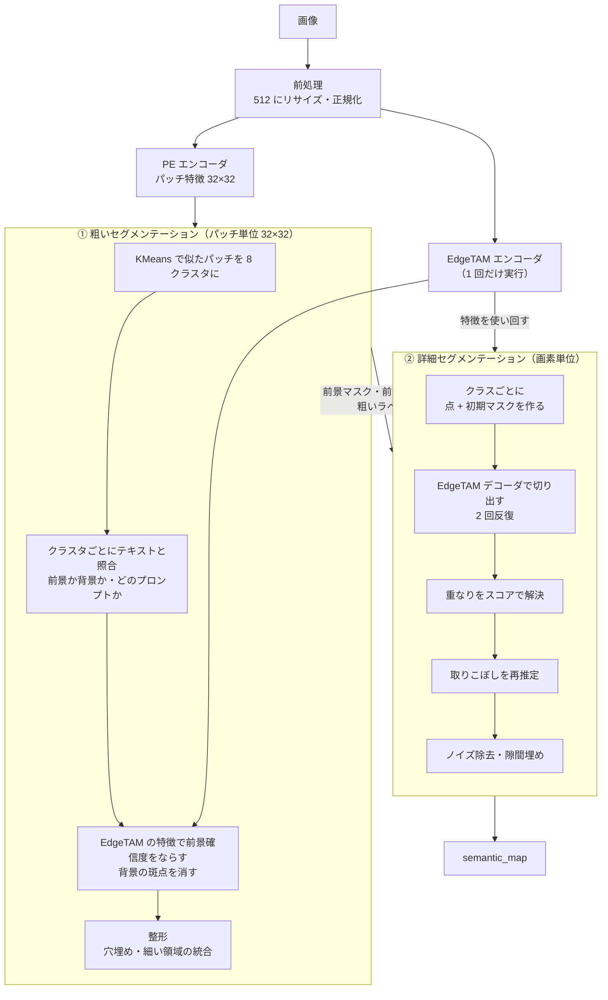
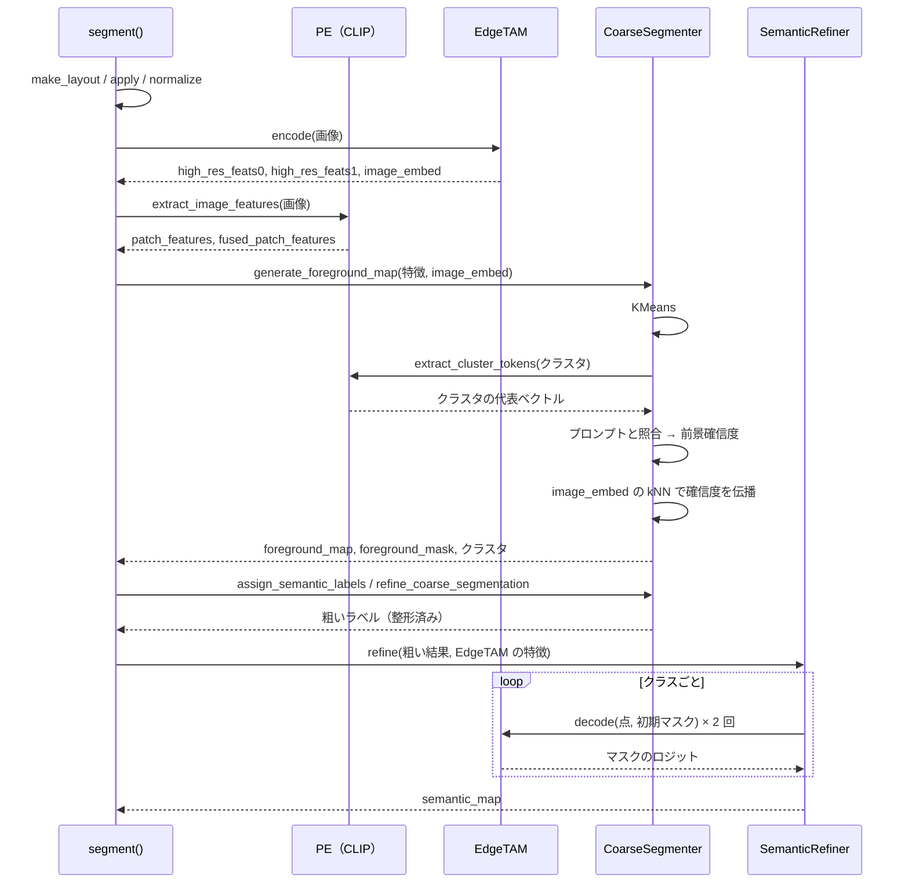
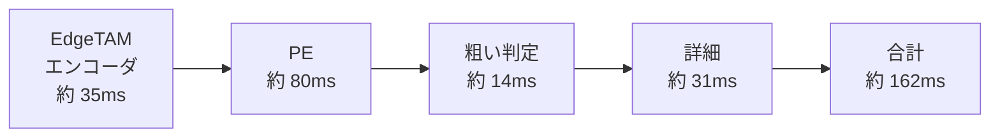

# 全体像

テキストプロンプトだけで（学習なしで）、画像から「何がどこにあるか」を CPU 上で ~200ms で求める。

**① 粗いセグメンテーション（PE）で当たりを付け、② 詳細セグメンテーション（EdgeTAM）で輪郭を切り出す。**

| 資料 | 内容 |
|---|---|
| **この資料** | 全体の流れ・2 段階にした理由・設定・処理時間 |
| [coarse_segmentation.md](coarse_segmentation.md) | ① 粗いセマンティックセグメンテーションの詳細 |
| [detailed_segmentation.md](detailed_segmentation.md) | ② 詳細セグメンテーションの詳細 |
| [method_history.md](method_history.md) | これまでに試した手法と、現在の手法との比較（メリット・デメリット） |

以降の説明は、同じ 1 枚（コイン 9 枚、3024×3024）を例にする。各資料の末尾に、前景が複数クラスの画像（カップ麺）の例もある。


カップ麺（4 クラス）の例:


## 入力と出力

| | 内容 |
|---|---|
| 入力 | RGB 画像 1 枚、前景/背景のテキストプロンプト（`prompts/`） |
| 出力 | `semantic_map`（元画像と同じ大きさ。0 = 背景、1〜 = 前景クラス）。クラスは前景プロンプトに対応 |

## 全体フロー



- 粗い段階は **「だいたいどこに何があるか」**、詳細な段階は **「その正確な輪郭」** を決める。
- EdgeTAM エンコーダは 1 回だけ実行し、①の伝播と②のデコードで使い回す。

## 処理の流れ（シーケンス）



## なぜ 2 段階にしたのか

| 課題 | 1 段階だとどうなるか | 2 段階の解決 |
|---|---|---|
| 学習なしで物体の種類を知りたい | EdgeTAM は「点を置いた物体」を切り出すだけで、種類は分からない | PE（CLIP 系）が画像とテキストを比べて、種類と場所を決める |
| 輪郭を画素単位で正確にしたい | PE の特徴は 16px = 1 パッチ。32×32 の格子では輪郭が荒く、縁・影で太る | EdgeTAM が画像を見て輪郭を決める |
| EdgeTAM に点を置く場所が要る | 点を自動で決める手がかりが無い | PE の粗い結果の「内側」に正例点、「遠い背景」に負例点を置く |
| 速く動かしたい | 画像全体を重いモデルで画素単位に判定すると遅い | 粗い段階は 8 クラスタを 8 回判定するだけ。EdgeTAM はエンコーダ 1 回 + クラスごとに軽いデコーダ |

**粗い結果は「正解」ではなく「ヒント」** として渡す。内側は確実、縁は不明として扱うので、粗い段階の太りや欠けを引き継がない（[detailed_segmentation.md](detailed_segmentation.md)）。

## 各段階の入出力

| 段階 | 入力 | 出力 | 解像度 |
|---|---|---|---|
| 前処理 | 元画像 | モデル入力（512 付近） | 画素 |
| PE | モデル入力 | パッチ特徴 | 32×32 |
| EdgeTAM エンコーダ | モデル入力 | `image_embed`（256ch）・高解像度特徴 2 つ（32ch・64ch） | 32×32・64×64・128×128 |
| ① 粗い | PE 特徴・`image_embed` | 前景確信度・前景マスク・粗いラベル | 32×32 |
| ② 詳細 | ①の出力・EdgeTAM の特徴 | `semantic_map` | 元画像 |

## 設定

`configs/ov_config.yaml`（PyTorch 版は `torch_config.yaml`）。

| キー | 値 | 意味 |
|---|---|---|
| `image_size` / `resize_mode` | 512 / `fit` | モデル入力の大きさ・アスペクト比の扱い |
| `k_clusters` / `n_iter` | 8 / 10 | KMeans |
| `foreground_threshold` | 0.5 | 前景の確信度のしきい値 |
| `prompts_dir` | `prompts/candidates/color_free_bg` | 前景・背景プロンプト |
| `use_edgetam_clustering` | true | EdgeTAM の特徴で前景確信度を伝播 |
| `edgetam_foreground_points_per_class` | 4 | クラスごとの正例点 |
| `edgetam_background_point_count` | 4 | 負例点 |
| `edgetam_refine_iterations` | 2 | EdgeTAM デコーダの反復回数 |
| `semantic_max_side` | 1024 | マスク演算の作業解像度（長辺） |
| `ov_num_thread` | 4 | OpenVINO のスレッド数 |

コードに固定した値（近傍 3・logit 幅 8・スコア重み 0.5 など）は `core/common/params.py`。

## 処理時間（OpenVINO・FP32・4 スレッド）



上の値は、このコイン画像を連続実行したときの 1 枚分（実行ごとに ±15ms 程度ばらつく）。複数画像の中央値は約 177ms（[tmp/performance.md](tmp/performance.md)）。

NumPy の BLAS のスレッドは 1 に制限している（`core/openvino/runtime_utils.py`）。既定の 20 スレッドは、行列積の後も待機して OpenVINO のスレッドとコアを取り合い、直後の推論を 2〜4 倍遅くする。

## コードの対応

| 処理 | ファイル |
|---|---|
| 全体の流れ | `core/common/segmentation_runner.py`（`segment`） |
| 入力サイズの決め方 | `core/common/image_layout.py` |
| ① 粗い推定 | `core/common/coarse_segmentation.py`（`CoarseSegmenter`） |
| ② 詳細 | `core/common/semantic_refiner.py`（`SemanticRefiner`） |
| 点の選択・連結成分・ガイデッドフィルタ・隙間埋め | `core/common/mask_utils.py` |
| 固定ハイパーパラメータ | `core/common/params.py` |
| モデル推論の口 | `core/openvino/`（OpenVINO）・`core/torch/`（PyTorch） |

手法の開発は backend 非依存の `core/common/` で行えば、OpenVINO・PyTorch の両方に反映される。

## この資料の画像の作り方

```bash
python tools/docs/make_doc_images.py [--image PATH] [--prefix coin]   # docs/images/ に JPEG で出力（幅 1200px 以下）
```

本体の `segment` と同じ処理を段階ごとに呼び、中間結果を画像にする（最後に `semantic_map` が本体と一致することを確かめる）。
