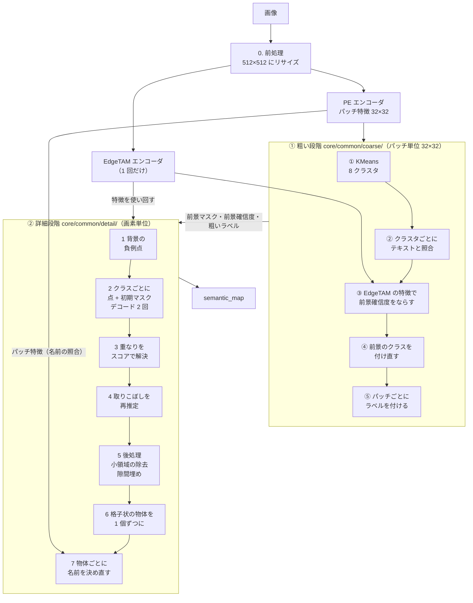
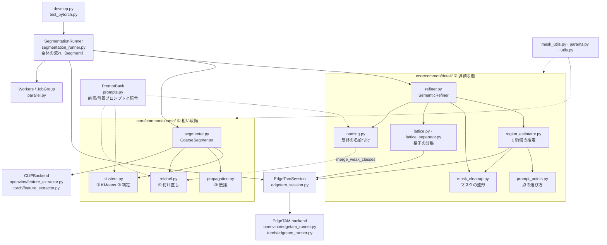

# 全体像

テキストプロンプトだけで（学習なしで）、画像から「何がどこにあるか」を CPU 上で求める。

**① 粗いセグメンテーション（PE）で当たりを付け、② 詳細セグメンテーション（EdgeTAM）で輪郭を切り出す。**
コードも同じ 2 つのブロックに分かれている（`core/common/coarse/` と `core/common/detail/`）。

| 資料 | 内容 |
|---|---|
| **この資料** | 全体の流れ・コードの構成・並行して走る処理・処理時間・設定 |
| [coarse_segmentation.md](coarse_segmentation.md) | ① 粗い段階。処理ごとの画像つき（コイン・カップ麺） |
| [detailed_segmentation.md](detailed_segmentation.md) | ② 詳細段階。処理ごとの画像つき（コイン・カップ麺） |
| [lattice_detection.md](lattice_detection.md) | ② の格子の検出（シリンジの巣の画像で段階ごとに） |
| [method_history.md](method_history.md) | これまでに試した手法と、現在の手法との比較 |

この資料の例は 2 枚。**コイン**（3024×3024。前景が 1 種類で、9 枚が散らばる）と、**カップ麺**（`noodle (2)`、1024×1024。ふた・カップ・麺・包装の 4 種類が重なる）。
どちらも 512×512 に縮めて処理する。

## 入力と出力

| | 内容 |
|---|---|
| 入力 | RGB 画像 1 枚、前景/背景のテキストプロンプト（`prompts/`） |
| 出力 | `semantic_map`（元画像と同じ大きさ。0 = 背景、1〜 = 前景クラス）。クラスは前景プロンプトに対応（`prompt_indices`） |

左から、入力・KMeans のクラスタ・粗い前景マスク・EdgeTAM に渡す点・最終結果。コイン:


カップ麺:


## 全体フロー



粗い段階は **「だいたいどこに何があるか」**、詳細な段階は **「その正確な輪郭」** を決める。EdgeTAM エンコーダは 1 回だけ実行し、③ の伝播と ② のデコードで使い回す。
粗い結果は「正解」ではなく**ヒント**として渡す（内側は確実、縁は不明）ので、粗い段階の太りや欠けを引き継がない。

| 課題 | 1 段階だとどうなるか | 2 段階の解決 |
|---|---|---|
| 学習なしで物体の種類を知りたい | EdgeTAM は点を置いた物体を切り出すだけで、種類は分からない | PE が画像とテキストを比べて、種類と場所を決める |
| 輪郭を画素単位にしたい | PE の特徴は 1 パッチ = 16 画素。32×32 では荒く、縁・影で太る | EdgeTAM が画像を見て輪郭を決める |
| EdgeTAM に点を置く場所が要る | 自動で決める手がかりが無い | PE の粗い結果の内側と、EdgeTAM の特徴で物体らしい画素に正例点、遠い背景に負例点 |
| 速く動かしたい | 画像全体を重いモデルで画素単位に判定すると遅い | 粗い段階は 8 クラスタを判定するだけ。EdgeTAM はエンコーダ 1 回 + クラスごとの軽いデコーダ |

## 処理ごとの変化

各処理が何を受け取り、何に変えるか。**画像は、各節の資料で、コインとカップ麺を並べて見られる。**

| 段階 | 入力 → 出力 | コード | 画像 |
|---|---|---|---|
| 0 前処理・特徴量 | 画像 → 512×512・PE と EdgeTAM の特徴 | `SegmentationRunner._preprocess` ほか | [入力と特徴量](coarse_segmentation.md#0-入力と特徴量) |
| ① KMeans | PE の特徴 → 8 クラスタ（パッチごとの番号） | `coarse/clusters.py` `kmeans_labels` | [① KMeans](coarse_segmentation.md) |
| ② クラスタの判定 | クラスタ → 前景確信度・最も近いプロンプト | `coarse/clusters.py` `judge_clusters` | [② 判定](coarse_segmentation.md) |
| ③ 確信度の伝播 | 前景確信度 → EdgeTAM の特徴が似たパッチどうしでならした確信度 | `coarse/propagation.py` | [③ 伝播](coarse_segmentation.md) |
| ④ 付け直し | 前景のパッチのクラス → 名前の判定し直し・統合・境目の整え | `coarse/relabel.py` | [④ 付け直し](coarse_segmentation.md) |
| ⑤ ラベルの付与 | クラスタ × プロンプト → パッチごとの連番ラベル | `coarse/segmenter.py` `assign_semantic_labels` | [⑤ ラベル](coarse_segmentation.md) |
| 1 準備 | 粗い前景 → 作業解像度・ガイド・背景の負例点 | `detail/region_estimator.py` `prepare` | [1 準備](detailed_segmentation.md#1-準備) |
| 2 クラスごとの推定 | 粗いマスク → 正例点・初期マスク・EdgeTAM のマスクとスコア | `detail/region_estimator.py` `estimate` | [2 推定](detailed_segmentation.md#2-クラスごとの推定) |
| 3 重なりの解決 | クラスごとのマスク → 1 枚のセマンティックマップ | `detail/refiner.py` `_refine_classes` | [3 重なり](detailed_segmentation.md#3-重なりの解決) |
| 4 取りこぼしの再推定 | どのクラスにも覆われない成分 → 単独で推定 | `detail/refiner.py` `_rescue_uncovered` | [4 再推定](detailed_segmentation.md#4-取りこぼしの再推定) |
| 5 後処理 | 小領域の除去・クラス境界の隙間埋め | `detail/mask_cleanup.py` | [5 後処理](detailed_segmentation.md#5-後処理) |
| 6 格子の分離 | 格子状の塊 → セルごとの物体（稀） | `detail/lattice*.py` | [6 格子](detailed_segmentation.md#6-格子状に並んだ小物体の分離) |
| 7 最終の名前付け | クラスの名前 → 物体ごとに決め直した名前 | `detail/naming.py` | [7 名前付け](detailed_segmentation.md#7-最終の名前付け) |

## コードの構成

処理の本体は backend 非依存の `core/common/` にあり、**段階ごとのパッケージ（`coarse/`・`detail/`）に分けてある**。モデルの呼び出し口だけが `core/openvino/`（OpenVINO）と `core/torch/`（PyTorch）にある。



| 処理 | ファイル |
|---|---|
| 全体の流れ | `core/common/segmentation_runner.py`（`segment`） |
| 前景/背景プロンプトとテキスト特徴、ロジットの照合 | `core/common/prompts.py`（`PromptBank`。① と ⑦ が同じ語彙で照合する） |
| ① 粗い段階の進行 | `core/common/coarse/segmenter.py`（`CoarseSegmenter.generate_foreground_map`） |
| ① KMeans・② クラスタの判定 | `coarse/clusters.py` |
| ③ 確信度の伝播（kNN グラフ） | `coarse/propagation.py` |
| ④ 前景のクラスの付け直し | `coarse/relabel.py`（`ForegroundRelabeler`） |
| ② 精緻化の進行 | `core/common/detail/refiner.py`（`SemanticRefiner.refine`） |
| ② 1 領域の推定 | `detail/region_estimator.py`（`RegionEstimator`） |
| ② プロンプト点の選び方 | `detail/prompt_points.py`（負例点・物体の上の正例点） |
| ② マスクの整形（ノイズ除去・隙間埋め） | `detail/mask_cleanup.py` |
| ② 格子状の小物体の分離 | `detail/lattice.py`（検出）・`lattice_separator.py`（`LatticeSeparator`） |
| ② 最終の名前付け | `detail/naming.py`（`RegionNamer`） |
| EdgeTAM の呼び出し口 | `core/common/edgetam_session.py`（`EdgeTamSession`。lock・前後処理） |
| 並行処理 | `core/common/parallel.py`（`Workers`・`JobGroup`） |
| パッチ格子・マスクの基本演算（両段階で共通） | `core/common/mask_utils.py` |
| 固定ハイパーパラメータ・表示の定数 | `core/common/params.py`（共通 → ① → ② → 実行環境 → 表示の順） |
| モデル推論の口 | `core/openvino/`（OpenVINO）・`core/torch/`（PyTorch） |

- **小領域の除去・隙間埋め**（`remove_small_regions`・`fill_narrow_gaps`）は、粗いマスクではなく **EdgeTAM が切り出した後の `semantic_map`（作業解像度の画素）** を整えるので、② の `detail/mask_cleanup.py` にある。`fill_narrow_gaps` は、隙間が「粗い前景の内部」かの判定にだけ、粗い前景マスクを読む。
- ④ の `merge_weak_classes` は、⑦ の最終の名前付けも使う（`detail/naming.py` が `coarse/relabel.py` から読む）。
- 手法の開発は backend 非依存の `core/common/` で行えば、OpenVINO・PyTorch の両方に反映される。

## 並行して走る処理

OpenVINO の推論は GIL を離すので、推論の最中に別スレッドで NumPy / OpenCV の整形を進められる。**スレッドに載せる仕事は 3 つ**（`worker_threads` = 2。`core/common/parallel.py`）。


カップ麺の 1 枚（第 6 層のモデル、下記の PC）。上の段がメインスレッドの段階、下の 2 段がワーカー、最下段がデコーダー。ワーカーの緑（左）が kNN グラフで、PE と重なる。精緻化では、領域の推定（緑）が、別の領域のデコード（赤）と重なる。デコーダーは同時に 1 つだけ。

| 仕事 | 場所 | 重なる相手 |
|---|---|---|
| EdgeTAM の特徴の kNN グラフ | `SegmentationRunner._start_edge_graph`（`coarse/propagation.py` の `edge_graph_of`） | PE の推論 |
| 領域（クラス・取りこぼしの成分）の推定 | `SemanticRefiner._refine_classes` / `_rescue_uncovered` | 別の領域のデコード |
| クラスごとの小領域の検出 | `detail/mask_cleanup.py` の `remove_small_regions` | クラスどうし |

出力がスレッドの有無で変わらないための決まり:

- 推定（`RegionEstimator.estimate`）は入力を読むだけで、何も書き換えない。**結果の反映は `SemanticRefiner` だけが、クラス番号の順に行う。**
- デコーダーは `EdgeTamSession` の lock で同時に 1 つ（格子分離のデコードも通る）。
- 取りこぼしの再推定は、クラス反映後に覆われていない成分を先に投機的に推定し、反映のときに覆われていたら結果を捨てる。
- `worker_threads: 0` なら、スレッドを使わず、`result()` を呼んだときにその場で実行する（同じ出力）。

## 処理時間

この資料を作った PC（Intel Core i7-12700、WSL2、OpenVINO・FP32・4 スレッド、第 6 層のモデル）で、5 回測った中で合計時間が中央値の回（`tools/docs/make_timeline_image.py`。2 回の捨て実行の後。段階ごとの開始・終了を記録しながら測っている）。

| 段階 | コイン（3024×3024 → 512） | カップ麺（1024×1024 → 512） |
|---|---|---|
| 前処理（リサイズ） | 0.5 ms | 0.2 ms |
| EdgeTAM エンコーダ | 25.4 ms | 25.8 ms |
| PE（kNN グラフが重なる） | 63.0 ms | 70.2 ms |
| ① 粗い段階（KMeans・照合・伝播・付け直し） | 9.1 ms | 13.5 ms |
| ② 詳細段階（クラス・取りこぼし・後処理・名前付け） | 44.3 ms | 135.4 ms |
| **合計** | **143 ms** | **245 ms** |
| デコード（回数 / 合計） | 2 回 / 11.3 ms | 14 回 / 73.0 ms |

- 時間の大半は、特徴抽出（PE + EdgeTAM エンコーダ）と、クラス・領域ごとのデコード。デコードの回数は「（クラス数 + 再推定した成分数）× 反復回数」。カップ麺は（4 クラス + 再推定 3 成分）× 2 = 14 回。
- ① の内訳（別の測定。5 回の中央値）。コイン / カップ麺: KMeans 1.4 / 1.3 ms、クラスタごとの代表トークンと照合 3.2 / 3.3 ms、伝播 0.2 / 0.4 ms、付け直し 4.4 / 8.6 ms。
- ② の最後の名前付けは 8.5 ms（どちらの画像も。照合のモデル 2 回を含む）。格子の判定（格子でない画像では何もしない）は約 5 ms。格子を検出したときだけ、006（シリンジの巣 80 個）で、検出 22 ms + 位相の補正 16 ms + セルごとのデコード 76 ms。
- NumPy の BLAS のスレッドは 1 に制限している（`core/openvino/runtime_utils.py`）。既定の 20 スレッドは、行列積の後も待機して OpenVINO のスレッドとコアを取り合い、直後の推論を 2〜4 倍遅くする。
- 同じコード・同じ画像でも、測定ごとに合計は数 % ばらつく（カップ麺: 239・245・250 ms の 3 回の測定）。過去の比較は [method_history.md](method_history.md#整理で測ったこと2026-10-31)。

## 設定

`configs/ov_config.yaml`（PyTorch 版は `torch_config.yaml`。コード側に既定値は無く、キーは yaml に必ず書く）。

| キー | 値 | 意味 |
|---|---|---|
| `image_size` | 512 | モデル入力の一辺。画像は 512×512 にリサイズする（縦横比は保たない）。16 と 32 の倍数であること |
| `k_clusters` / `n_iter` | 8 / 10 | KMeans |
| `foreground_threshold` | 0.5 | 前景の確信度のしきい値 |
| `edgetam_foreground_points_per_class` / `edgetam_background_point_count` | 4 / 4 | クラスごとの正例点・背景の負例点 |
| `edgetam_refine_iterations` | 2 | EdgeTAM デコーダの反復回数 |
| `semantic_max_side` | 1024 | マスク演算の作業解像度（長辺） |
| `ov_num_thread` | 4 | OpenVINO のスレッド数 |
| `ov_static_shape` | true | 入力の大きさを固定してコンパイルする（約 12% 速い。出力は動的形状と bit 単位では一致しない）。true のときは、EdgeTAM のグラフも書き換える（出力は同じ） |
| `worker_threads` | 2 | 推論と重ねて整形を実行する Python のスレッド数（0 で重ねない。出力は変わらない） |
| `model_dir` | `./weights/openvino_models` | OpenVINO モデルのフォルダ |

コードに固定した値（近傍 3・logit 幅 8・スコア重み 0.5 など）は `core/common/params.py`。

## 画像の作り方

この資料の画像は、**第 6 層のモデル**で作った（PE のクラスタリングに使う層は、モデルの変換時に固定される）。

```bash
# 第 6 層のモデルを作る（EdgeTAM のモデルは openvino_models からコピーする）
python convert_openvino.py --cluster-layers 6 --out-dir ./weights/openvino_models_l6 --pe-only
cp weights/openvino_models/edgetam_* weights/openvino_models_l6/

# 画像（docs/images/ に JPEG で出力。幅 1200px 以下）
python tools/docs/make_doc_images.py --image "/home/llm/datasets/02_object_detection/coin/001_crop.png" --prefix coin --model-dir weights/openvino_models_l6
python tools/docs/make_doc_images.py --image "/home/llm/datasets/01_classification_sample/noodle/noodle (2).png" --prefix noodle --model-dir weights/openvino_models_l6
python tools/docs/make_timeline_image.py --image "/home/llm/datasets/01_classification_sample/noodle/noodle (2).png" --model-dir weights/openvino_models_l6   # 処理のタイムライン図（静かな状態で）
python tools/docs/make_relabel_doc_image.py --model-dir weights/openvino_models_l6                                                                       # ④ の「なし / あり」
python tools/docs/lint_docs.py                                                                                                                           # 画像・リンク・mermaid の検査
```

`make_doc_images.py` は、本体の `segment` と**同じ段階の関数を同じ順に**呼び、各段階の中間結果を画像にする（最後に、`semantic_map`・粗いラベル・クラスの名前が本体と一致することを確かめる）。
格子の画像（`make_lattice_doc_images.py`・シリンジの画像が要る）は、データがあるときだけ再生成できる。
