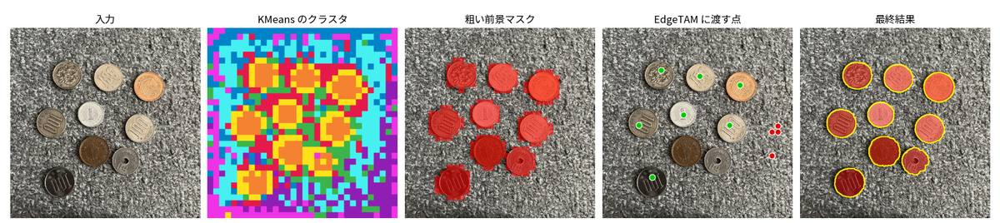
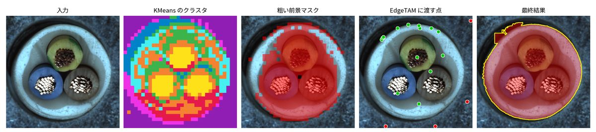
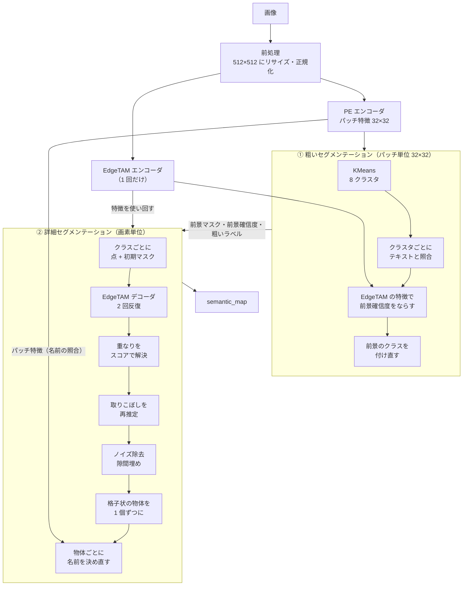
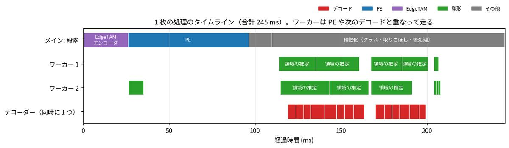
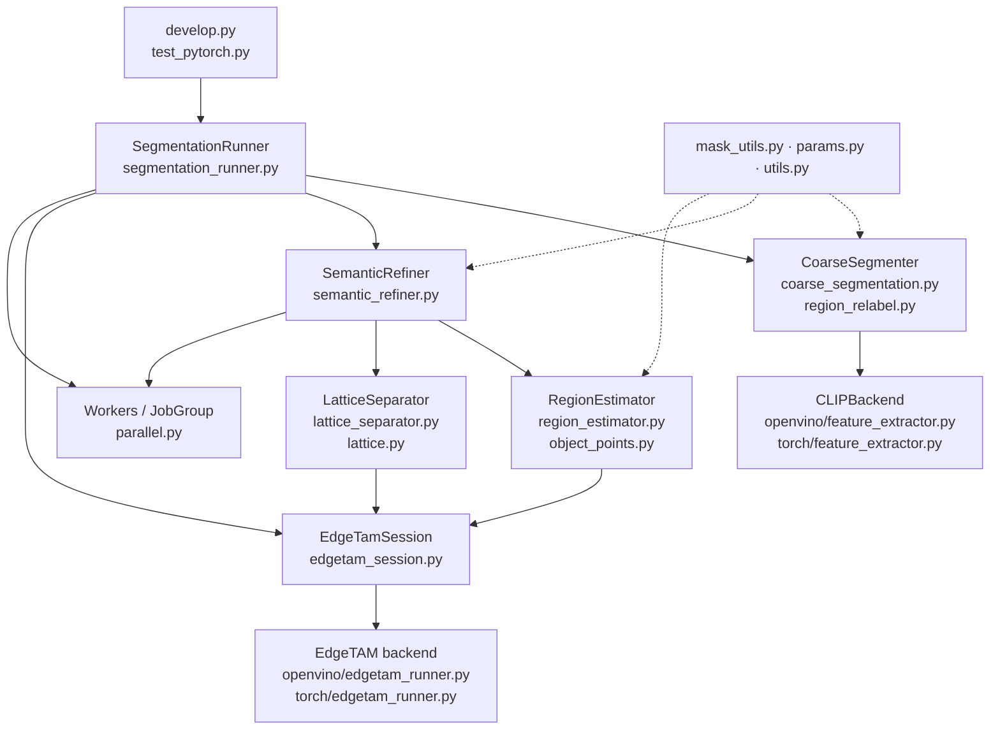

# 全体像

テキストプロンプトだけで（学習なしで）、画像から「何がどこにあるか」を CPU 上で求める。

**① 粗いセグメンテーション（PE）で当たりを付け、② 詳細セグメンテーション（EdgeTAM）で輪郭を切り出す。**

| 資料 | 内容 |
|---|---|
| **この資料** | 全体の流れ・並行して走る処理・処理時間・モジュール構成・設定 |
| [coarse_segmentation.md](coarse_segmentation.md) | ① 粗いセマンティックセグメンテーション |
| [detailed_segmentation.md](detailed_segmentation.md) | ② 詳細セグメンテーション |
| [lattice_detection.md](lattice_detection.md) | ② の格子の検出（シリンジの巣の画像で段階ごとに） |
| [method_history.md](method_history.md) | これまでに試した手法と、現在の手法との比較 |

## 入力と出力

| | 内容 |
|---|---|
| 入力 | RGB 画像 1 枚、前景/背景のテキストプロンプト（`prompts/`） |
| 出力 | `semantic_map`（元画像と同じ大きさ。0 = 背景、1〜 = 前景クラス）。クラスは前景プロンプトに対応 |

左から、入力・KMeans のクラスタ・粗い前景マスク・EdgeTAM に渡す点・最終結果。コイン（前景が 1 種類）:



MVTec cable（前景が複数のクラス）:



## 全体フロー



粗い段階は **「だいたいどこに何があるか」**、詳細な段階は **「その正確な輪郭」** を決める。EdgeTAM エンコーダは 1 回だけ実行し、① の伝播と ② のデコードで使い回す。
粗い結果は「正解」ではなく**ヒント**として渡す（内側は確実、縁は不明）ので、粗い段階の太りや欠けを引き継がない。
最後に、EdgeTAM が切り出した物体の画素だけから PE の代表トークンを作り直して、物体ごとに名前を決め直す（② の 7。種類の違う物体を分ける。前景のマスクは変えない）。

| 課題 | 1 段階だとどうなるか | 2 段階の解決 |
|---|---|---|
| 学習なしで物体の種類を知りたい | EdgeTAM は点を置いた物体を切り出すだけで、種類は分からない | PE が画像とテキストを比べて、種類と場所を決める |
| 輪郭を画素単位にしたい | PE の特徴は 1 パッチ = 16 画素。32×32 では荒く、縁・影で太る | EdgeTAM が画像を見て輪郭を決める |
| EdgeTAM に点を置く場所が要る | 自動で決める手がかりが無い | PE の粗い結果の内側と、EdgeTAM の特徴で物体らしい画素に正例点、遠い背景に負例点 |
| 速く動かしたい | 画像全体を重いモデルで画素単位に判定すると遅い | 粗い段階は 8 クラスタを判定するだけ。EdgeTAM はエンコーダ 1 回 + クラスごとの軽いデコーダ |

## 並行して走る処理

OpenVINO の推論は GIL を離すので、推論の最中に別スレッドで NumPy / OpenCV の整形を進められる。**スレッドに載せる仕事は 3 つ**（`worker_threads` = 2。`core/common/parallel.py`）。



MVTec cable の 1 枚（第 6 層のモデル、この資料を作った PC）。上の段がメインスレッドの段階、下の 2 段がワーカー、最下段がデコーダー。ワーカー 2 の緑（左）が kNN グラフで、PE と重なる。精緻化では、領域の推定（緑）が、別の領域のデコード（赤）と重なる。デコーダーは同時に 1 つだけ。

| 仕事 | 場所 | 重なる相手 |
|---|---|---|
| EdgeTAM の特徴の kNN グラフ | `SegmentationRunner._start_edge_graph` | PE の推論 |
| 領域（クラス・取りこぼしの成分）の推定 | `SemanticRefiner._refine_classes` / `_rescue_uncovered` | 別の領域のデコード |
| クラスごとの小領域の検出 | `mask_utils.remove_small_regions` | クラスどうし |

出力がスレッドの有無で変わらないための決まり:

- 推定（`RegionEstimator.estimate`）は入力を読むだけで、何も書き換えない。**結果の反映は `SemanticRefiner` だけが、クラス番号の順に行う。**
- デコーダーは `EdgeTamSession` の lock で同時に 1 つ（格子分離のデコードも通る）。
- 取りこぼしの再推定は、クラス反映後に覆われていない成分を先に投機的に推定し、反映のときに覆われていたら結果を捨てる。
- `worker_threads: 0` なら、スレッドを使わず、`result()` を呼んだときにその場で実行する（同じ出力）。

小領域の検出の重ねを外すと、合計が 4.4% 遅くなった（8 枚 × 5 周）。

## 処理時間

この資料を作った PC（Windows、OpenVINO・FP32・4 スレッド、第 6 層のモデル）で、5 回測った中で合計時間が中央値の回（`tools/docs/make_timeline_image.py`。段階ごとの開始・終了を記録しながら測っている）。

| 段階 | コイン（3024×3024 → 512） | cable（1024×1024 → 512） |
|---|---|---|
| 前処理（リサイズ・正規化） | 2.3 ms | 2.7 ms |
| EdgeTAM エンコーダ | 49.5 ms | 46.3 ms |
| PE（kNN グラフが重なる） | 106.3 ms | 104.8 ms |
| 粗い前景（KMeans・照合・伝播・付け直し） | 11.1 ms | 12.5 ms |
| 精緻化（クラス・取りこぼし・後処理） | 83.8 ms | 197.7 ms |
| **合計** | **255 ms** | **366 ms** |
| デコード（回数 / 合計） | 2 回 / 20.1 ms | 8 回 / 88.4 ms |

- 時間の大半は、特徴抽出（PE + EdgeTAM エンコーダ）と、クラス・領域ごとのデコード。デコードの回数は「（クラス数 + 再推定した成分数）× 反復回数」。
- 格子状の物体を検出したときだけ、② の最後に約 +150ms（006 の 80 個）。検出したかの判定は毎回走り、約 14ms。
- ② の最後の名前付け（2026-11-06 に追加）は平均 約 7ms（照合のモデル 2 回 約 2.3ms を含む）。上の表はそれより前の測定で、含まない。この検証の環境（WSL2・OpenVINO 4 スレッド）で 46 枚を交互に 5 周測った差は、1 画像あたり +6.8ms（+4.5%）。
- NumPy の BLAS のスレッドは 1 に制限している（`core/openvino/runtime_utils.py`）。既定の 20 スレッドは、行列積の後も待機して OpenVINO のスレッドとコアを取り合い、直後の推論を 2〜4 倍遅くする。
- **コードの整理（2026-10-31）の前後の比較**: 同じ画像を、整理前と整理後で実行順を入れ替えながら 6 周測った。画像ごとの最小値の比（整理後 / 整理前）は 0.93〜1.00、中央値 0.986。出力は 42 枚で全項目一致。測定のばらつきが大きく（同じコードどうしでも ±1〜2%、周ごとの合計は ±10〜20%）、数 % の差は検出できない。

## モジュール構成



| 処理 | ファイル |
|---|---|
| 全体の流れ | `core/common/segmentation_runner.py`（`segment`） |
| ① 粗い推定 | `core/common/coarse_segmentation.py`（`CoarseSegmenter`）・`region_relabel.py`（前景のクラスの付け直し。名前の判定し直し・統合・境目の整え） |
| ② 精緻化の進行 | `core/common/semantic_refiner.py`（`SemanticRefiner`） |
| ② 最終の名前付け | `core/common/region_relabel.py`（`name_final_regions`）・`coarse_segmentation.py`（`final_region_logits`。照合の根拠） |
| ② 1 領域の推定 | `core/common/region_estimator.py`（`RegionEstimator`）・`object_points.py` |
| EdgeTAM の呼び出し口 | `core/common/edgetam_session.py`（`EdgeTamSession`。lock・前後処理） |
| ② 格子状の小物体の分離 | `core/common/lattice.py`（検出）・`lattice_separator.py`（`LatticeSeparator`） |
| 並行処理 | `core/common/parallel.py`（`Workers`・`JobGroup`） |
| 点の選択・連結成分・ガイデッドフィルタ・隙間埋め | `core/common/mask_utils.py` |
| 固定ハイパーパラメータ・表示の定数 | `core/common/params.py` |
| モデル推論の口 | `core/openvino/`（OpenVINO）・`core/torch/`（PyTorch） |

手法の開発は backend 非依存の `core/common/` で行えば、OpenVINO・PyTorch の両方に反映される。

## 設定

`configs/ov_config.yaml`（PyTorch 版は `torch_config.yaml`。コード側に既定値は無く、キーは yaml に必ず書く）。

| キー | 値 | 意味 |
|---|---|---|
| `image_size` | 512 | モデル入力の一辺。画像は 512×512 にリサイズする（縦横比は保たない）。16 と 32 の倍数であること |
| `k_clusters` / `n_iter` | 8 / 10 | KMeans |
| `foreground_threshold` | 0.5 | 前景の確信度のしきい値 |
| `edgetam_foreground_points_per_class` / `edgetam_background_point_count` | 4 / 4 | クラスごとの正例点・背景の負例点 |
| `edgetam_refine_iterations` | 2 | EdgeTAM デコーダの反復回数 |
| `semantic_max_side` | 1024 | マスク演算の作業解像度（長辺） |
| `ov_num_thread` | 4 | OpenVINO のスレッド数 |
| `ov_static_shape` | true | 入力の大きさを固定してコンパイルする（約 12% 速い。出力は動的形状と bit 単位では一致しない）。true のときは、EdgeTAM のグラフも書き換える（出力は同じ） |
| `worker_threads` | 2 | 推論と重ねて整形を実行する Python のスレッド数（0 で重ねない。出力は変わらない） |
| `model_dir` | `./weights/openvino_models` | OpenVINO モデルのフォルダ |

コードに固定した値（近傍 3・logit 幅 8・スコア重み 0.5 など）は `core/common/params.py`。

## 画像の作り方

この資料の画像は、**第 6 層のモデル**で作った（PE のクラスタリングに使う層は、モデルの変換時に固定される）。

```bash
# 第 6 層のモデルを作る（EdgeTAM のモデルは openvino_models からコピーする）
python convert_openvino.py --cluster-layers 6 --out-dir ./weights/openvino_models_l6 --pe-only
cp weights/openvino_models/edgetam_* weights/openvino_models_l6/

# 画像（docs/images/ に JPEG で出力。幅 1200px 以下）
python tools/docs/make_doc_images.py --image PATH --prefix coin --model-dir weights/openvino_models_l6
python tools/docs/make_timeline_image.py --image PATH --model-dir weights/openvino_models_l6   # 処理のタイムライン図
python tools/docs/lint_docs.py                                                                  # 画像・リンク・mermaid の検査
```

`make_doc_images.py` は、本体の `segment` と同じ処理を段階ごとに呼び、中間結果を画像にする（最後に `semantic_map` が本体と一致することを確かめる）。
格子の画像（`make_lattice_doc_images.py`・シリンジの画像が要る）と、正例点の比較図（`make_points_doc_images.py`・MVTec の正解 `fg_mask` が要る）は、データがあるときだけ再生成できる。
