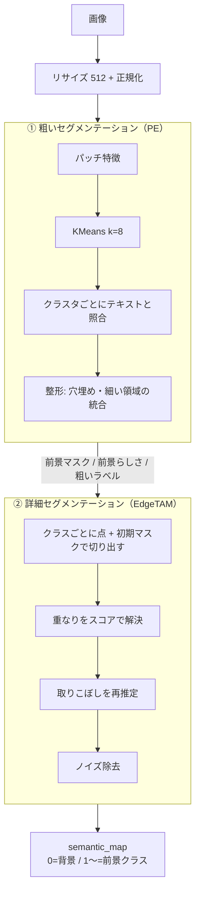
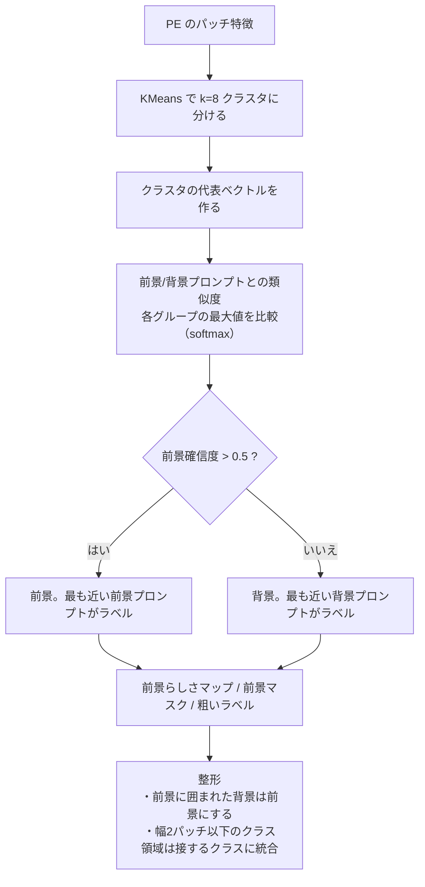
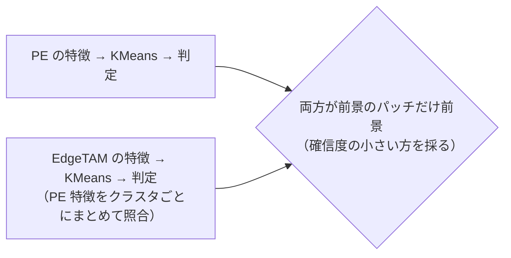
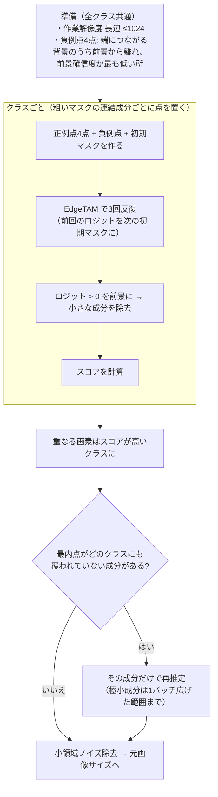
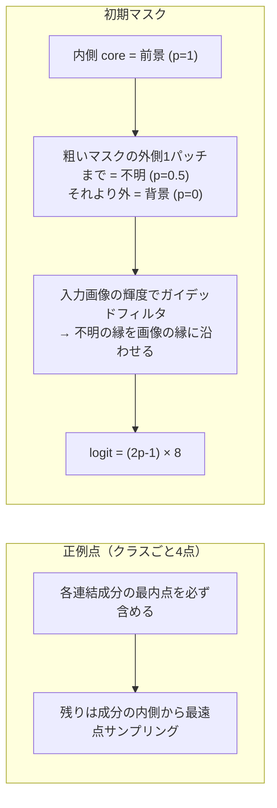
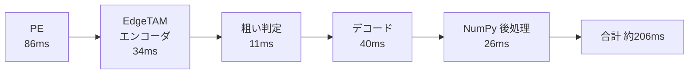

# セグメンテーションの手法（現状のまとめ）

テキストプロンプトだけで（学習なしで）、画像から「何がどこにあるか」を求める。
**①粗く当たりを付け → ②細かく切り出す**の2段階。経緯・実験結果は [coarse_segmentation.md](coarse_segmentation.md) / [semantic_refiner.md](semantic_refiner.md) / [improvement_methods.md](improvement_methods.md)。

## 全体像



コード: `core/common/segmentation_runner.py` の `segment`。各処理は `with Timer(...)` で計測。

## ① 粗いセグメンテーション（`coarse_segmentation.py`）



### オプション: EdgeTAM の特徴でも判定して AND（`use_edgetam_clustering`）



| | |
|---|---|
| 効果 | 背景の斑点・織り目の誤検出が半減（合成データ IoU +0.05） |
| 代償 | 小物体の検出率が少し低下。大きな単体物体（cable など）では下がることがある |
| 注意 | EdgeTAM のエンコードは1回だけ実行し、②にも使い回す |

## ② 詳細セグメンテーション（`semantic_refiner.py`）

### 全体



### 入力の作り方



斑点（3パッチ未満の孤立成分）はクラスの推定に混ぜない（物体が背景へ広がるのを防ぐ）。

### スコア（重なりの解決用）

```
スコア = EdgeTAM の確信度 × (0.5 + 0.5 × 粗い前景らしさ)
```

## 設定

| キー（`configs/ov_config.yaml`） | 値 | 意味 |
|---|---|---|
| `image_size` | 512 | リサイズ後の一辺 |
| `k_clusters` / `n_iter` | 8 / 10 | KMeans |
| `foreground_threshold` | 0.5 | 前景の確信度の閾値 |
| `prompts_dir` | `prompts/candidates/color_free_bg` | 前景・背景プロンプト |
| `use_edgetam_clustering` | false | EdgeTAM 特徴でも判定して AND |
| `edgetam_foreground_points_per_class` | 4 | クラスごとの正例点 |
| `edgetam_background_point_count` | 4 | 負例点 |
| `edgetam_refine_iterations` | 3 | EdgeTAM の反復回数 |
| `semantic_max_side` | 1024 | マスク演算の作業解像度（長辺） |
| `ov_num_thread` | 4 | OpenVINO のスレッド数 |

コードに固定した値（近傍3・logit幅8・スコア重み0.5 など）は `core/common/params.py`。

## 処理時間の目安（OpenVINO・FP32・4スレッド）

[improvement_methods.md](improvement_methods.md) §9.3 の測定値（`use_edgetam_clustering: true`、中央値）。



## コードの対応

| 処理 | ファイル |
|---|---|
| 全体の流れ | `core/common/segmentation_runner.py` |
| ① 粗い推定 | `core/common/coarse_segmentation.py` |
| ② 精緻化 | `core/common/semantic_refiner.py` |
| 点の選択・連結成分・ガイデッドフィルタ | `core/common/mask_utils.py` |
| モデル推論の口 | `core/openvino/` / `core/torch/` |
