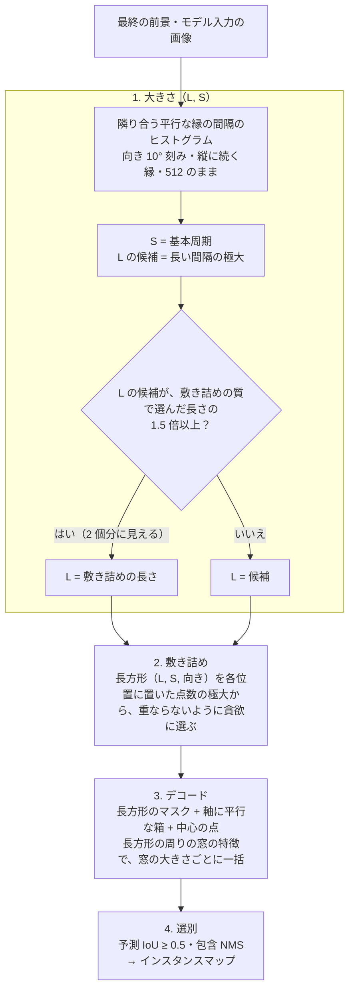
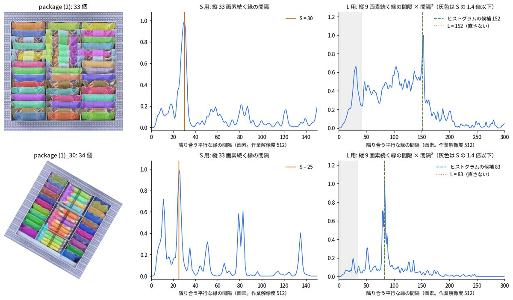

# 密集した長方形の物体の分離

向き・大きさが混在して接した**細長い長方形の物体**（積んだ荷物・並べた部品）を、**1 個ずつのインスタンス**に分ける。学習はしない。
`core/common/rect_size.py`（大きさ）・`rect_tiling.py`（敷き詰め）・`rect_separator.py`（`RectSeparator.separate`。デコードと選別）。**`dense_instances: true` のときだけ動く（既定は false）**。
全体は [overview.md](overview.md)、格子状の並びの分離は [lattice_detection.md](lattice_detection.md)（こちらは規則的な並びだけ）。

| | 内容 |
|---|---|
| 入力 | モデル入力の画像（512×512・RGB）・最終の前景（`semantic_map > 0`）・EdgeTAM の特徴 |
| 出力 | `result.instances`（`InstanceResult`）: インスタンスマップ（元画像の大きさ・uint16・0 = なし・1〜 = 予測 IoU の高い順）・予測 IoU・敷き詰めた長方形の大きさ（長辺 L・短辺 S）。`run()` は `rect_instance_map.png`・`rect_instance_overlay.png` も保存する（`instance_split` の保存名と区別する `rect_`） |
| 仮定 | 物体の大きさ（L・S）は画像に 1 つ。向きは自由。物体どうしは接していてよい |

**なぜ必要か。** EdgeTAM は、点では接した物体を 1 個ずつに分けられないが、箱なら分けられる。箱は軸に平行なので、傾いた物体には**長方形のマスクを初期マスクに与えて**補う（向きを戻さず、再エンコードもしない）。そのために物体ごとの中心・向き・大きさが要る。**大きさを画像から求める**のがこの処理の中心で、物体の中心と向きは、その大きさの長方形を前景に敷き詰めて決める。

## フロー

左 = インスタンス（色 + 境界線）、中 = S 用のヒストグラム、右 = L 用の曲線。上: package (2)（42 個。正解の大きさ 149×29）、下: 30° 傾けた package (1)（35 個。正解 79×24）。

| 段階 | 関数 | 内容 |
|---|---|---|
| 1 | `rect_size.gap_histograms` | 画像を 5〜10° ずつ回して、**縦に続く縁**（縦 33 画素 / 9 画素の最小値フィルタ）の極大を行ごとに探し、**隣り合う極大の間隔**を縁の弱い方の強さで重みづけして数える。向きに依らず、物体の辺に当たる向きで間隔が揃う。勾配は 1 回だけ求め、向き a の縁は cos a · Gx + sin a · Gy |
| 1 | `rect_size.pick_short` / `pick_long` | S = 縦 33 画素のヒストグラムの、最大の 0.8 倍以上の極大のうち最小の間隔。隣り合う縁だけを数えるので、2 個分（S の 2 倍）は現れない。L の候補 = 縦 9 画素のヒストグラムの、S の 1.4 倍より長い間隔のうち（間隔² × 値）が最大のもの |
| 1 | `RectSeparator._estimate_size` | 端と端が接する並びでは、L の候補が 2 個分になる。候補の 0.45〜1.15 倍の梯子（60 から 1.2 倍刻み）の各長さで敷き詰めて、質（覆う前景の割合 × 弱い方の辺の縁の強さ）が最大の長さの 1.5 倍以上なら、その長さを L にする |
| 2 | `rect_tiling.tile` | 向きごとに、長方形の中の前景の割合（coverage）と 4 辺の縁の強さの地図を、回した長方形のカーネルの相関で求める。点数 = coverage⁴ × 縁の強さ の極大から、点数の高い順に、前景の割合 80% 以上で、選んだ長方形との重なりが 20% 以下のものを選ぶ |
| 3 | `RectSeparator._decode` | 長方形（0.85 倍）の内側 +8・外側 −8 を初期マスクに、箱と中心の点で、EdgeTAM デコーダーを窓（箱の長辺 / 16 + 3 トークンを 4 の倍数に切り上げ）で一括実行。デコーダーの 3 候補のうち 2 番目を採る |
| 4 | `RectSeparator._select` / `_instance_map` | 面積 20 画素以上・予測 IoU 0.5 以上のマスクを、予測 IoU の高い順に、IoU 0.3 以上または小さい方の 50% 以上が重なるものを除いて採り、1 枚のラベルマップにする。重なる画素は面積の小さい方 |

256 に縮小してヒストグラムを数えると、継ぎ目の弱い縁が消えて S の当たりが 85% に落ちる（512 のままなら 95 枚中 94 枚。残り 1 枚は本体の前景が空）。

## 精度と時間

F1@0.5（正解のインスタンスと IoU 0.5 以上でマッチ。`tools/experiments/dense_instances/eval_core.py` で `segment` 全体を測った）。向き・大きさが混在する合成（接した荷物を並べた画像）と、実画像 package。

| データ | 枚数 | 既定 | 向き 5°・走査 128 / 15°（C1） | 大きさを正解で与えた場合 |
|---|---|---|---|---|
| 合成・開発（設定を選んだ） | 36 | 0.810 | 0.842 | 0.861 |
| 合成・評価（設定を選んだ） | 24 | 0.752 | 0.784 | 0.795 |
| 合成・独立（設定を固定してから初めて見た） | 30 | 0.761 | 0.797 | 0.819 |
| 実画像 package（3 種類の画像の 5 枚） | 5 | 0.653 | 0.639 | 0.668 |
| **全体** | 95 | **0.772** | 0.803 | 0.821 |

| 設定（`params.py`） | 追加 | 本体込み（6 枚の平均） | 最大 |
|---|---|---|---|
| **既定**（向き 10°・走査 96 画素 / 20°） | **+223 ms** | **441 ms** | 534 ms |
| C1（`RECT_GAP_ANGLE_STEP = 5`・`RECT_SCAN_HALF = 128`・`RECT_SCAN_ANGLE_STEP = 15`） | +325 ms | 541 ms | 627 ms |

- この PC（WSL2・OpenVINO 4 スレッド）で、`dense_instances` の偽と真を交互に測った中央値。偽は約 217 ms。package (2) の内訳: 縁の間隔のヒストグラム 約 70 ms・梯子の走査 約 90 ms・最終の敷き詰め 約 80 ms・デコード 約 45 ms。実画像 5 枚の平均は 503 ms（前景が広い）、合成は 436〜482 ms。
- 大きさを敷き詰めの質だけで選ぶ従来案（方式 U）は、独立 30 枚で 0.53・実画像で 0.05。
- 初めて窓をデコードするときは、動的形状のモデルのコンパイルで遅れる。
- OpenVINO のスレッド数は 4 のまま。分離の処理は追加のスレッドを使わない。

## 限界

| 限界 | 内容 |
|---|---|
| 対象が狭い | 長い直線の縁を持つ**細長い長方形**（検証した縦横比は合成で 3〜5.5・実画像で 3.4〜5）。正方形に近い物体は未検証（L の候補は S の 1.4 倍より長い間隔だけ） |
| 小さい物体 | 散らばった小さい部品（短辺 24〜41 画素の MVTec 部品）では、大きさが当たらない（S の当たり 0.25〜0.42・F1 0.10 以下）。縁の長さの設定を小さくしても直らなかった |
| 判定の仕組みが無い | 長方形が密集した画像かを判定しない。有効にすると、ほかの画像でも何か返す（MVTec capsule で 4 個・hazelnut で 12 個）。そのシーンと分かっているときだけ有効にする |
| 本体の前景に依る | 前景が空なら大きさを求めない（`instances` は None）。前景の外の物体は出ない |
| 大きさは 1 つ | 大きさの違う物体が混ざる画像は、最も多い 1 つの大きさに合わせる |
| L は S ほど頑健でない | L の重み（間隔²。1〜3 で当たりが 0.55〜0.88）と 2 個分の判定（1.5。独立 30 枚の結果も見てから選んだ）は、65 枚を見て選んだ。端と端が接する並びで L を 2 個分に取ることがある |
| 評価が小さい | 実画像は 3 種類の画像の 5 枚で、開発にも使った。新しい定数は 42 個（`params.py` の `RECT_*`）で、まだ根拠が薄い |
| 作業解像度 | `image_size` が 512 のときだけ（画素の定数は 512 の画素）。違うとエラー |
| C++ 版 | 未追従（`cppsrc/`） |

報告（試して効かなかった案・各設定の比較）は `outputs/dense_instances/mixed.html` の 9 章。画像は `python tools/docs/make_rect_doc_image.py`（package の実画像が要る）。
