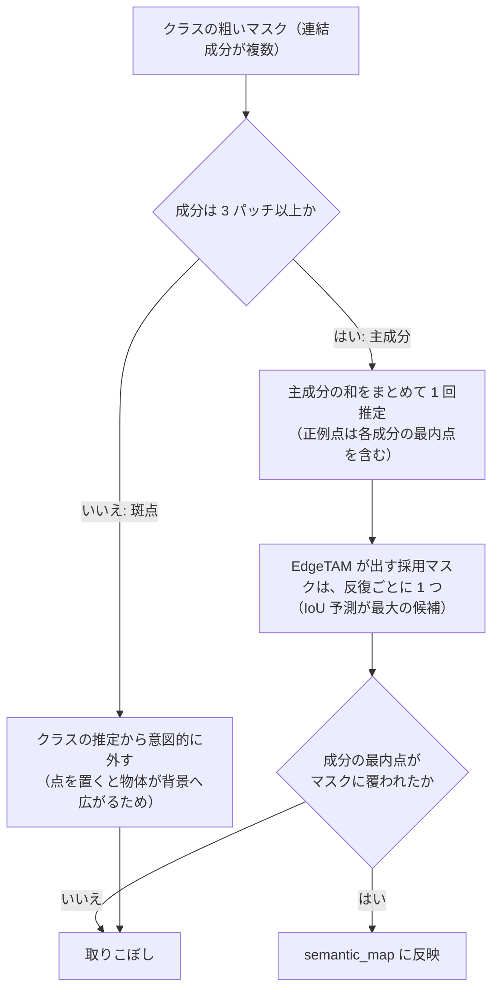
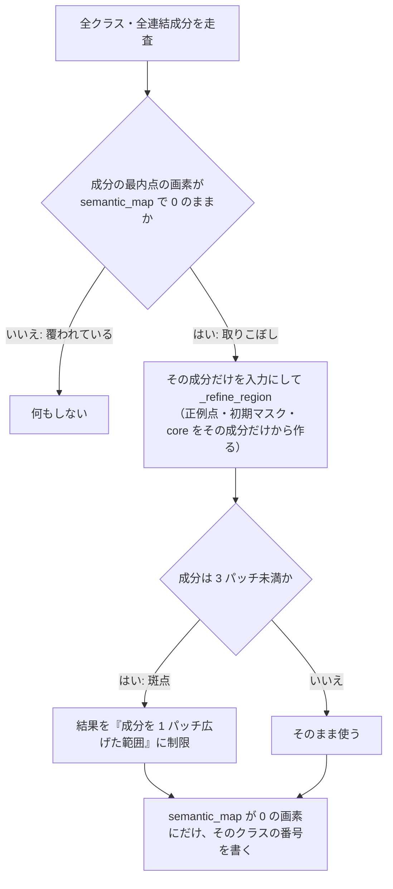

# 取りこぼしの再推定（`_rescue_uncovered`）

`core/common/semantic_refiner.py` の `_rescue_uncovered` は、クラスごとの推定（`_refine_classes`）のあとに、
**どのクラスにも覆われなかった粗い連結成分を、その成分だけで EdgeTAM に切り出させ直す**処理。

```python
binary, _, _ = self._refine_region(ctx, region, [component], f"クラス{class_id}(再推定)")
```

関連: [semantic_refiner.md](semantic_refiner.md) §5・§9、[overview.md](overview.md)。

## なぜ必要か

クラスごとの推定では、同じクラスの成分を**まとめて 1 回**で EdgeTAM に渡す。そのため、成分が結果から漏れる場合がある。



取りこぼしが起きる主な場合は次の 2 つ。

| 場合 | 起きる理由 |
|---|---|
| 斑点（3 パッチ未満）の成分 | 上の通り、クラスの推定に**意図的に混ぜていない**。後でここで個別に扱う |
| 主成分だが、まとめた推定のマスクに入らなかった | 離れた複数の物体にまたがる点でも、採用するマスクは 1 つ。別の物体にマスクが寄ったり、小さい成分が除去されたり、ロジットが 0 を超えなかったりして漏れる |

別のクラスに負けて消える場合は、ここでは拾わない。重なる画素は勝ったクラスの値が入るので、最内点は 0 にならない。

## 何をするか



## 設計上のポイント

- **その成分だけで推定する理由**: 他の成分の点や初期マスクが混ざらないので、EdgeTAM がその成分に集中する。まとめた推定で漏れた物体を拾える。
- **斑点の範囲を制限する理由**: 1〜2 パッチの孤立成分は、物体ではなく背景の斑点であることが多い。制限なしで切り出すと、斑点が物体として大きく広がる。1 パッチ（粗いマスクの信頼限界）だけ広げた範囲に収める。
- **0 の画素にだけ書く理由**: すでにスコアで決めた画素は上書きしない。再推定の結果は重なり解決（スコア比較）に参加せず、`best_score` も更新しない。
- **点の記録**: 再推定で与えた点も `point_coords` / `point_labels` に追加される（`foreground_overlay.png` に描かれる）。

## コスト

再推定した成分ごとに、EdgeTAM のデコードが `edgetam_refine_iterations` 回増える。成分の最内点がすべて覆われていれば、追加の処理は走らない（走査だけ）。

## 確認方法

`debug: true` にすると、`output_dir/<画像名>/debug/` に再推定した成分のマスクが `c<クラス>_rescue_<X>_<Y>.png`（X, Y は最内点のパッチ座標）で保存される。斑点が物体として大きく広がっていないかを見る。

## 未確認の点

- 再推定が実際にどれくらいの頻度で発生するか、精度（IoU）をどれくらい上げているかは、この文書では測っていない。無効にしたときの差を見るには、`_rescue_uncovered` の呼び出しを外して `tools/evaluation/eval_pipeline.py` で比べる。
