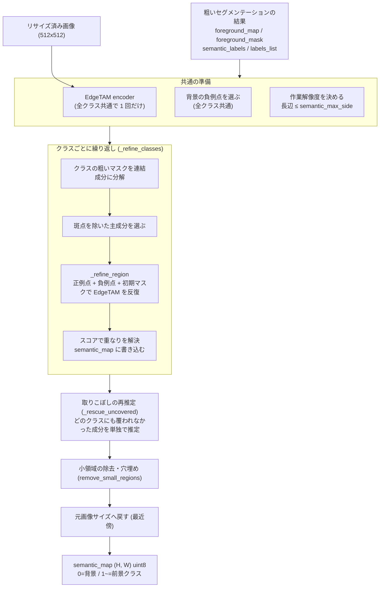
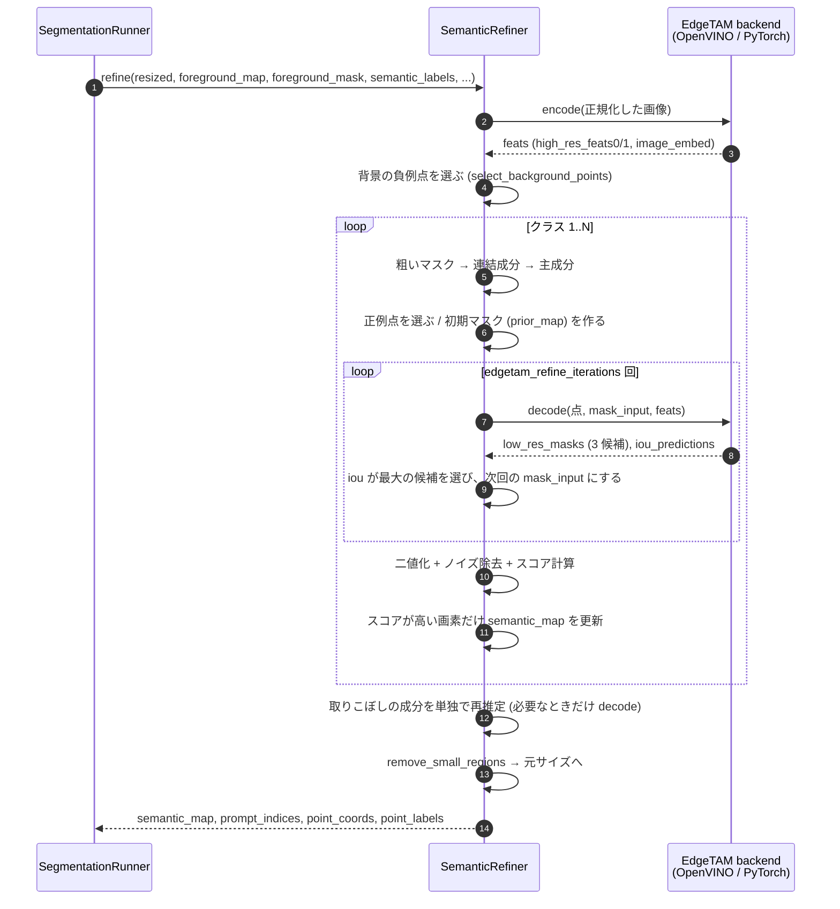
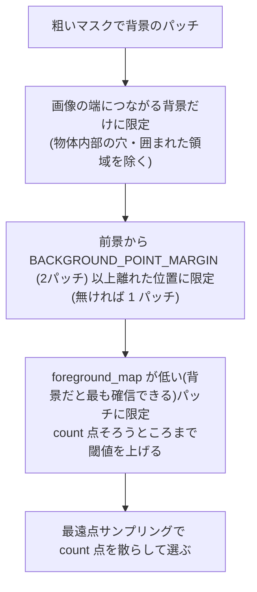
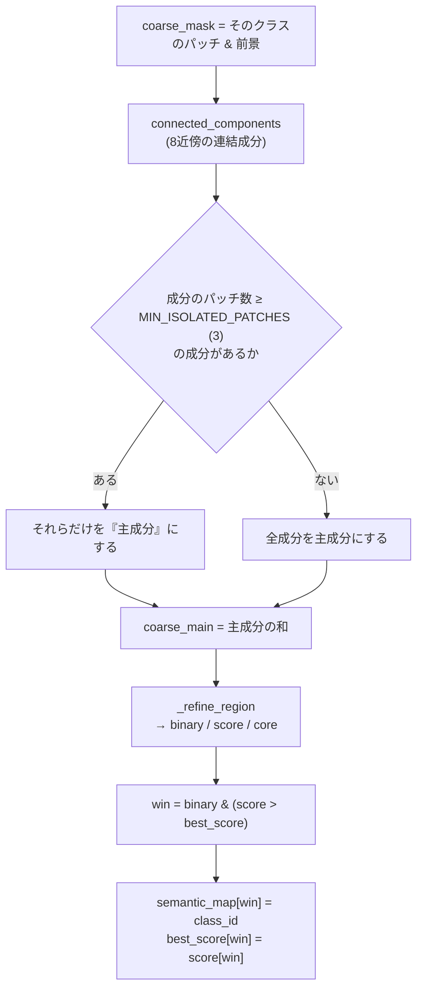
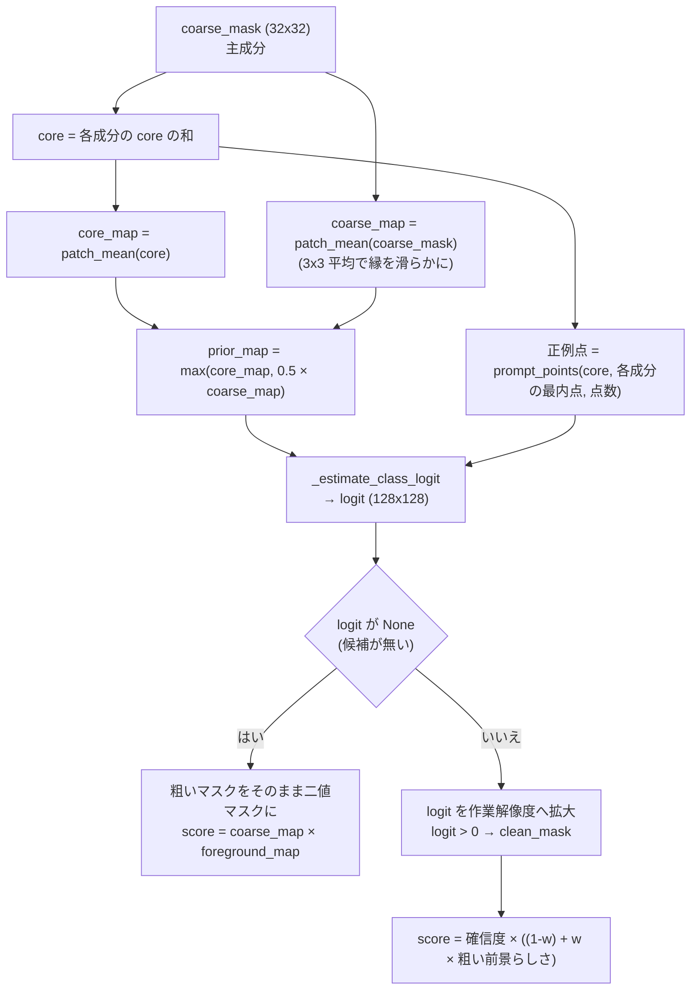
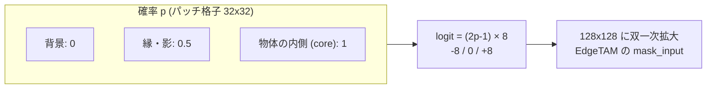
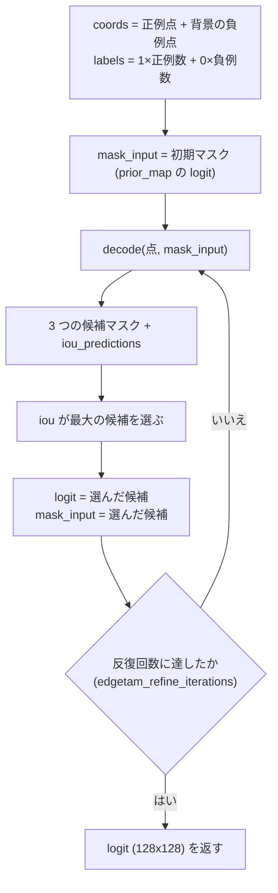
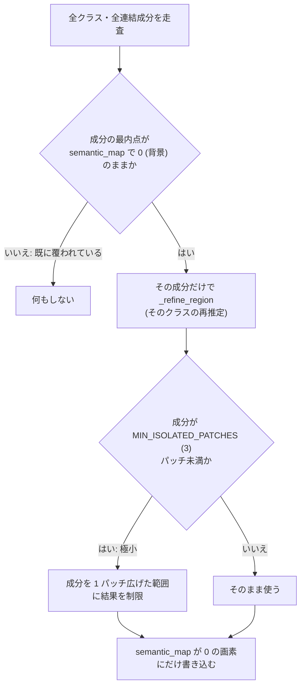

# セマンティックセグメンテーションの精緻化（refine）

`SemanticRefiner.refine`（`core/common/semantic_refiner.py`）の処理をまとめる。OpenVINO 版・PyTorch 版で共通のコードで、EdgeTAM の `encode` / `decode` だけが backend に依存する。

この段階の目的は、[粗いセグメンテーション](coarse_segmentation.md)が出した **32×32 パッチ単位の「どのクラスか」を、EdgeTAM（SAM2 系のプロンプトセグメンテーション）で画素単位の輪郭へ高精度化し、1 枚のセマンティックマップに統合すること**。

粗い結果は次の 2 つの役割で使われる。

- **プロンプトの根拠**: どこに正例点（物体の内側）・負例点（背景）を置くか
- **事前確率**: EdgeTAM の初期マスク（`mask_input`）と、クラス同士の重なりを解決するときのスコア

- [1. 全体像](#1-全体像)
- [2. 入力と出力](#2-入力と出力)
- [3. 処理の流れ（シーケンス）](#3-処理の流れシーケンス)
- [4. 共通の準備](#4-共通の準備)
- [5. クラスごとの推定（`_refine_classes`）](#5-クラスごとの推定_refine_classes)
- [6. 1 領域の推定（`_refine_region`）](#6-1-領域の推定_refine_region)
- [7. EdgeTAM の反復（`_estimate_class_logit`）](#7-edgetam-の反復_estimate_class_logit)
- [8. 重なりの解決](#8-重なりの解決)
- [9. 取りこぼしの再推定（`_rescue_uncovered`）](#9-取りこぼしの再推定_rescue_uncovered)
- [10. 後処理と出力](#10-後処理と出力)
- [11. デバッグ画像の読み方](#11-デバッグ画像の読み方)
- [12. 設定値・固定値](#12-設定値固定値)
- [13. 設計上の意図と注意点](#13-設計上の意図と注意点)
- [14. 試して採用しなかった対策](#14-試して採用しなかった対策)

---

## 1. 全体像



要点は次の 3 つ。

1. **画像の特徴量抽出は 1 回、デコードはクラスごとに複数回**。重い encoder は共通で使い、軽い decoder をクラスごと・反復ごとに回す。
2. **粗いマスクを「ヒント」として EdgeTAM に与える**。点だけでなく、粗いマスク自体を初期マスク（事前確率）として入力する。
3. **クラス同士の重なりはスコアで決める**。クラスごとに独立に推定するので、同じ画素を複数クラスが主張しうる。

---

## 2. 入力と出力

| 区分 | 名前 | 内容 |
|---|---|---|
| 入力 | `resized` | リサイズ済み（正規化前）の画像。EdgeTAM encoder の入力になる |
| 入力 | `foreground_map` | 粗い前景らしさ (32×32, 0〜1)。スコア計算と背景点の選択に使う |
| 入力 | `foreground_mask` | 整形後の粗い前景マスク (32×32, 0/1) |
| 入力 | `semantic_labels` | 整形後の粗いセマンティックラベル (32×32)。クラスタ判定を展開したもの |
| 入力 | `labels_list` | ラベル → 前景プロンプトのインデックス対応 |
| 出力 | `semantic_map` | (H, W) `uint8`。0=背景、1〜=前景クラス |
| 出力 | `prompt_indices` | クラス 1〜に対応する前景プロンプトのインデックス |
| 出力 | `point_coords` / `point_labels` | EdgeTAM に与えた点（画像座標、全クラス分）。可視化用 |

前景クラスは、前景マスク内に現れた `semantic_labels` の値を昇順に並べ、**1 から振り直す**（`class_id = 1, 2, ...`）。前景が 1 つも無いときは、全面 0 のマップを返して終わる。

---

## 3. 処理の流れ（シーケンス）



---

## 4. 共通の準備

### 4.1 EdgeTAM encoder

`predict_encoder` が `resized` を EdgeTAM 用の mean/std で正規化し、`encode` に渡す。得られる `feats = (high_res_feats0, high_res_feats1, image_embed)` は、以降のすべてのクラス・反復で使い回す。

### 4.2 作業解像度

マスク演算（連結成分・メディアン・重なり解決）は画像が大きいと重い。そこで、長辺が `semantic_max_side`（既定 1024）以下になる**作業解像度**で行い、最後に元画像サイズへ戻す。小さい画像は拡大せず、そのまま使う。

```
scale = min(1.0, semantic_max_side / max(width, height))
作業解像度 = (round(width * scale), round(height * scale))
```

### 4.3 背景の負例点（全クラス共通）

`select_background_points` で `edgetam_background_point_count`（既定 8）点を選ぶ。選び方は次の順に絞り込む。



- **端につながる背景だけ**にするのは、物体の穴・影の中に負例を置くと物体が欠けるため。
- **前景から離す**のは、粗いマスクが縁や影で最大 1 パッチ太る、という前提に基づく。
- **確信の弱い「背景」を避ける**のは、濃い布のように、実際は物体なのに背景扱いになった領域へ負例を置くと、物体を打ち消してしまうため。

選んだ点は `transform_coords` でパッチ格子の座標から、各パッチ中心の画像座標へ変換する。

---

## 5. クラスごとの推定（`_refine_classes`）

クラスごとに、次を行う。



### 連結成分が返すもの

`connected_components` は成分ごとに次の 3 つ組を返す。

| 要素 | 意味 |
|---|---|
| 最内点 `peak` | 距離変換が最大の点（成分の中で最も中心寄り）。細い物体でも必ず内側に乗る |
| `core` | 成分を 1 パッチ内側へ縮めた領域。縮めると消える細い成分は成分そのものを `core` とする |
| `region` | 成分マスクそのもの |

### 斑点を主成分から外す理由

背景クラスタの一部が、前景クラスの孤立した 1〜2 パッチの斑点として混ざることがある。これに正例点を置くと、その点を経由して物体のマスクが周囲の背景へ広がる。そこで **3 パッチ未満の孤立成分は、クラスの推定に混ぜない**。斑点は後段の再推定（[9 章](#9-取りこぼしの再推定_rescue_uncovered)）で、範囲を制限して個別に扱う。全成分が斑点なら（`or comps`）、取りこぼしを避けるため全成分を使う。

---

## 6. 1 領域の推定（`_refine_region`）

粗いマスクを受け取り、**EdgeTAM の二値マスク・重なり解決用スコア・core** を返す。



### 6.1 初期マスク（`prior_map`）：粗い結果を事前確率として与える

粗いマスクの中でも、**core（物体の内側）は確実、core の外側（縁）は不確か**という前提で確率を作る。

| 領域 | 確率 | 意味 |
|---|---|---|
| core 内 | 1.0 付近 | 前景だと確信できる |
| core 外の粗いマスク | `PRIOR_NON_CORE_PROBABILITY` = 0.5 | 前景とも背景とも言えない（縁・影） |
| 粗いマスク外 | 0 付近 | 背景 |

この確率 `p` を `logit = (2p - 1) × PRIOR_LOGIT_RANGE`（±8）に変換し、128×128 に拡大して `mask_input` にする。`p = 0.5` が logit 0（不明）になる。



縁を「不明」にしておくことで、EdgeTAM が画像の実際の輪郭に沿って縁を決められる。粗いマスクが太っていても、その太りを鵜呑みにしない。

### 6.2 正例点（`prompt_points`）

`edgetam_foreground_points_per_class`（既定 8）点を、**core 上**から選ぶ。

1. **各連結成分の最内点を必ず含める**。細い物体・小さい物体にも漏れなく点が置かれる。
2. 点数が足りなければ、core 上で既存の点から最も遠い点を順に足す（最遠点サンプリング）。

core を使うのは、縁（粗いマスクが太りやすい）に正例点を置かないため。

### 6.3 二値化とスコア

- **二値マスク**: `logit > MASK_LOGIT_THRESHOLD`（0）を作業解像度で取り、`clean_mask` で小領域（`min_area` 未満）の除去とメディアン平滑化を行う。`min_area` は粗いマスクの分解能（1 パッチ）に相当する画素数。
- **スコア**（重なり解決用）:

```
confidence = sigmoid(logit)                         # EdgeTAM の確信度
prior      = coarse_map × foreground_map            # 粗い前景らしさ
score      = confidence × ((1 - w) + w × prior)     # w = SCORE_PRIOR_WEIGHT = 0.5
```

EdgeTAM が自信を持っていても、粗い段階で前景と判断されていない場所はスコアが下がる。逆に両方が合意した場所のスコアが高くなる。

---

## 7. EdgeTAM の反復（`_estimate_class_logit`）



- **点**: 正例（`label=1`）とクラス共通の負例（`label=0`）を合わせて渡す。点は画像座標から EdgeTAM の入力サイズへ `EdgeTamHelper.transform_coords` で変換される。
- **反復**: 前回選んだ候補のロジットを次回の `mask_input` にして、再推定を繰り返す（既定 3 回）。1 回目は粗いマスク由来の初期マスク、2 回目以降は EdgeTAM 自身の出力が入力になり、輪郭が安定していく。
- **候補の選択**: decoder は 3 つの候補マスクを返す。`iou_predictions` が最大のものを採用する。
- **マスク本体は計算しない**: `postprocess(need_masks=False)` で元解像度へのリサイズと二値化を省き、ロジット（128×128）だけを使う。リサイズは必要になった時点で `_refine_region` が作業解像度に対して 1 回だけ行う。

---

## 8. 重なりの解決

クラスごとに独立して推定するため、複数のクラスが同じ画素を主張しうる。`semantic_map` と同じ大きさの `best_score`（初期値 -1）を持ち、**スコアが高いクラスが勝つ**。


- 先に処理したクラスが有利になることは無い。後のクラスは「現在の最高スコアを上回った画素」だけを奪う。
- 背景（0）は特別扱いで、どのクラスの二値マスクにも入らなかった画素が自然に 0 のまま残る。

---

## 9. 取りこぼしの再推定（`_rescue_uncovered`）

クラスの主成分から外した斑点や、他のクラスに負けて消えた小さな物体を拾うための段階。



- **覆われているかの判定**は、成分の**最内点 1 点**だけで行う（成分全体ではない）。
- **既に他のクラスが塗った画素は上書きしない**（`semantic_map == 0` のみ）。取りこぼしの救済が、確定済みの結果を壊さないようにする。
- **極小成分は範囲を制限する**。1〜2 パッチの孤立成分は背景の斑点であることが多く、制限なしで推定すると周囲の背景まで広がるため。

---

## 10. 後処理と出力

1. `remove_small_regions`（in-place）
   1. クラスごとに、`min_area` 未満の連結成分を背景（0）へ戻す。
   2. 背景に残った `min_area` 未満の穴を、周囲（1 画素外側のリング）で最も多いクラスで埋める。
2. 作業解像度が元画像サイズと異なる場合は、`INTER_NEAREST` で元サイズへ戻す（クラス ID を補間で壊さないため）。
3. `(semantic_map, prompt_indices, point_coords, point_labels)` を返す。

---

## 11. デバッグ画像の読み方

`config` の `debug: true` のとき、`output_dir/<画像名>/debug/` に中間画像が保存される（`debug: false` では保存しない）。クラス番号を `N` とする。

| ファイル | 内容 | 見るポイント |
|---|---|---|
| `cN_coarse_mask` | クラス N の粗いマスク | 粗い段階の誤りかどうかの切り分け |
| `cN_core` | 正例点を置く core | 細い物体で core が消えていないか |
| `cN_edgetam_mask` | EdgeTAM が出した二値マスク | 輪郭が実際の物体に沿っているか。背景へ漏れていないか |
| `cN_score` | 重なり解決に使うスコア | クラス同士の境界が不自然でないか |
| `cN_rescue_X_Y` | 再推定した成分（最内点 X, Y）の二値マスク | 斑点が物体として拡大されていないか |
| `semantic_map_before_cleanup` | 後処理前のセマンティックマップ | 小領域ノイズの量 |

切り分けの順番は、**`cN_coarse_mask`（粗い結果）→ `cN_core`（点の位置）→ `cN_edgetam_mask`（EdgeTAM）→ 最終結果**。粗いマスクが誤っていれば精緻化では直らない。

---

## 12. 設定値・固定値

### `configs/*.yaml`（調整可能）

| キー | 既定 | 意味 |
|---|---|---|
| `edgetam_foreground_points_per_class` | 8 | クラスごとの正例点の数 |
| `edgetam_background_point_count` | 8 | 背景の負例点の数（全クラス共通） |
| `edgetam_refine_iterations` | 3 | 前回のロジットを入力に再推定する回数 |
| `semantic_max_side` | 1024 | マスク演算の作業解像度の長辺上限 |
| `edgetam_high_res_feature_downscale_factor` | 4 | 初期マスクの解像度（`image_size` ÷ この値 = 128） |

### `core/common/params.py`（コードに固定。変えるときはここだけ編集）

| 定数 | 値 | 意味 |
|---|---|---|
| `PATCH_NEIGHBORHOOD` | 3 | 近傍の大きさ。core の縮め幅・粗いマスクの平滑化 |
| `BACKGROUND_POINT_MARGIN` | 2 | 負例点を前景から離すパッチ数 |
| `MIN_REGION_PATCH_AREA` | 1.0 | ノイズとして除く最小面積（1 パッチ分に相当する画素数の倍率） |
| `MIN_ISOLATED_PATCHES` | 3 | 斑点とみなす孤立成分の上限パッチ数 |
| `PRIOR_LOGIT_RANGE` | 8.0 | 初期マスクのロジット幅 |
| `PRIOR_NON_CORE_PROBABILITY` | 0.5 | core の外側にある粗いマスクの確率 |
| `MASK_LOGIT_THRESHOLD` | 0.0 | 二値化の閾値 |
| `SCORE_PRIOR_WEIGHT` | 0.5 | スコアに粗い前景らしさを混ぜる割合 |
| `MEDIAN_BLUR_KSIZE` | 3 | 輪郭の平滑化カーネル |
| `EDGETAM_MASK_DOWNSCALE` | 8 | `postprocess` に渡す縮小サイズの倍率 |

---

## 13. 設計上の意図と注意点

- **粗いマスクは「正解」ではなく「ヒント」**。core は確信が高い場所、縁は不明、として扱うことで、粗い段階の太り（縁・影）を精緻化で修正できる。
- **「点を置く場所」の選び方が結果を左右する**。正例は core（内側）から、負例は前景から離れた確信の高い背景から選ぶ。縁や影に点を置くと物体が欠ける・広がる。
- **斑点は 2 段階で扱う**。クラス推定からは外し（広がりの防止）、再推定では範囲を制限する（取りこぼしの救済）。
- **精緻化は粗い誤りを直せない**。背景を前景と判定した場合は、正例点が背景に置かれるので EdgeTAM もそれに従う。クラスタ単位の誤判定や、クラスの割れは粗いセグメンテーション側で対処する（[粗いセグメンテーション](coarse_segmentation.md)の 8 章）。
- **処理時間の目安**: encoder は 1 回、decoder は「クラス数 × 反復回数 +（再推定した成分数 × 反復回数）」回。クラス数・反復回数・点数が増えるほど遅くなる。精度と速度のトレードオフは `edgetam_refine_iterations` で調整できる。
- **PyTorch 版でも同じコード**。差し替わるのは `encode` / `decode` だけで、点・初期マスク・スコアの計算は共通。手法の実験は `core/common/` を編集すれば両 backend に反映される。

---

## 14. 試して採用しなかった対策

精度向上の案を、MVTec（物体 10 カテゴリ、`tools/evaluation/eval_prompts.py --num 5`）で測った。現行は dev IoU 0.817 / holdout IoU 0.836。どれも採用していない。

| 対策 | 結果（dev IoU / holdout IoU） | 理由 |
|---|---|---|
| リファイン後のマスクを `extract_cluster_tokens` で再判定し、背景なら消す | 0.817 → 0.749（診断スクリプトでの見積もり） | 下記 |
| EdgeTAM の候補選択を、`iou_predictions` 最大から、事前マスクとの一致度最大へ | 0.762 / 0.761 | 粗いマスクの core に引きずられ、物体の一部しか取れない |
| 同、一致度 × `iou_predictions` | 0.764 / 0.772 | 同上 |
| 他クラスの正例点を負例に加える | 0.768 / 0.775 | 同じ物体が複数クラスに割れている画像で、割れ目が固定される |
| 粗いマスクを 1 パッチ膨張した範囲に届かない EdgeTAM 成分を除く | 0.817 / 0.836（変化なし） | MVTec では飛び地がほとんど無く、効果を測れなかった |

### 再判定が効かなかった理由

`tools/evaluation/diag_refined_judgement.py` で、リファイン後の連結成分（295 個、50 枚）を粗い段階と同じ方法で再判定した。

- 154 成分が「背景」と判定された。うち、正解も背景だったのは 74 成分、正解は前景だったのは 80 成分。
- 消えた画素は、正しく消した背景が約 99 万、誤って消した前景が約 299 万。
- 10 パッチ以上の大きな成分でも、正しく消した 16 に対して誤って消した 39 で、大きさを制限しても改善しない。
- zipper は 0.99 → 0.15 まで落ちた画像がある（布の領域が背景と判定される）。

粗い段階の誤り（何を物体とみなすか、背景パッチに物体の意味が混ざる）と同じ限界が、マスク単位の判定にも出る。リファイン後のマスクは輪郭が正確でも、トークンの判定の弱さは変わらない。

### 未検証の点

- 小さい物体（画像面積の 0.5% 未満）の評価データが無い。`tools/dataset/make_synthetic_dataset.py` の部品・背景が環境に無く、合成データは作れていない。小物体への影響は、データができてから測る。
- 「粗いマスクの支持範囲」案は、背景への漏れが多いデータで効くかもしれない。合成データでの再評価が必要。
