# セマンティックセグメンテーションの精緻化（詳細セグメンテーション）

[粗いセグメンテーション](coarse_segmentation.md)が出した **32×32 パッチ単位の「どのクラスか」を、EdgeTAM（SAM2 系のプロンプトセグメンテーション）で画素単位の輪郭へ高精度化し、1 枚のセマンティックマップに統合する**段階。

実装は `core/common/semantic_refiner.py`（`SemanticRefiner.refine`）。OpenVINO 版・PyTorch 版で共通のコードで、EdgeTAM の `encode` / `decode` だけが backend に依存する。固定値は `core/common/params.py`。

- [1. 全体像](#1-全体像)
- [2. 設計の思想: 何を解決したいのか](#2-設計の思想-何を解決したいのか)
- [3. 処理の詳細と、その実装の理由](#3-処理の詳細とその実装の理由)
- [4. デバッグ画像の読み方](#4-デバッグ画像の読み方)
- [5. 設定値・固定値](#5-設定値固定値)
- [6. 運用上の注意](#6-運用上の注意)
- [7. 処理時間](#7-処理時間)
- [Appendix: 実験の記録](#appendix-実験の記録)

---

## 1. 全体像

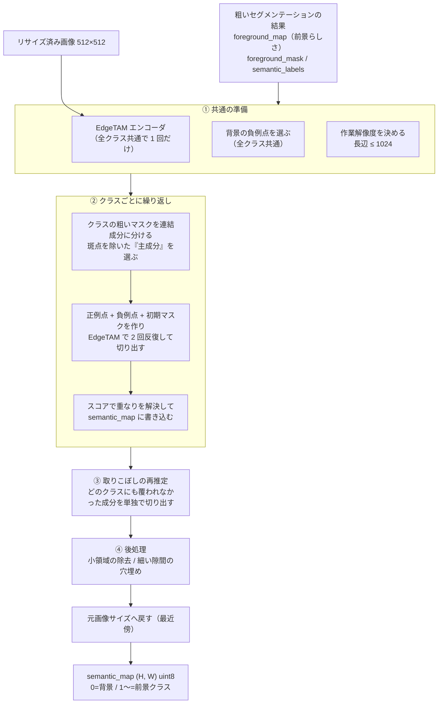

| | |
|---|---|
| 入力 | リサイズ済み画像、粗い結果（`foreground_map` / `foreground_mask` / `semantic_labels` / `labels_list`）、EdgeTAM の特徴（粗い判定で計算済みなら再利用） |
| 出力 | `semantic_map`（0 = 背景、1〜 = 前景クラス）、`prompt_indices`（クラス 1〜 に対応する前景プロンプトの番号）、`point_coords` / `point_labels`（EdgeTAM に与えた点。可視化用）、`debug_images`（中間画像） |

前景クラスは、前景マスク内に現れた `semantic_labels` の値を昇順に並べ、**1 から振り直す**。前景が 1 つも無いときは、全面 0 のマップを返して終わる。

---

## 2. 設計の思想: 何を解決したいのか

粗い結果は「**だいたいどこに何があるか**」は分かるが、**輪郭は信用できない**（1 パッチ = 16px の格子で、縁・影では最大 1 パッチ太る、縁のパッチは物体と背景が混ざって落ちる）。この段階は、そのヒントを使って EdgeTAM に正確な輪郭を切り出させる。**処理の各ステップは「どの課題のためか」で説明できる**。

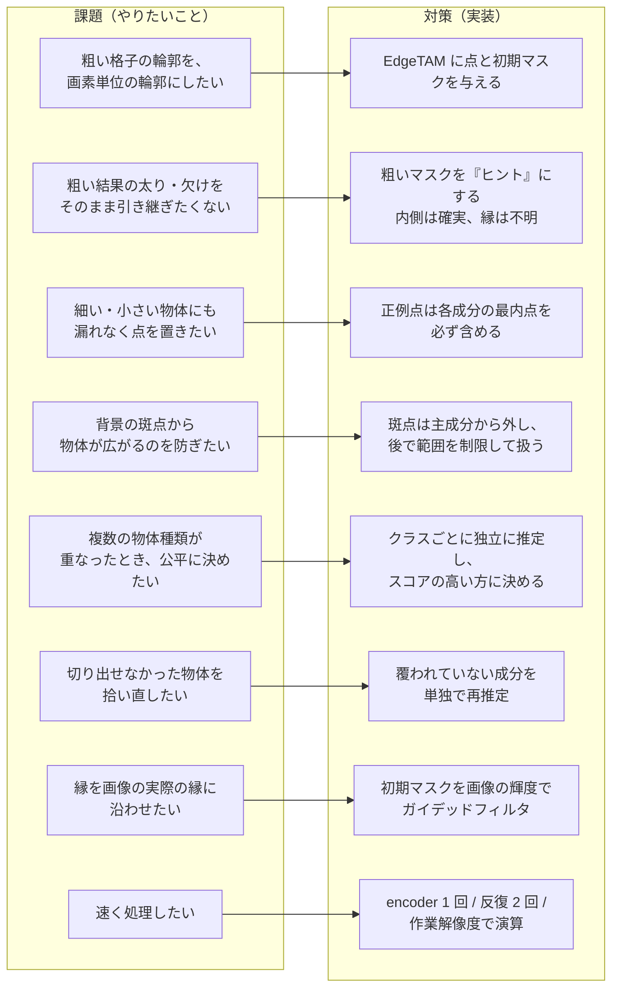

### 2.1 粗いマスクは「正解」ではなく「ヒント」

粗いマスクをそのまま正解にすると、縁・影の太りも、縁の欠けも引き継ぐ。そこで次のように扱う。

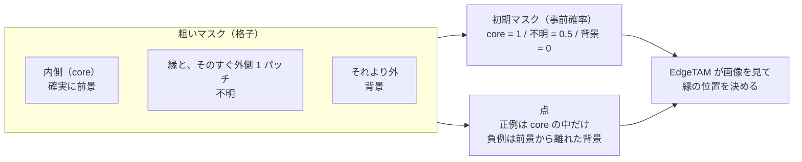

- **内側（core）は確実、縁は不明**と扱えば、粗い段階の太りを精緻化で修正できる。
- **外側 1 パッチも「不明」**にするのは、粗いマスクが物体より内側に入る（縁のパッチは物体と背景のトークンが混ざり落ちやすい）ことがあるため。外側を背景（0）にすると、EdgeTAM が縁を戻せず**縁が削れる**（toothbrush・capsule・cable で顕著だった。[A.1](#a1-外周を不明にする効果)）。「粗いマスクを膨らませる」のとは違い、膨らませた分を前景とは言わない。
- **点は「置く場所」が結果を左右する**。正例を縁に置くと背景へ広がり、負例を物体の近くに置くと物体が欠ける。だから正例は core（内側）、負例は前景から離れた「背景だと最も確信できる」場所に置く。

### 2.2 クラスごとに独立に推定する

EdgeTAM は 1 回の呼び出しで 1 つのマスクを返す。複数の種類の物体（クラス）がある画像では、**クラスごとに別々に呼び出す**。他のクラスの点を負例に混ぜると、同じ物体が複数クラスに割れている画像で割れ目が固定されてしまう（[A.4](#a4-採用しなかった詳細側の案)）ので、混ぜない。
独立に推定するので、同じ画素を複数クラスが主張しうる。そこで**スコアの高いクラスに決める**。

### 2.3 斑点は 2 段階で扱う

背景クラスタの一部が、前景クラスの孤立した 1〜2 パッチの斑点として混ざることがある。これに正例点を置くと、その点を経由して物体のマスクが周囲の背景へ広がる。そこで、

1. クラスの推定には**斑点を混ぜない**（広がりの防止）。
2. 後段の再推定で、斑点を**範囲を制限して**個別に扱う（本物の小物体の取りこぼしの救済）。

### 2.4 縁を画像に沿わせる

32×32 の事前確率を拡大するだけでは、縁の位置が 16px の格子に縛られる。また、外側 1 パッチをまるごと「不明」にすると、小物体では不明の領域が物体と同じ大きさになり、背景へ膨らむ。そこで、事前確率を 128×128 に拡大して**入力画像の輝度をガイドにしたガイデッドフィルタ**をかけ、縁の「不明」を、画像の明るさの縁に沿って物体側・背景側へ倒す。

### 2.5 精緻化は粗い誤りを直せない

背景を前景と判定したクラスには、正例点が背景に置かれ、EdgeTAM もそれに従う。クラスタ単位の誤判定や、クラスの割れは粗いセグメンテーション側で対処する（[coarse_segmentation.md §8](coarse_segmentation.md)）。後から再判定して消す案も試したが、悪化した（[A.4](#a4-採用しなかった詳細側の案)）。

---

## 3. 処理の詳細と、その実装の理由

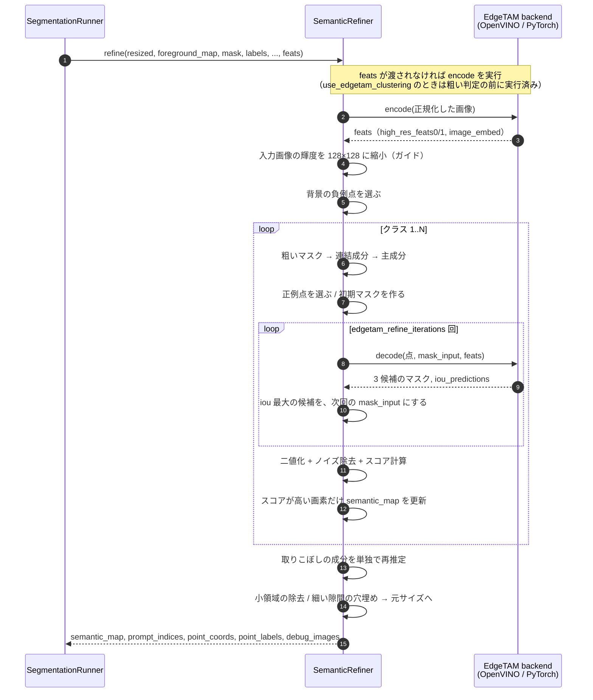

### 3.1 共通の準備

#### EdgeTAM エンコーダ

`predict_encoder` が `resized` を EdgeTAM 用の mean/std で正規化し、`encode` に渡す。得られる `feats = (high_res_feats0, high_res_feats1, image_embed)` は、以降のすべてのクラス・反復で使い回す。

`use_edgetam_clustering: true`（既定）のときは、粗い判定が `image_embed`（前景確信度の伝播）を使うので、`SegmentationRunner.segment` が**粗い判定の前に 1 回だけ**エンコードし、`refine(..., feats)` に渡す（精緻化の中では再実行しない）。

さらに、初期マスクの縁を整えるガイドとして、`resized` を EdgeTAM の高解像度特徴量と同じ大きさ（128×128）に縮小し、RGB の平均（輝度、0〜1）を作る（`RefineContext.guide`。1 枚につき 1 回）。

#### 作業解像度

マスク演算（連結成分・メディアン・重なり解決）は画像が大きいと重い。そこで、長辺が `semantic_max_side`（既定 1024）以下になる**作業解像度**で行い、最後に元画像サイズへ戻す。小さい画像は拡大せず、そのまま使う。

```
scale = min(1.0, semantic_max_side / max(width, height))
作業解像度 = (round(width * scale), round(height * scale))
```

#### 背景の負例点（全クラス共通）

`select_background_points` で `edgetam_background_point_count`（既定 4）点を選ぶ。次の順に絞り込む。

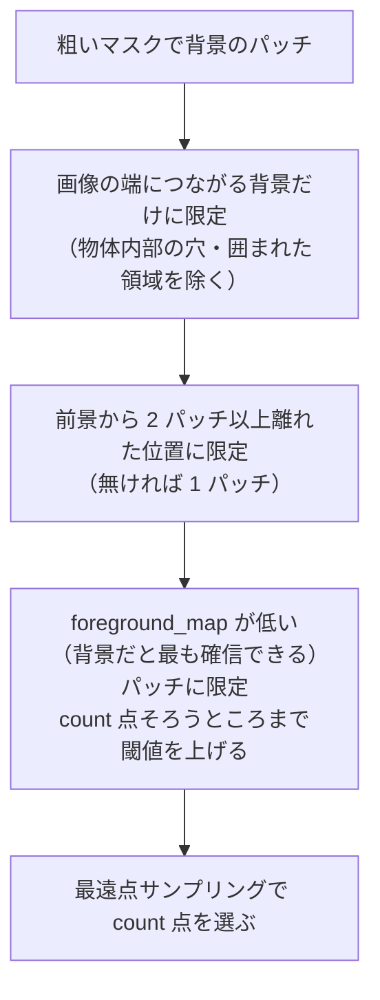

| 絞り込み | 理由 |
|---|---|
| 端につながる背景だけ | 物体の穴・影の中に負例を置くと物体が欠ける |
| 前景から離す | 粗いマスクが縁や影で最大 1 パッチ太る、という前提に基づく |
| 確信の弱い「背景」を避ける | 濃い布のように、実際は物体なのに背景扱いになった領域へ負例を置くと、物体を打ち消してしまう |

選んだ点は `transform_coords` で、パッチ格子の座標から各パッチ中心の画像座標へ変換する。

> **負例点が隅に密集する**のは、伝播で `foreground_map` が連続値になり、「count 点そろうところまで閾値を上げる」が、最も確信度の低い count パッチそのものになるため。ばらしても精度は上がらないことを確認済み（[A.5](#a5-背景の負例点をばらす)）。

### 3.2 クラスごとの推定（`_refine_classes`）

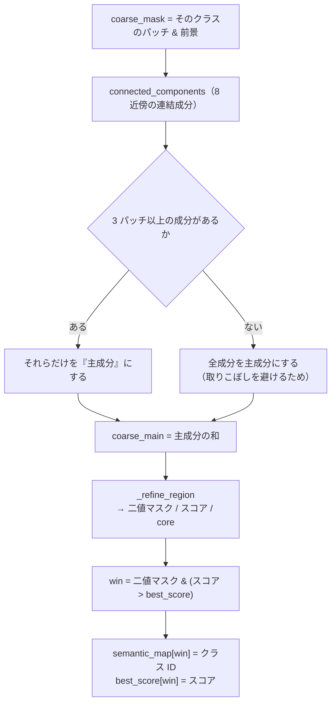

連結成分ごとに、`connected_components` は次の 3 つ組を返す。

| 要素 | 意味 |
|---|---|
| 最内点 `peak` | 距離変換が最大の点（成分の中で最も中心寄り）。細い物体でも必ず内側に乗る |
| `core` | 成分を 1 パッチ内側へ縮めた領域。縮めると消える細い成分は成分そのものを `core` とする |
| `region` | 成分マスクそのもの |

### 3.3 1 領域の推定（`_refine_region`）

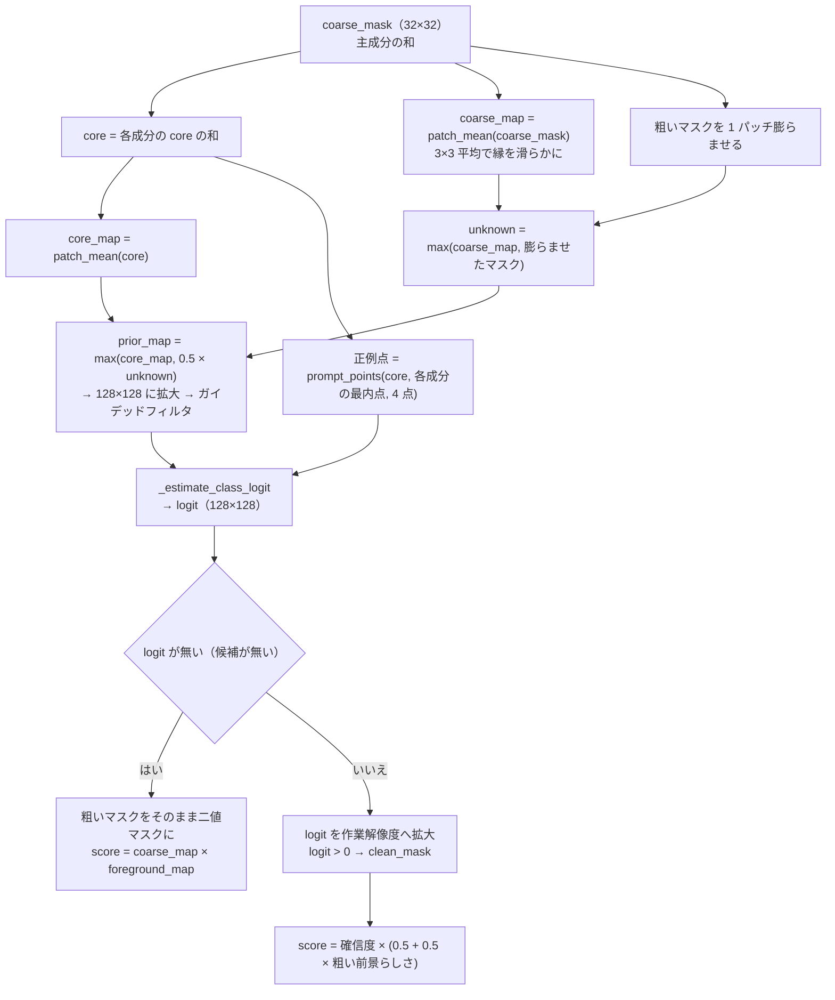

#### 初期マスク（`_build_prior_map`）

| 領域 | 確率 | 意味 |
|---|---|---|
| core 内 | 1.0 付近 | 前景だと確信できる |
| core 外の粗いマスク | 0.5（`PRIOR_NON_CORE_PROBABILITY`） | 前景とも背景とも言えない（縁・影） |
| 粗いマスクの外側 1 パッチ | 0.5 | 不明（粗いマスクの信頼限界） |
| それより外 | 0 付近 | 背景 |

```python
unknown = np.maximum(coarse_map, binary_dilation(coarse_mask, PATCH_STRUCTURE).astype(np.float32))
prior_map = np.maximum(core_map, PRIOR_NON_CORE_PROBABILITY * unknown)
```

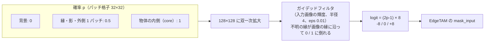

ガイデッドフィルタ（`mask_utils.guided_filter`）の半径は 1 パッチ（128×128 では 4 画素）。窓の中で「事前確率 ≒ a × 輝度 + b」と当てはめて平均するので、画像が平坦な所は平滑化され、縁のある所は縁が保たれる。縁の「不明」が、その画素の明るさのパターンが物体側と似ていれば 1 に、背景側と似ていれば 0 に倒れる。効果の測定は [A.1](#a1-外周を不明にする効果)。

確率 `p` は `logit = (2p - 1) × PRIOR_LOGIT_RANGE`（±8）にして `mask_input` にする。`p = 0.5` が logit 0（不明）になる。

#### 正例点（`prompt_points`）

`edgetam_foreground_points_per_class`（既定 4）点を、**core 上**から選ぶ。

1. **各連結成分の最内点を必ず含める**。細い物体・小さい物体にも漏れなく点が置かれる。
2. 点数が足りなければ、core 上で既存の点から最も遠い点を順に足す（最遠点サンプリング）。

core を使うのは、縁（粗いマスクが太りやすい）に正例点を置かないため。

#### 二値化とスコア

- **二値マスク**: `logit > 0` を作業解像度で取り、`clean_mask` で小領域（`min_area` 未満）の除去とメディアン平滑化を行う。`min_area` は粗いマスクの分解能（1 パッチ）に相当する画素数。
- **スコア**（重なり解決用）:

```
confidence = sigmoid(logit)                         # EdgeTAM の確信度
prior      = coarse_map × foreground_map            # 粗い前景らしさ
score      = confidence × ((1 - w) + w × prior)     # w = SCORE_PRIOR_WEIGHT = 0.5
```

EdgeTAM が自信を持っていても、粗い段階で前景と判断されていない場所はスコアが下がる。逆に**両方が合意した場所のスコアが高くなる**。どちらか一方に偏らないよう、重みは等しい（0.5）。

### 3.4 EdgeTAM の反復（`_estimate_class_logit`）

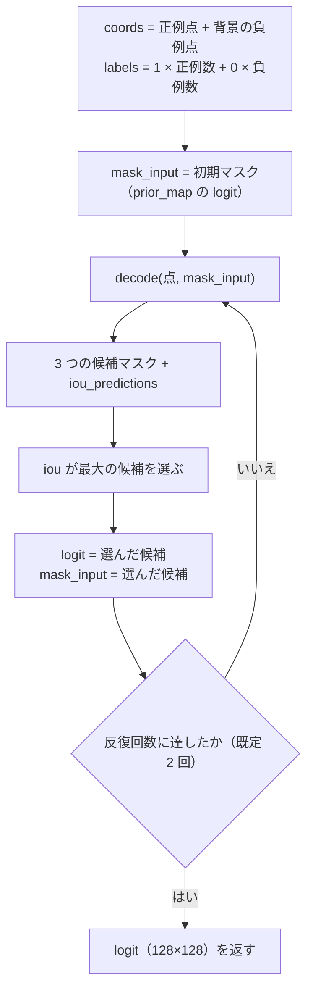

- **点**: 正例（`label=1`）とクラス共通の負例（`label=0`）を合わせて渡す。画像座標から EdgeTAM の入力サイズへ `EdgeTamHelper.transform_coords` で変換される。
- **反復**: 前回選んだ候補のロジットを次回の `mask_input` にして、再推定を繰り返す。1 回目は粗いマスク由来の初期マスク、2 回目以降は EdgeTAM 自身の出力が入力になり、輪郭が安定していく。**2 回に減らしても精度はほぼ同じ**（MVTec −0.002）で、デコードが約 1/3 減る（[A.3](#a3-点の数と反復回数)）。
- **候補の選択**: decoder は 3 つの候補マスクを返す。`iou_predictions` が最大のものを採用する（別の基準は悪化した。[A.4](#a4-採用しなかった詳細側の案)）。
- **マスク本体は計算しない**: `postprocess(need_masks=False)` で元解像度へのリサイズと二値化を省き、ロジット（128×128）だけを使う。リサイズは必要になった時点で `_refine_region` が作業解像度に対して 1 回だけ行う。

### 3.5 重なりの解決

クラスごとに独立して推定するため、複数のクラスが同じ画素を主張しうる。`semantic_map` と同じ大きさの `best_score`（初期値 -1）を持ち、**スコアが高いクラスが勝つ**。

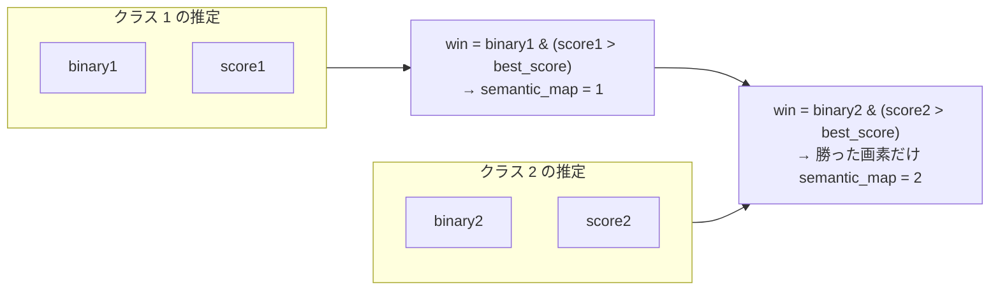

- 先に処理したクラスが有利になることは無い。後のクラスは「現在の最高スコアを上回った画素」だけを奪う。
- 背景（0）は特別扱いで、どのクラスの二値マスクにも入らなかった画素が自然に 0 のまま残る。

### 3.6 取りこぼしの再推定（`_rescue_uncovered`）

クラスの主成分から外した斑点や、主成分でもマスクに入らなかった成分を拾う。詳しい理由と設計は [rescue_reestimation.md](rescue_reestimation.md)。

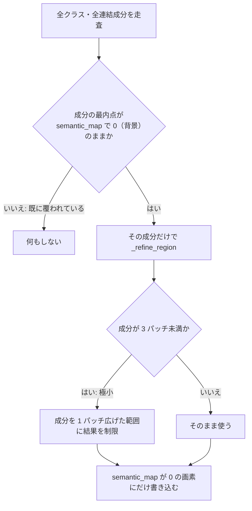

- **覆われているかの判定**は、成分の**最内点 1 点**だけで行う（成分全体ではない）。
- **既に他のクラスが塗った画素は上書きしない**（`semantic_map == 0` のみ）。取りこぼしの救済が、確定済みの結果を壊さないようにする。
- **極小成分は範囲を制限する**。1〜2 パッチの孤立成分は背景の斑点であることが多く、制限なしで推定すると周囲の背景まで広がるため。

### 3.7 後処理

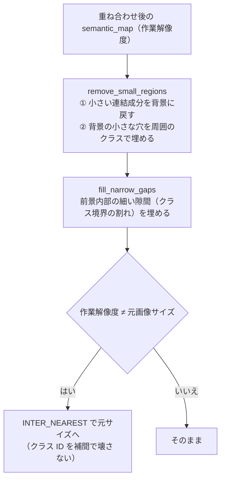

#### 小領域の除去（`remove_small_regions`）

1. クラスごとに、`min_area` 未満の連結成分を背景（0）へ戻す。
2. 背景に残った `min_area` 未満の穴を、周囲（1 画素外側のリング）で最も多いクラスで埋める。

#### クラス境界の割れと、細い隙間の穴埋め（`fill_narrow_gaps`）

**現象**: クラスごとに別々に EdgeTAM を実行し、最終マップは各クラスのマスクの和になる。1 つの物体が複数クラスに分かれたとき（例: カプセルの橙の半分が、上は pill・下は capsule）、**クラスの境界が画像の強い縁（ハイライト線など）に重なると、どちらのクラスのマスクもその縁で止まり、間が背景のまま割れる**（`capsule/test/good/000.png` の「500」の下の切れ目。幅 約 14px、長さ 約 300px）。

```
クラス A | 割れ | クラス B           穴埋め後
 ####### . ####### ← 縁で両方止まる    ####### # #######
 ####### . #######                    ####### # #######
         ↑ 幅が 1 パッチ未満の背景
```

**対処**: 最終マップ（作業解像度）に対して、粗い前景を 1 パッチ縮めた内側（core）にある、**幅が 1 パッチ未満で、両側が 2 クラス以上に接する背景の隙間**を、前景にする。

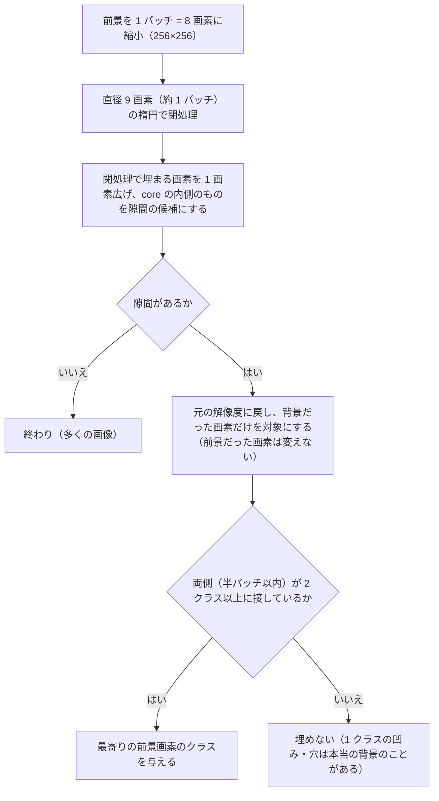

- 粗い前景の分解能（1 パッチ）より細い背景は、粗い判定からは背景と言えないため埋める。
- 1 クラスの物体の凹み・穴（両側が同じクラス）は、本当の背景のことがあるので埋めない。
- 縮小は実装上の値（`GAP_FILL_PIXELS_PER_PATCH` = 8）で、結果は 1 画素程度しか変わらない（全解像度の閉処理は約 11ms、縮小すると 0.1ms）。新しい調整値は無い（幅の基準は 1 パッチ）。
- **効果**: 前景だった画素の削除・クラスの変更は 0。IoU は MVTec 0.8373 → 0.8380、合成は同じ。処理時間は中央値 約 1ms。詳細・限界・採らなかった案は [A.6](#a6-クラス境界の割れの穴埋め)。

---

## 4. デバッグ画像の読み方

`SegmentationRunner.run` は、`output_dir/<画像名>/debug/` に中間画像を常に保存する（精緻化は画像を `SegmentationResult.debug_images` に集め、保存は `ResultSaver` が行う）。クラス番号を `N` とする。

| ファイル | 内容 | 見るポイント |
|---|---|---|
| `cN_coarse_mask` | クラス N の粗いマスク | 粗い段階の誤りかどうかの切り分け |
| `cN_core` | 正例点を置く core | 細い物体で core が消えていないか |
| `cN_edgetam_mask` | EdgeTAM が出した二値マスク | 輪郭が実際の物体に沿っているか。背景へ漏れていないか |
| `cN_score` | 重なり解決に使うスコア | クラス同士の境界が不自然でないか |
| `cN_rescue_X_Y` | 再推定した成分（最内点 X, Y）の二値マスク | 斑点が物体として拡大されていないか |
| `semantic_map_before_cleanup` | 後処理前のセマンティックマップ | 小領域ノイズの量 |

切り分けの順番は、**`cN_coarse_mask`（粗い結果）→ `cN_core`（点の位置）→ `cN_edgetam_mask`（EdgeTAM）→ 最終結果**。粗いマスクが誤っていれば精緻化では直らない。

---

## 5. 設定値・固定値

### `configs/*.yaml`（調整可能）

| キー | 既定 | 意味 |
|---|---|---|
| `edgetam_foreground_points_per_class` | 4 | クラスごとの正例点の数（以前は 8。外周 + ガイデッドフィルタと併用で、8 と同等以上のまま点が約半分） |
| `edgetam_background_point_count` | 4 | 背景の負例点の数（全クラス共通。以前は 8） |
| `use_edgetam_clustering` | true | 粗い判定の前景確信度を、EdgeTAM の特徴の類似度で伝播する（[coarse_segmentation.md §3.5](coarse_segmentation.md)）。true のとき EdgeTAM のエンコードを粗い判定の前に 1 回だけ実行して精緻化に渡す |
| `edgetam_refine_iterations` | 2 | 前回のロジットを入力に再推定する回数（以前は 3） |
| `semantic_max_side` | 1024 | マスク演算の作業解像度の長辺上限 |
| `edgetam_high_res_feature_downscale_factor` | 4 | 初期マスクの解像度（`image_size` ÷ この値 = 128） |

### `core/common/params.py`（コードに固定。変えるときはここだけ編集）

| 定数 | 値 | 意味 |
|---|---|---|
| `PATCH_NEIGHBORHOOD` | 3 | 近傍の大きさ。core の縮め幅・粗いマスクの平滑化 |
| `BACKGROUND_POINT_MARGIN` | 2 | 負例点を前景から離すパッチ数 |
| `MIN_REGION_PATCH_AREA` | 1.0 | ノイズとして除く最小面積（1 パッチ分に相当する画素数の倍率） |
| `MIN_ISOLATED_PATCHES` | 3 | 斑点とみなす孤立成分の上限パッチ数 |
| `PRIOR_LOGIT_RANGE` | 8.0 | 初期マスクのロジット幅 |
| `PRIOR_NON_CORE_PROBABILITY` | 0.5 | core の外側にある粗いマスクと、その外側 1 パッチの確率 |
| `GUIDED_FILTER_EPS` | 0.01 | ガイデッドフィルタの正則化（0.001〜0.01 で結果は同じ）。半径は 1 パッチ（`high_res_feature_size // feature_size` = 4 画素） |
| `MASK_LOGIT_THRESHOLD` | 0.0 | 二値化の閾値 |
| `SCORE_PRIOR_WEIGHT` | 0.5 | スコアに粗い前景らしさを混ぜる割合 |
| `GAP_FILL_PIXELS_PER_PATCH` | 8 | 前景内部の細い隙間を探すときの縮小の大きさ（実装上の値） |
| `MEDIAN_BLUR_KSIZE` | 3 | 輪郭の平滑化カーネル |
| `EDGETAM_MASK_DOWNSCALE` | 8 | `postprocess` に渡す縮小サイズの倍率 |

---

## 6. 運用上の注意

- **PyTorch 版でも同じコード**。差し替わるのは `encode` / `decode` だけで、点・初期マスク・スコアの計算は共通。手法の実験は `core/common/` を編集すれば両 backend に反映される。
- **`image_size` を変えるとき**（OpenVINO のデコーダー）。旧いデコーダー（`edgetam_decoder.xml`）は、変換時の画像サイズ（512）が定数としてグラフに焼き込まれていて、1024 などでは起動時のウォームアップが失敗した。2026-10-24 に修正して再変換済み。

  | 焼き込まれていた値 | 症状 |
  |---|---|
  | 密な位置エンコーディング（`sam_prompt_encoder.get_dense_pe()`。形 `[1, 256, 32, 32]` の定数） | 1024 では埋め込みが 64×64 でトークン数が合わず、`Add` の形の不一致で失敗 |
  | 点の座標の正規化の除数（`input_image_size` = 512） | 位置エンコーディングの形を直しても、1024 では点の座標が 2 倍にずれる |

  修正（`core/torch/edgetam_runner.py` の `DecodeModel`）: どちらも `image_embed` の大きさ（H, W）から求める。密な位置エンコーディングは、sin / cos の加法定理で行ごと・列ごとに求めて掛け合わせる（元と同じ値、誤差 3e-6。素直に実装すると 1 回 約 0.5ms 遅くなる）。座標の除数は、埋め込みの大きさ × ストライド（16）。
  再変換: `python convert_openvino.py --edgetam-only [--out-dir DIR]`（約 30 秒）。変換の最後に、2 倍の正方形・非正方形の画像サイズで PyTorch と照合し、ずれたら例外にする。
  確認: 512・640・1024・384・非正方形で最大差 logit 7e-3・iou 7e-4 以下。512 のデコード時間は同じ（1 回 約 7ms）。本体の評価（512）も変更前と同じ。`image_size` を 384〜1024 にしたパイプライン全体も動く（1024 は 512 の約 4〜5 倍の時間）。
- **`image_size` は 16 の倍数にする**（埋め込み = 画像 ÷ 16、マスク入力 = 画像 ÷ 4）。
- **`et_use_int8: true`**（重みを INT8 に圧縮したモデル）は、旧いモデルでも前景が 0% になる（確認済み。原因は未調査）。
- **精緻化は粗い誤りを直せない**（§2.5）。背景を前景と誤判定したクラスタ、クラスの割れは粗いセグメンテーション側で対処する。

---

## 7. 処理時間

OpenVINO・FP32・`ov_num_thread: 4`。精緻化に関わる段の目安（実画像 17 枚 + 合成 12 枚の中央値。詳細は [performance.md](performance.md)）。

| 段 | 時間 |
|---|---|
| EdgeTAM エンコーダ（粗い判定にも使う） | 約 32 ms |
| EdgeTAM デコード（約 4 回、1 回 約 6〜7 ms） | 約 25 ms |
| NumPy / OpenCV の後処理（隙間埋めを含む） | 約 18 ms |
| **精緻化の合計（エンコーダを除く）** | **約 43 ms** |

- encoder は 1 回、decoder は「**クラス数 × 反復回数 +（再推定した成分数 × 反復回数）**」回。クラス数・反復回数・点数が増えるほど遅くなる。精度と速度のトレードオフは `edgetam_refine_iterations` で調整できる。
- マスク本体を計算しない（`need_masks=False`）、作業解像度で演算する、NumPy 段を外接矩形の中だけで処理する、BLAS のスレッド数を 1 に制限する、などの高速化が入っている。

---

# Appendix: 実験の記録

精緻化に関して行った実験を、一覧にする。**採用したものは本文に反映済み**。採用しなかったものも、再び同じ案を試さないよう結果を残す。

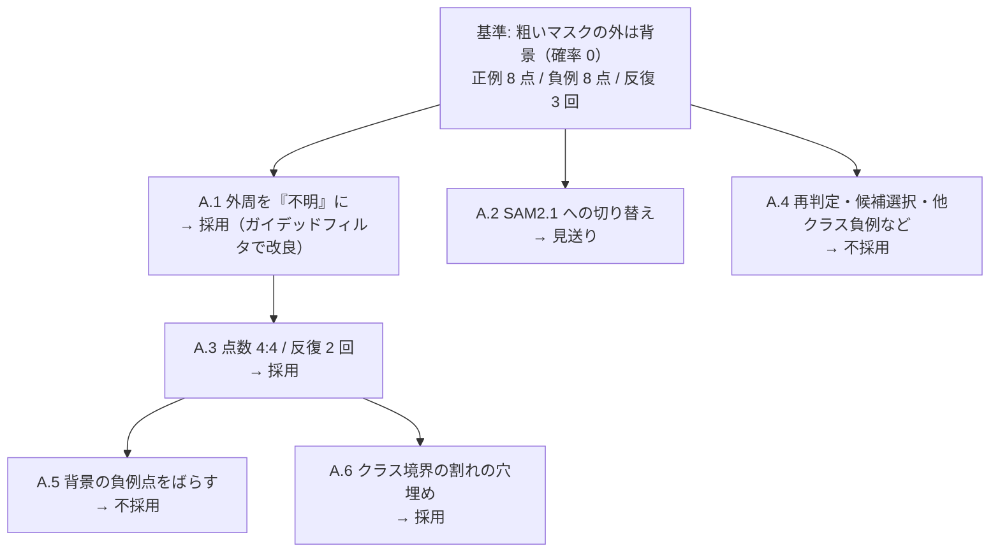

評価は MVTec AD の物体カテゴリ（`tools/evaluation/eval_prompts.py`）と合成データ（MVTec の部品 × 背景）。IoU は最終セマンティックマップの前景（> 0）と正解の IoU。信頼区間は 95%。

## A.1 外周を「不明」にする効果

粗い結果の外周の扱いが、精緻化の精度を最も大きく左右した。詳細は [improvement_methods.md](improvement_methods.md) §2・§3、粗い側の経緯は [coarse_segmentation.md](coarse_segmentation.md) のAppendix A.3・A.5・A.7。

- **発見**（粗い側の追検証）: 粗いマスクの外は背景の事前確率 0 から始まるため、**粗いマスクが正解より約 1 パッチ（512 入力で 16px）広いときが最良**。正解を粗い結果にしても IoU 0.870、1 パッチ膨張で 0.924、収縮で 0.669。予測のマスクを膨張すると FP が増えて悪化（−0.098）。
- **外周を不明にする**: 粗いマスクを 1 パッチ膨らませた範囲のうち core でない部分の事前確率を「不明」（0.5）にする。11 変種中 9 で最終 IoU が有意に上がる。第 6 層のみ 0.815 → 0.844（+0.030 [+0.009, +0.051]）、toothbrush は 0.83 → 0.98。膨張より +0.06〜+0.14 高い。
- **代償**: 小物体で背景へ膨らむ。合成データで第 6 層のみの IoU は 0.573 → 0.521（−0.053）、誤検出面積 10.3% → 12.7%。
- **ガイデッドフィルタ**: 事前確率を 128×128 に拡大し、入力画像の輝度（128×128 に縮小）をガイドに、半径 4（= 1 パッチ）・eps 0.01 でフィルタ。MVTec 108 枚で 0.815 → **0.844**、独立 54 枚で 0.806 → 0.827。合成の悪化は **0.566（−0.007、有意でない）**に消える。1 回 約 3ms（NumPy）。
- **限界**: ガイドが輝度のみで、透明・低コントラストの物体は縁の手がかりが弱い。PyTorch 版で選んだ手法で、本体に組み込んだ後に OpenVINO でも測り直した（D・点 4:4 で MVTec 0.839、PyTorch は 0.840）。

## A.2 精緻化のモデルを EdgeTAM から SAM2.1 tiny に替える

精緻化（エンコーダー・デコーダー）を、公式 SAM2.1（Hiera-T）に替えて測った。全表・図は `outputs/sam2/index.html`、実験は `tools/experiments/sam2/exp_sam2.py`。本体は変更していない。

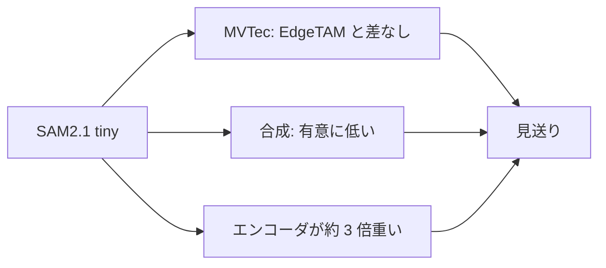

- **実装**: `core/torch/sam2` は EdgeTAM の fork で公式 SAM2.1 とは別物。同名のパッケージは同時に置けないので、公式を `core/torch/sam2_official/`（パッケージ名 `sam2_official`）にコピーした（`tools/setup/vendor_sam2.py`）。`core/torch/sam2_runner.py` の `TorchSam2Backend` は `TorchEdgeTamBackend` のサブクラス（EdgeTAM と SAM2.1 はデコーダーの入出力と特徴量の形状が同じ）。`python test_pytorch_sam2.py`（`configs/torch_config_sam2.yaml`）。公式との照合で差は 0。
- **モデルだけを替えた効果**（前景 8 点・背景 8 点、粗い判定は PE 第 6 層、zipper を除く）: MVTec 108 枚で 0.815 → 0.819（差なし）、独立 54 枚で 0.806 → 0.814（差なし）。合成データは 0.573 → 0.551（−0.022 [−0.041, −0.003]）と有意に低い。toothbrush は 0.83 → 0.90（SAM2.1 は縁が削れにくい）、capsule は 0.81 → 0.74（背景への広がり）。
- **点数**（前景 1〜4 × 背景 1〜4）: 「点が多すぎる」は支持されない。MVTec で点を減らすと両モデルとも下がる（EdgeTAM 4:4 −0.019 / 2:2 −0.037 / 1:1 −0.166、SAM2.1 4:4 −0.015 / 2:2 −0.050 / 1:1 −0.223）。12:12・16:16 は 8:8 と差がなく、8 点で飽和。
- **外周「不明」との組み合わせ**: 外周ありでは点数への依存がほぼ無くなる。前景 4・背景 4 が 8:8 と同等（EdgeTAM +0.002、SAM2.1 +0.005、差なし）。
- **処理時間**（PyTorch・CPU・4 スレッド）: SAM2.1 のエンコーダー 213ms（EdgeTAM 66.6ms、約 3.2 倍）。デコーダーは 1 回約 9ms で点数にほぼ依らない。
- **判断**: 見送り。判断基準を満たさないので OpenVINO 化は作っていない。1024 入力（SAM2 の学習解像度）は未検証。
- **限界**: 17 設定を同じ 108 枚で比べており多重比較の補正は無い。PyTorch のみ。capsule・metal_nut で背景全体に前景が広がる失敗が設定ごとに出たり消えたりして、結果は不安定。

## A.3 点の数と反復回数

- **点数 4:4**（外周 + ガイデッドフィルタと併用）: MVTec 0.840（+0.026）、合成 **0.590**（+0.017）、検出率 0.909、点は 62 → 32 / 枚。8:8 と同等以上のまま点が約半分（A.2 の点数実験と合わせて、外周ありのときだけ成り立つ）。時間への効果は小さい（デコード 1 回あたりの時間はほぼ変わらない）。
- **反復 3 → 2 回**（2026-10-24）: 精度が同じ（MVTec −0.002）で、デコードが 7.2 → 4.8 回 / 枚（約 1/3 減）。

## A.4 採用しなかった詳細側の案

精度向上の案を、MVTec（物体 10 カテゴリ、`tools/evaluation/eval_prompts.py --num 5`）で測った。基準は dev IoU 0.817 / holdout IoU 0.836。どれも採用していない。

| 対策 | 結果（dev IoU / holdout IoU） | 理由 |
|---|---|---|
| リファイン後のマスクを `extract_cluster_tokens` で再判定し、背景なら消す | 0.817 → 0.749（診断スクリプトでの見積もり） | 下記 |
| EdgeTAM の候補選択を、`iou_predictions` 最大から、事前マスクとの一致度最大へ | 0.762 / 0.761 | 粗いマスクの core に引きずられ、物体の一部しか取れない |
| 同、一致度 × `iou_predictions` | 0.764 / 0.772 | 同上 |
| 他クラスの正例点を負例に加える | 0.768 / 0.775 | 同じ物体が複数クラスに割れている画像で、割れ目が固定される |
| 粗いマスクを 1 パッチ膨張した範囲に届かない EdgeTAM 成分を除く | 0.817 / 0.836（変化なし） | MVTec では飛び地がほとんど無く、効果を測れなかった |

#### 再判定が効かなかった理由

`tools/evaluation/diag_refined_judgement.py` で、リファイン後の連結成分（295 個、50 枚）を粗い段階と同じ方法で再判定した。

- 154 成分が「背景」と判定された。うち、正解も背景だったのは 74 成分、正解は前景だったのは 80 成分。
- 消えた画素は、正しく消した背景が約 99 万、誤って消した前景が約 299 万。
- 10 パッチ以上の大きな成分でも、正しく消した 16 に対して誤って消した 39 で、大きさを制限しても改善しない。
- zipper は 0.99 → 0.15 まで落ちた画像がある（布の領域が背景と判定される）。

粗い段階の誤り（何を物体とみなすか、背景パッチに物体の意味が混ざる）と同じ限界が、マスク単位の判定にも出る。リファイン後のマスクは輪郭が正確でも、トークンの判定の弱さは変わらない。

#### 未検証の点

- 小さい物体（画像面積の 0.5% 未満）の評価は、その後に作った合成データ（MVTec の部品 × 背景）で測れるようになった。上の表の案は MVTec のみの評価。
- 「粗いマスクの支持範囲」案は、背景への漏れが多いデータで効くかもしれない。合成データでの再評価が必要。

## A.5 背景の負例点をばらす

質問: 背景の負例点が隅に密集する。ばらしたら性能は上がるか。レポートは `outputs/bg_points/index.html`、実験は `tools/experiments/bg_points/`。

**密集の理由**: 伝播（`use_edgetam_clustering`）の副作用。伝播前は確信度が PE のクラスタごとに一定（3〜5 種類）で、最初のレベルで候補が 49〜211 パッチになり、最遠点サンプリングで 27〜31 パッチに広がった。伝播の後は確信度が連続値になり（候補 200〜680 パッチに 210〜674 種類）、候補は 4〜9 パッチ、広がりは 2〜6 パッチ。

**ばらしても精度は上がらない**（cable を除く MVTec 96 枚 + 独立 48 枚、合成 120 枚、OpenVINO、点 4:4）。基準は MVTec 0.8380 / 独立 48 枚 0.8610 / 合成 0.6567。

| 選び方 | MVTec 96 枚の差 | 独立 48 枚の差 | 合成 120 枚の差 |
|---|---|---|---|
| 候補を確信度の下位 10% に広げて最遠点 | +0.0009 | −0.0019 | −0.0015 |
| 下位 25% | +0.0013 [−0.0003, +0.0034] | −0.0024 | −0.0017 |
| 下位 50% | +0.0006 | −0.0071 | +0.0003 |
| 確信度を使わず、外側背景の全部から最遠点 | **−0.0036 [−0.0085, −0.0006]** | **−0.0108 [−0.0253, −0.0001]** | +0.0014 |
| EdgeTAM の特徴で背景を 4 つに分け各 1 点（最低確信度） | −0.0024 | −0.0156 | +0.0002 |
| 同（クラスタ中心に最も近い点） | −0.0044 | −0.0117 | −0.0001 |
| 背景 8 点（最も低い 8 パッチ）→ 下位 25% から 8 点 | +0.0032 [−0.0004, +0.0096] | −0.0061 | +0.0008 |

合成の背景の種類別（plain / textured / pattern / natural 各 30 枚）の差も ±0.006 以内。有意な改善は無く、確信度を使わない選び方は有意に悪化する。負例点は「背景の一点」として働き位置にあまり依らず、最も確信できる背景に置くのが安全で、広げると物体に近い・影や縁など背景か怪しい場所へ置いて物体を削る危険が増える、と推測している（確かめていない）。**現状のまま**。

背景が一様でない実画像で広げたいときは、`select_background_points` の確信度の絞り込みを、「下位 25% の確信度の候補から最遠点」に替える（`np.quantile(foreground_map[candidate], 0.25)` 以下に限定）。評価データでは差が出なかった。

関連: 事前マスクを EdgeTAM の 128×128 特徴で推定し直す案（H1〜H4）も試したが、合成が有意に下がり不採用（[coarse_segmentation.md](coarse_segmentation.md) の Appendix A.9）。

## A.6 クラス境界の割れの穴埋め

§3.7 の `fill_narrow_gaps` を導入した経緯。

**効果**（cable を除く MVTec 144 枚・合成 120 枚、OpenVINO）:
- `capsule/test/good/000.png` の核の穴（粗い前景の内部で背景のまま残る割合）2.06% → 0.05%、クラス境界の割れ 3 → 0（右端の凹みも埋まる）。
- 変わるのは、背景だった画素のみ。**前景だった画素の削除・クラスの変更は 0**（42 枚で確認、144 枚の指標でも 0）。変わる画素は、MVTec で平均 0.027%（最大 1.25%、144 枚中 23 枚）、develop.py の 17 枚で 4 枚（最大 0.37%）。
- IoU: MVTec 0.8373 → 0.8380、独立 0.8611 → 0.8610、合成 0.6567 → 0.6567（ほぼ同じ。検出率 0.869、誤検出 3.48%）。

**採らなかった案**:
- **事前マスクで他クラスの前景を「不明」にする**（案 B）: 割れは消え、MVTec IoU +0.0035 だが、クラスのマスクが他クラスの領域へ広がる（このカプセルでは tube が「500」の周りの楕円まで広がった）。前景が平均 0.39%（最大 11%）・クラスが平均 0.73%（最大 7.3%）変わる。マスクがシャープでなくなるので、ユーザーの判断で戻した。
- **1 クラスの隙間も埋める**（クラスの条件なし）: 合成データの小物体で、凹みを埋めて IoU が下がる（合成 −0.0016 [−0.0029, −0.0006]、6 枚で −0.015〜−0.04）。クラスの境界に限ると、合成は変わらない。
- 全解像度で閉処理: 結果はほぼ同じだが約 11ms。
- 閉処理の直径を 1.5 パッチにする: 右端の凹みも埋まるが、1 パッチ以外の根拠が無い。
- 細い穴（太さ 1 パッチ未満の背景の穴）を全部埋める: 物体の外側へ開いた背景（screw の太った粗い前景の縁など）も埋めてマスクが太る。
- core 全体を最近傍クラスで埋める: screw が 0.680 → 0.779 になるが、緩い正解（`fg_mask`）への過適合で、見た目はマスクが太る。

**限界**: 幅が 1 パッチ以上の隙間（toothbrush 7 の毛の領域が落ちる穴など）は直さない。粗い前景が誤っているとき（影を前景に含む）は、その誤りの隙間も埋めて悪化することがある（capsule 40: 0.917 → 0.895。もともと上の影が誤検出）。細い本物の背景（2 クラスにまたがる物体の中の、幅 1 パッチ未満の背景）も、core の内側なら埋める。
